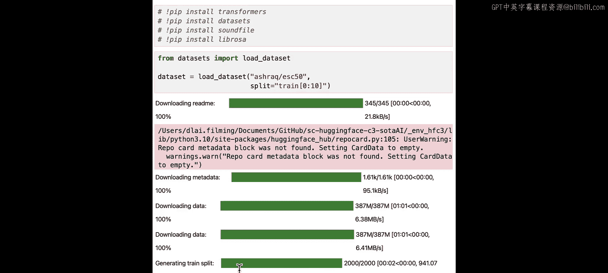
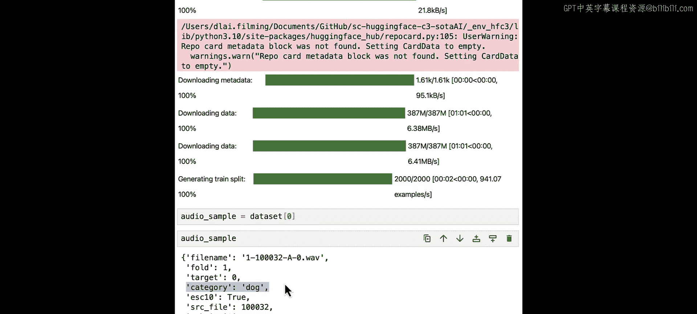
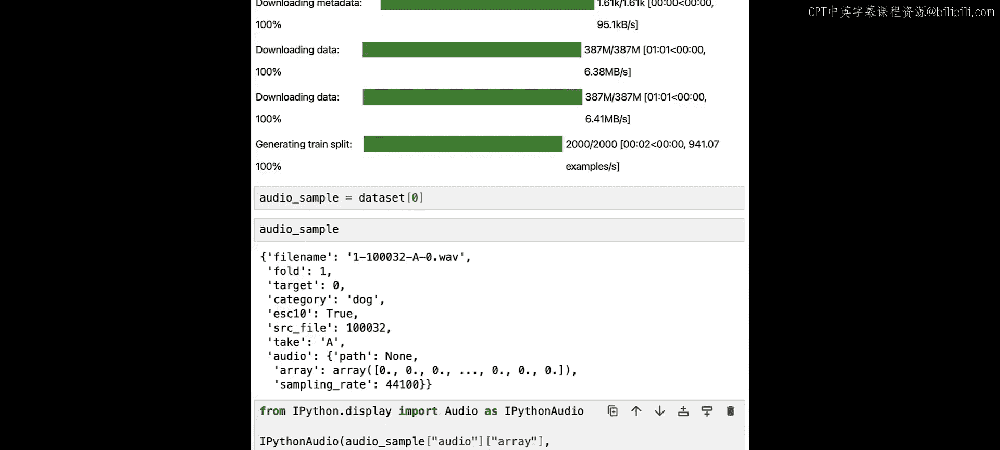
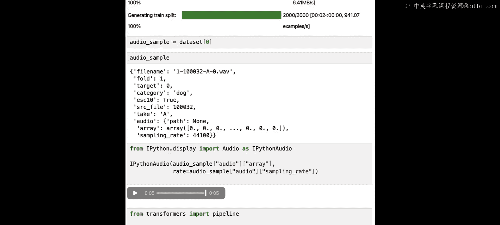
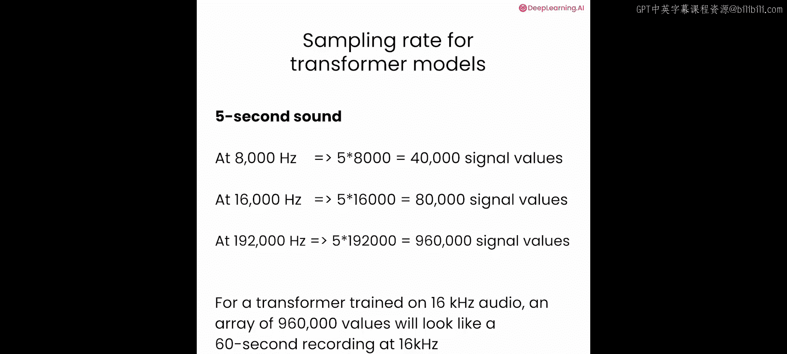
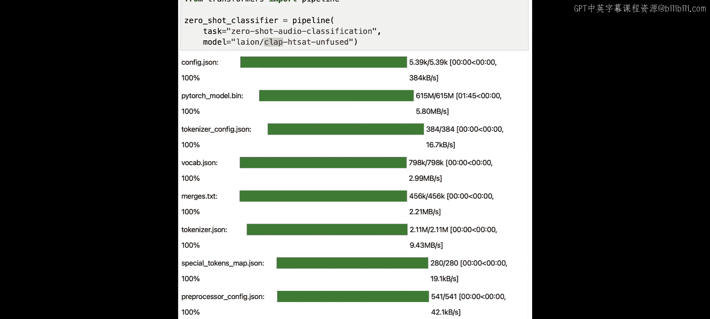
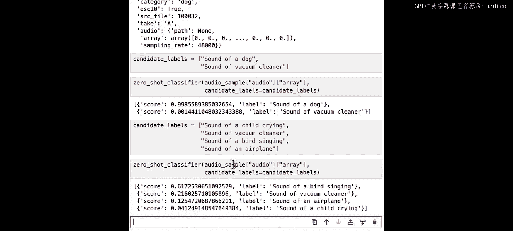
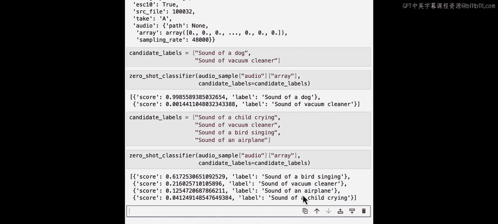

# 吴恩达《Hugging Face的开源模型｜Open Source Models with Hugging Face》中英字幕（英文可关） - P6：6.zero shot audio classification.zh - GPT中英字幕课程资源 - BV16u4m1u7t4

Audio classification has many applications。 For example。

 you may want to identify the language someone is speaking。

 or perhaps you want to know what birds are in your area。Let's build a sound classifier。

 but there's a catch in the traditional classification a model predicts a label from a prede set of classes it was traineded on。

If there are no models trained on your specific set of classes。

 you would have to collect a data set and an to a model。

Here you'll use an alternative approach that doesn't require fine tuning。

For this classroom， the libraries have already been installed for you。

 if you're running this on your own machine， you can install the transformers and data sets and other required libraries by running the following。

I will command them out because they're already installed here。

 We're going to need a sound to classify。 So let's load an audio data set from the Higg and face hub。

The ESC50 dataset is a labeled collection of five second environmental sounds。

 such as sounds made by animals and humans， nature sounds， indoor sounds， urban noises。

 you're not going to need the whole dataset， so we're just going to load a few examples。

This example is labeled as dog。So it's likely a recording of a dog barking， let's give it a listen。

Sounds like a do to me， let's build the classification pipeline。

For this kind of audio classification， you will need a pretrained clap model at the moment it is one of a kind architecture available for this task so you can find it on the Hi and F hub by filtering models with feature extraction multimodel task and then filtering by the name clap。

To classify your audio example， you'll only need the array of audio datat。 However。

 the example has to have a sampling rate that the model expects。

 Let's step back and talk about the sampling rate。 as sound wave is a continuous signal。

 This means it contains an infinite number of signal values in a given time。

 but the audio your computer can work with is a series of discrete values known as digital representation。

To get the digital representation of a continuous audio signal。

 we first captured the sound with a microphone。Then the analog signal is converted into an electrical signal。

Then the electrical signal is sampled to get the digital representation。

Sampling means measuring the value of continuous signal at fixed time steps。 As a result。

 the sampled waveform is discrete with a finite number of values at uniform intervals。

 A very important characteristic of the digitized audio is the sampling rate。

 It is the number of samples taken in one second， and it is measured in Hz or kiloherz。 For example。

8 kiloherz is the sampling rate of audio in a telephone or a walkieta 16 kherz is a sampling rate that is good enough to capture human speech without a sounding muffled。

A sampling rate of 192 kilohertz is something that you can expect from professional high definitionfin audio recording equipment。

 but why is the sampling rate important when working with AI models。

 Consider an example a five secondcon sound at a sampling rate of 8 kilohertz will be represented as a series of 40000 signal values。

 the same 5 second sound sample at 16 kilohertz will be represented as a series of 80000 signal values and at 192 kiloherz it will be represented with almost a million values for transformformer model。

 these three arrays are very different。 Transformer models treat input as sequences and rely on attention mechanisms to learn audio representation。

 They are trained on datasets where all examples have the same sampling rate and they do not generalize well to other sampling rates So for a transformer model trained on 16 kilohertz。

Audio， a five second high quality audio that is expressed in nearly a million values will look like a 60 second recording。

 let's get back to the code if a transformer model has been trained with audio samples each recorded at the sampling rate of 16 kiloherz it's going to view any input as if it was recorded at the same sampling rate。

 so let's take a  one second sound which has been recorded with 192 kilohertz sampling rate。

 how many values will the array representing that sound have。

192000 values。 But if we take a model that has been trained on the audio examples with 16 kHz sampling rate。

 I it going to see as one second or more， Let's find out the model is going to see 192。

Thousand values。 And it expects that one second contains 16000 values。So for this model。

 the recording is going to look like 12 seconds。 So what if now we have a5 second recording at high definition。

 meaning 192 kiloHz and the same model that was strained with audio samples at 16 kiloHz。

 How long will the5 second recording at high definition look like to this model we have 5 seconds times 192000 values per second。

So this sample will be an array of 960000 values。 The model expects each second to contain 16000 values。

Let's divide the number of values that we have by 16000。 This way。

 we'll see how many seconds the model will think that this example is。

So as you can see the original sound was only5 seconds， but with a lot of samples per second。

 but for a model that has been trained with a lower sampling rate。

 this exact audio will look like a 60 second recording Now let's get back to our task and check what the sampling rate or the mile in this lesson expects。

 we can get this information from the pipeline。So this model was trained on audio examples recorded at 48 kilowahertz。

 Let's check the sampling rate of our example。In this case。

 this is not a large difference in the sampling rate， and the model will likely do okay。

 but this is not always going to be the case， as you'll see in other examples。

 So let's see how you can automatically cast the whole dataset set to the correct sampling rate when loading it with dataset sets library。

 Let's check the first sampling again。Now it has the same sampling rate as the model。

 When you load the dataset this way， all of the audio examples will have the correct sampling rate。

 so the audio sample is now ready for the model。 However。

 you also need to provide the pipeline with the candidate labels。

 Claap takes both audio and text as input and computes the similarity between the two。

 If you pass the text input that strongly correlates with an audio input。

 you'll get a high similarity score。 conversely， passing a text input that is completely unrelated to the audio input will return a low similarity score。

 So let's define some candidate labels to compare the sample width。

Pass the audio sample and the candidate labels to the pipeline and see what label is the most likely。

Now try more than two candidate labels and then try some completely unrelated labels。

 see if you can gain some intuition for the limitations of this approach。

 let's try some completely unrelated labels。We'll use the same pipeline with the same audio sample。

 remember that was a dog barking。

So as you can see here， the candidate labels now have nothing to do with dogs or barking。

 yet the model still tries to find the most plausible label among given options。In the next lesson。

 we'll do automatic speech recognition。

