# 吴恩达《Hugging Face的开源模型｜Open Source Models with Hugging Face》中英字幕（英文可关） - P7：7.asr.zh - GPT中英字幕课程资源 - BV16u4m1u7t4

Automatic speech recognition ASR is a task that involves transcribing speech audio recording into text。

 Think meeting modes or automatically generated video subtitles。For this task。

 you'll learn to work with the Ws model by Open AI。

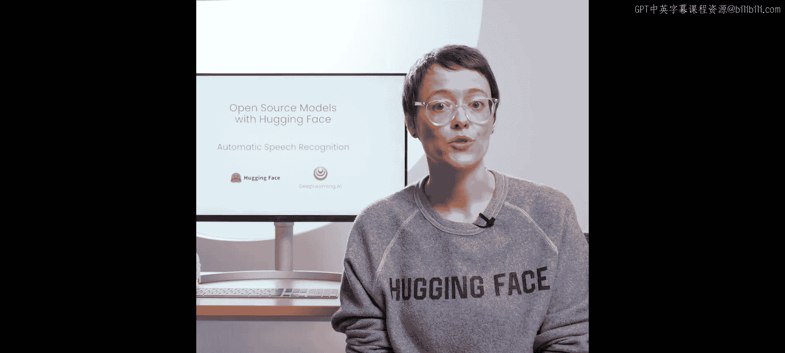

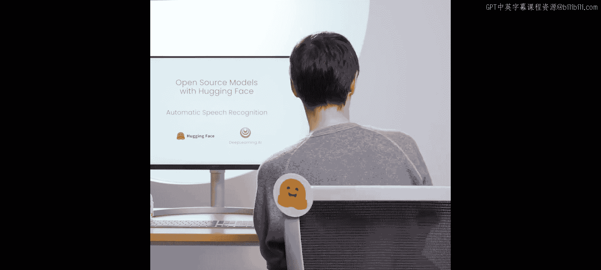

Just as before， all the necessary libraries have been installed for you。

 but if you're running this on your own machine。You will need the same set of libraries as before。

 plus video interface。Let's load the speech dataset this time we'll take Libbri speech。

 it is a corpus of approximately 1，000 hours of data derived from narrated audiobooks。

Oftentimes audio datasets are very large so it's useful to know how to load them in streaming mode this way the examples will be loaded as needed one at a time for a streamed dataset。

 you can access the examples one by one and this is how you can take the first example。

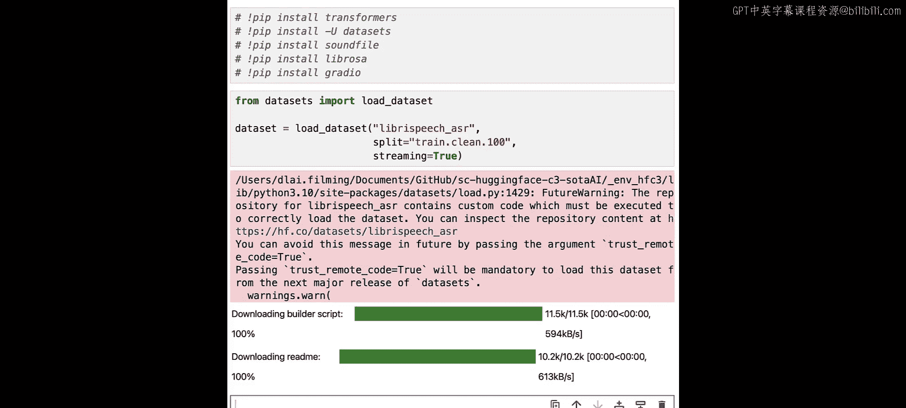

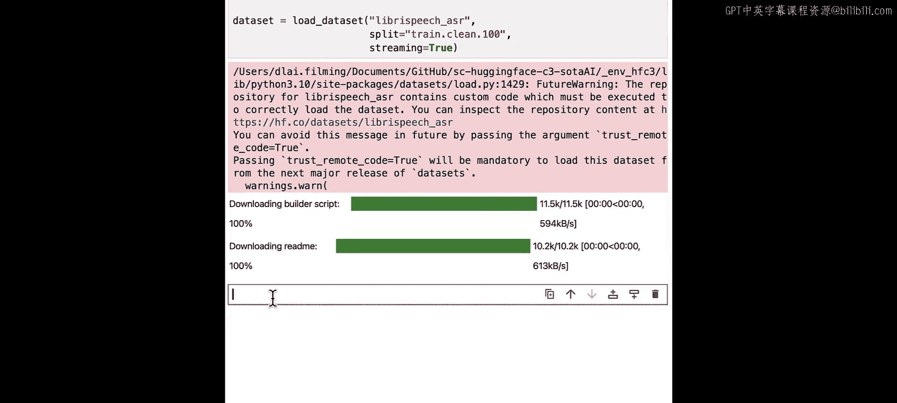

By the way， if you want to access more than one example， let's say the first five。

 you can do it with the take function。Inside this list。

 you can access individual examples with your indices。You can pick whichever example you prefer。

 but for now let's stick with the first one。Just like before。

 you will only need the audio part of this example。 Let's listen to the narration。嗯。Chapter 16。I没。

使用する。This days on。Lines， but I wanted you to see every step by which we came。I， too。

 agree to whatever。There are thousands of pretrained models for automatic speech recognition available on the Hogen phasese hub。

 you can find them by selecting the automatic speech recognition task。 However。

 whisper by openaiI remains one of the best models for this task Whis was pretrained on a vast quantity of labeled audio transcription data 680000 hours to be precise What is more 117000 hours of this pretraining data is multilingual or non-english This results in checkpoints that can be applied to over 96 languages here for the sake of efficiency we will use the distilled version of the model that only works for the English language by distilled I mean a smaller model that was trained using the responses of the full whisper model This checkpoint is over 10 times smaller5 times faster and within 3% word error rate of the large model just as before let's check the sampling rate that whisper expects。

Now let's see what sampling rate our example has。Hay， this time they're the same。

So we can pass the audio as is to the pipeline。It worked Now let's compare this to the transcription that came with the example。

Notice that unlike the transcription that came with the example。

 whisper returns transcription with proper capitalization and punctuation。

 which makes it much easier to read Now let's build a simple transcription demo and we'll use radio for this。

Let's create a transcribe speech function that will be a wrap around our pipeline。

Next you can create a tabbed interface where one tab will let record audio from the microphone and the other tab will let the user upload audio files。

So here's how we create the tab that will let the user record the audio from the microphone。

 we need to create a greater interface pass the transcribe speech function。

 define where the audio input is going to come from in this case it's microphone and what the output should look like in this case it's a text box。

If you would like to learn more about radiod， there is a course about Gd on deploying AI。

And we'll create the tab for uploading files in the same fashion。

Now just bring everything together and launch the demo。Try the demo， try recording yourself。

 speaking into the microphone or try uploading audio files and see if the transcription matches what you say。

Let's test if Whis can transcribe what I am saying right now。자라！

And try speaking for about a minute and see what happens to the transcription。

 You may notice that this demo only transcribed part of what you were saying if you were speaking for longer than 30 seconds This is because whisper expects audio samples to be under 30 seconds and everything else will be trunccate it realistically you may want to transcribe longer recordings。

 say a whole meeting， you can still do that with this pipeline。

 but you will need to provide a few additional arguments。

 so let's illustrate straight this let's get a longer audio example first。

 we're going stop the demo otherwise it's going to prevent us from running any more cells to stop the radio demo click on the square icon that interrupts the kernel。

 we're gonna be using the same automatic speech recognition pipeline Let's check again what the sampling rate the model expects。

Now， this is a big difference in sampling rate。

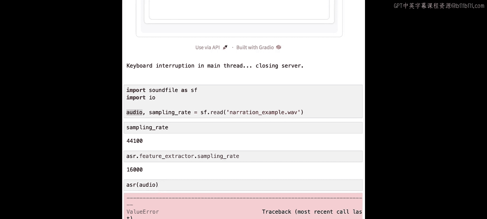

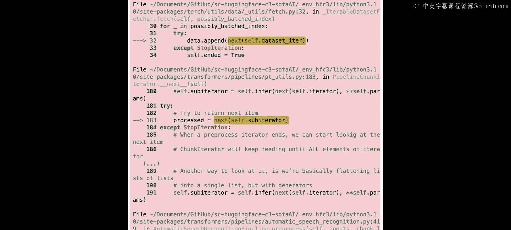

The error says that the model expects a single channel audio input and we must have more than one。

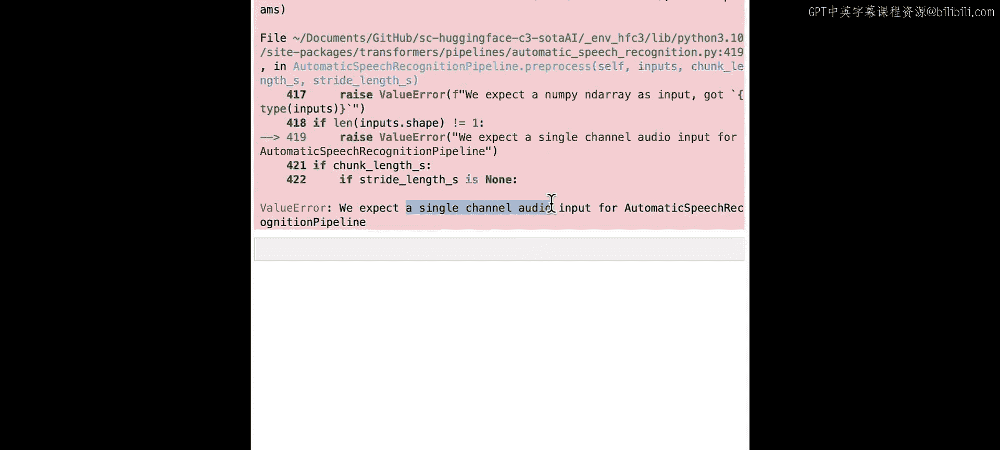

So。We are probably working with the stereo audio。 Steereo uses two channel audio。

 This helps create a sense of space and directionality in sound。

 which enhances the listening experience。 Stereo is great at adding spatial component to audio So when you're listening to music。

 you get a better experience， but for transformer models， it's usually not needed。

 Most transformer models work with monochannel audio。

 this is because you don't really need to have the spatial information to identify whether the sound is of a dog barking or a cat meowing you don't really need to know where the speech is coming from。

 you just need to know what has been said at the same time。

 stereo audio has two channels so that's twice amount of data and it just increases complexity for the computations without really。

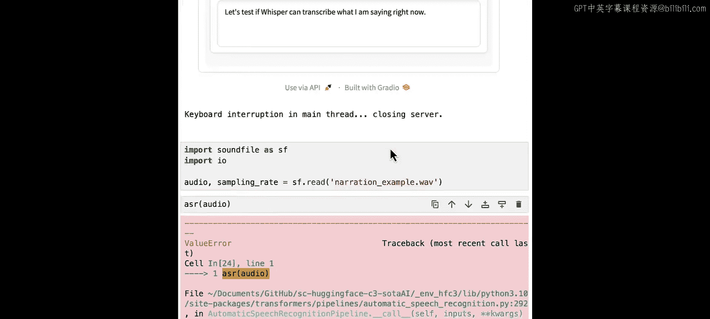

Providing any benefit， Let's see how we can convert this audio to mono。

 Let's check the shape of the audio array。

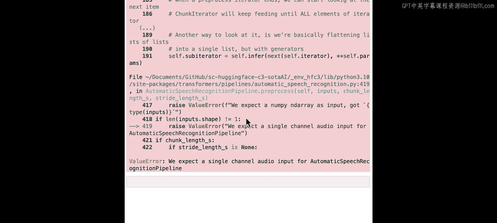

As you can see there are two channels in this audio but we need just one。

 we're going to use a library called Libbrosa to convert this audio array from stereo to mono Libbroa expects the shape of the audio array to have the number of channels first and then the data so one more step before we can do the conversion is to transpose this array。

Let's check the shape again。Now let's convert this audio to mono。Now that this is done。

 let's listen to the example。They rock。Yes。I see the chlor shining。ま？Goodパイ。All right。

 let's try to pass this audio directly to the pipeline and see what happens。

Oh no the text generated by the model does not really match the audio Why is that this is because the sampling rate of the audio example does not match the sampling rate of the model the model tries to guess what the generation is but fails to do so let's double check this let's see what the sampling rate of this example is。

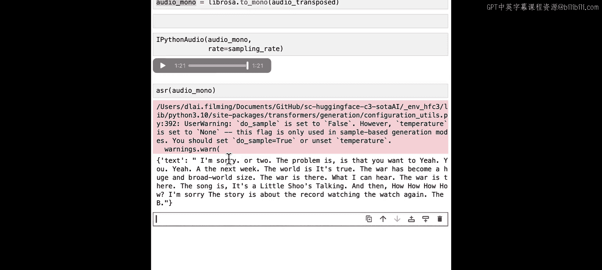

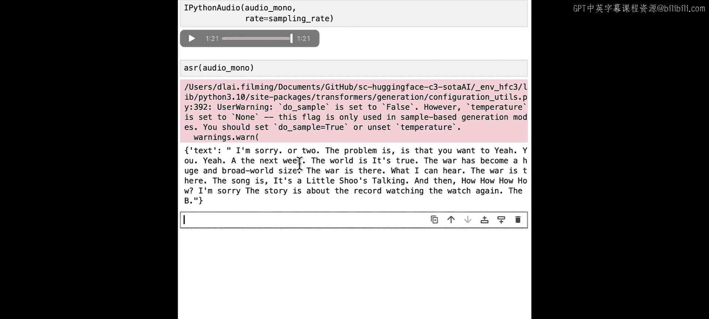

The sampling rate of the example is 44。So100 Herz and let's see what the pipeline expects。

And the pipelinePo expects the audio to be sampled at 16 kilohertz。 Let's fix this。

 We can resemble an individual file using Libbroa。

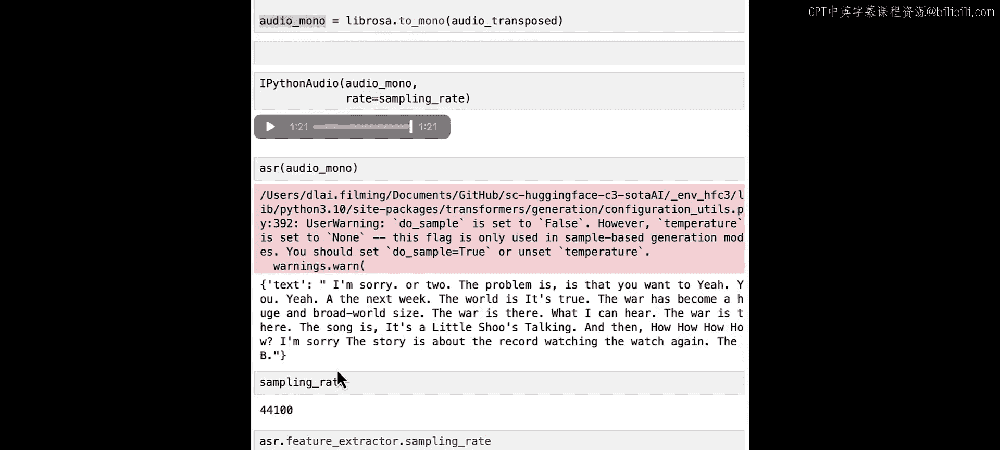

Now the audio example is ready for the pipeline for the pipeline to be able to transcribe the longer video。

 we will need to pass a few arguments to it， but first let's talk about how automatic speech recognition pipeline handles longer recordings because whisper can only taken in up to 30 seconds at a time to transcribe this longer example。

 the pipeline will split the long file into chunks we can specify the chunks length for whisper 30 second chunks are optimal since this match as the input that the model expects and each segment will have a small amount of overlap with the previous one This allows the pipeline to accurately stitch the segments back together at the boundaries since it can find the overlap between segments and merge the transcriptions accordingly because the audio is split into chunks the pipeline can transcribe the chunks independent of each other。

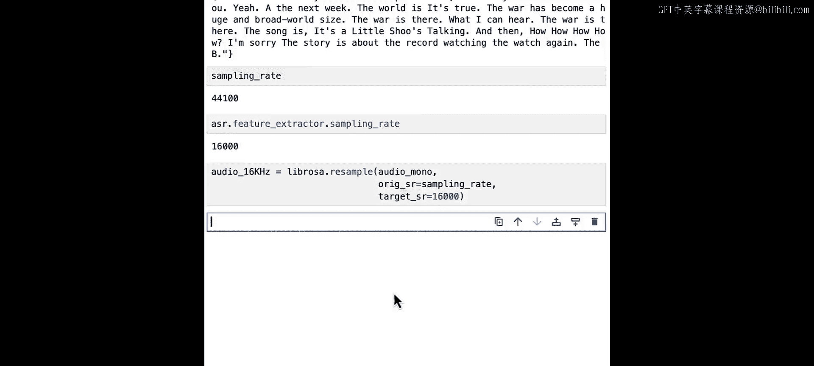

And then combine the results。 For this reason， you can transcribe batches of chunks in parallel。

 Let's see the arguments that will be passed into the pipeline。

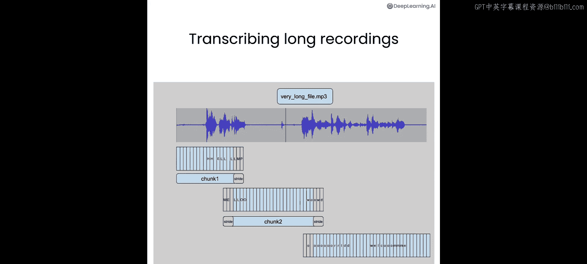

Next， the length for the chunks， 30 seconds in this case。

Next we'll specify how many chunks we want processed in a parallel using batchge size。 In this case。

 the original file is only one minute and 21 seconds so there is no need to have a batchge size larger than three or four in case of a larger file the batchge size will depend on your hardware and memory available to you。

 if you try a large batchge size and get an out of memory error you know that you need to try a smaller batch size So in the first introduction lesson I gave you a roll of thumb to estimate how much memory you would need for a model to run to estimate the batchge size think of it as a multiplier for that memory amount so how many models you can run in parallel So if you have the hardware to do that you can have a large number of batchgees In this case for managers。

But we also don't need anymore because 30 second splits with a bit of overlap for it is probably even redundant。

 probably we can do three。But just in case three or four for this case is fine。

 try and experiment with batch size and see what your hardware can handle。Finally。

 you can set return timestamps to true and this enables predicting segment level timestamps for the audio data These timestamps indicate the start and end time for a short passage of audio and it can be particularly useful for aligning the transcription with the input audio to output the transcription with the timestamps。

 you can print the chunks part of the output。Now we get the transcription for the full audio and we get the timestamps。

 Now， let's see how we can modify the demo to accept longer audio recordings。 First。

 let's copy the original demo。 Let's copy the transcribes speech function。Here。

 we're going to modify。How we are calling the pipeline。Instead of giving it only the audio file。

 we'll pass additional arguments。micof。The only thing that we need to update in the interfaces is the name of the function。

嗯。The code snippet launching the demo doesn't change。So it's ready to go。

Try uploading an audio file that is longer than 30 seconds or record yourself speaking into a microphone again longer than 30 seconds and see if it works。

In the next lesson， you'll learn how to go in the opposite direction and go from text to speech。

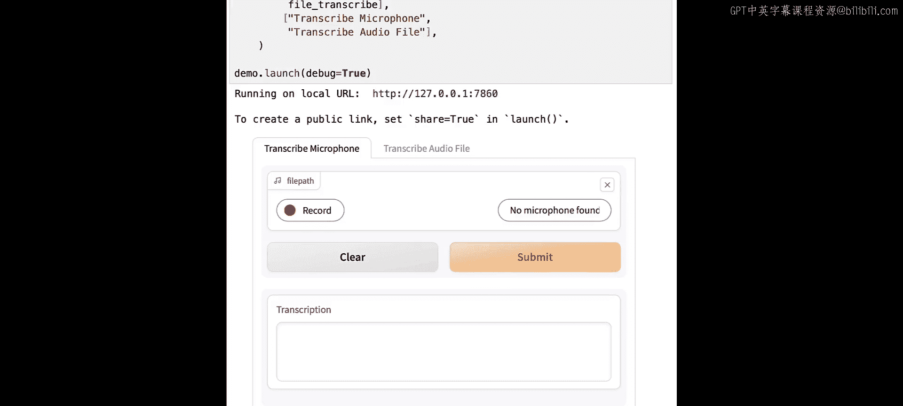

Let's go to the next lesson。