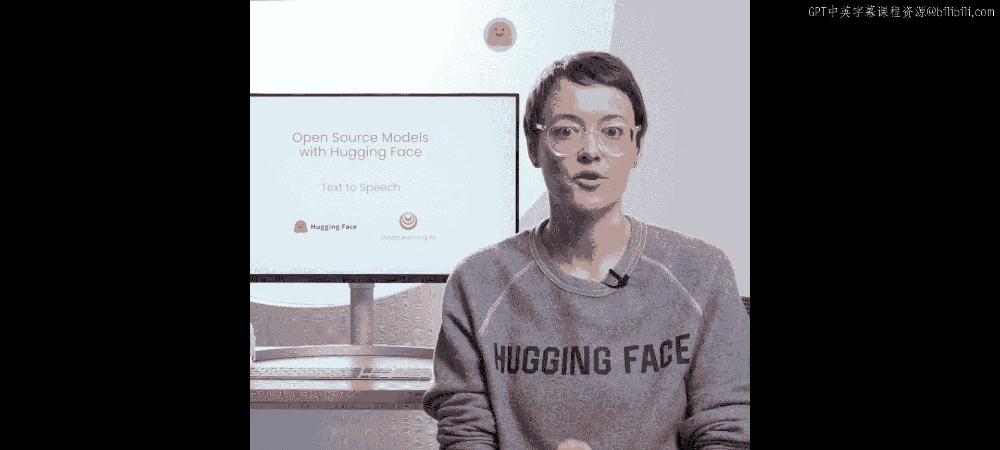
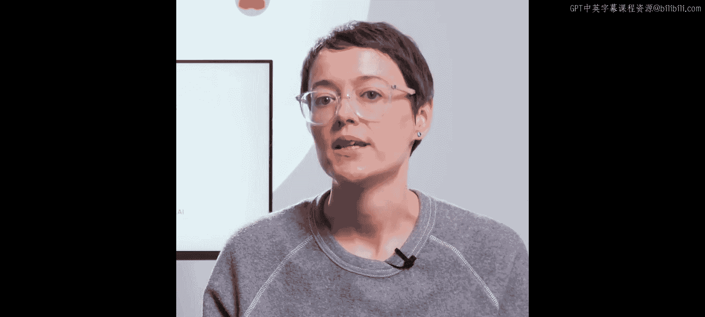
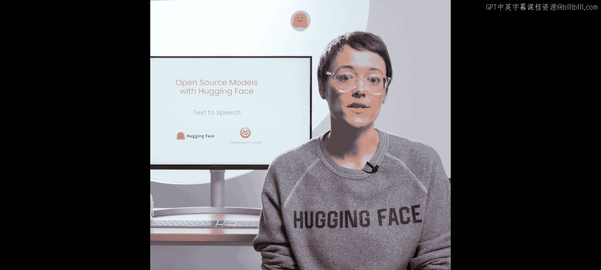
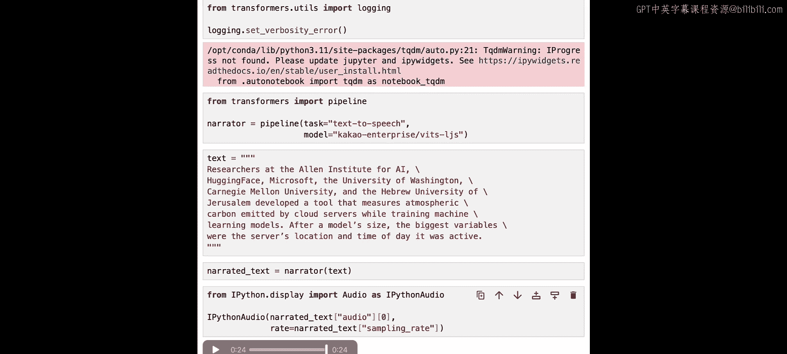

# 吴恩达《Hugging Face的开源模型｜Open Source Models with Hugging Face》中英字幕（英文可关） - P8：8.tts.zh - GPT中英字幕课程资源 - BV16u4m1u7t4

In this final audio lesson， we'll tackle text to audio generation by converting text to speech。

 Tt to speech is a challenging task because it is a one to many problem。 In classification。

 you have one correct label， maybe a few in automatic speech recognition。

 There is one correct transcription for a given utterance。 However。

 there is an infinite amount of ways to say the same sentence。

 Each person has a different way of speaking， but they are all valid and correct。

Think about different voices， dialects， speaking styles， and so on， despite these challenges。

 there are open source models that can handle this task really well and you are about to use one of them。

We'll use a VITS pretrain model from Cacao Enterprise。

 This is one of the two models that can fit in this environment。

And this model has a permissive license。 Once you have the pipeline。

 all you need to do is to pass some text to it。Let's write some text。Now。

 let's pass this text to the pipeline。Well let's give it a listen。Researchers at the Allen Institute。

AI I face Microsoft。The University of Washington。Carnegie Mellon University and the Hebrew University of Jerusalem developed a tool that measures atmospheric carbon emitted by cloud servers while trained machine learning models。

SThe biggest variables were the server's location and time of data was。And just like that。

 you can convert text into an aerated audio recording feel free to paste your own text and play with the pipeline in the next lesson Eunice will show you how to build an object detector Let's go on to the next lesson。

