# 吴恩达《Hugging Face的开源模型｜Open Source Models with Hugging Face》中英字幕（英文可关） - P9：9.object detection.zh - GPT中英字幕课程资源 - BV16u4m1u7t4

Hi， in this lesson you will explore computer vision models and play with some of them to build a cool application in particular you will build an assistant that can help a visually impaired person understand what is in a picture let's get started。

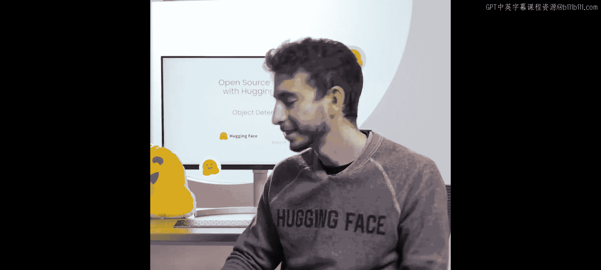

Okay so just a quick heads up before starting the lesson so for this classroom the libraries have been already installed but if you want to run the notebook by your own on your own machine make sure to install the required libraries which can be installed through this following command so yeah let's get started so first of all we want to import the utility methods that we're going to use for this library so make sure to import from helper the methods called load image from URL and render results on image so we're going to quickly do that before starting。

So。For this lesson we're going to focus on a specific task in computer vision called object detection so first of all we're going to load a pipeline object as we've been doing it so far from our previous lessons。

 so we're just going to import pipeline from transformers and load the object detection pipeline that we called OD pipe。

That we will call using a model from Facebook called DTR Resnet 50。

 so just run the following to get started。To load the pipeline and before moving forward I wanted to give some insights on this specific task we're going to focus on so what is object detection so the task of object detection simply consists of detecting objects of interest in a specific image so for example as you can see on this image the object detection model is able to detect all relevant objects in an image and one thing to notice is that object detection combines two subtask which are classification but also localization because for each object that you detect in an image you also have to provide the label of the instance but also delocalization of the detect object you may be wondering how did we choose this DTR resident150 model from Facebook because today we have many state of the art object detection models that you can use from the AI ecosystem in general so for that you can simply browse the hugging face hub and use the filter object detection that you can see on the left and get all the available object detection models that you can freely down。

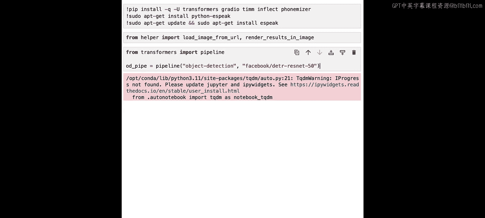

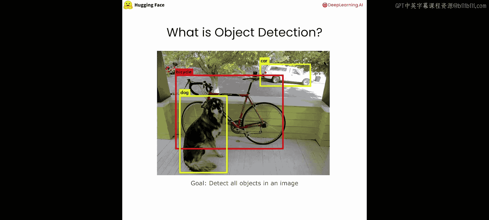

from the hub and you can easily determine some matrix that you're going to use to select your models。

 So for example， you can select your model based on the number of downloads or number of likes and also sometimes the authors provide the evaluation matrix of their models on some specific data sets directly on the model cards。

 So those are I would say the important matrix that you can use in order to select the model that you're going to use for your task and for this lab we're going to use the Facebook DTR Resident 50 model。

 so now that we have loaded the pipeline let's directly start using it so let's directly use our pipeline by loading an image that we have prepared for you So this is a recent image that we took altogether in a restaurant for filming our course。

 So yeah we're going to see what are the objects that the model is going to detect in this image so I would invite you to take a few seconds to make yourself familiar with the pipeline make sure to pass the image into the pipeline get the output from the pipeline and you can use。

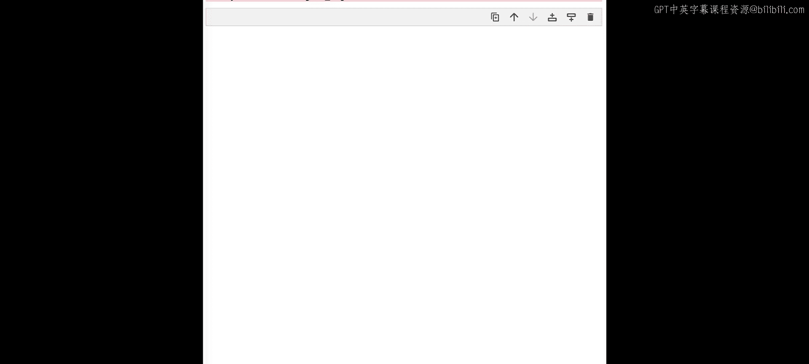

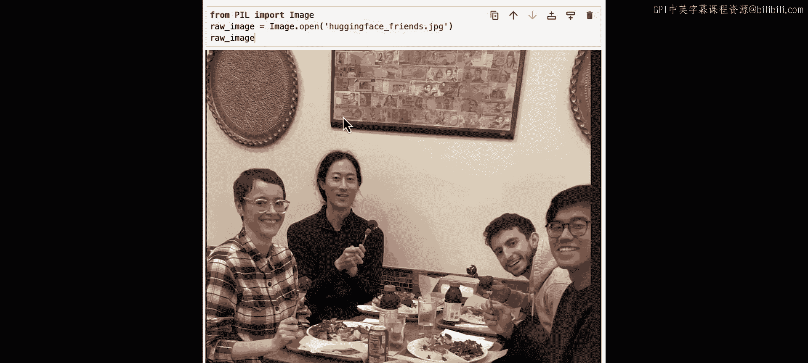

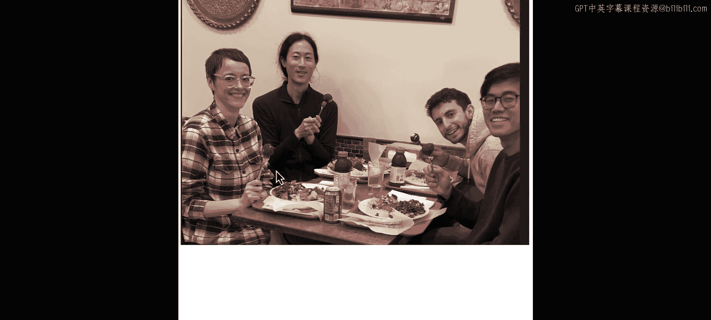

The render results in image function that we have provided in the helpers in order to render the results directly in the image。

 Okay， so to get the results from the pipeline simply call OD pipe on thearrow image。

 So we're going to do that right now So pipeline output。

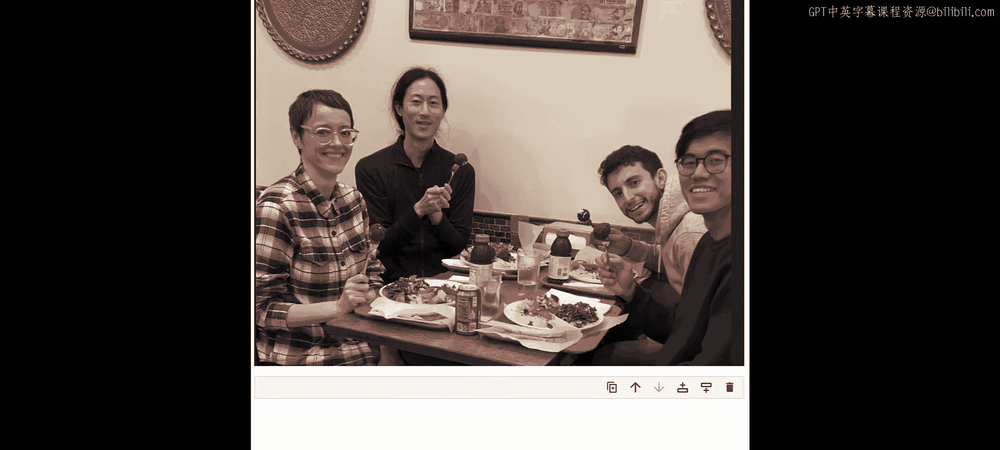

Equal O D pipe on the row image。 So yeah， once we got the prediction。

 I will just call render result in image by passing the image and also the pipeline outputs。

And let's see the final results。

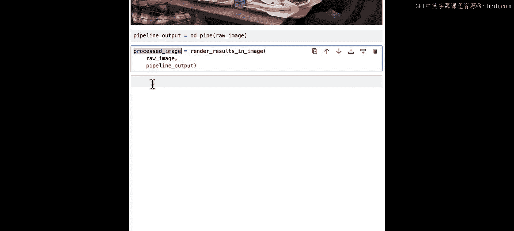

So yeah as you can see the model has accurately predicted all the persons that are on the image so with the corresponding mounting box you can also see the confidence score of the predictions for each predicted instance the model has also predicted the bottles。

 the cups and forks， but yeah it looks like the model was not able to predict the falafels but maybe with some fine unique will be able to do that so yeah now I invite you to post the video and try that on your own with your own images can be some local images that you load using pill but you can also pass some image URLs if you want to use an image that is on the web。

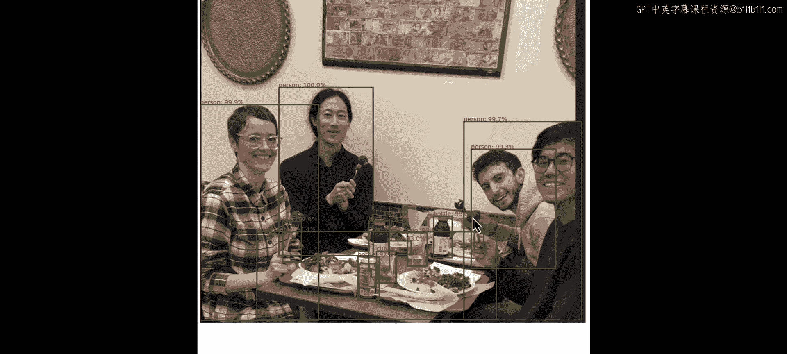

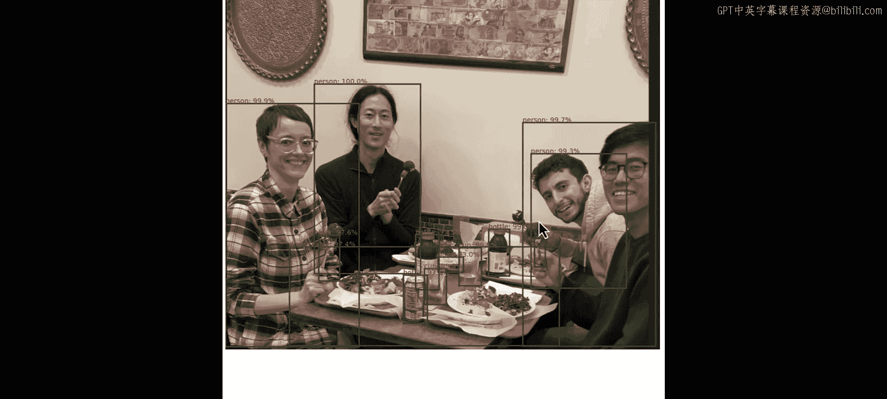

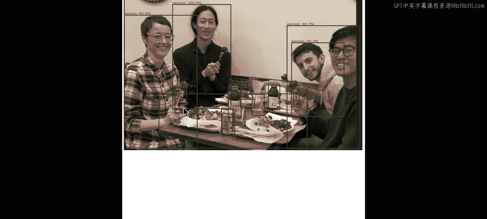

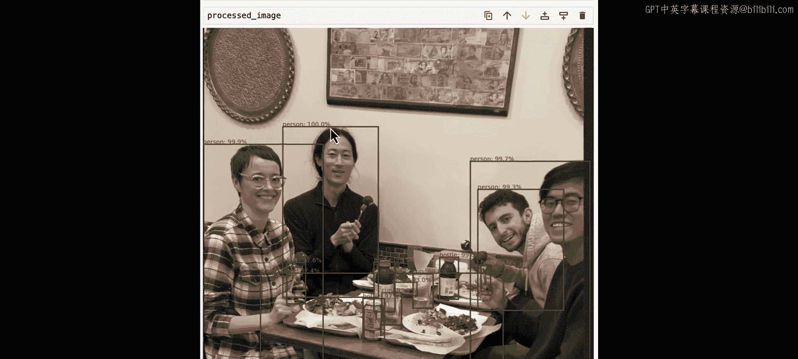

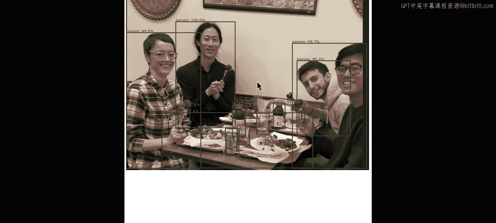

Okay so let's see how we can make that a bit more user friendlyly So let's say tomorrow you want to show that to your friend and make a nice demo using the model。

 So we're going to use a library called radio in order to expose a simple interface so that's pretty much the final demo will look like something like this so a simple interface where you can pass an image here we pass a prompt but you can also pass an image and then you get the results of the pipeline right next to the original image that way you can share easily the demo with anyone and anyone will be able to try the model out of the box using their own image let's get started for that will first import radio as follows so the radio interface expects to have a method where you pass the input and return the output so we'll create a method that will do everything under the hood for the users given an image so for that will define a method called get pipeline prediction。

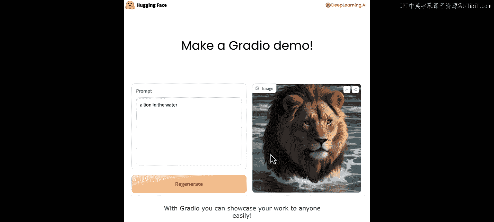

So death。Get pipeline prediction that will take a peel image as an input and we' split it up in two steps so the first step will be to get the pipeline output given the peel image and we will use the globally defined OD pipe that we have loaded beforehand so that we won't have to load the pipeline each time we willll call this method so that it will be much more efficient and then we will use the helper function that we have used before render results in image directly on the original image using the pipeline output。

And then return the final processed image， alright。

And actually the code to make the grad interface is going to be pretty much straightforward。

 so once you have that method defined you just have to create an object of Gr dot interface that will take as input this method get pipeline prediction and we just have to properly define what is the input and what is the output and we'll just have to call demo dot launch to launch the demo so if you run this code snippet。

And be able to define the demo and we will call demo dot launch with share equal true so that you can also share a link for the demo to anyone。

Okay， so once you have the demo app， you can load any image from your local computer and pass it to the model。

 so let's try out with this this image。

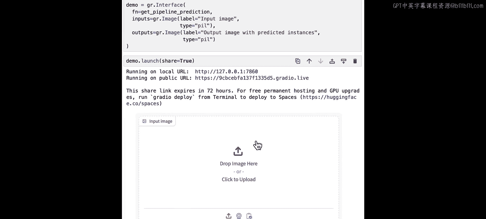

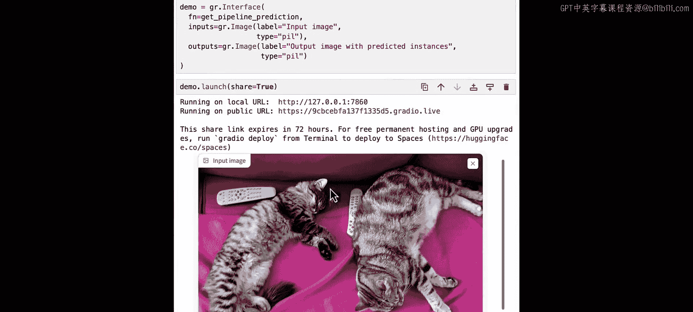

And click on submitm。

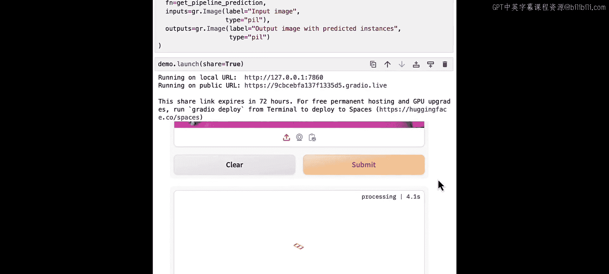

Yeah so as you can see in this really cute picture， the model was able to detect both cats。

 the remotes， but also the couch， but we can't really see it because of this icon but yeah feel free to try it out with your own local images you can also pass as I said。

 if you want to use row pipeline you can also pass an URL to the pipeline directly and also you can share this link to anyone so that they can try out the demo on their computer as well you can also send this link to your friends so that they can try out the demo on their own but please keep in mind to let your computer open and running because the demo will be running on your computer。

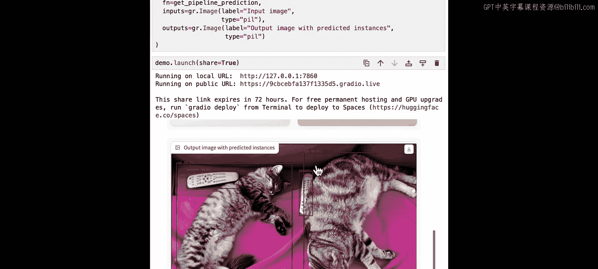

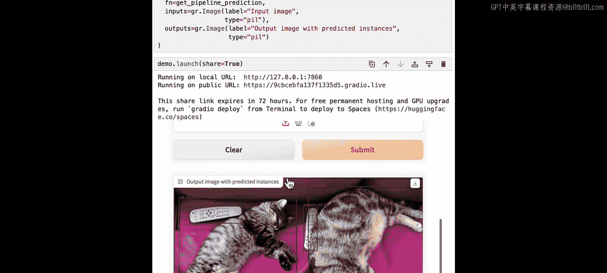

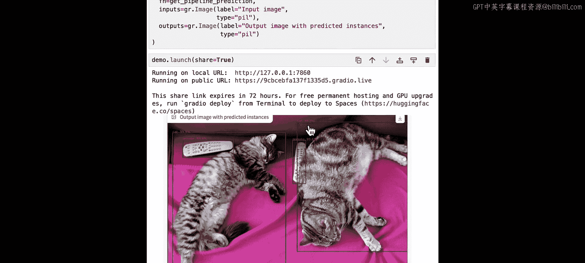

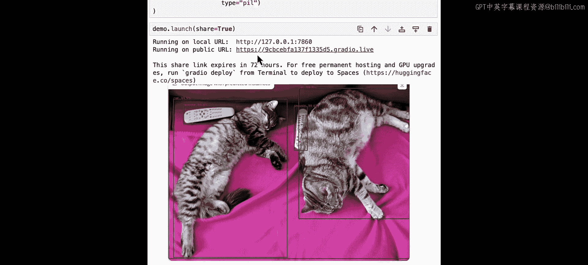

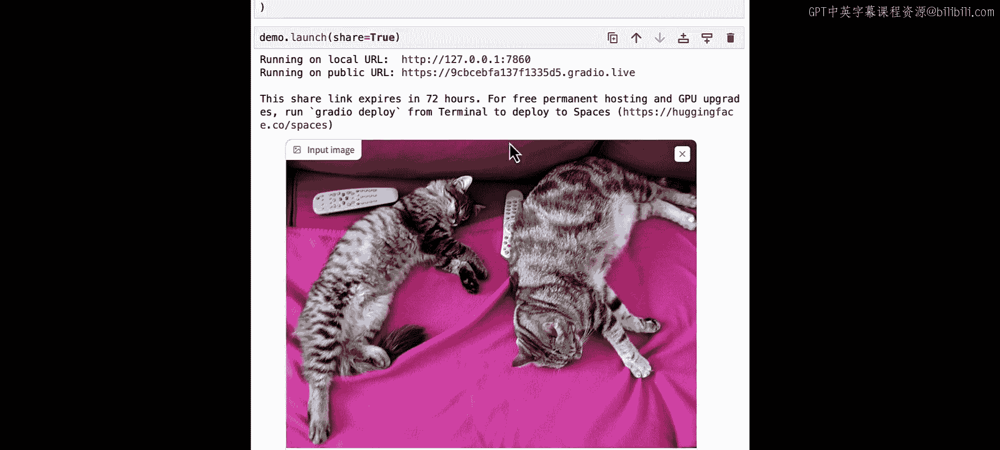

Yeah so for the last part of this lab we'll see how to make an AI part assistant using two different models so let's say you have an image which is here you just have to pass it to the object detection pipeline to get all the relevant objects in the image with their labels and then we can perform some sort of post-procesing of the output of the pipeline so that we have a more natural text that describes what's in the image and we can pass that image to the text to speech model which is also going to be another pipeline which is going to generate an audio that we narrate the text that we created in this step and then we'll have the audio saying in this image we have this this and this so this is what we're going to do right now and yeah let's get started yeah so we can combine the object detector model that we have just used with that text to speech model to help us indicate and dictate what are the objects that are in an image with their number of occurrences So first of all if you try to inspect the output of the pipeline you will get something like this So it's an。

Aray of dictionaries with each dictionary corresponding to one detected object with the label。

 the coordinate of the bounding boxes together with the confidence score。

 so if we create a simple method that processes this array and returns a string of the summary of what's in the image。

 we can pass that summarize string to untex to speech model to dictate as what's in the image。

So let's try that out so we will use the same image that we use before and the same pipeline so we're not going to rerun everything again because we will use the audioD pipe that we have already loaded。

 which is here and we will just have to import that helper method called summarize predictions natural language from the helper's function that we have provided to you let's try to see what the text would look like if you pass the pipeline output to that method So if you run this method and print out text we'll get in this image there are two forks。

 three bottles， two caps， four persons one bowl and one dining table which is a quite accurate representation on what's in the image So you can also take your time and try to inspect what's in this method but all the logic behind this method is pretty straightforward it just tries to combine all the output that is in this array and try to make a sentence out of it All right and what model are we going to use to generate agen of the image so we're still going to use pipeline。

But as you have seen in the previous lesson， we're going to use the T to speech pipeline with this specific model from Cacao Enprise。

 you can read more about the model directly on the model card of this model。

 but yeah we're going to use this pipeline and let's get the narrated text from the text to speech pipeline given the text。

Perfect， yeah， so to in order to listen to the narrated text。

 we'll need to run this small snippet that uses iPad and audio。

 So let's try out right now and try to listen what's in the narrated text。There are two forks。

3 bottles， two cups，4 persons， one bowl and one dining table。

That's quite good and quite accurate we can wrap the whole pipeline in a single method so that you just have to pass an image and it will return you directly the narrated audio you can also wrap that in a gra interface so that you can let your friends try that out on their own so yeah I'll invite you to post the video and try that out with other images maybe also other models that you can find on the hub so that you can compare different performances across different models and also maybe try to wrap everything in a gra demo so that you can share it with your friends。

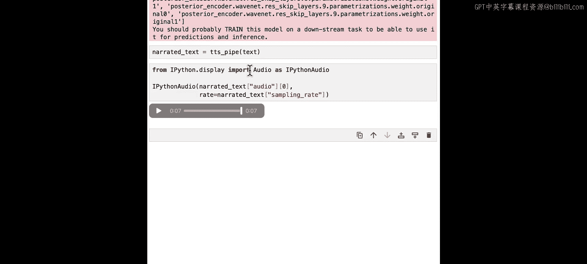