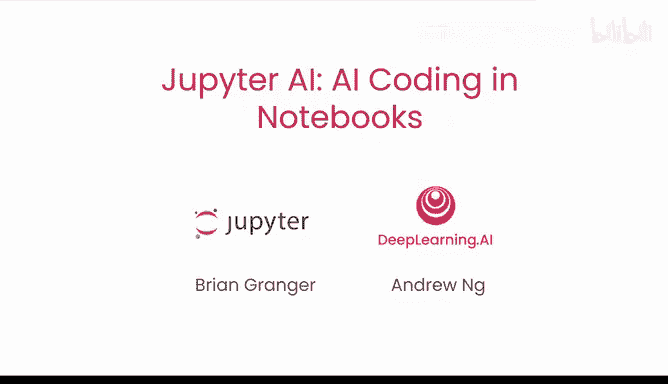
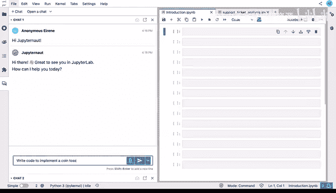
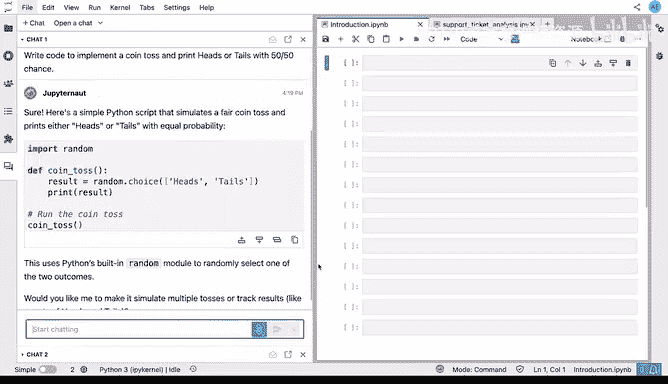
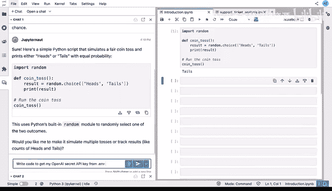
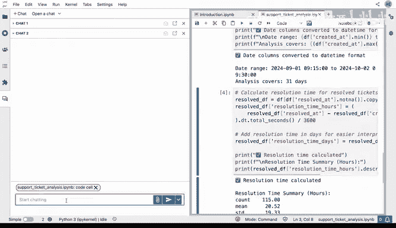
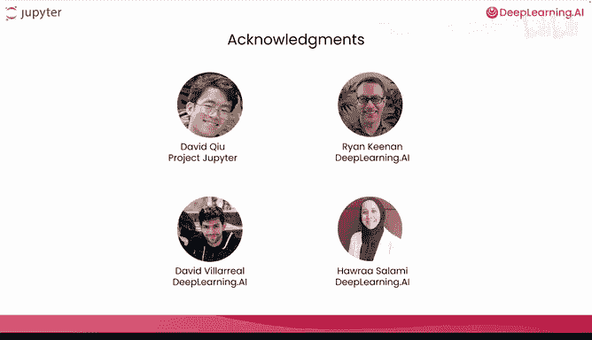

# 吴恩达《Jupyter AI：在笔记本中进行人工智能编程｜Jupyter AI AI Coding in Notebooks》 - P1：1.intro.zh_en - GPT中英字幕课程资源 - BV1XB1QB7Eqr

Welcome to Judayi。Cthing by hand where you write every line of code manually is becoming obsolete。

So coding notebooks have to evolve away from manual coding to using AI to code for you。

 I'm thrilled to be here with Brian Granger， who is co founder of Project Jupiter to introduce Jupyter AI。

You either use it here on the Deepland AI site or run it locally on your own computer。

 Jupiter Notes are a workhorse of AI developments and data science。

 and we also use them extensively at Dele AI，  moving notebooks full way to the AI coding era would be a to step for a few and thrilled to be teaching this with Brian。

 Thanks， Andrew， When we created the I Python notebook in 2011。

 and later rebranded it as the Jupiter notebook in 2014。

 we did so with the mission of creating a community drivenn open source ecosystem of tools for data science。

 scientific research and education。 Jupiter notebooks have long been the default prototyping environment for this type of work。

 But it turns out that most of the AI coding assistant that have emerged in the last couple of years。

 have struggled to function well in a Jupiter notebook environment。😊，And so we built Jupiter AI。

 which is an open source framework that is purpose built to integrate AI into Jupyter Notes and Jupiter Lab Jupyter AI works well for the kinds of tasks you might already be familiar with from using other AI assisted coding tools。

 like writing code and answering your questions about code。

But it is more than that and also has capabilities designed specifically for working with coding notebooks。

 Let me show you with Jupyter AI， you have a chatbo called Jupyter not alongside your notebook So I can say hi Jupyter not and get a response or maybe more useful。

 I can say write code to implement a coin toss and print hits or tails with 5050 chance and it generates the code instead of manually copy pasting it into my notebook I can just use a single click here to insert the code into my notebook and look it runs or something I often ask an L to help with If I've forgotten what's the syntax for calling the open AI API I can also to write the solar standard code to get my open AI secret API key and then make a call to the on。

Or if I'm looking at someone else's notebook， I can drag a cell over here and ask。

 what does this cell do， Or even ask， what does this whole notebook do and give a quick summary to help me understand the notebook。

 that all this is integrated with Jupiter makes a workflow of using AI coding with a notebook much easier。

 You can think of Jupiter AI as an AI collaborator for everything you do in Jupiter。

 whether that's exploring data in a Jupyter notebook。

 Prototyping L O M workflows or even building custom agents that are integrated into Jupyter La chat experience。

 In fact， there's much more to Jupiter AI than we'll have time to cover here。

 But this course will give you a great start。 And I don't know， Andrew。

 I'm thinking maybe we need to have a follow up course after this。

 There's a lot of an exciting things in Jupiter AI that we won't have time to cover today。

 such as custom agents tool calling an agent to agent collaboration。 No， that sounds great to be。

 And even in this course， I think you than a lot。 In the first exercise。😊。

You learn how to use the chat interface to generate code and ask questions about code， for example。

 generate a call to an open AI API。Then in the second exercise。

 you use Jurup AI to build a chat app that can help you find goodBooks using an online books API and through that you learn more advanced prompting strategies。

Then in the third exercise， you create a workflow to retrieve and analyze stock data and see some of the best practices for how to use Jupiter AI for data analysis。

 This course is set up a little differently than our other short causes in that is not arranged as a side by side notebook with video for every lesson instead offers demonstrate each exercise in a video and then you get handson practice yourself and can build the same application I demoed using the same prompts or modify the prompts to build something customized to your all liking Many people have worked to create this course。

 I'd like to thank David Q and everyone else that's worked on Jupyter AI and from DeBer AI Ryan Kean。

 David Viaro and Harrasami Let's go on to the next video to get started with Jupyter AI。

