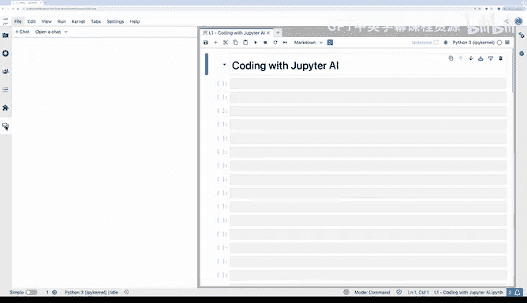
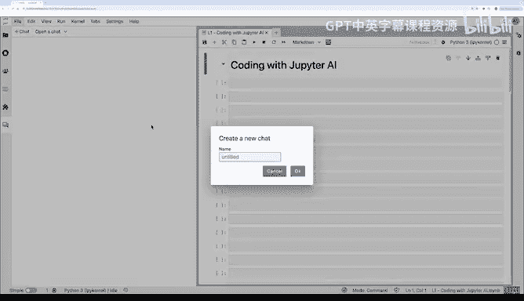
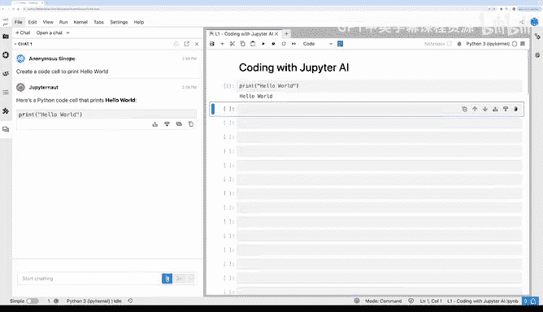
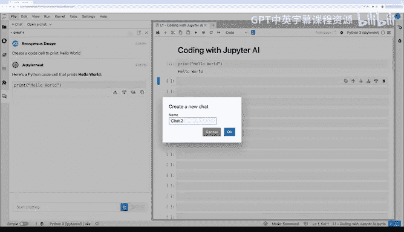
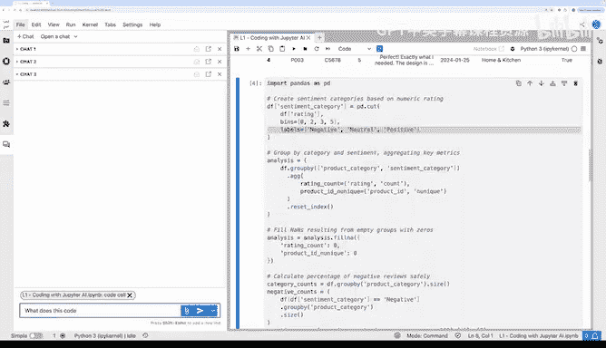
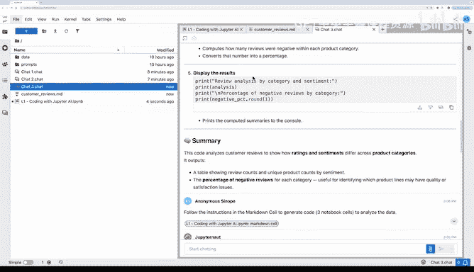

# 吴恩达《Jupyter AI：在笔记本中进行人工智能编程｜Jupyter AI AI Coding in Notebooks》 - P2：2.coding-with-jupyter-ai.zh_en - GPT中英字幕课程资源 - BV1XB1QB7Eqr

In this lesson， I'll show you the basics of Juta AI， how to use chat to generate code。

 how to ask questions about code and how you can give the model additional context for that chat We illustrate this with a couple examples。

 including calling the open AI API and also doing some basic data analysis。😊。

One neat thing about JupiI is chats are saved as documents。

 which also lets you open them up as files and use that as contexts for future chats。

 Let's look at how you can use JupyI Let's start coding with JupiI to bring up the chat window。

 look for this speech bubbles icon and click on it in this brings up the chat environment and then hit plus chat to start the new chat。

 you have to give this name I'm going to give it maybe a knowledge great name。

 This is called this chat1 and let's start the hello world。

 So I would to say create a call cell to print hello world。😊。

And this then takes a second to create this co cell。

 And instead of having a copy paste this to my Jupynter notebook on the right。

 I can select a cell say here on the right， and then this inserts it above the activector cell below the active cell and this replaces the active cell。

 So I'm gonna put it above the activector cell there。 And then let's run it。 ya hello world。

 let's not look at the more complex。Exampled， let me actually just start a new chat for this， so。

Clear out the chat context。 Here's my chat too and for this second example。

 I wanted to use Openly eyes API to write fun fortune cookie message。

 So here's my prompt critical cell that use Open eyes Gp41 mini to write a fun fortuneune cookie message and then I'm going tell it to use Python dot end to load my secret API key from do end and then here's the exact prompt that I'm suggesting for generating fortune cookies so let'。

Run that。And。😔，Here's a bunch of code。 I'm going to take a quick look， let's see。

 let me just slide console。😊，Replace it and then the me go ahead。And run it。So far so good。

 also my name。And it says。Your Christmas like wifi。 Oh， that's nice。 Only I know the password。

 All right， that's pretty funny。 So I'm showing you this coding process now and what I hope you do after this video is go to the Jupyter notebook environment that comes after this video where we have Jupii running and there please click on the speech bubble to open up the chat environment and then try to generate code like I am doing now or generate a new piece of code and have a do something different from this if you wish I want to show just one third and final example for this video which is using a for data analysis。

😊，So here someone else has already written a Jupyter notebook with these two cells and let me just run the first cell and it loads this customer reviews csv data file so you can see product I customer ID this rating looks like it's rating for one to five review text date and so on。

 and here are some analysis code and let me just run this So we run this and let me scroll down and it looks like you know it done on the bunch of analysis。

 But if I want to find out what this code is really doing what I can do is select this code cell notice I'm clicking here on the left I'm not clicking specific positive this code cell I'm clicking oh here to the left to select the code cell and then when I drag this code cell to the chat and ask what does this code cell。

2。And so with that context， it is telling me that the code cell performs multistep data analysis on Df。

 so it looks like it categorizes each review as negative neutral or positive for reviews from less than two the three to4 and5 and then it creates a new sentiment category groups it and so on you can run this yourself and read through this if you wish。

 but this is a nice quick way without my needing to read all of this Python code to understand what is this analysis looks like this is actually saying that the product reviews there were in the bookss category two products that had a negative rating on the books and none were neutral and two or positive and so on。

 So the summary of the reviews that we have Now let's say you want to write your own code or get AI to write code for you to carry out a more complex。

 more sophisticated analysis。 What I have done here is rather a fairly detailed spec or fairly detailed prompt。

Of a more complex analysis process that I want code to be written for。

 So this is createcode that extract reviews from pandas the frame and summarize the issues reported when I'm writing a fairly complex program I might spend quite a bit of time minutes。

 ten of minutes， maybe even an hour sometimes to write a very long and detailed prompt specifying exactly what I want to do。

 And in this case， I've written this prompt in a jupyter notebook cell in markdown。

 So notice this is a markdown cell。 And I find that editing a prompt like this in markdown is maybe more convenient than trying to type a super long prompt into the chat into the little chat window over here。

 and let me just hit shift enter to get it back to the nice formatting。

 And so this long prompt or this program specification says for step 1。

 I want to extract the reviews a list step 2 examine the reviews step 3 print and save the summary into certain file。

 So what I can do is then drag the cell。The notebook。And say。Follow the instructions。Inindi。😔。

Mardown so。To generate。Coat， I want three。Notebook。Cells。To analyze。The data。

 And so I'm telling it to delete the instructions where a markdown file and write code。

To clarity analysis。And。All right， let me select the first cell and move that over is a second cell for step two。

And is the third cell。Bve that over as well。And。Let's see for a quick glance， looks okay。

 Exed 50 y reviews。Now it will use G41 mini to generate reviews。 This takes a few seconds to run。

 Lastly， I wanted to save all this into customer reviews。 M dot markdown。

 And if I go to my file browser looks like it actually worked generate reviews I specify in the long prompt and。

Safe the analysis by Mardown found here I want to just point out wonder the neat feature of Jupyter AI。

 which is that these chats that we had chat1 Cha2 Cha3， I know they're not the best names。

 but each of these chats is actually stored in a file So we just generated to these files and if I click on say chat3 chat then this is actually the saved conversational history that you just saw us go through just now and this is convenient for later referring back to chats or even using these chats as context for future conversations that you may have with this chatbo So that's it for getting started jubil I hope that you go and try out some of these ideas yourself here on the deep learning AI platform and after that come back to the next video we'll look at some even more advanced ways to use JubileeI to write code for you。

