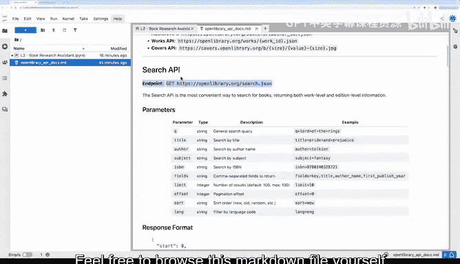
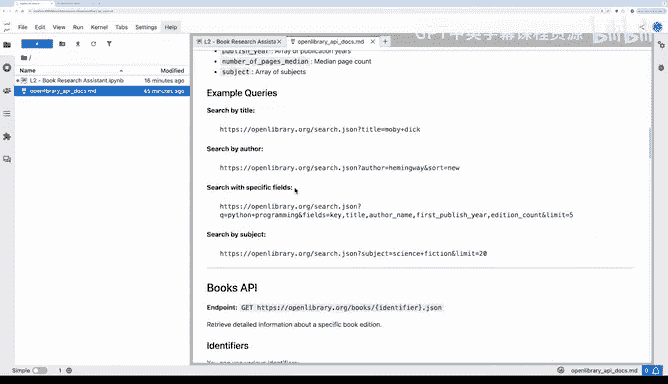
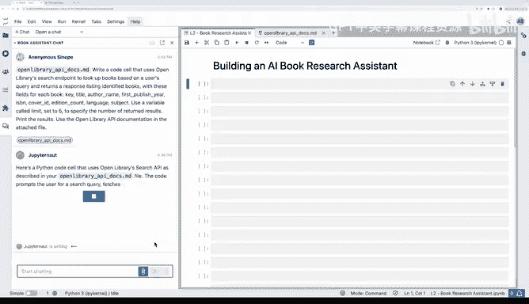
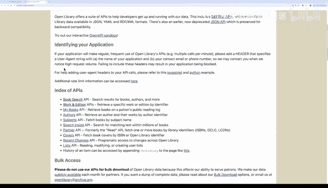

# 吴恩达《Jupyter AI：在笔记本中进行人工智能编程｜Jupyter AI AI Coding in Notebooks》 - P3：3.building-an-ai-book-research-assistant.zh_en - GPT中英字幕课程资源 - BV1XB1QB7Eqr

In this lesson， we'll look at more advanced ways to use DI as a coding assistant。

The motivating example is building a book recommendation assistant using the Open Library API。

 which returns information about books。For APIs that OMS aren't already trained to use。

 one key idea is writing documentation for their API， which you see me do in the markdown file。

So you can then give that markdown file as context to the LM so that it gets the API usage instructions it needs to generate correct code You also see some of the best practices for organizing contacts for AI coding Let's take a look in this lesson we're going to use the open library API in order to build an AI book research assistant and in doing so we'll go over some best practices for using Ju AI to code for you we'll be using the internet archives open library says APIs to search for books。

 the open library has a set of different APIs for example。

 to search for books with the book search API and a number of others in order to make our OM know how to use these APIs I've created here。

 a markdown doc， let's open that up Openworth Markdown preview that is a file with detailed documentation on how to use these APIs so how to use。

endpoints free to read through this documentation， but the one I'm going to use is actually this one。

 which is a search API that lets you for example， search for load of the rings or producting prejudice or multi by token or search for fancy books and so on Ph free to browse this markdown file yourself after you're done watching this video and read through。

Some of this documentationation， if you wish， I'm going to click on the bubble here to start the chat and。

That's have。Book assistant。Check。

And what I'm going to do is。Attach my open library API docs do M D Mac Dalfo download want type at file。

Or you can actually click here and then。I'm going to type open library there pops up and click this so I'm attaching thismountdown files documentation。

 Then here's the problem we're going to use write a code cell that uses Open library's search end point to look up books and so on returns a response list listing the key title author name and so on and then in this case let's limit to five results and I'm saying use the open library API documentation in the attach file。

 So let's run that。

And it generates this piece of code。So let me copy it over to my notebook with one click and let's give the shot into your book search query。

 I want to find science fiction。And so， this， then。

I guess calls the API and gets back the top five results。

 So science fiction hall of Fame Rob a serverber He Arthur Isaac Gasov lots of great authors。

 Oh the foundation novel， which I love by Isaac Gasziov strange in the strange then and by you have a pretty interesting science fiction books。

 So it looks like this is working in order to build a book research assistant。

 what I'd like to do is take this code。 this Jupyn notebook cell。

 It just calls the API prints out the results。 take this code and wrap it in a function so that I can then give this as a function or as a tool to an L to call。

 So one way could do that is you could drag this cell notes I'm clicking out here。

 drag it over and attach this and then say please take this code cell and wrap it in the function。

 Another way without attaching it is write a prompt that says wrap it code above in a function search box with good Ptrain documentation input inside the query and。

The limit， let's now have this default to returning 10 books and output adjacent J string。And so on。

 And let's。Run that。 And in now。Hm。😔，T the code and looks like it did a decent job with wow。

 pretty nice documentation， in fact。 So let me now take this code and。Ctpy I Jupiter notebook。

So you can just define it as follows and if I want to test it。

 I can then try results equal searchbook science fiction， print results。

And now it is returning to top 10 books so that works We've successfully created a searchbook function that uses the open library API to search for books。

 Next， we need to give this function as a tool to an OM to build the book research assistant in order to do that we're going to use the open source AI suite library。

 which is a library that makes it easy to get Elms to use tools as well as makes it easy for you to switch between different AM providers there an open source package that a friend Rohi Prasad and I had been working on but because a fairly new package ElmMS have not yet been natively trained on the syntax of how to call AI suite So one thing we could do is write a AI suite API documentation Markdown file like we did with the open library API docs Markdown file but in order to use AI suite successfully。

 it turns out giving it a cold example like this should be enough to get the ElM to figure it out。

 So I've written here in a row。Jupyter markdownsell。

 just an example of how to use AI suite and if you're familiar with two calling or function calling using an L AI suite has a relatively simple library where you just have to tell it whether the tools which is search box in an example and this code snippet is enough to get the Om to decide if it needs to call the searchbook function。

 which you just create it up above in order to fulfill a user query。

 So what I'm going to do is let's take the cell， drag it to the chat and then I'm going to front your use example to create a simple chat handler function。

 chat to tools， input the user message and then output that and it can use the searchbook tool。

If it wishes。So this generates the code and it looks like it's giving the search box function we created above as a tool to thearrow correctly。

 so let's copy this over。And。Let's go ahead and run it。 so that has defined the chat with tools。

functionunction。And now， here's a。Jupynter boxel where my query is social boxable science fiction。

 Let's run that。 And so we're going to use the chat of tools function that we define above。

 So this runs for minutes and it looks like it calls the two in depth a。Decent other results。

 and these other the results returned by the function calling。 So these results look decent。

 but for debugging purposes， I want to make sure that this really used the function we defined up above。

 rather than just use thes pre knowledge to regurgtitate a bunch of plausible sounding books。

 So let me go back up to this function。 And I want to add print statement to just let me know status update when this function is being used。

 I'm going to tow it。Modify。Di。😔，Search box function。To add a print statement。Sure when it is。

Calls with。Basic status messages。All right， so that should make the operation of this。

L in with trans。Sas generating the code。 And I'm going to select the cell。 and let's just。Replace it。

 it's going to redefine this。Let's see what happens this time round。 Okay， good now is。

Giving me a bunch of statuss updates before it has return。And then， if I。We run this。

This time this look for。Books on dragons， social books of all dragons。Oh， I like dragons。

 Let's see what happens。Good， so it's looking folks on dragonagons。 All right。

 some of these look like they're pretty fun。 So that shows how you might take a cell and ask the tripod to irrerate and modify the code for you as well。

 After this video， please go to the Jupyter lab on this website and play this yourself。

 And in that lab， we have some optional instructions you can follow you want to use some of these other APIs to build potentially more complex book research agents。

😊。

s as maybe after retrieving certain books you might want to look up some details in that work to print out more details about the books that those retrieve。

 so please go to the lab and I hope you have fun using Jupyter AI to build applications like this and maybe youll find some cool books you want to be too。

