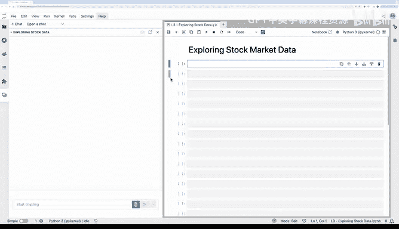
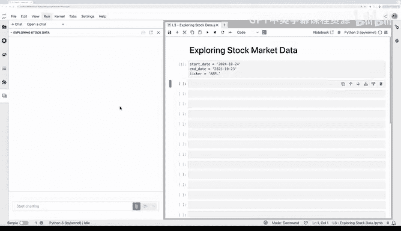
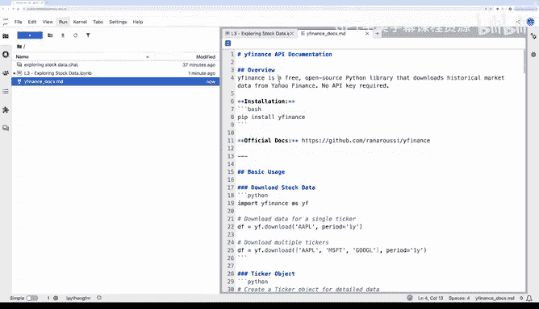
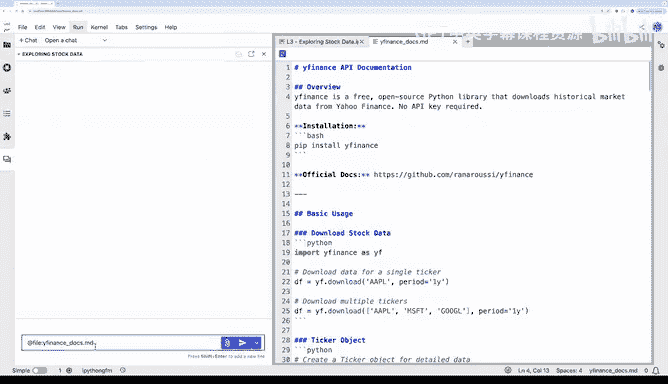
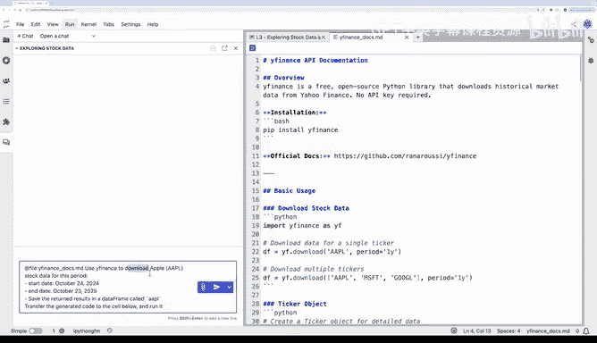
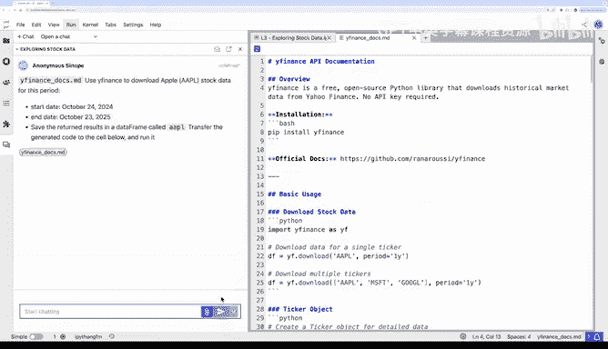

# 吴恩达《Jupyter AI：在笔记本中进行人工智能编程｜Jupyter AI AI Coding in Notebooks》 - P4：4.exploring-stock-market-data.zh_en - GPT中英字幕课程资源 - BV1XB1QB7Eqr

In this lesson， I'll show you how you can use Jupiter AI to perform data analysis and visualization。

 In particular， we're going to make an API call to grab some stock data and then use Jupiter AI to help us perform analysis and visualization。

 All right， let's go。 Let's say I' am interested in analyzing Apples stock data between October 24。

2024 and October 23，2025。 For that， I've defined the start and end dates of the analysis period and specified Apple's ticker symbol to grab this stock data I'm going to use why finance。

 which is a Python package you can import to fetch financial data from Yahoo finance。

 similar to what you saw in the previous exercise with Andrew。

 I've prepared a markedon file that contains the documentation for why finance。

Here in the chat window， I'll attach the markdown file and then ask Jupiter Not to use why financein to download Apple stock data for the period I'm interested in and save the results to a data frame。

Here's the code。I'll click here to transfer the code and run the cell。

Here are the first five rows of the data frame。Each row shows four types of prices for a particular day。

Open is the price when the market opened for that day。

 High is the highest price reached during the trading day。

 Low is the lowest price reached during the trading day。

Clothes is the price when the market closed for that day。Finally。

 volume represents the number of shares traded that day。 Now。

 you can see that each column has two indices。 The price type and the ticker symbol。

 You can see that more clearly， if you print the columns of the data frame。

Since I'm focusing only on Apple stock data， I'd like to remove the second index。

So let me tell Jupi or not that my columns are multi indexed and ask how I can flatten them。

All right， let's apply the generated code to the data frame。Grape。Now。

 my data frame is single indexed。 After you load your data。

 you may want to quickly explore things like the shape of the data frame and the values of each column。

Pands data frames have many methods that help with quick exploration。

 But let's say I forgot the syntax。So I'll ask Jupiter not to display the shape and statistical summary of the data frame。

Great。😊，Let's get the code and run it。So the number of rows is 249。

 which represents the number of trading days during the analysis period。

This makes sense since trading days don't include weekends and holidays。

 And I can see from the count here for each column。That there are no missing values。

 And the remaining statistics all look good。 Let's now find the first metric。

 which is a total return to understand the overall change in price over the last year for that。

 I'll just use the closing price because it's usually used as a reference point for analyzing changes in the stock's value over time。

 So I'll ask Jupiternot to use the closing price from the data frame to calculate the total return in percentage based on the start price and end price。

Let's find out the total return for the past year，12。61 per cent。

 The overall return for the past year is positive， but this doesn't mean that the closing price was always in an upward trend。

 So let's look at the daily fluctuations of the closing price by plotting it。

I'll ask Jupiterot to help me write code to visualize Apple's closing price。

 I specified that I want to use mattepllibb and clarified some requirements like access label。

 grid and appropriate colors。So let's run the generated code。And here's the line chart。

You can see there was a decreasing trend during the months of March and April。 but after that。

 there was more of an increasing trend。 So now I'm curious to learn more about this lowest date and peak date。

 I'll ask Jupiterot to help me find these exact dates and mark them on the same plot。All right。

 So the peak price happened on October 21，2025 and the lowest price on April 8，2025。

To get some context， I'll do a web search for news related to these dates using Serer。

Surper is an API that allows you to programmatically access Google search results。

 so I'll ask Jupiter not to help me with the syntax by relying on the internal knowledge of the underlying model。

 which is GPT 5 chat latest in this case。Since Serer requires an API key。

 I clarified here that the API key is saved in a dot E N V file。

 and I ask it to return snippets of news for each date。Let's generate the code。Here's the code。

Let me transfer it to this code cell， and then run it。From the returned results。

 it looks like the peak price was driven by the iPhone 17 sales and positive corporate earnings reports。

And the lowest price happened due to concerns related to tariffs。During that same period。

There were higher fluctuations in stock prices。To quantify that， I'll calculate a volatility metric。

 There are different measures for volatility。 The simplest one is to find the standard deviation of the daily percentage changes。

It could be an overall measure for the entire period， or it could be over a rolling window。

 Let's find both。So first， I'll ask Jupiterot to help me find the overall volatility。Here's the code。

 Let's run it。 The overall volatility was around 2 per cent。You could， for example。

 find the volatility for another company or for some benchmark like the S& P 500 index。

 which represents the overall US stock market and compare the values。And finally。

 I'll ask Jupiternot to help me find the rolling volatility based on a window of 20 days。

 identify periods of high volatility and save those days in a data frame so I can use them later in my summary of insights。

😊，Let's transfer and run this code。So as I expected。

 the high volatility days mainly occurred in April。Now。

 I'd like to put together all the computed metrics in a report to summarize the insights for that。

I'll make an L L M call to generate the report， and I'll ask Jupiternot to help me with the syntax。

 So I'll ask it to generate code that uses GPT 4 dot1 Min takes in the ticker， start date and date。

 total return。Volatility， volatility measures and the new snippets for the peak and lowest dates。

And provides a summary of the insights。Let's run the code and here's the summary You can think of additional analysis。

 steps and measures to compute， as well as how you can automate this entire workflow。For now。

 please go to the next exercise after this video to try the same steps。

 and then Andrew and I will see you in the last video。

