# 吴恩达《LLM Agent Fine-Tuning： Enhancing Task Automation with Weights & Biases》中英字幕 - P1：LLM Agent Fine-Tuning- Enhancing Task Automation with Weights & Biases.zh - GPT中英字幕课程资源 - BV1Hw4m1o7xC

Hey everyone， my name is Diana Chan Morgan and Im run All Things Community here at Deep learningning。

AI Today is our last webinar of the year we've had so much fun doing so many different workshops。

 doing with all of our different course partners as well as other exciting ML community partners as well。

😊，Today we have a very exciting workshop， and event to finish off the year you surrounding fine tuning LLM agents for application and automation Today in the session you'll discover cutting edge fine tuning techniques。

 things like master， Laura for low rank adaptation， metrics and logging mastery。

 maintaining comprehensive logs with weights and biases， unveiling weights and biases。

 debugging power， learning how the traces can be utilized to pinpoint issues。

 prompting your way to success， and hands-on evaluation with weights and biases。😊。

For today's session， the session will be recorded and we will send out the slides afterwards and now we have to introduce our host so today we have An Sha who are so lucky to have hey Ni。

😊，Hey Diana we're happy to have you here Anishsha' is passionate about bringing machine learning to life as practical products。

 his experience spans traditional ML deep learning and recommendation systems。

 he's an active speaker， developer dedicated to democratizing ML through tools。

 lessons and resources happy to have you here today。😊，Thanks， Diana。

 I'm super excited to talk about today's talk， which is about LM agents。

 One of the most exciting things I'm coming that's coming up for 2024。

 and we have a lot to talk about。 So let's get started。 Awe， well take it away。

 So before we talk about agents， we you talk about the current state of chatbots as we know it to hand wave over this really quickly for those of you who are tired of the Rag demos that you see a lot of nowadays。

 very simply， Rag is a framework for how to incorporate proper context into how you interact with the large language model。

 So， for instance， in the case of chat G， when you ask a question relating to financial documents。

 medical history or even programming， it makes sense to ensure that whatever you're providing to chat GT。

 incorporate the full context of what you're trying to solve。😊。

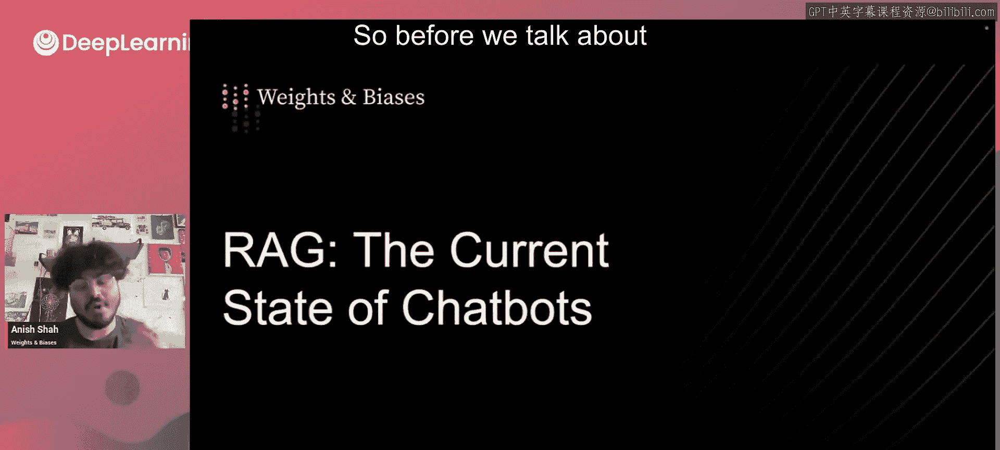

So that breaks down to what does that context look like so there are a lot of fancy techniques out there using interesting embedding models and very high performanceform databases like vector databases to pretty much solve this ability of finding the right context to provide to your chat GPT like application so that it actually solves your question or your user's question and a lot of times what this context looks like is very dynamic based on the nature of what the user asks。

😡。

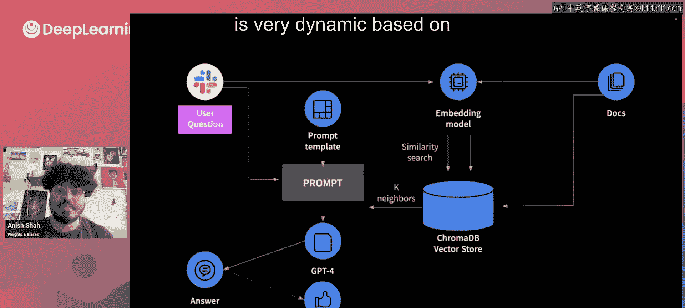

And so because of the dynamic nature of how RA pipelines work and also the non deterministic nature of large language models。

 user feedback is essential in all applications that you make and so。😡。

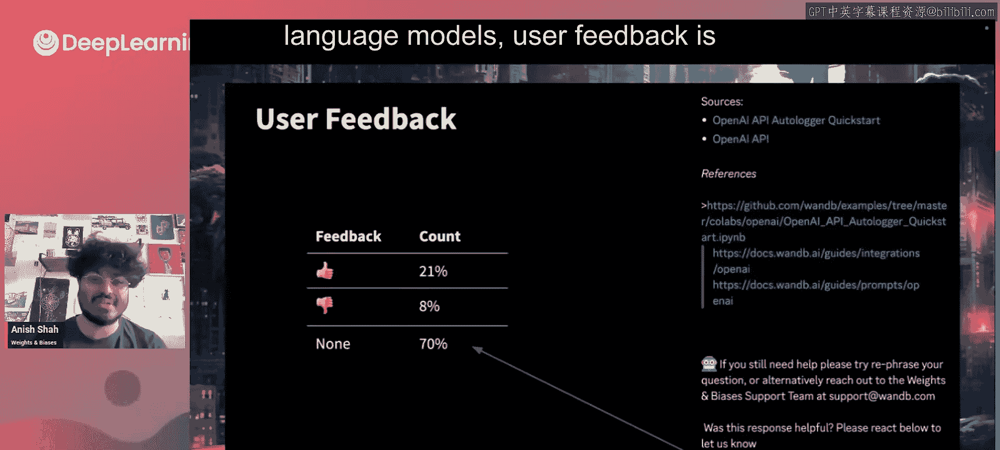

What you may do from an evaluation perspective is take all the ups。

 votes and down votes from your users and all the questions asked to your application and condense it into a smaller evaluation set。

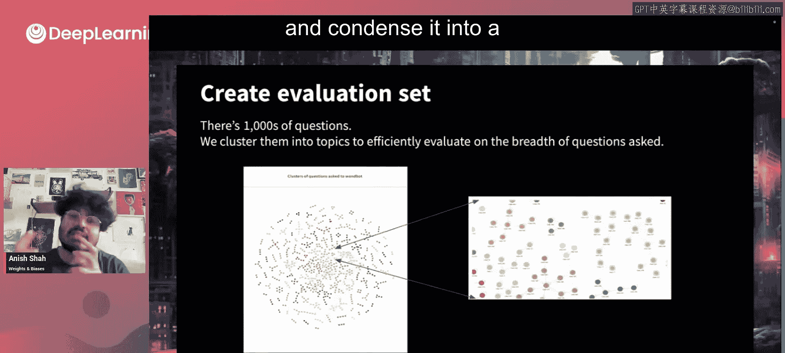

And then you may want to take certain questions from this evaluation set and use that to actually score how well your model is doing。

😡，Just to let you know this is a full recap of just drag quickly we'll walk in through some dashboards and actually talk about agents and how all of these workflows you see now also apply to agents but in this case we condense our evaluation set into something that's a little bit more workable and then we run evaluation so two kinds of popular evaluation frameworks we hear about is LLM as a judge which we use LLMs to score other LLMs for metrics such as faithfulness a the accuracy of the answer given a document and relevancy how useful was a document in consideration for an answer that's very useful from a large language model to kind of perform。

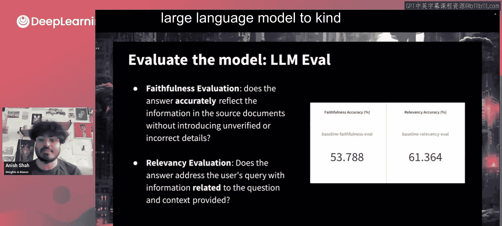

Then you also have the most necessary component， which is the human in the loop。

 have an expert actually evaluate whether or not the answer is correct and ensure that things such as hallucinations and other information such as hyperlinks actually work。

😡。

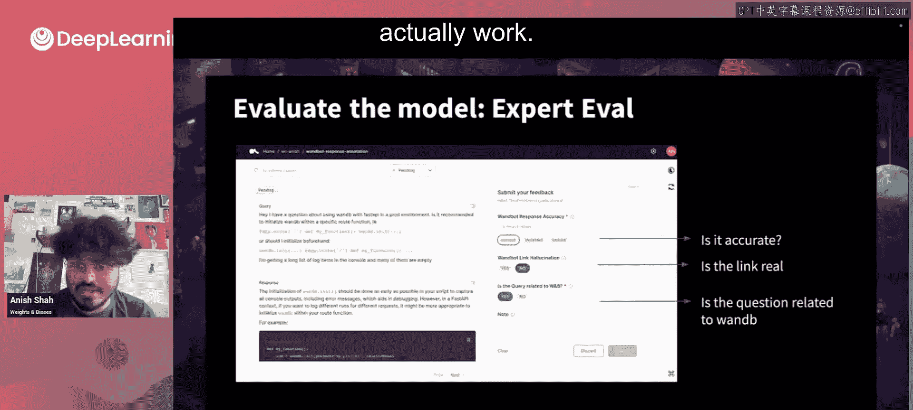

And we do this to find problems such as gaps in the knowledge base our own of our large language model。

 or also hallucinations， seeing if the large language model。

 even if provided the right context makes up certain answers or hyperlinks。😡。

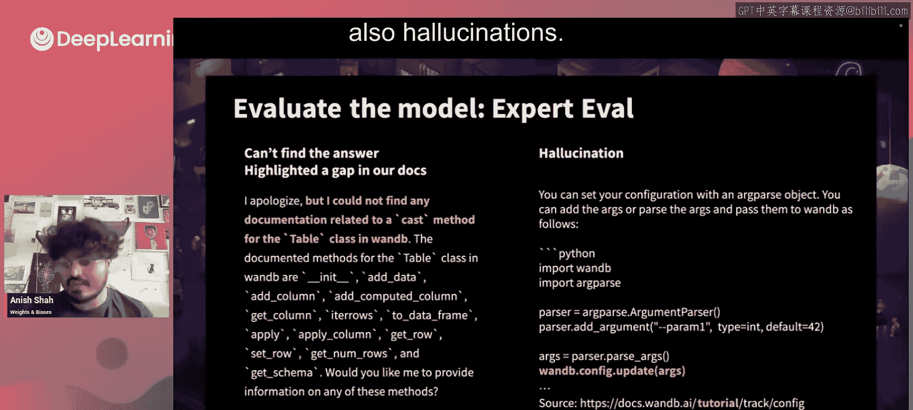

So in the case of traditional evaluation， we have an understanding of what our users are using with our application。

 so when I say traditional evaluation and I think traditional machine learning。

 I'm thinking as related to hey， classify this image as a cat or dog for instance。

 you know generally the target distribution as it relates to the data you use to train your model。

 but in the case of large language models， we don't know any of that information。

 we don't have access to that full corpus of pretraining data spanning the internet wide terabytes that it takes。

 and we also don't know exactly how our users will use our chatbots even in the case of a famous car company recently。

 we see that how users interacted with their chatbot very widely based on just what the users were looking to do with the bot。

 be it malicious or actually，Related to queries for the company。

So because we don't have access to our training distribution in our product。

 our users' distribution until we actually release our product。

 we have to approach evaluation from a different framework。😡。

So one thing that's really popular is ensuring that our large language model always performs well on a pre standardard case of benchmarks。

 these benchmarks are typically grouped together nowadays in tools such as the LM evaluation harness or even open AIs evaluations。

😡。

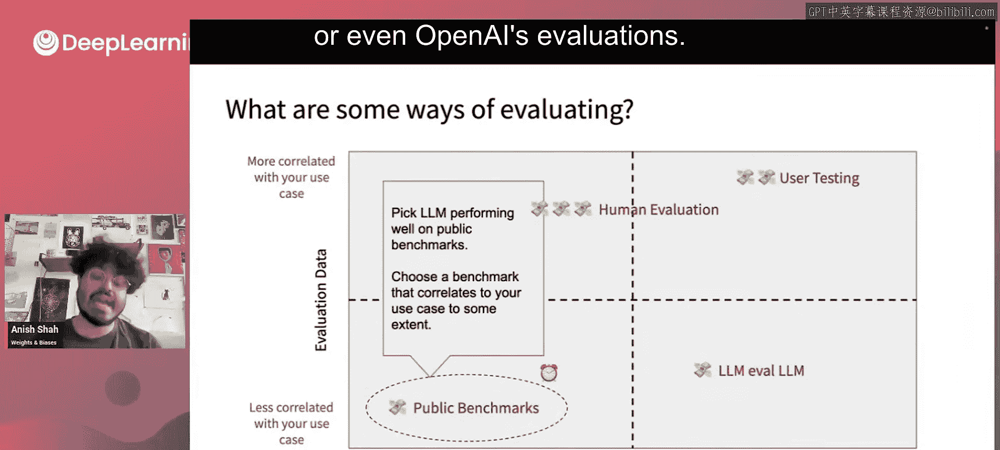

So this' is an example of some tasks that you can see from the LLM evaluation harness。😊。

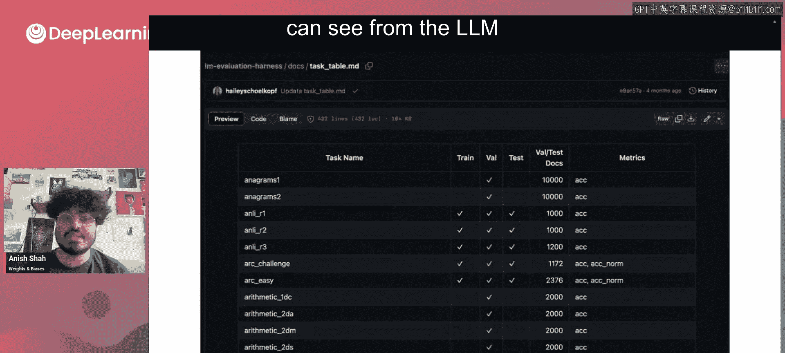

Then the next gold standard is to hire people， have real humans and experts who know both your user distribution and your training data。

 sit down and understand whether or not the large language model is answering questions appropriately given contexts。

😡，Then the most useful one， but the hardest to gather is user testing。

 so at this point you either partner closely with a customer or you have to go and release your application of the world and use systems like I showed earlier to condense down and isolate and essentially mind the user behavior to ensure that you're actually gathering the breath the breadth and extremes of how the users are breaking your chatbot in production。

😡，And then you also have the large language models evaluating other large language models。

 as I mentioned with the faithfulness accuracy earlier。And the relevancy accuracy。So in general。

 this can be broken down into kind of three systems that we can do currently as an individual user trying to evaluate our model。

 The first is eyeballing quite directly in which you start with a few examples and then you iterate on them and。

Directly understand from the inputs and outputs that large language model or your application。

 which uses a couple steps of large language models and sees if the answer actually the answer responded by our large language model relates to the question asked by the user So example of this can be seen here we can see this is a weights and biases traced diagram where we can see that there are a couple steps that actually encompass how we're solving this text to SQL problem。

 we can see that there's LM chain， a transformation chain and this LM chain utilizes open AI if we actually were to drill in here。

We can see that we can see the full。User， the full prompt that was passed over to our LLM。

And then this response by that by that large language model。

 we also have access to all the metadata associated with this model。

 and this experiment was run months ago。 for instance， So at any point。

 we were want to rerun the similar collection of test questions against our large language model。

 we'd able to compare it from changes from three months ago to now。

 something I find really important as large language model updates happen been very frequently behind closed doors from these closed model providers。

😡，Then we have supervisionbased approaches where what we might want to do is actually in the case of where there's a definitive answer relating to our large language model that may be something like a multiple choice answer or directly looking for a specific key phrase or word。

 something as as simple as a table similar to Excel is useful here as we're able to aggregate the predictions and understand。

 hey， this is where all the mistakes occurred from our prediction column and isolate the rows where the problem occurred or isolate where all the correct answers occurred and see where the actual problem li in the thought process of our model。

😡，So this can be seen here。Where we may want to drill down and understand from all of the expressions of our model。

 here's the expression that was released。 And here's all the different metadata associated with this response and using standard table manipulations。

 such as where does the true result。Not equal。The prediction result。For instance。

This is really useful in that case。 Now we can see all the mistakes that occurred and isolate what types of questions。

 for instance， does my large language model typically fail at。

Then the last one is LM evaluating other LMs。 So this is the case where you may want to try using an LLM to explicitly score the output of our large language models。

 And this is useful in the case of automation。 So like in this case。

 I may want to test out three different prompts。😊，And I want to automate the scoring aspect of this。

 so instead of having a direct score， I might have an LM associated score here and be able to test that against various prompt templates。

😡，And this can be some seen something similar here where we test out different embedding models against different large language models against templates to see the final F1 score overlap。

And so all these evaluations occur in code itself with our weights and biases loggers and our weights and biases interface。

 we make it really easy for you to do this type of hyperparameter search or saving of these metrics and details directly to a dashboard weights and biases is a centralized system of records for information and I'll talk a little bit more about that soon。

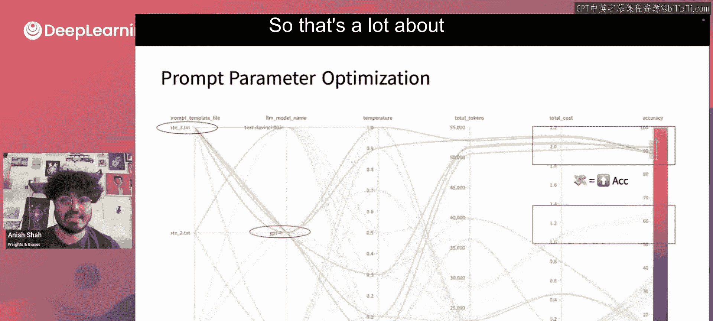

So that's a lot about how RaG works in evaluating RaG。

 all of which are really relevant for agents also a lot of these workflows for evaluation。

 for instance， all are mimicked with an agent workflows。

 but this is us improving processes around using our LLM。

 We actually want to improve our LLM in this case。😡。

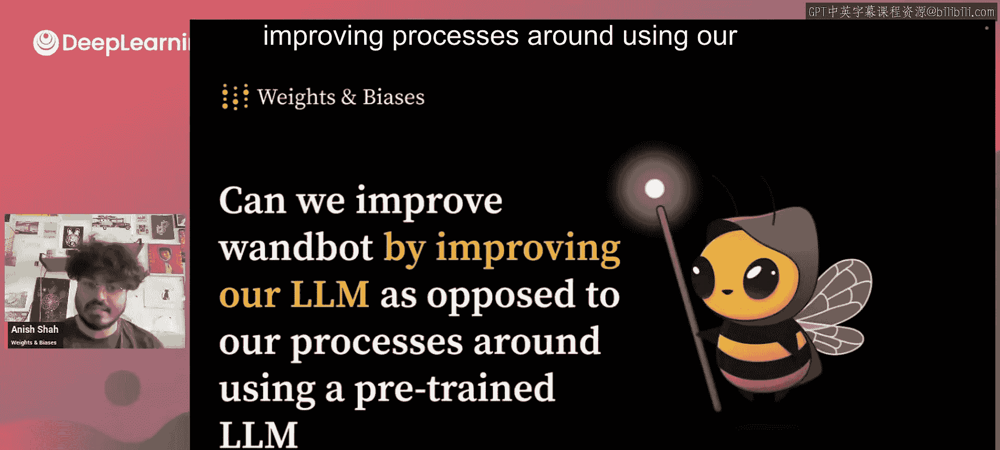

So we want to do is actually fine tune our large language models。

 and now'll be showing a condensed form of what we teach in of our fine tuning large language models class。

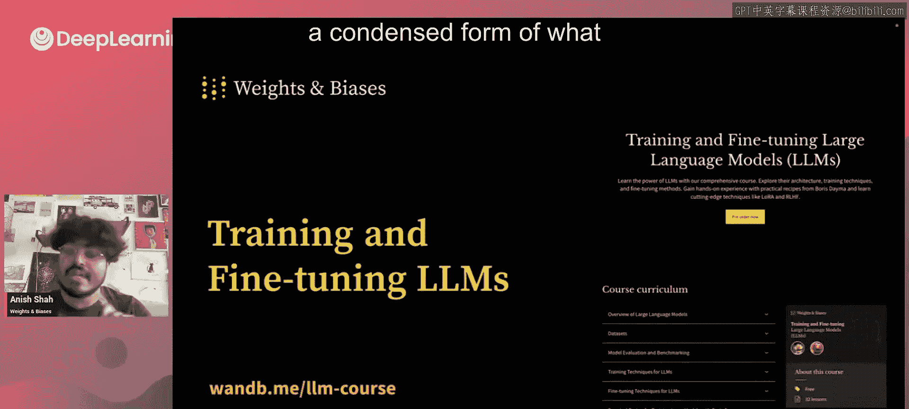

But in essence， one reason we may want to fine-t large language models outside of specificity for our data where we may be missing some knowledge for our large language model or also for it to be form fittedted for a task we care about ensuring that our large language model will always answer math questions properly after we teach it what it's been mistakeakn it on what we actually care about here is we're also reducing tokens we live in a token economy still a little bit where every single word and every single phrase we pass to a large language model。

 it crews a cost and so being able to reduce the complexity of our prompts by teaching this behavior directly to our large language model reduces the amount of words we need to use and also reduces the associated cost with those words。

😡，So one recap I quickly want to do is there's this fancy phrase called reinforcement learning human feedback。

 This reinforcement learning human feedback process is a fine tuning process we did on large language models to ensure it speaks like a human at a baseline large language models will simply finish the prompt associated with it with reinforcement learning human feedback。

 We have taught the large language model to speak and respond as a human would and also to be make considerations of what the input text it was given is like All this done by feeding it additional data in the training process of these large language models where these large language models to remind you have been taught generally across internet scale data。

So this process of fine tuning different from RLHF。

 the one that we will be using more so is parameter efficient fine tuning training a large language model is not a cheap or efficient feet it requires a large volume of GPUs scattered across clusters and acquire a large volume of data and time and unfortunately I am not Google like company myself I cannot afford nor do I have access to those assets as easily but where I do have access to is data and behavior of the users I evaluated on earlier from my ragbased application and use for evaluation generally to understand where the mistakes for my large language models are coming from I have access to that data and that data is very powerful for us not only because of the evaluation work which we saw the value earlier but in this ability to take that same data。

And use it to increase the capability of these large language models。

 we're at a stage where evaluation and user feedback data can be directly used to improve our large language models。

😡，And we use Laura for that。 I'm not going to sit here and explain the beauty of the mathematics of Laura or linear algebra。

 but what I will say is Laura is really useful for us because what it does is it allows us to isolate specific components of our large language model to reduce the volume of data。

 time and GPU resources needed to train our model。😡。

This is done because we have realized from lots of different research that you can increase the behavior of these large language models by only selecting very useful layers within our large language model and it only iteratively improving those underlying numbers that correspond to its thought process and Laura is useful here because it treats it as a very nice math problem where instead of having us directly update the large language model itself。

 which is inefficient for our use case instead what it says is it says we can treat these updates that we want to apply to our model as a separate collection of mathematical matrices and because we're able to separate out the two problems。

 these separate mathematical matrices which we can apply onto the original large language model itself。

😡，They themselves are significantly smaller than the model。

 and they're significantly easier to calculate over And so that is simply to say you can take this multigabytes。

 large language model and result in a fine-tuned adapter as we call them that is only a few megabytes large And so for us that's really useful because this small megabyte size file can be applied onto our large language model and this means that we can have not only one of these adapters that work with this large language model we can have a collection of them we can make as many adapters across all our data sources and all of our tasks that all work with something like a Lama2based model but all individually live separately from each other and only during when we need to run our Lama2 model with a specific behavior do we need to apply this update this。

😡，tuning update that we did in this Laura process。

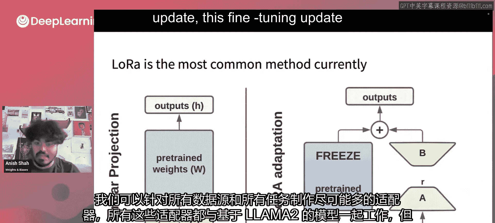

There are a lot of interesting parameters to adjust within Laura。

 the most useful are specifically are， which is the inherent rank of the underlying matrices that you're creating。

 that's just to say how you adjust the rank increases the complexity of the training。

 but also increases the amount the specificity the update of the training process itself。

 so affect how well things are remembered during our fine tuning over our data of mistakes already generated by a large language model earlier。

😡，So I'll leave these parameters up to investigate later these spy deckck will be shared。

 but there is certain heuristics shared by folks at Pytorch Lightning that I would recommend to later that I will hopefully be able to share in the YouTube link and so Laura is not the only technique that exists one very intuitive one is prompt tuning itself where we instead we use our large language model to generate the best prompt。

 for instance， that will solve a task and we do that in a very machine learning specific way where we actually do the full machine learning back propagation process but that's just to say there's a lot of interesting ways to efficiently keep the current state of the large language model frozen and proper and only extract out the full knowledge needed to make the large language model better for our use case and better for the mistakes that it made earlier that we evaluated on。

😊。

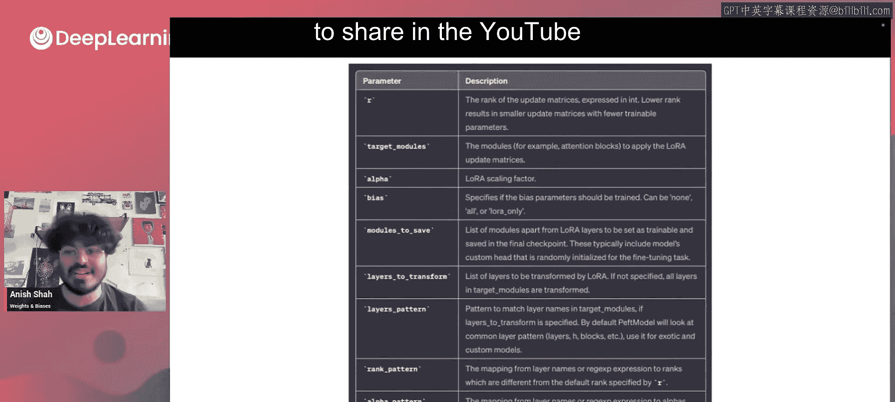

Just to keep the evaluation always top of mind for us。

Laura works really well is what this chart effectively shows。And to formulate our data for Laura。

 it's very similar to instruction tuning data sets that you see so dependent on the specific model you're using。

 what you may want to do is understand how your how you actually want to formulate your data so that's actually able to be properly prompted in a way that makes sense for your users so an example of one in this case is if you want to categorize something as safe or unsafe you can see that this task type policy and and yeah this taskup and policy are consistent across the prompt and response classification so when it was safe and unsafe what differs is this conversation and output format。

So for instance， in the case of low rank adaptationation。

 this piece can be held effectively in constant for your modeling。😡。

Because each of your specific data points that you're providing your large language model can be prepened essentially with whatever predescribed nature you want your large language model to recognize before I realizes。

 oh， I have been updated for this task and these specific collection of tokens even primed me better to solve that task I was fine tuned for。

😡，Weights of biases is a really helpful platform for centriflizing all this information。

 a lot of popular teams use us for training and fine tuning specifically and you can see that we are able to consolidate soon but you'll see how we consolidate all the different experiments be it fine tuning GPT 3。

5， which we'll be doing later， or if you're training something as complicated as a large language model directly using a framework like Pytorrch lightning。

But getting started is really easy with weights and biases actually it takes a few lines of code to actually store all the metrics。

 prompts or other information you want to our platform。

 or even less if you use one of our integrations like in the case of finetning Open AI。

 we have integration that syncs all the training data to a dashboard alongside references to the training data you used and any output model metadata so you can easily load up your finetune model by referencing our weights and biases dashboards。

😊。

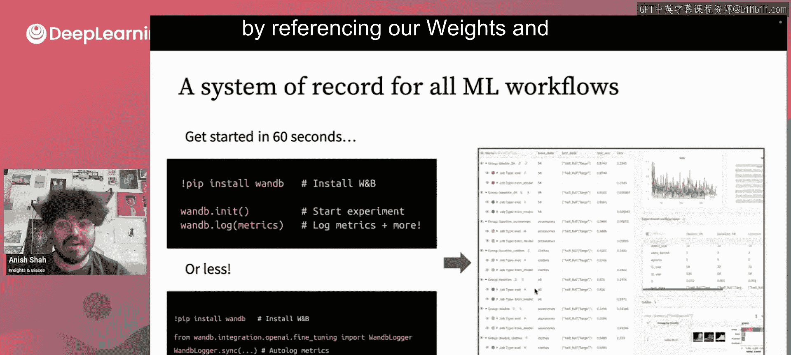

I'll flash this on the screen for a quick second just to say we are building a different collection of a large volume of tools around the MLO space and then the LMO space directly。

😊，But now let's get to agents， that was a fun talk about ragG。

 that was a fun talk about fine tuning and seeing how those two components relate together。

 how we can use the mistakes from a traditional ragG pipeline to increase the capability of our large language model generally。

But let's see how agents come into the fold and make this process of being able to dynamically reason over how we want to solve problems a lot better。

I'll actually be adapting slides from last week's talk from the folks at Lama indexex and Tru Area Me true E who talk about how to build evaluate iterate on LLM agents。

 I found their slides very useful so I will be showing them quite briefly here right now。😊。

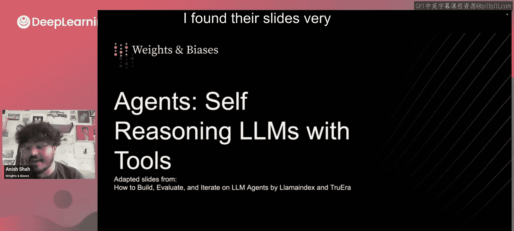

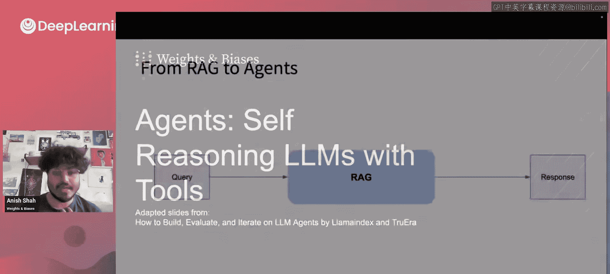

So in general， what we did right now is we've prebuilt the behavior of how our users will interact with our large language model。

 that's via RaG， we preri a template， we predisp all of our databases。

 so RaG will always have a consistent behavior。😡，But the problem is that we have prescripted all of that behavior in the case where our applications that from our users become varied across tasks。

 use cases and behavior， this rag like behavior and this prescripted behavior becomes easier to break。

The prompt that we may have used for one level of rag may not be appropriate for every user interaction。

😡，So what we had instead to use is we use agents effectively as a router for our query to be able to dynamically understand the core essence of the query by our user and then decide which appropriate action to take。

 so in this case an agent may decide our RAG pipeline is the best method to solve this user query that's coming in。

😡，So there are a couple forms of agents that occur So the one that's very useful is specialized data agents where it's similar to retrieval。

 except it has access to real time information So in the case of agents similar to humans we evolved once we understood actually how to use tools and fire appropriately so tool usage is very useful for agents as tools in our case can be any function。

😊，And it can be actually any API call also， so for instance。

 I can have my large language model understand that it's missing a certain piece of information and understand similar to us that we need to Google it。

😡，And then it goes and Googles the first three appropriate responses from Google So maybe to some of us humans also。

 instead of actually clicking on the page， it may just read the little blurb that shows up in the headline and use that information to actually formulate a response agents can vary across not just data that can be access to multiple tools itself。

 so maybe have access to Google and your calendar and ability to book flights to have access to the ability to take actions in a very useful way but in a very wide ranging way。

 so being able to。😊，Not only ingest information and return responses。

 but ingest information and perform actions that help with our other workflows。

 be it actually booking that flight for us once given a query about what the cheapest flight is and ensuring it has access to book on our account。

 for instance。😡，So data agents like I mentioned earlier。

 may want to read in information from a lot of different sources。

 maybe even iteratively where may want to analyze a file over a couple different steps。

 but then take its output and release it to the world so in this case we may read recent emails。

 retrieve context that relate to the emails and the question asked by the user。

 analyze appropriate files， be it one or five and keep continue to analyze these files until a stop criteria is met。

😡，Formulate a response and send that response back to my slacklack channel， for instance。

This is the full breadth and power of agents， but with each of these different interactions done by our agent。

 there is a point where a failure can occur， it can fail at reading the latest emails。

 it can fail at retrieving context， it can fail at the iterative process of analyzing a file。

 and it can also fail at being able to appropriately send that slacklack message for us。

So a more generalized form of what I showed earlier can be seen here where you have an agent。

You have an agent that's able to given a message， decide if it wants to use a ragg pipeline。

 book a ticket or send a slack message。But also in this other external piece。

 which is useful is the fact it has access to memory。

 so understands in its full sequence of agent decisions， it has a scratch pad to look like to say。

 okay， at this point， I've already read the emails。

 I've already retrieved the context now what's next is what the agent can asks itself as it continuously interacts with the tools and its own memory similar to us humans would。

And so to go back to the Rag pipeline showed earlier， Rag in itself is just one tool。

 It is one tool where we prescripted behavior about how a certain type of user question should be answered and how the answer relates to a database。

 So in this specific example， we may have a a database that relates to。Um。

 some numbers were lean to lift。Maybe some numbers relating to Uber？But instead of having us say。

 hey， always read these two databases and provide that to my large language model as a response。

 what we instead want to happen is we want our agent to understand that our question may be something along the lines of compare liftft financials to Uber financials and it will make the decision to select both of these databases to。

To use as data sources and then that pass that over to the rest of our RAg pipeline， for instance。

 so it is able to dynamically choose what data is appropriate and also dynamically choose which specific workflow this data should pass to to get to the right answer。

😡，So。To to res where the failure points could occur though， at any point during a tool usage。

 a selecting the right database or booking that flight， it could choose the wrong tool。 It could say。

 oh， instead of booking a flight， I may want to Google more at ends the infinite loop of Googling prices over and over instead of having the full action of。

Yeah， a full action of doing what we actually wanted to do， which is book that flight for us。

 So that is the case of rogue paths not actually choosing the right database or choosing the right booking tool。

We also made the problem of infinite loops where it's not it may con say to itself that it cannot find an answer。

 so continuously Googles over and over， not realizing that in its scratch pad of memory。

 there was a specific answer from Google that was returned that actually solved the answer that we wanted It was too busy looking at its full memory and all of the different attempts it had and realizing that。

😡，It got that the right answer was lost in all of this process that the agent was doing。

And we also have just failed API calls， maybe somewhere along lines。

 a service was turned off and the agent does not realize that and will continuously beating a dead service over and over again with API requests rerunning into this rogue path infinite loop problem that we mentioned earlier。

😡，And then lastly， the most important one is agents might just make stuff up given the full context and all of the problems mentioned earlier。

 it may say， okay， well， I can't access the tools I need。

 I can't appropriately pull data from the databases and I don't know where to put it to I'm just going to me being the LLM that I am just make up an answer that seems correct。

 And so that's where we see a lot of failures and faults occur。

 not only in the actually ability by the large language model to choose the right tools and components internally。

 but also returning a response that's appropriate giving that user question。

 So that's where all the evaluation methods I mentioned earlier during the ragg piece all still come into play。

 you still need to check for relevancy and relevancy and factualness from your large language model that's running this agent behind the scenes。

 but you also need to ensure that you have the appropriate。Tasks that you're evaluating for。

Like in the case of the LLM evaluation harness， you want to ensure that。

Every time you make improvements to an agent or you move from RAG to agent that the overall accuracy for the task you're solving for also doesn't go down agents give you flexibility at the cost of being inconsistent in the current state of things and that's where the traditional evaluation pipelines that you set in place earlier to get this initial user feedback from RAG pipelines is essential here。

😡，啊。So yeah， that's just to say that everything you're doing earlier with RaG still is in play here。

 the only real piece that's different is that you may need specific tests to ensure that the appropriate tools are being used。

😡，And so if there are some best practices in how to actually approach this。

 you may want to write useful prompts， make tolerant prompts to ensure that if there's any failures and tools that occur。

 you properly account for that， and you also have different prompt engineering techniques that you can do here。

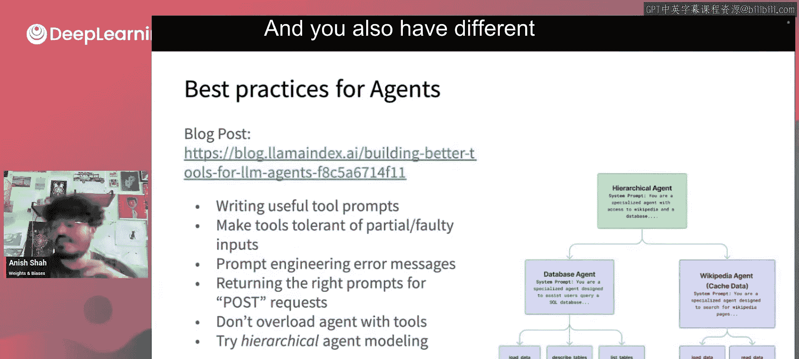

But in the case of what I showed you earlier， it actually turns out that LMs are extremely complicated。

 you can have sorry LM agent applications can become extremely complicated once taken to production so like in the case where you have autogene you have agents that autogenerate code for you there are a lot of moving pieces that are not just as simple as hey hit Google and provide missing context it becomes a lot more complicated where you have multiple databases and honestly multiple agent agents that may communicate with each other。

That's just to say that building standard pipelines in RAG first and then having basic agent interactions is essential to get to the point where you can build multi agent。

 multi database complicated agent use cases。😡。

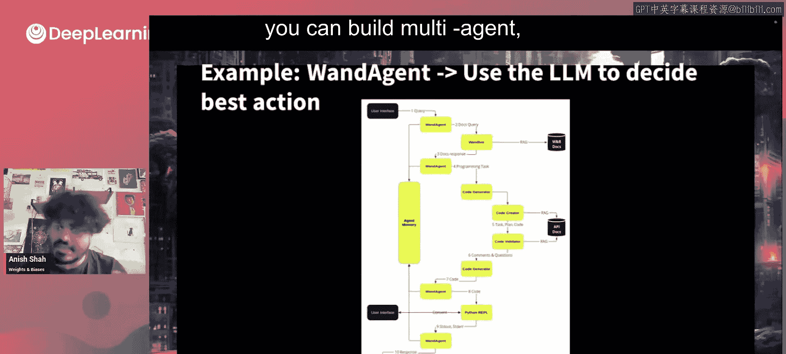

And that's the kind of direction we're seeing from agents right now。

 we can see that as LLMs and YuCs evolve people are building kind of these very fascinating multi-agent environments where we are simulating hospitals or we're simulating whole towns where we have agents all communicate with each other。

 but have intrinsic motivation that we set via prompts and these tools。

That's just to say that for those familiar with reinforcement learning。

 this is very similar to how I would consider a large language model agents。

 I give it a reinforcement learning agent lens that may be a little scary for some of you to hear the phrase reinforcement learning and I assure you it's not all just Boston dynamicy robots。

😡，嗯。It's a lot more straightforward and simple than that。

What we want from our reinforcement from any agent， as we call it。

 is the ability to interact with the world and make intrinsic thought processes that will help us decide plans to execute given what's available to me in the world that I know of。

That's simply to say that for a robot， it may be known that it has a camera。

 so it knows directly the vision of the world around it， and so when it's told to pick up an object。

 it knows internally I need to rotate certain motors and move certain joints of mine to be able to actually adjusts myself to grab the odd object knowing that I am I as the robot and compose a certain way。

😡，Now， if I were to kind of tweak a certain words， a few words。

 that same framework applies for large language models also。 So with large language models， I。

 as a large language model may know I have access to certain API tools and databases。

 I have internal prompts I may be able to try out that allow me to solve a certain task。

 and then this task is actually provided via a prompt from the external world。 A K， the user。 So I。

 as a large language model can make plans against the user' prompt。😡。

To be able to solve that user question with the internal thought processes I have and the internal knowledge of the tools and databases I have available to me。

 So reinforcement learning and large language model agents both actually have very similar workflows。

 And with that in mind。We can actually use that as a basis to build out this kind of framework on how to approach building extremely powerful agents。

 and these are the same frameworks that were used by people building these simulated towns。

 for instance。😡，So one very popular method is called react， so reasoning and then acting。Um。

 so in this case， instead of directly answering a question， for instance。

 what we want our our large language model to do is actually take a second to consider what the user query is and how we should approach solving a question similar to how we don't just jump into doing things as humans。

😡，So what you do is you create this concept called a reasoning trace。

 aka the decomposition of what actions I would want to take given an observation， aK。

 the prompt by a user， that's a lot to say that if we want to show just a practical example。😡。

Over here with just reasoning only you can see that answer for a question we may actually have just directly the answer iPod。

 but then in the underlying thought processes it goes let's think step by step so as also a little tie in to be able to get your large language models to do thought processes like thought answer there are different prompt engineering techniques such as chain of thought for instance。

 so in this case where use chain of thought only we can see that it refers to the Apple remote and the Apple TV to try to go and give an answer so。

😡，Sorry。Yes。So in the case of a large language model only it gave the wrong answer of iPod。

 When we gave only chain of thoughts， it gave the wrong answer of i， iPod iPod touch。But now with Re。

 what we can do is we actually broke our thought process into set of thought and answer into thought。

 action and observation。 So in this case， because our agent is aware that has access to tools and databases。

 it knows that it can go and search for the Apple remote。😡，It can read the the headline from Google。

 it can use the information from the headline of Google to then search。😡。

Iteratively over and over until it reaches a proper resolution where it realizes front row is controlled by an Apple remote or the keyboard function keys。

 so the keyboard function keys， so the keyboard itself is the final result of what the other device can be used to control a program control the Apple remote program。

😡，And so it took a couple steps of knowledge to actually resolve to that point where the chain of thought would simply only use the internal knowledge of the model to answer a question where in this case。

 we allow the thought process of our model， recognize that it can use the external world to solve and answer。

😡，And so we can take all of this thought process and actually make our large language model。

 do it not only better， but also make it the default behavior of our large language model。

 and the way to do this is using the same exact fine tuning techniques is earlier。

 except instead of having our user the feedback from our users earlier as our only our fine tuning data what we can do is actually transform our users' data into something that is similar to this react style format。

😡，And so。Let's give a quick run through an example of this。

So this here is an example where we want to finet a GT3。

5 react agent on better chain of thought so what we're going to do is we're going to actually have our large language model answer a few questions using GT4 and we will take the outputs of that GPT4 thought process and use it to finetune GT3。

5 and that will improve GPT3。5s behavior to not necessarily be the same quality as GPT4。

 but to still have the same degree of thoughtfulness as GPT4 as we want to improve not necessarily the behavior of our large language model in this case。

 but we want our model to be better at thinking which is the hopefully a lot of teachers also we're teaching you as you are growing up。

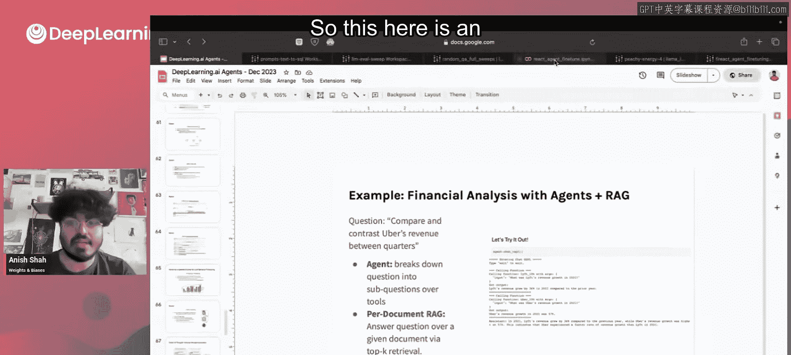

So from a code perspective， weights biases is a very minimal component。

 where you're going to see here is a lot of code by Lama index。

 a very popular framework that I quite like。So。To get using weights and biases。

 all you need to do is create this weights and biases global handler。

 or there's other different forms using our weights and biases callback handler， but in this case。

 after setting these two lines of code，😡，Every single resultant trace that's generated and also the information from Lama index are stored to a wait into the bias's dashboard。

 The same dashboard will also contain the metrics and details of our fine tuning process as we do it with our open with open AI。

So what we do in our case is we set up GBbT 3。4 and 3。5。

We set up some tools where these are the three different databases of our use case。

 where our use case in this problem is we want to improve not only the thought process of our GPT3。

5 agent but improve our thought process as it relates to the financial analysis of the Uber quarterly financial data。

 so these are the three different three different databases month by month of the three quarters of the Uber data from 2022。

 and we want to ensure that our 3。5 agent is able to answer questions about these three different databases in a thoughtful way and in a way that it's able to always efficiently choose the proper database to solve a certain user query。

So what we may want to do is after loading our LLM up GPT 3。5 turbo。

 we may want to try out just a basic agent to see how the behavior is。

Quickly answering the question for you， it looks like it gives a pretty good answer。

 but the problem is actually doesn't look at the right database as it relates to the question in this case because it doesn't appropriately look for the highest revenue growth and as a result returns the wrong answer for us it just kind of gives general statistics about a database it's selected。

 not the one with the highest revenue growth。So instead what we might want to do is we want to synthetically generate data for fine tuning ourselves so what we do is we have this generic query where we say you are a teacher and you have to create questions which relate to the different databases we have available and that makes sense for the data that lives in it。

😡，We go and we synthetically generate 20 questions based on underlying databases。

And then we actually follow up one level deeper and we actually say， hey。

 you are a financial assistant and given these interesting questions about the Uber financials。

 I actually want you to jump in and add in a variety of different questions so we can have a variety of similar styled questions across each of our databases but so that when we fine tune our data。

 we aren't just having one data points for every important topic。

 we have a couple data points for each of these different important topics。

So with this process in place， we're able to generate a bunch of different questions。

 So two for each of the different varieties， so a total of 40 different questions。Oh， sorry。

 80 different questions。 I apologize。呃，yes。So we generate four for each of the different the different original questions that we had earlier。

 So now we have 80 good questions to ask G4， which will we will ask G4 So we'll be using G4 with as our underlying agent LM to thoughtfully answer 80 synthetically generated questions about the database。

 which we care about where each of these questions are financial questions that relate directly to each of these databases。

 And so weve say once we save all of these different questions， we can actually go ahead and。😊。

Run our G agent。 Oh， sorry， Run our GT agent against each of them。

Where we specifically have told our model to provide to provide the react thought process that I showed earlier。

 so not only does it just directly answer the question。

 it will thoughtfully think about what the question is asking， think about what action needs to take。

 apply that action and then iteratively keep continuing the process until it reaches some certain stop criteria。

 which is that finish command， we have GBT4 answer all of these questions which will simulate the user behavior that we would instead want。

😡，And we save it quite easily using the fine tuning handler that Lama indexex provides。😡。

So once we have our fine tuning data of really well thought out chain of thought processes。

 sorry react thought processes across all of these different questions as are really specifically through our data。

 which is financials about Uber， we can take that data， ensure all the data is proper。

 So this is a copy and paste script directly from the Open AI website to ensure that your data is not malformed for fine tuning。

We load up。We load up the client from OpenI。And we actually just run trading， so。

We load our model in， tell it how long we may want to train it for。

 we point it to that data we saved earlier。

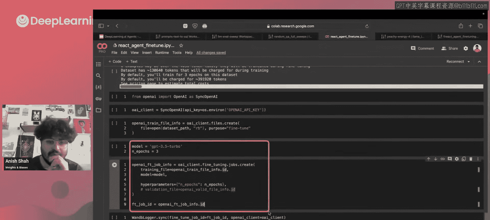

And then as the model trains， we can run our single line of code called the tobe w tobe logger。

 which will sync all of our metrics of once the open AI fine tuning is finished。

 where we'll have now a centralized system of record where not only do we have access to all the metadata information relating to our fine tuning process。

 we have access to the training metrics directly itself。

 the underlying agent thought processes as we showed similar to what we showed earlier in the traces。

 we have understanding of the utilization of the network and disk as we use our agent applications。😡。

We can access also the model directly where we have access to not only the metadata but we can actually load in the model JSON itself and use our finet model moving forward for a training so if I want to easily share this fine tune model with a colleague and alongside the details and the agent traces itself I simply need to share with them this weights and biases link they have access to all that different information。

😡。

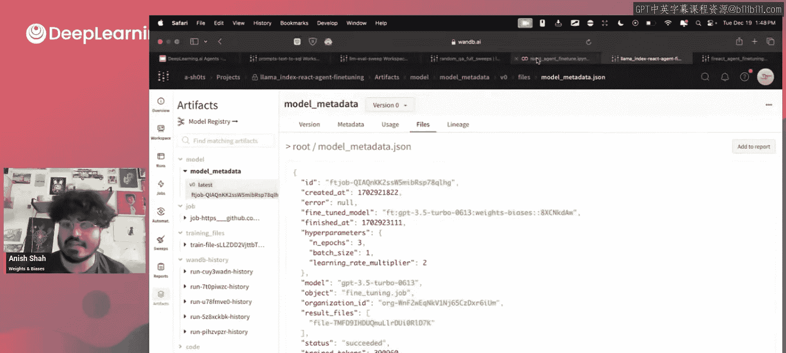

So， I can。Take that fine tuned URL and simply load that back in to our open AI instance and use our react agent moving forward。

 Sorry， Not this one。嗯。Yes， yes。 that is one。 We're now moving forward， our fine tuned agent。😊。

Is now available to us。 And we can use this to now understand。

to use a cheaper and more effective form G3。5 turbo to get to get extremely similar behavior as a G4 level quality agent if it were if it were given our specific data。

 so it does not reach the same quality as G4 but it is works extremely effectively。

 I don't have evaluation in this specific notebook and I will be sharing this notebook afterwards。

 but yes， we would use the similar LM evaluation harness to compare both of these behaviors。😡。

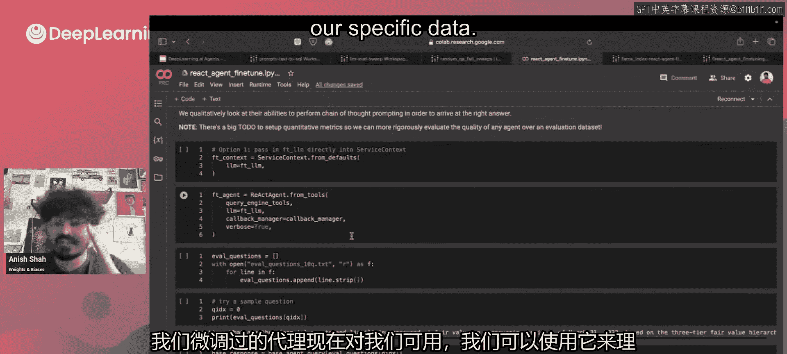

So。Now that we have a fine tune agent with better chain of thoughts。

We're done right now we've solved the problem of being able to improve the processes of Lms and we also improve agents。

 So now we're at AGI， right people。😡，No， clearly that's like not the case instead what we can see is oh。

 as an aside for evaluating agents， one additional layer of agent evaluation is the concept of eO ratings。

So with elo ratings， what you want to what this does is effectively tells you。

Similar in like the concept of game theory， it tells you how well you rank against others in a similar bracket。

So that is simply to say that the best way to actually see how well a chatbot does。

 specifically an agent chatbot is to actually compare it against other agent chatbots because there is no good effective way to understand how well a chatbot does with its thought process in a good qualitative way other than comparing it to other agents who we consider to have good underlying thought process behavior。

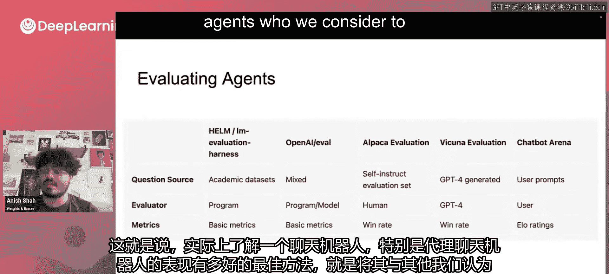

So to quickly get through this so we can answer some questions， I see that' that they're popping up。

 there are other techniques imp prompting such as reflection。

 which is this concept where not only you have this reaction where you you see an input by a user。

 you create an action trace and then you create observation。

 what you can said do is given you certain outputs you actually run evaluation on yourself during the thought process of an agent。

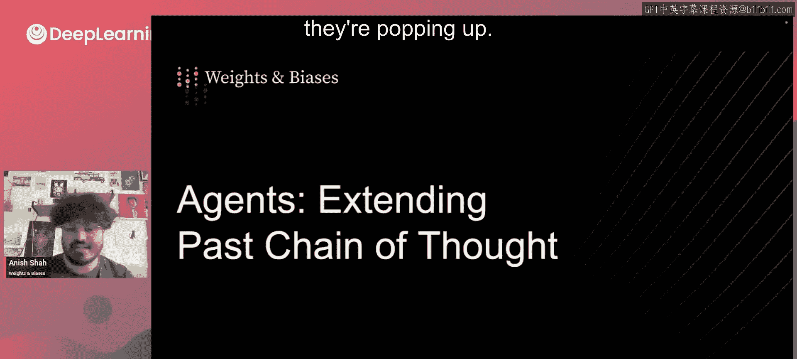

Take that evaluation and then use that as a piece internally to say， okay， I failed here in runtime。

 for instance， where I reach an error， read that error。

 look at what I previously generated and generate more thought processes in our react format。

 So that's the concept of reflection， which kind of mimics this long-ter behavior。😡。

And then you also have tree of thought， which is a deeper way of thinking where instead of directly answering a user question by naively thinking our thought our first thought is the best thought to do instead what we might want to do is break our thought process into a couple different plans and then internally we consider each of the different plans and vote on which one we think is actually the best plan to take from a thought process perspective and then take that appropriate set of actions。

 so in this case it's like considering for a very open-ended question which approach makes the most sense for you knowing that all of them to some degree make the most sense but one making more sense than others I really love how agents kind of have this meta thinkinging perspective to all of it that are all grounded in very promptable formats and natural language formats。

So now we're seeing because of all these changes and how we're thinking of how to prompt agents to work better。

 we currently live in this what I realize now it looks like a complicated diagram but really isn't we live in this world where before we have traditional machine learning now we have prompt engineering and in the future now what we'll do is we'll have parameter learning where we have agents all good at various different things。

And each of these agents will know when what to do for certain input and also we'll able to select our best type of agent also dynamically。

 where we have agents selecting other best agents so we remove the human in the loop for a lot of these processes。

😡，And so this kind of combination of understanding all the different techniques coming for agents and all the techniques we have for fine tuning have a natural crossover。

 so they're a very interesting research topics like Fire Act。

 which kind of say let's just take all of these prompt engineering techniques put it in a standard format and use that for fine tuning。

 which I personally think is a very exciting trajectory for the future of fine tuning large language models and in the case of open source we can see that this is very doable right now with this is an example of that same exact project where we can use all the standard techniques I showed you earlier from weights and biases and have them centralized in one system of record where you can compare all the different types of experiments across my GPT3。

5 experiments oh my open source experiments still using the same evaluation frameworks and the same tooling that I'm extremely comfortable with myself。

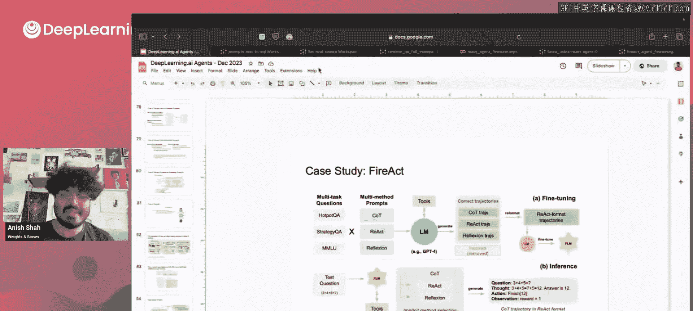

So I know that was a lot to see and learn about， but it was extremely exciting to talk about this stuff and I'm going to open it up now to questions。

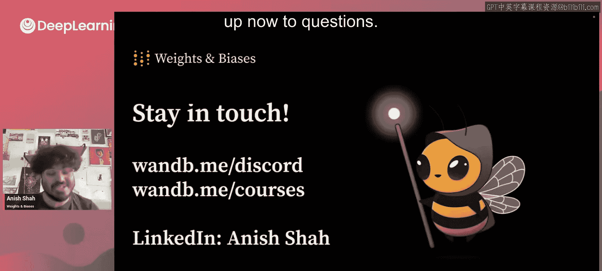

Absolutely， that was great An niche I'm sure that our community really loved everything that you had to present and really。

 really thorough really well done。 I prepped a few questions before we end today。

 So the first one being you mention Laura as the best technique to finding an LLM What are other techniques algorithms use。

 can you call it any discrete advantages over Laura？😊，Yeah， sure。 So let's see， sorry。

 I'm gonna actually share my screen again and bring up that one slide。Let me do that right now。

So I think it's Laura is nice because。It is way more grounded in in the core concept of what fine tuning does。

 which is in the course of machine learning is apply weight updates to the underlying neural network style layers to our model So what Laura does is actually allows you to put apply those updates but do so in a very clever way such that you only update what you need to and you only and you can save these updates。

😡，II away from the original model。 so you're not making the original model impure by applying those updates directly。

 so you can have your Lama2 base model and you don't need to save that full multi gigabyte file。

 you can set only to save the Laura weights itself。

 So that's one thing that's really useful about Laura is that if fine tunes in a good way。

 as we know fine tuning from a traditional perspective。

 But things such as oh I do realizem sharing my screen right now oh I that's So then we have things such as adapter tuning。

 prefixed tuning and prompt tuning those are。😡，Are more intuitive forms， I would say。

 So like in the case of prompt tuning， what we do is we have a process where we actually have our large language model teach us what specific garbled sense of words you need to add to a prompt。

 So it recognizes how to answer it properly。 So it's a backwards approach where instead this random gibberish string to us humans may mean nothing。

 but it may mean the world to the large language model where it says， oh。

 this sequence of 10 random tokens means I need to answer Uber financial questions。Internally。

 large language models can be weird like that， but that is like the intuition behind prompt tuning so very intuitive technique and is also extremely efficient in itself。

 but doesn't have the same intuition as simply updating the internal layers of the model which represent the thought process capabilities of the model itself we're just form fittingtting our input prompt to be a little more clever and then things like adapter tu and prefix tuning I would say are actually heavily related to Laura。

 they're just older forms of it which are slightly more inefficient from a GPU consumption perspective or also just a usability perspective because it may cause you to save like multigabyte files for each of the different models you fine tune on。

Great， thank you Anish Let me share this question， how would the learning rate impact the fine tuning process。

 Are there any other hyperparameters that need to be taken care of while fine tuning a model？😊。

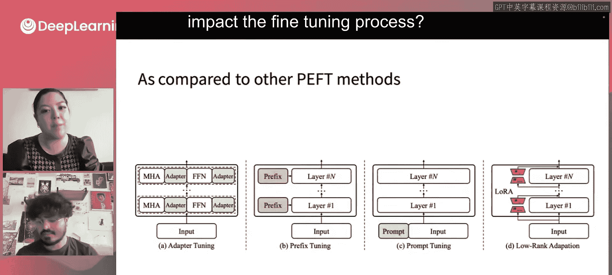

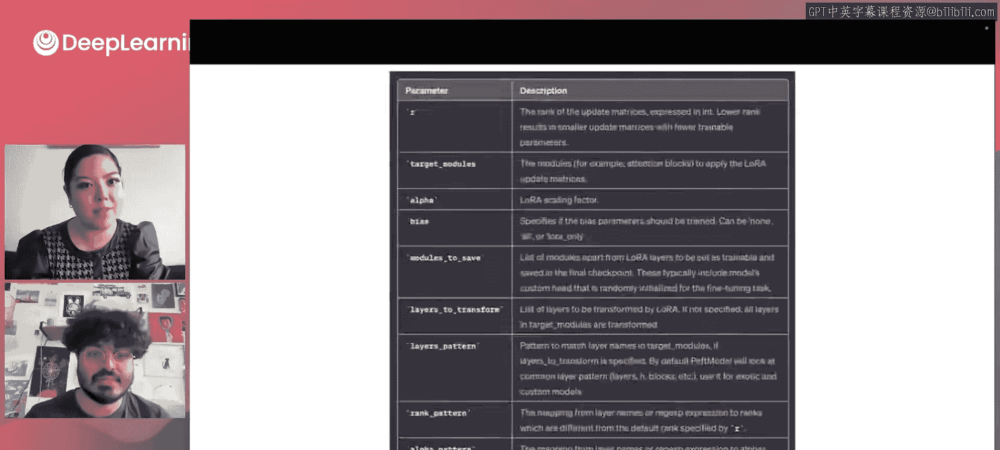

Yes， so if you're talking about fine tuning generally。

 it is always very dependent on the task itself。 so certain vision models versus certain NLP models all very quite a lot based on their architecture So I do apologize it is gonna to be a little bit of wishywa answer but I will say there are heuristics that apply to certain architectures of models I would refer to the baseline or research papers of these different architectures either from directly from the research or the implementation that's released and then adjusting slightly from those different parameters itself as was highlighted by what's important the research paper each architecture varies quite differently based on how many layers you use what types of layers and whats optimizes you use So even in the case of during training you may want to even stop an experiment and continue training with a different set of hypo。

😊，To maintain consistency the only truth I guess I will say here to know what to update is to ensure that you use the proper tooling to capture the configurations and the effects on the metrics you care about such as loss in accuracy so the little spiel here is like weight devices is great for that a lot of the large language model providers use us for this kind of reason where they can see at a certain point where the convergence of the large language model training may be looking a little bit off with weird spikes and loss and that may cause because for concern we to shut down experiment and they change the hyperparameter so I would say observation matters observation and the ability to do this hyperparameter checks is more important than actually one hyperparameter itself。

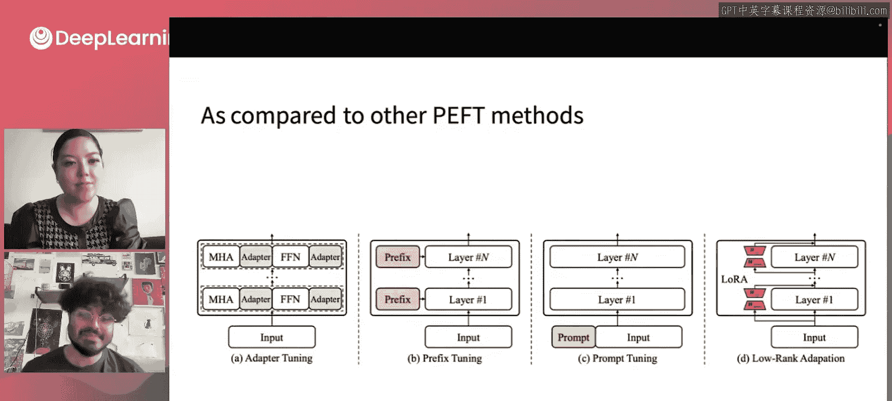

Absolutely well I think that's all the questions that we have time for today obviously I wish we could go through all of them。

 but thank you Ni so much for such an amazing workshop definitely the last of the year but not one of the most important I would say so thank you everyone for tuning in please fill out our event survey form we're definitely going bring more events you know and workshops into 2024 and wishing you guys all a happy holiday season we'll see you really soon bye。

😊。