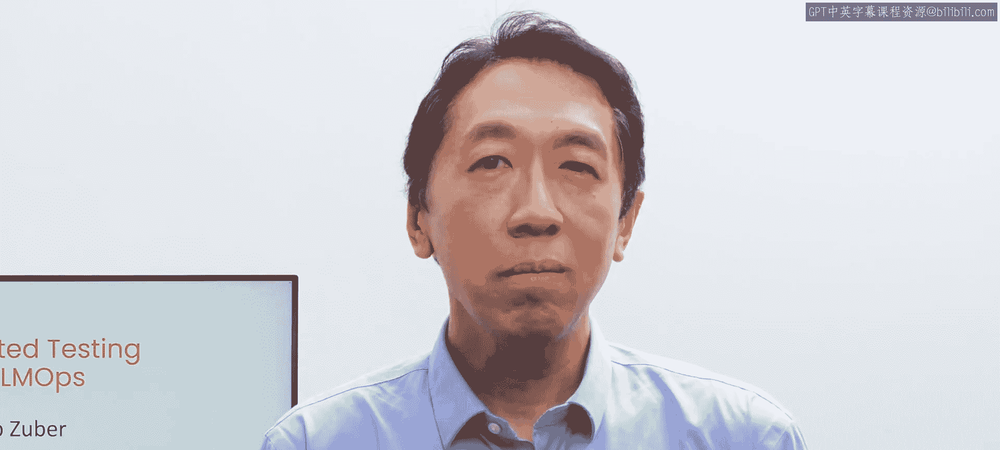
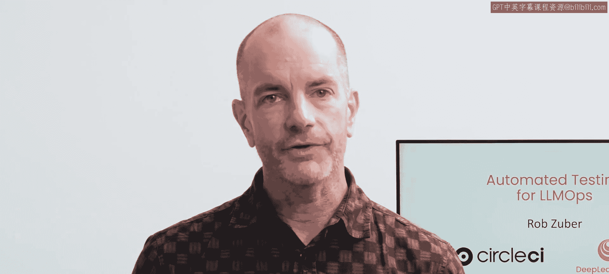
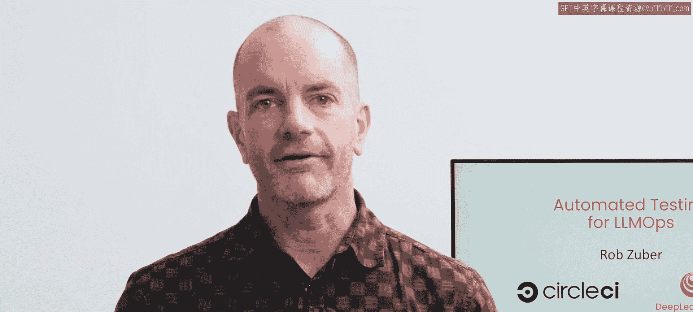
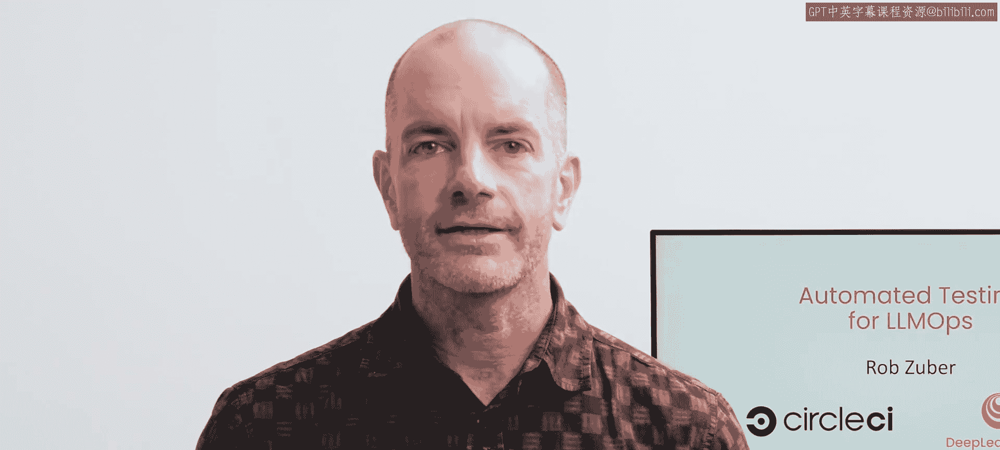
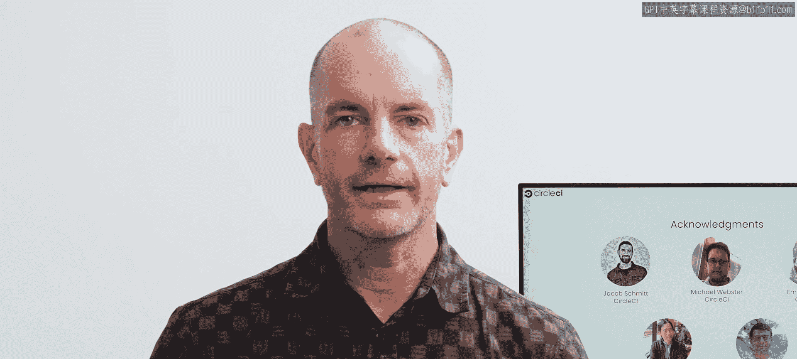

# 吴恩达《LLMOps的自动化测试｜Automated Testing for LLMOps》中英字幕（英字可关） - P1：1.introduction.zh - GPT中英字幕课程资源 - BV1mT4y147Dk

Welcome to this short course automated testing for LLM Ops built in partnership with Circle CI。

Software testing helps you identify bugs and security vulnerabil in your applications。

 and automated testing frees up your time and energy further so they can focus on the creative path of designing and building your application In this course。

 you learn modern software engineering practices focus on testing for the practical development and deployment of LM based applications。

😊，Two kinds of LM evaluations that you implement in this course are rule based evaluations and model graded evaluations。

Rubays evals use string or pattern matching， for example。

 regular expression matching and a fast and cost effective to run I use these whenever I want to evaluate outputs that have a clear right answer such as cing classification and if say you have ground truth labels。

Rubay's Evals are quick and cheap to run so you can run these tests every time you commit a code change to get fast feedback on the health of your application。

Model grade evaluations are relevant for applications where there are many possible good or bad outputs。

 For example， if you ask an LM to write text content for you。

 there can be more than one high quality response。 here。

 you might prompt an evaluation LM to have it assess the quality of the output of your application LM。

 In other words， use an LM to evaluate the output of another OM。

Model graded Els take more time and cost more， but they allow you to assess more complex outputs。

 I'm delighted to introduce our instructor for this course， Rob Zuber。

 chief technology officer for Circle CI。

Rob has spent decades leading engineering teams and also helping customers scale up their software delivery practice by making processes repeatable。

 scalable and reliable， he'll show you how to do this for your applications as well with an emphasis on testing。

Thanks Andrew， in your software development process。

 you and your teammates may commit code updates or bug fixes multiple times per day in this course you'll learn to set triggers that automatically run your evaluations whenever you or your teammates commit code changes to the repository。

Your team may also release updated versions of the app on a broader cadence perhaps once every two weeks。

 before deploying to users， you can also automate more holistic。

 comprehensive pre releaselease evaluations。For per commit evals。

 you can include rules based evaluations because they're fast and cheap to run。

And for those pre releaselease Evals， it may be very helpful to use model graded Evalals to do more thorough testing before deployment。

By the end of the course， you will combine per commit and pre releaselease EVs into an automated testing suite。

 and for this course you'll design tests to detect hallucinations in LLM responses。

Many people have worked to make this course possible。 I'd like to thank on the Cir C side。

 Michael Webster， Jacob Schmidt and Emmawe from Deeplening。 AI。

 Eddie Shu and Eshb Gagari have also contributed to this course。

 The first lesson will be a quick overview of continuous integration terms and technologies that we'll use as the foundation for building our automated LOM testing pipeline。

 And when you finish this course， that will be a real testament to your dedication to building good applications。

 or if you're not sure how much you'll use these ideas， you can still test the waters。

 So let's go on to the next video to get started。😊。

