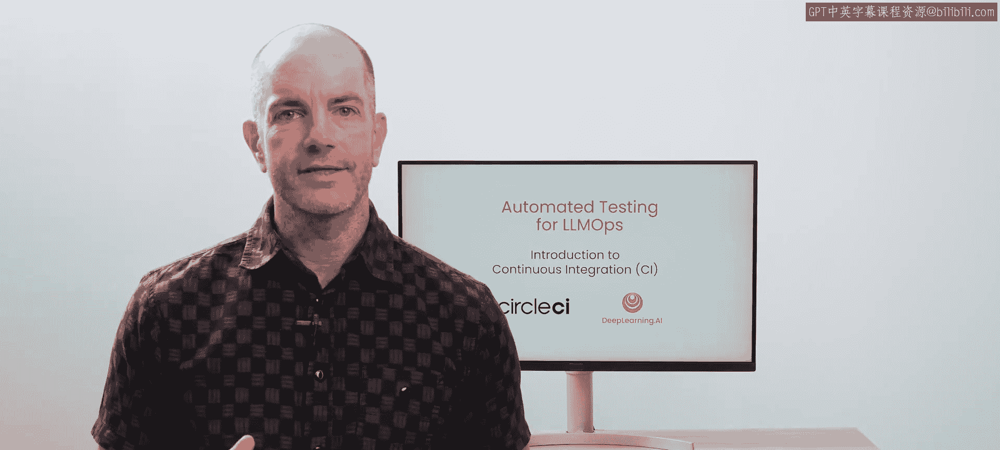
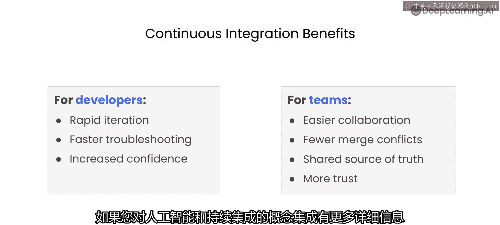
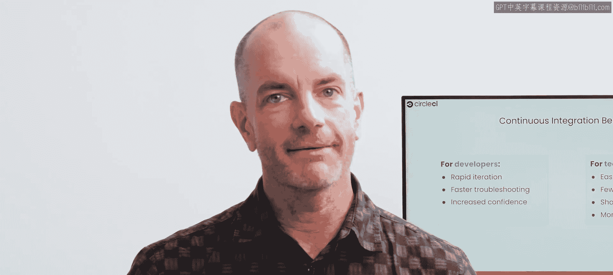

# 吴恩达《LLMOps的自动化测试｜Automated Testing for LLMOps》中英字幕（英字可关） - P2：2.Introduction to Continuous Integration (CI).zh - GPT中英字幕课程资源 - BV1mT4y147Dk

In this lesson， you'll get a quick overview of the technology we'll be using to automate our LLM Evals continuous integration we'll discuss what continuous integration is。

 why it's important， and that will give us a solid foundation for the automated workflows we'll build in later lessons。

 Let's dive in。😊。

So what exactly is continuous integration In a nutshell。

 continuous integration or C is a development practice that revolves around making small。

 frequent changes to your software and thoroughly testing those changes with everyone else's。

 In other words， your're continuously validating that your new features and updates work as intended when integrated with those from the rest of your team。

 This method allows you to detect and fix issues early before they become bigger problems that are harder for you and your team to solve。

 Let's see how this works in the context of an LLM powered application。

 Imagine yourre working on a cutting edge virtual assistant application。

 with continuous integration every time you or a team member makes a code change be it refining the LLM prompts or updating data integrations。

 you merge that change into a central repository。 Now， here's where the magic happens。

 Once the code is merged， the C platform kicks in。 It automatically builds your application。

 simulating how it would behave。😊，In a real world environment。

 automated tests are run to ensure that your L O M produces accurate and reliable results。

 These tests cover everything from basic functionality to more complex issues like hallucinations or biased outputs。

 Why is this important， Well， think of it as having a supercharged feedback loop。

 The C platform provides near instantaneous feedback on your changes。 If an issue is detected。

 perhaps the model is generating unexpected outputs。 you're alerted right away。

 This rapid feedback loop allows you to catch and address issues early in the development cycle。

 That way， buggy code doesn't make its way into other features your team members are building or even worse。

 get deployed to your users。 Now， let's talk about the perks for you as a developer。

 Con integration significantly reduces the time and effort spent on debugging and troubleshooting。

 It's not that your test will never fail。 But when a test does fail。

 you'll have actionable information you can use to get back on track quickly。😊。

And continue innovating CI empowers you to iterate quickly。

 experiment with new features and make improvements with confidence。

 but the advantages extend beyond individual developers。 For teams。

 C fosters collaboration by encouraging smaller， more frequent contributions。

 Coning changes are minimized， making it easier to manage and resolve issues。

 The shared repository becomes a reliable source of truth and the automated testing ensures that everyone is building on a stable foundation。

 This creates a culture of trust， collaboration and faster delivery of high quality software。

 Moreover， continuous integration sets the stage for additional automation in how you deploy。

 monitor and retrain your language models， enabling your team to move towards a more agile and responsive development practice。

 for AI developers where innovation is rapid and constant C provides the structure needed to excel。

 If you're interested in more details on the conceptual integration of AI。😊。

And continuous integration we have a minise on our podcast。

 the confident commit that goes into this in great detail with many fantastic guests throughoutout the rest of this course。

 you'll use CciI as your continuous integration platform as you explore different techniques for testing and evaluating your LLM applications you'll be able to trigger your automated evaluations and view the results in the circle CI user interface。

😊。

All of the setup work has been done for you so that you can focus on learning and applying the strategies used in the course。

In a team environment， you'll often have a CicCD expert who is responsible for setting up and maintaining your pipelines。

 but if you are interested in learning more about what's happening behind the scenes。

 feel free to explore the configuration files provided in the project repository。

 We've also included an optional lab at the end of this course that will give you a chance to walk through a step by step process of setting up a workflow in Ccle CI。

😊，While this only scratches the surface of what you can do with continuous integration。

 using it throughout this course will give you the knowledge and tools you need to start making automated testing a central part of your development practice。

 These are skills that will benefit you for your entire career and set you up to follow modern software engineering practices。

 no matter where your interests take you。 Allright。

 let's get started right in your first evaluations and setting them up to run in C C。

 See you in the next lesson。😊。

