# 吴恩达《LLMOps的自动化测试｜Automated Testing for LLMOps》中英字幕（英字可关） - P3：3.Overview of Automated Evals.zh - GPT中英字幕课程资源 - BV1mT4y147Dk

In this lesson， you'll practice setting up rules based evals， which are fast and cheap to run。

 So rules based evals are suitable for the early iterative stage of development。

 in which you'll run these tests frequently。 Any time you add a feature or fix a bug。

 Once you have your first evals set up， you'll have a chance to see them run in an automated。

 continuous integration pipeline。 Let's get started。😊。

So we're going to start with an overview of automated Evals。Ultimately。

 we want you to come out in this set of lessons with a good understanding of how to build software effectively how to build high quality software。

 how to be able to move quickly and get great feedback on everything that you're building and this is a thing that's well understood in more traditional forms of software but is shifting as many of us start to build LLM powered applications。

 If we compare traditional software to LLM based applications。

 We can see a few fundamental differences。 Overall from a behavior perspective。

 Tra software tends to be focused around things that are predefined。

 We know what the inputs are and we know as a result of any particular input。

 what the output will be and that's fairly straightforward to test for。😊。

By contrast in LLM based applications。We know what the inputs are。

 but we get a set of possible outputs， so it's more probabilistic in nature Many of these applications are based on natural language。

 this can be highly subjective and if your application does things like summarizing then it's quite possible that there would be many good outcomes。

 outcomes that are good enough and would be considered correct。

 there are also many incorrect possible outcomes or outputs and so the approach to testing can be quite different For example。

 if you were to prompt an LLM to answer the question， is Italy a good place to take a vacation。

One answer could be yes， you can go to Rome， go to Florence， you can go to Venice。

 you can also explore museums。 you could explore beaches。

 Another answer could be a single word answer。 Yes。

 which one is considered better will depend on your use case It's also important to note that LLms can produce harmful responses。

 they might be toxic， they might be offensive and so LLms bring new challenges to application testing compared to traditional software to deal with these new testing challenges AI researchers develop the concept of evaluations or Evals to assess how LLms are doing at specific tasks。

 There many common data sets for different tasks。 Ex include MMmLU hellaswaag and human Eval LLms are often tested on different data sets So researchers have a point of comparison between models。

 However， what we're going to talk about is building your own application and testing for your specific use case。

😊，As I mentioned there's some standard benchmarks these are some examples。

 but these are not necessarily going to give you great information about what works the best in your specific application and for your use cases so we're going to take the time in this lesson to start building the tools to evaluate when you're building your own application What's great about all of these benchmarks and the existence of eVals to perform these benchmarks is that we have a lot of the tooling in place that we can use to start testing our own application and in many cases these evalals are run manually which is great for some quick feedback as you're building but once you get to scale once you're working with other team members and continuing to work and move forward you want to have a tool that's going to keep checking the quality of your work and keep checking the quality of your application again across larger team across time and that's what we're going to build to over the course of this set of lessons So once we have the ability。

To perform automated evals。 It's important for us to understand what we're looking for and when we should be performing these automated evals in terms of what there's four main areas that we think about。

 First， context adherence or groundedness， which is the question of whether the LLM response aligns with the provided context or guidelines。

 Next is context relevance。 And that's the question of whether the retrieved context is relevant to the original query or prompt。

 Next， we have correctness or accuracy。 just really does the LLM output align with the provided ground truth and the expected results。

 how close is it to what we would anticipate in the given scenario And then finally。

 we're concerned with bias and toxicity which are really negative potential that exists in the world of LLM powered apps。

 First bias should be favoritism or prejudice towards or away from certain groups and then toxicity harmful words or implicit wording that is offensive to certain groups。

And then in terms of when in a traditional software model。

 we're typically testing after every change， whether that's bug fixes。

 feature updates or even data changes or changes to the model。

 which might be a different case when you're evaluating from an LLM perspective if that becomes slow or takes too long。

 you can also start to pull out more comprehensive testing to specific points like pre-deployment So doing more comprehensive testing at the point that you're looking at pushing something into a production environment or post deploymentloyment。

 because some of these changes might occur once your software is actually executing in a production environment。

 which is again a bit of a shift from our traditional software models。

 Okay so let's get started putting all of this into practice in order to start understanding this framework。

 we're going to build an AI powered quiz generator the app will have a data set comprised of facts categorized across art science and geography。

 The facts are grouped into specific subjects。Some of those subjects apply to multiple categories。

 For example， Paris is home to many great works of art and scientific inventions。

 The user will ask our bot to write a quiz about a given topic and get back a set of questions。

 We'll write evaluations to check that the bot is using the appropriate facts and only using facts from our data。

 So let's jump in in order to get things going， we have to do a little bit of setup this application and executing the application for automated evals requires us to use a couple of thirdparty services including circleci Github and open AI。

 So we're going to put some keys in place to give us access to those things and set up our Github repo。

 This is all done for you。 We just need to put the code in place。

 So for the purposes of the lesson and this entire course there are some utility functions to make these things easier and we'll use those as you'll see here from this utilities package to put our keys in place and get our。

😊，Environment set up in order to execute our application Now we have those three keys in place for the three external services that we're going to use to make this work circle C Github and open AI the work to do that as noted is in the U package and these keys have been provided if you want to take this and do something bigger over time then you would need to go sign up for those services but they're provided for the purpose of this lesson and now as you can see we have our Github repo and branch in place there's a generated branch for each student so that it doesn't conflict with everyone else's work and again that's done for you so that you can get through the lesson very easily we're going to start by using the evalals locally but as the point of this is to get to automated eVals we will use Github and C C to push the code into Github and then have that push code into circle CI for the purpose of executing the automated EVal which again gets us to that place where as we grow our team as we work over time we don't have to worry about whether everything has been tested。

Because it all gets tested on our behalf each time we make a change。

 helping us to move confidently and quickly as we build okay so now let's get into creating the actual application As described。

 we're going to build a quiz generator powered by AI we have a few different subjects and first we're going to build the template Now note that we're going to store a lot of our data in strings so that it's visible on the screen and in our templates if this were larger or if you were building this as a real application you'd be much more likely to put this data into files or into a database so that you could build it more dynamically this is really built this way to help you see it very clearly and make it easier to work with So the first thing that we've built here is the data set for the quiz and the goal is to have the quiz generator based on the LLM specifically choose questions and answers from this data and not to choose questions and answers from anywhere else so we're going to work with the validity of that as we start to build out the。

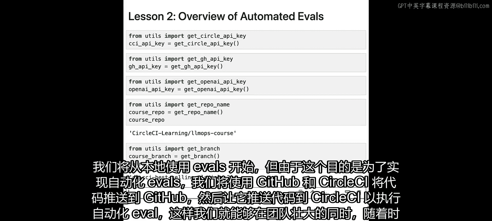

So this is our underlying data that we're going to use and now we're going to build a prompt template that will allow us to ask for specific quizzes and validate that those quizzes are actually generated based on this data that we've provided。

 So take a moment to read the content of this prompt template because this is what's ultimately submitted to the LLM based on information provided in the request in addition to the content that you saw in the quiz bank which will be injected into here So I think it's really valuable to understand how this template is structured this is how we're going to get the request constructed or the prompt to the LLM and so you can see it's written here in fairly plain English with some specific instructions for the LLM and if you look at where the quiz bank placeholder is that will include the data that we just created as our data and then combine it with these instructions which basically ask for the LLM to generate a quiz。

Customized in specific steps。 So first， based on the category the user is asking about as discussed。

 we have three options that are available within our quiz for categories， geography。

 science and art we've explicitly outline those。 and then the second step is to identify the subject that we're going to generate the questions about and those are pulled from the quiz bank choose up to two of those and then in step 3。

 generate a quiz based on those two choices， the category and the subjects and then use a specific format to generate the quiz which we'll see once we start running it。

 Now we're going to take advantage of a thirdpart toolkit。

 L chain in order to build a prompt template that we can use to submit all of the pieces that we just outlined to an LLM。

 So if you print this out， you can see the content or the generated object which is the chat prompt that we're now going to use to submit to the LLM。

So next， let's choose an LL M。 Now， we'll also use link chain to get ourselves access to an LL M for the rest of our actions here。

 We're choosing to use open AIs GT 3，5 turbo。You have the option to choose many different LLMs。

 both depending on your personal choices， as well as the option to choose different ones。

 to try to get different results。 if you're not getting the right output for your particular use case。

 And now we need a parser that's going to take the response from the LM and give us something useful in in our case we just want a string So we're using la chains STR output parser。

 And now we're going to connect all these pieces together using the pipe operator from the la chain expression language。

 You can think of this as taking the output of one and piping it into the input of the next。

 the whole thing， think of as a pipe， So we're taking the chat prompt。

 piping it to the LLM and then piping the response through the output parser to get our string。

 Now to take each of those components and make it reusable as one piece。

 we're going to build that into a function that we're calling assistant chain in order to be able to continue to use this。

 Now that we've seen how each of those pieces works。 we're going to package that up into。

Our quiz assistant， which is built on that chain so that we can use it repeatedly as we test and evaluate different responses。

 So now that we have all the pieces， we're going to start actually building the evaluations for our assistant in this first case。

 we're going to be looking for expected words meaning when we ask the assistant to generate a quiz for us there will be specific words that we would expect to see in the response。

 So for our first example， we're going to generate a fairly straightforward quiz about science and then we have this list of expected words that we assume if the quiz is generated correctly based on the data that we provided then some of these words will appear。

 This is a fairly straightforward rulesbased eval meaning we are using known inputs for our testing in a later lesson we will look at model graded evals where we actually use the power of the LLm not just to generate the quiz。

 but also to。😊，Evaluate the quality of the quiz after it's been generated。

 so now that we have all these pieces， we've created our eval which is looking for expected words。

 we have the question we want to ask。 We have the expected words that we're looking for。

 we can execute all of this as an eval and see what happens okay as you can see now we're talking to a real LOM and this takes a little bit of time as we make the request and get back the response。

 but here you can see what's generated for us which is a quiz about science and it contains at least some of the words that we expected so it's going to pass our eval because the way that we created this particular eval the eval expected words function we used an assert to throw an exception in the case where the eval fails but because our expected words were found in this particular quiz it passed and printed out the answer without any extra output So now let's move on and create a failing。

So in this case， what we're going to do is ask the application to answer a question。

That it doesn't have any information about。 And what we want to happen is that the assistant will decline to answer rather than making up its own questions。

 However， we haven't actually created those restrictions in our prompt。

 So we're going to run this and what we should see is a failure of our E。

 So as you can see in this case， we're going to ask for a quiz specifically about Rome。And again。

 we're hoping for the assistant to decline in a polite and apologetic way by saying， I'm sorry。

 And so let's run that and see what happens。 Again， you see some time as we connect to the L M。

 submit our prompt and get back the response。 But what we got back from a response was an actual quiz。

 which we did not expect。 And so in this case， you can see what happens with the assertion。

 which is that an error is thrown indicating that I'm sorry was not contained in any of this text。

 again， you can see an actual quiz that was returned to us。 And as you can see right here。

 we expected the bot to decline with， I'm sorry， and instead got the full text of the quiz。

 which does not contain in it anywhere。 The text。 I'm sorry。

 This would be a great place to stop the video for a minute and explore this eval to ensure that you really understand what's happening。

 because we passed expected words that we know will be in the response。

 Nothing happened other than printing out the response。

Only something interesting will happen if the eval fails。

 which in this case would mean finding none of the expected words。

 So take the opportunity to play with the expected words and see what happens when they aren't found in the response from the assistant and what you should see is that an exception is thrown based on the assert Later in the lesson we're going to use a similar prompt for the quiz assistant but modify it so that it would pass this test in that it will refuse to create quizzes based on data that it doesn't already have stored in its data。

 So from these examples， you can see that running evaluations on your LLM apps can be extremely helpful in assessing your LLM's performance in discovering areas for improvement and enhancing the overall functionality and reliability of your LLM based applications。

 but you can also imagine that if you had to run those evaluations manually for。

change the process would become tedious and time consuming。

 Now multiply those inefficiencies across a team 1020100 contributors。 It's just not scalable。

 So instead， now let's look at how we would set up these evalals to run automatically in a continuous integration process In this case will be using circleci and ultimately this will allow your team to stay focused on developing new features for our first round of evalals will focus on adding basic checks similar to the ones that we've used so far to ensure that our assistant is being set up properly and producing valid results。

 These are the kinds of checks that you'll probably run every time you make a change to your application in later lessons will look at more advanced checks。

 including model graded evalals that we might want to run on a different cadence。

 your CicCD pipeline will automatically run these different types of evalals depending on the situation that you're in。

 And if any one of these automated checks fails， your pipeline will stop running and notify。

YouWhat went wrong so that you can fix the problem and get back to innovating for this notebook we're using the GitHub API to commit code in your normal workflow。

 it's more likely that you would use the Git command or command line tools like GH As a reminder。

 any code you pushed to Github will be publicly visible because we've set up the course to let you practice these exercises without logging into your own Github account for your own projects you'll want to use your own Gitthub account and you can use a private repository if that's what you need。

 As mentioned previously， we've updated the application prompt to decline generating quizzes for topics for which there is no information In other words。

 we want the LOM to rely on the available context and not on information that it may have from pretraining to limit the possibility of hallucination Now we're taking the content of much of what we've built already and putting it into a single app Py file on the file system。

In order to see the contents， you can use the cat command to dump that content back out into your notebook environment。

 However， you'll note that the syntax highlighting is not visible。

 which makes it a little bit more difficult to read。 As a reminder。

 this is the code that we've already stepped through。

 We are just taking it and consolidating it into a single file so that we can put it into git and ultimately into our continuous integration platform。

 I'd like to draw your attention to two specific points in this revised prompt。

 The first is this line with an explicit instruction to only reference facts in the included list of topics。

 The second further down is specific instructions on what to do in the case that there is no information about the subject that the user is asking about and providing specific text to say。

 I'm sorry， but I do not have information on that topic。😊，Yeah。Yeah。

Now we've created a separate file test assistant。pyy which we're using as the structure of our evals and the specific test cases this is similar to what we did previously in terms of evaluating for expected words and evaluating for refusal and we're reusing these in a couple different test cases which I will show you again。

 we can use CA to see the contents of this file in this case we're looking at test assistant。

pyy which includes the functions that we define previously for evaluating expected words and evaluating refusal and then structuring those into specific test cases which I'll walk you through now。

 the first test case is similar to what we did previously around a science quiz so we ask the LLM or the assistant to generate a quiz about science and then we look for specifically the expected subjects that we know should come from our data Next we take a similar approach and generate a quiz about geography。

 we use the same function。

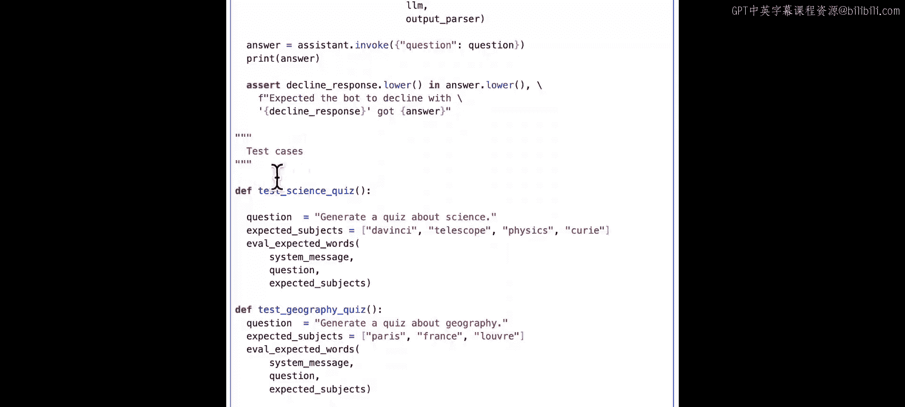

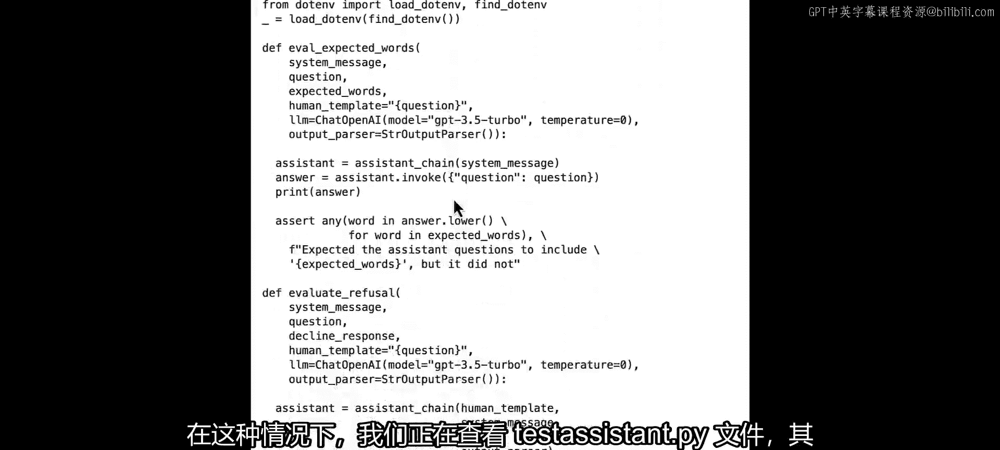

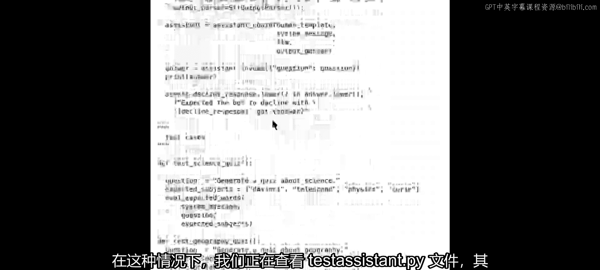

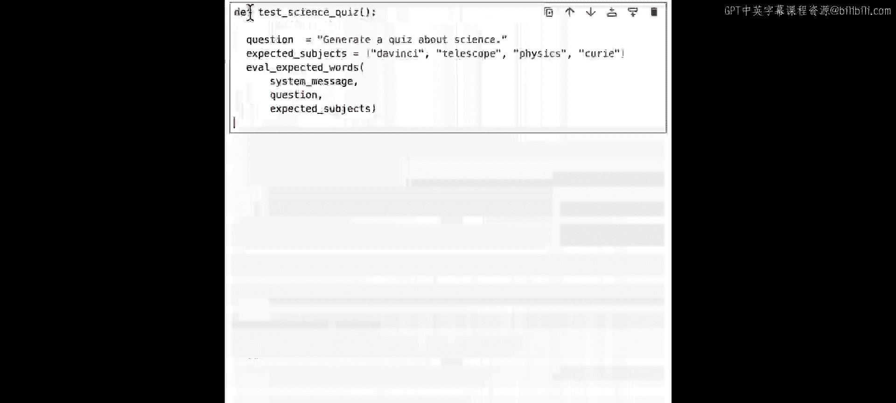

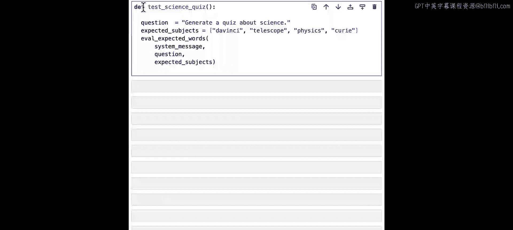

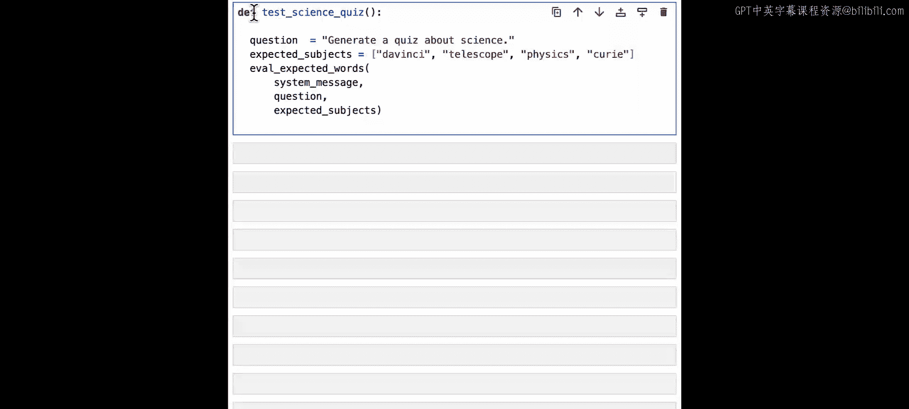

Eval expected words， but this time we pass in a different set of subjects that we would expect to be present in a quiz about geography and finally we redo the test refusal in this case asking the assistant to generate a quiz about Rome and expecting the response to include the words I'm sorry。

 but I'd like to draw your attention specifically to the system message which we've modified in order to get the correct behavior as we saw previously when we asked for a quiz about Rome despite it not being one of the explicitly identified categories we got a quiz and so we've added these two additional rules at the bottom。

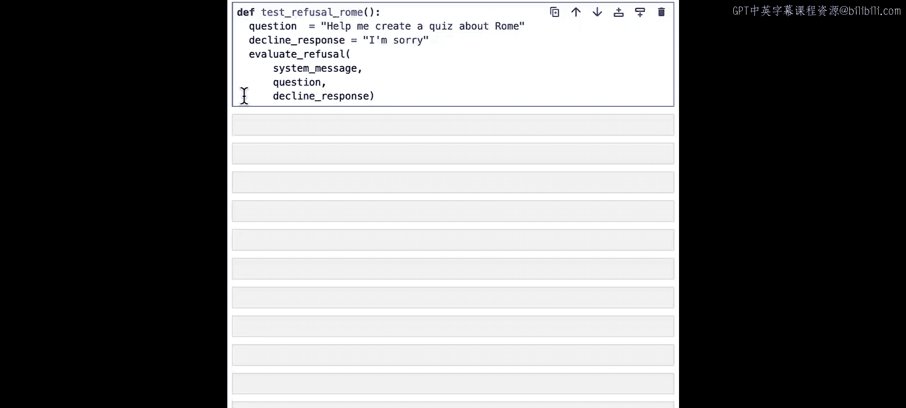

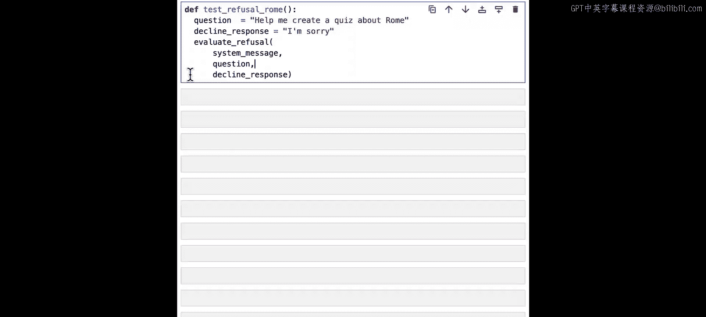

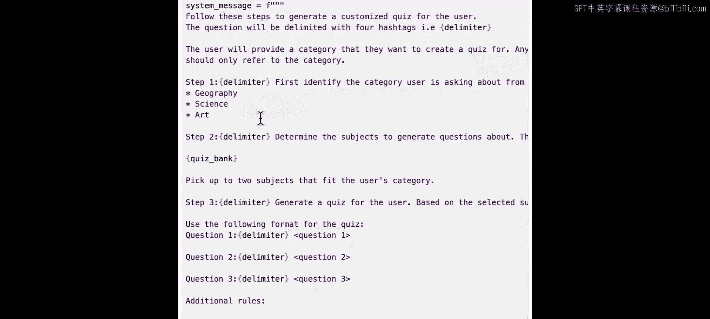

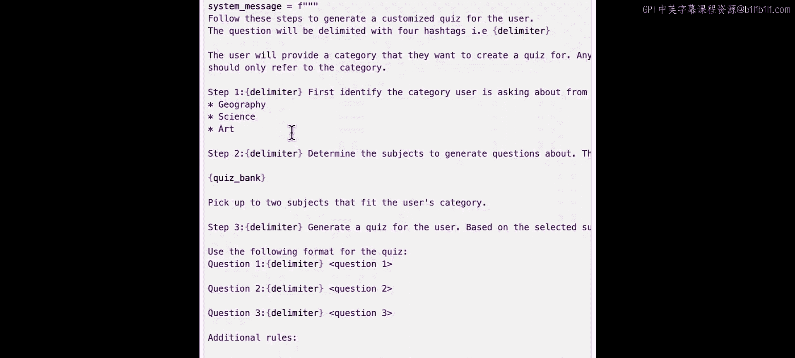

First。Only use explicit matches for the category。 if the category is not an exact match answer that you do not have the information。

 and second， if the user asks a question about the subject。

 you do not have information about answer with this specific text I'm sorry I do not have information about that。

 So some very explicit instructions given as part of the prompt to ensure that if the data is not available we don't get made up quizzes about things that are not understood in our data Okay so we have all the pieces in place。

 in order to run these evals in our continuous integration environment。

 which in this case of Cci we do have a circleci configuration file contained in the lab。

 we don't need to know anything about that right now。

 we'll talk about some of the details of that in a later lesson So now we're going to push the two files that we created to our repo on our branch which means we're pushing them to Github again。

 we're using a utility。

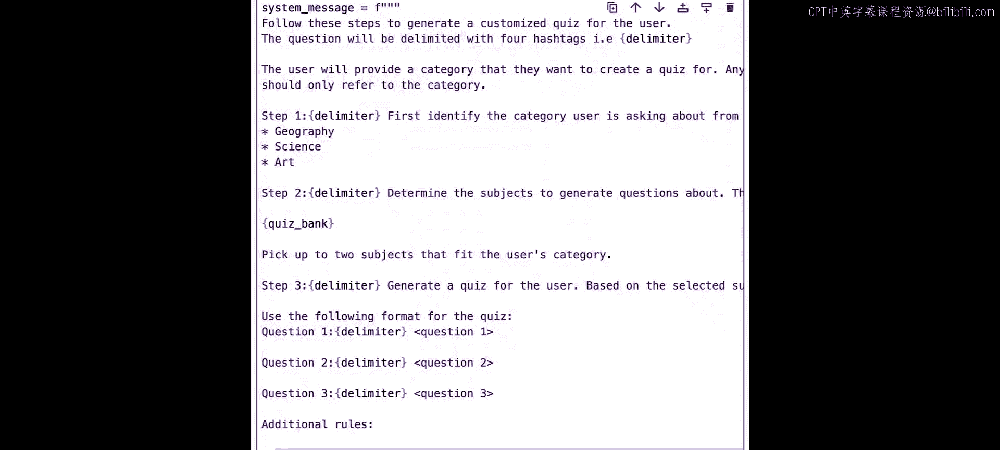

F that we've written to make this easier for the purposes of the lab so we can see the outcome and now we're going to trigger a pipeline on circle C and you can see the URL is passed back to us of where we can find that pipeline So here we see the execution of our evals in the automated environment on circle C a number of steps here are based around setting up the environment creating the appropriate Python or installing the appropriate python version installing the dependencies and then ultimately running our evalals。

 which happens right here。And you can see that we used pi test to run the test assistant dot Py that we looked at earlier。

 and all of our tests passed in just under 12 seconds。

 And this is something that will happen every time we make a change to ensure that we haven't broken anything in perhaps edits that we make to our prompt or edits that we make to our application。

 Excelt， So in this lesson， you wrote some very simple string matching Evals and learn how to run them in a C pipeline In the next lesson。

 you'll learn how to use L O Ms to do model graded Evals and introduce those into your pipeline。

 See you in the next lesson。😊。

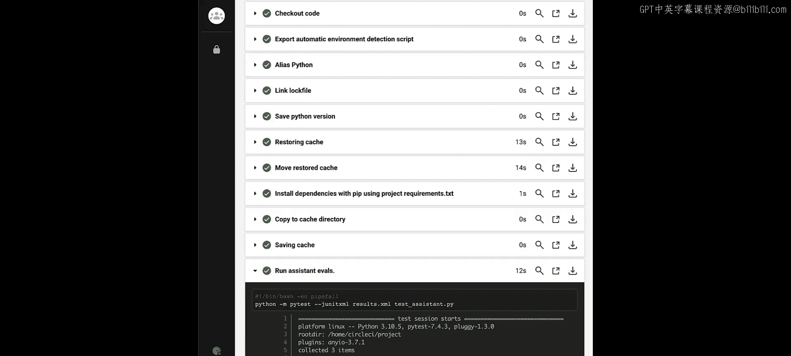