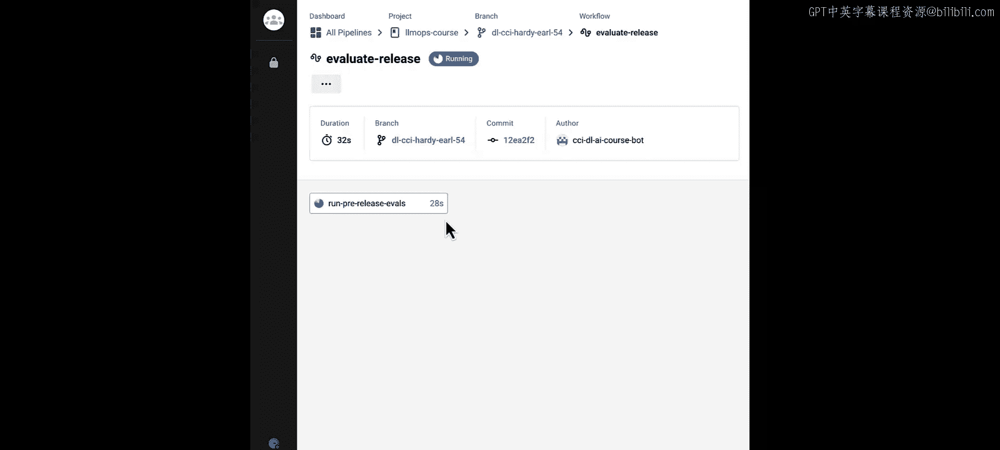
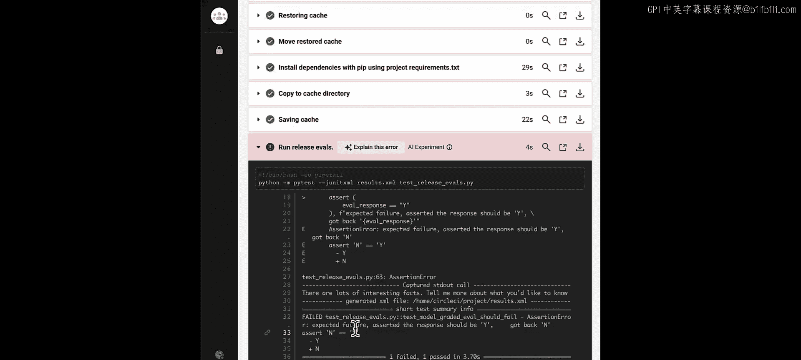
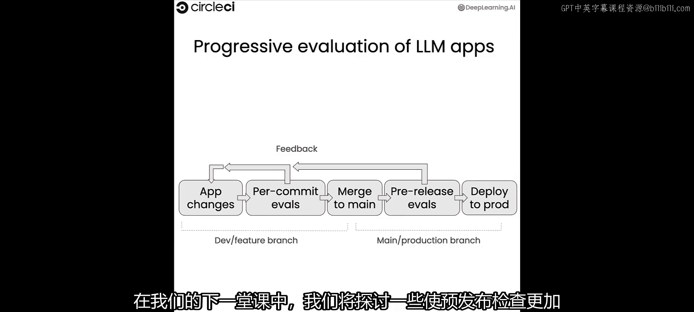

# 吴恩达《LLMOps的自动化测试｜Automated Testing for LLMOps》中英字幕（英字可关） - P4：4.Automating Model-Graded Evals.zh - GPT中英字幕课程资源 - BV1mT4y147Dk

So far， you've used fast rules based evaluations that are suitable for running frequently on every commit for stages of development leading up to deployment。

 more robust and comprehensive evaluation methods can help you better ensure overall quality before you deploy the app to users。

 One such method is model graded evaluation where you'll use an LLM to evaluate the LLM app。

 Let's take a look at this kind of eval and how to automate this as part of your testing pipeline。😊。

Okay， until now， we've been using rules based EVs to make sure our models follow the guidelines we set up in our prompt and stick to the facts we provided in our data。

But in order to have full confidence in our application。

 we also need to be sure our model is generating high quality contextually appropriate responses。

 E LLM output can be tricky because a good response to a query is subjective。

 we could try and write custom rules like we did for our initial evals to make sure that expected data is in the output。

 but this gets more and more complicated and more and more fragile as the application grows。

 One approach to checking the output of an LLM is to use another LLM as a greater This is referred to as model graded evaluation。

 willll show a quick example to make sure our model is actually producing output as a quiz。

 We aren't concerned with the content just yet。 only that the LLM is giving back responses that look like a set of quiz questions。

 will look more closely at the quality of output in our next lesson。

 So in this lesson we're going to focus on judging whether the responses in the desired format and then in our next。

😊，lessonsson will look at things like hallucination and adherence so let's jump right in and write a passing and a failing test case to see how this works first off。

 we need to establish our keys again as we did in the previous lesson so we'll do that now。

For the purposes of adding model graded evals， we're going to continue to use the application that we generated in the last lesson。

 So let's take another look at that just to remember what we're working on。 Again。

 you can use the cat command if you want to see the contents of one of these files on your local file system they're all included with the lab that you have Now let's look at what it looks like to build a model graded eval This is going to look similar to the work that we did to build the quiz assistant。

 except in this case， we are building a prompt that tells the LLM to evaluate the output of the quiz assistant So you can see here that we're giving specific instructions to the LLM to tell it the role that it plays in evaluating the work of the quiz assistant before evaluating an actual quiz assistant we are going to simulate this by writing an LLM response as if it came from the quiz assistant and using our eval to determine。

If that response would pass the test that we're looking to make， as you can see here。

 the full message or prompt for the Eval is telling the LLM to evaluate a generated quiz based on the context and determine whether or not it looks like a quiz or test。

 It is not meant to evaluate whether the information is correct。

 Then it is told specifically to output a Y if the response is a quiz。

An N if the response does not look like a quiz。Now we are going to use Lang chain to build the familiar chain that we saw in the previous lesson except this time we're building a chain specifically to do the evaluation。

 So first we have our chat prompt template as we built previously Next we select our LLM which also we did in the previous lesson and again。

 we're using G3。5 turbo and finally we select an output parser。

 which again is the STR output parser to take the response from the LLM and generate a basic string。

 we chain these together as we did previously， but to recap we take the eval prompt。

 we pipe it to the LLM we take that response and pipe it to the output parser to get the string that we're looking for So now we've built a basic eval chain using a known good LLM response which we showed earlier and we can prove that we get a positive result by invoking that eval chain against that known text as if it were the。

pon。From an LLM。And as you can see in this case， we get a Y。

 which means the known good response that we put in is believed by the LLM to look like a quiz in the format that's expected。

 However， we also want to ensure that it will fail if it doesn't look like a quiz in order to do that we' first store all of the eval chain creation code as a utility function so we can use it repeatedly Next we store a known bad result so that we can pass it into a new eval chain and now we invoke this new eval chain and see that we get the correct response。

 which is an n to indicate that the text does not look like a quiz Now we're going to take our newly created model graded eval capability and incorporate it into the tests that we're running inside of our continuous integration pipeline so we have two files for testing on the file system in the lab The first is test assistant py which you can see here and is what we were running。

Previously the second is testreleaseevals py， which is a rollup of all of the work we just did to show how to create a model graded eval and execute it against openaiI Okay so now that we have the release evals。

 which are the model graded evals stored in the test release evals py file along with the previous files we had the test assistant and the app where we stored our original code。

 We're going to push all of that to Github and then to circleci so that we can evaluate our application including the model graded evalals Now in this particular case。

 we are using the full evaluation for the positive case。

 but intentionally passing the knownbed result to the negative case to show what it looks like when there's a failure in the continuous integration pipeline We are also only going to trigger the release evals job on circleci so that we don't do as much testing for this particular。

We do this through this function trigger releaselease evals。

 which uses a parameter past to the workflow。 You can see here that the only job that is running is the run prerelease evalals because that was the one we specifically selected through that parameter So as you can see we ran the model graded evalals in this run and we did get a failure because we intentionally passed the known bad content Great so you can see that your pre-release evalals run when you merge your application changes to the main branch in a real-wor development scenario this would happen after you've made changes on your dev branch and run your per commit evalals we're setting up a system to progressively increase our confidence in the application as we get closer to releasing it to users in our next lesson we'll look at ways that you can make the pre-release checks even more robust including running evaluations on multiple data points writing evaluations to detect hallucinations in your application and storing evaluation results for human review in C CI。

I'll see you in the next lesson。