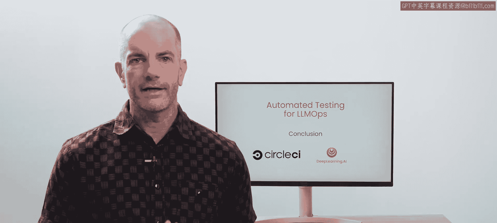
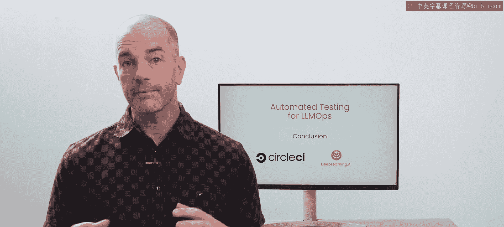
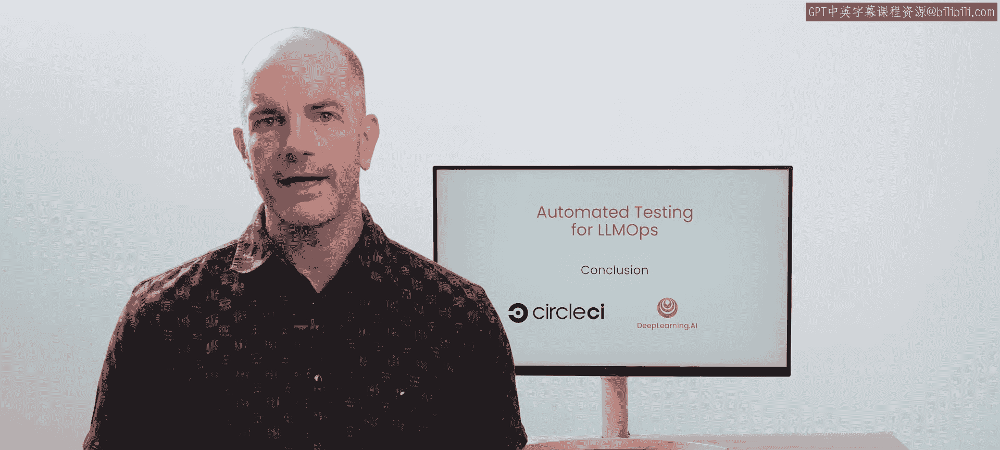
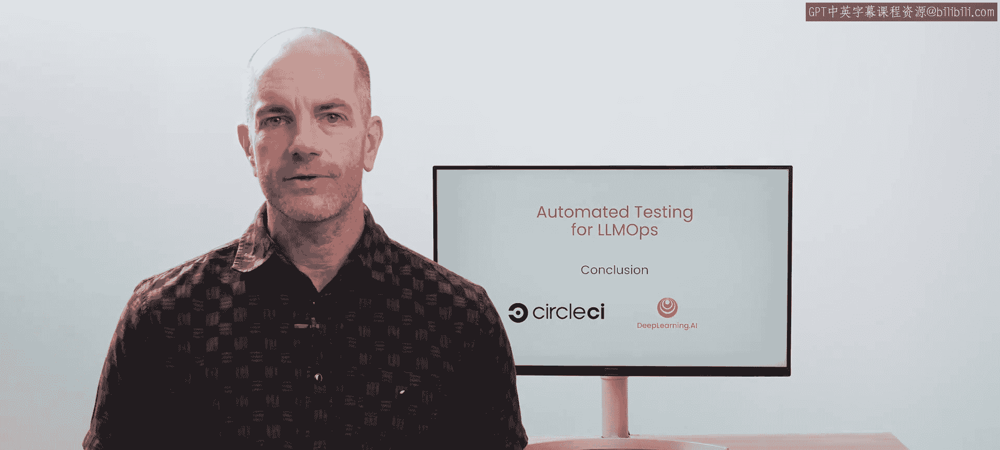

# 吴恩达《LLMOps的自动化测试｜Automated Testing for LLMOps》中英字幕（英字可关） - P6：6.conclusion.zh - GPT中英字幕课程资源 - BV1mT4y147Dk

Congratulations， in this course， you've learned some amazing things。 You've looked at Evals。

 how to use them effectively， and then how to automate them in a comprehensive pipeline so you can work together with a large group and build amazing technology quickly and confidently。

😊。

This is an emerging space combining EVs with CI pipelines brings together a lot of core learnings and is changing rapidly。

 so I'm excited that you're at the front of that and learning everything that you've learned here in this course。

 I'm also really excited to see what you'll build next。😊。

