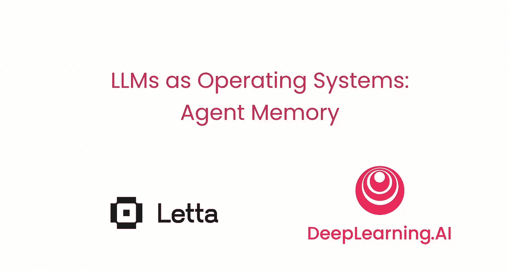
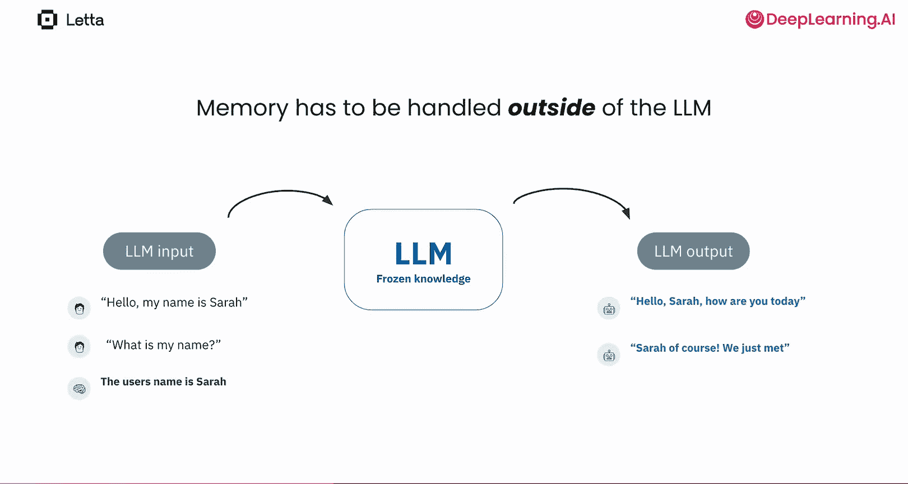
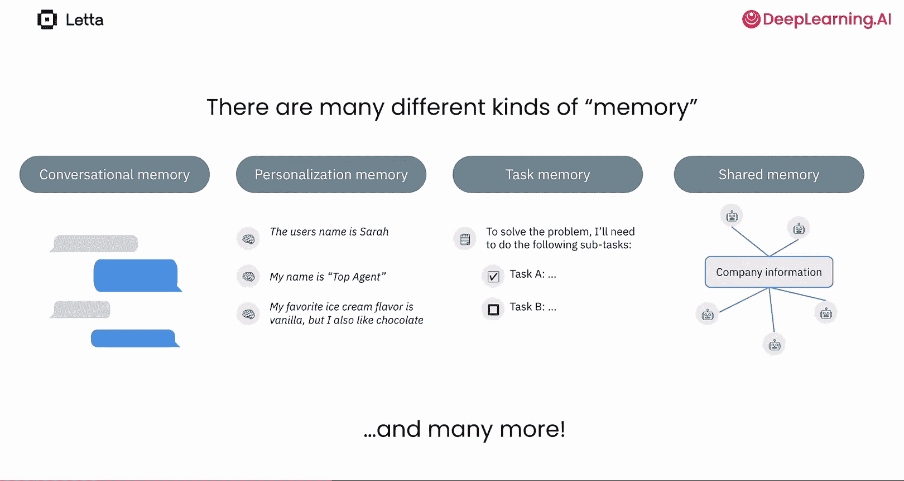
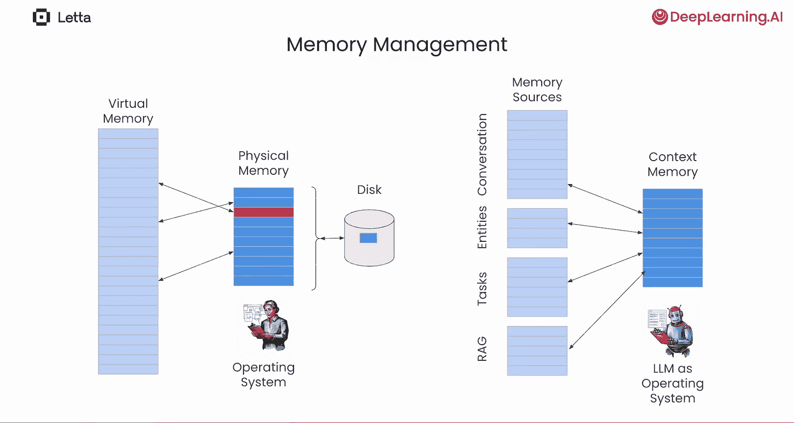
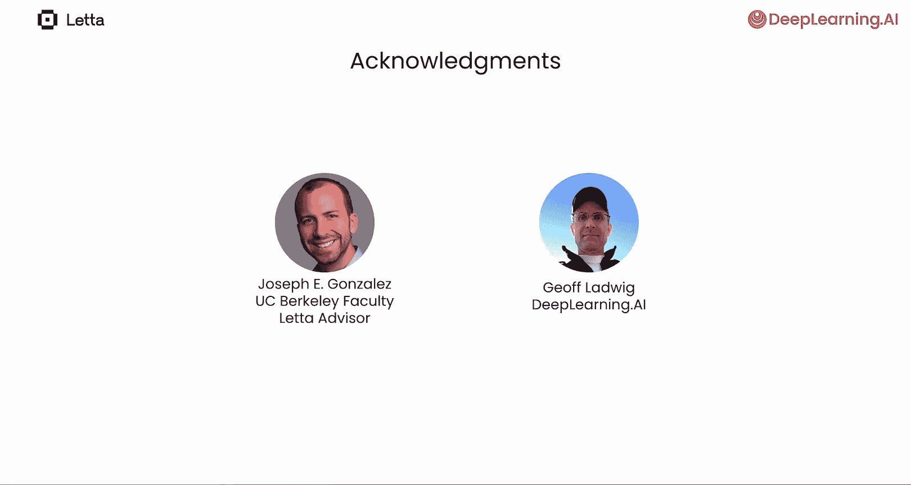

# 吴恩达《LLMs作为操作系统｜LLMs as Operating Systems： Agent Memory》中英字幕 - P1：1.intro.zh_en - GPT中英字幕课程资源 - BV1PFmiYiEWn

Welcome to LOMs as operating systems Age memory built in partnership with NA In this course。

 you explore and build memory for AI agents。 you also explore the idea that LM agent can manage his own input context window essentially acting as the operating system in an AI application your instructors for this course are two of the authors of the Inential paper MemG to OMs as operating systems and explicitlys on this topic welcome Charles Pecker and Sarah Withs Thanks for having us Thank you if you've taken some of our earlier course on prompting OMs API you might be familiar with the idea that although LMms can do amazing things。

 they don't have persistent memory and that you need to manage its memory explicitly Indeed the common example is if you make one API call to say hello my name is Sarah and then make a separate API called ask what is my name It won't remember if you wanted to remember you have to pass in the conversational history again with each additional。

APpiIBy including information the prompts also referred to as the input context。

 you can give the model additional information that you use to generate its output Ex and what is in the context window really determines the behavior of the LLM and your application for example。

 a chatbot application has conversational memory that stores earlier exchanges in the conversation you may also want to track personal facts or names over time or keep track of tasks you may want to share information between LLMs in different agents。

In RAG applications you retrieve relevant information from an external data source and introduce it into the context of the LLM So an LM can make use of any information that is included in this input context to generate its response but the space available in the input context window is limited and using longer input context also costs more a results is slower processing so managing this in context information what to include in this input context is really important the MGPT paper describe a novel approach to this to let the LM manage it if you're familiar with the concept of virtual memory from computer systems there's a nice analogy that MGPT uses to explain this idea。

But if you aren't familiar with that concept of virtual memory， don't worry about it。

 Disccourse will still make sense and still be useful to you but Charles why don't you explain that analogy Sure。

 so we like to think of the context window like the virtual memory on a computer your computer thinks it has a really large memory much bigger than the physical memory it actually has specifically it has a very large virtual memory when it tries to reference a virtual location that is not present in physical memory the operating system will first make room for it by moving a block of information that is in physical memory out to disk。

 preserving any changes in that block and then fetching the new block of information with a reference address from disk back into physical memory。

 Similarlyly， you can think of the context window of an LLM as analogous to the physical memory in our system an LM agent includes the role of the operating system and makes decisions about what information should be included in the context window AIs can use an LM for planning use tos and make decisions。

such as deciding to stop or continue a task a similar approach also let an AI agent manage isL memory to support memory management。

 the agent is given a section of the context window for long-term memory which the agent can write to the agent is given tools to access external storage such as databases to create a larger memory store combining tools to write to both its in context and external memory as well as tools to search external memory and place those results into the LM context So in this course。

 you' will get to put these ideas into practice In these lessons you will build an LLM agent that can edit its own memory from scratch This will ground you in the basic ideas of LLM memory management Next you'll go beyond the basics and learn the key concepts from the MGBT paper then will introduce Letta an open source agent framework in which agents have the tools and information to manage the context window you can use Letta not only to build MGBT agents as described in the original。

But also go beyond the research paper and build agents with more advanced types of memory In multiple lessons you'll create agents and explore the details of how memory is built You'll put this into practice by building a custom task memory You will use this knowledge and applications including your own research agent and an HR multiasian application where Asians share memory We want to acknowledge some of the people who helped create this course Professor Joseph Gonzalez who is a UC Berkeley faculty member and a letterta advisor。

The letter team and from Deep learning AI Jeff Ladwig。

 the ideas here are really exciting letting an AI agent manage its own memory is a novel and powerful technique and it provides a powerful infrastructure on top of which to build many applications Let's go on to the next video to start learning about this。

