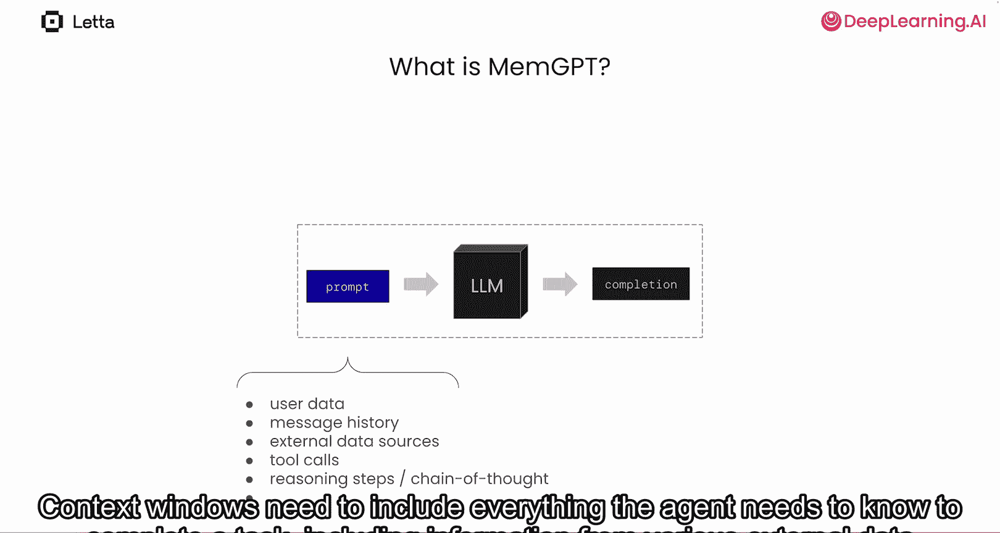
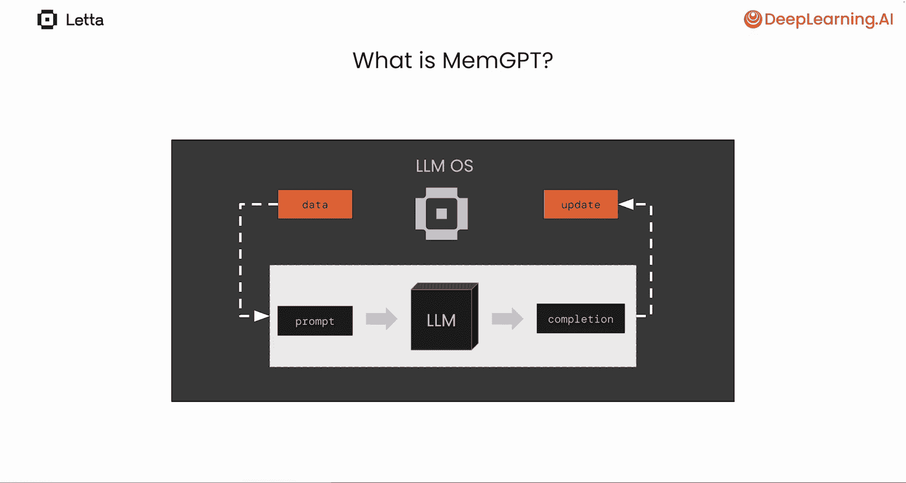
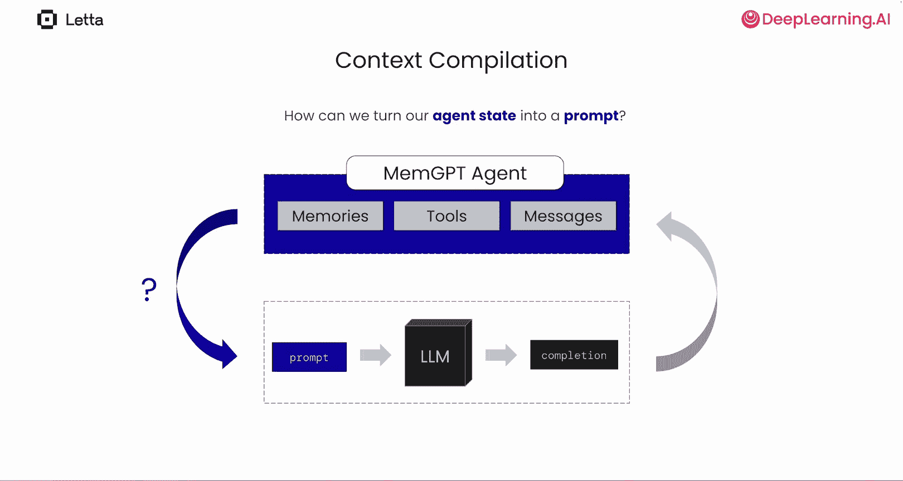
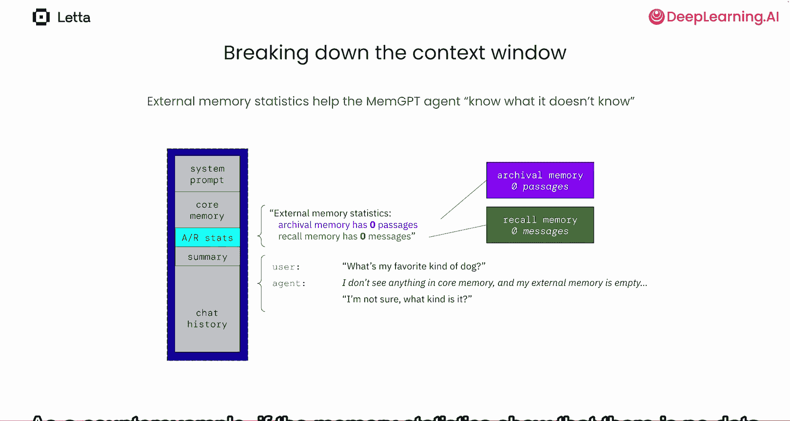
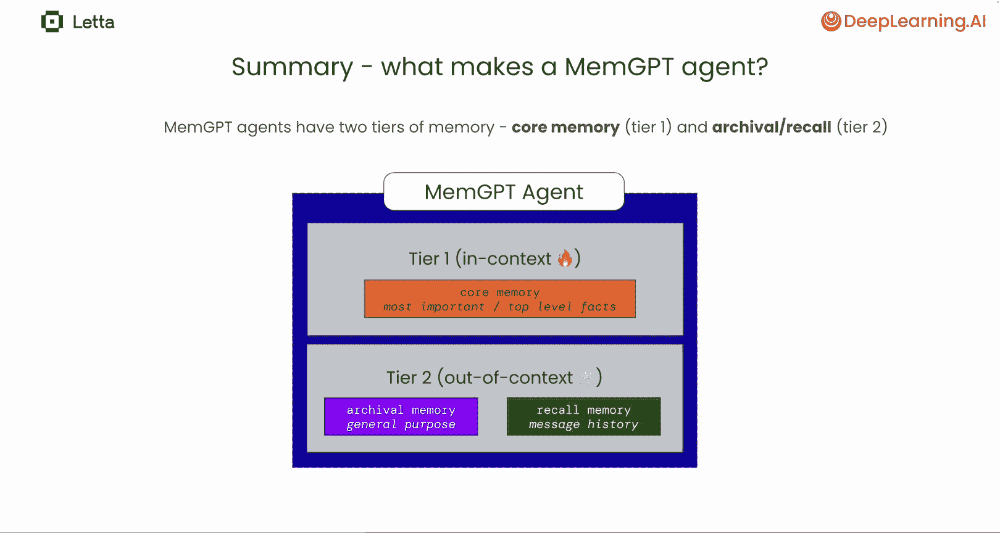
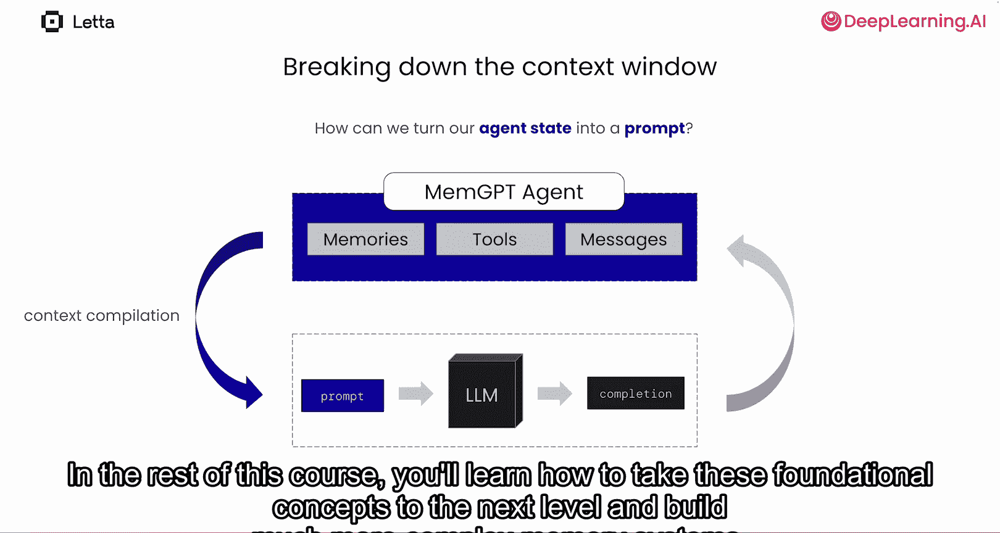

# 吴恩达《LLMs作为操作系统｜LLMs as Operating Systems： Agent Memory》中英字幕 - P3：3.memGPT.zh_en - GPT中英字幕课程资源 - BV1PFmiYiEWn

MMGPT enhances agents by enabling the LLM to manage its own context window In this lesson。

 you'll learn the key ideas behind the MGPT research paper， self editing memory， inner thoughts。

 heartbeats， context compilation and virtual context。 Allright， let's dive in。So what is MenGPT？

The MGPT research paper introduced a new way to think about using LLMs to build agents the main way to control the behavior of an LLM agent is by changing its input or its context window。

 however， it's often not so simple to determine how to construct an optimal context window for an LLM。

 particularly with complex LLM agents。Context windows need to include everything the agent needs to know to complete a task。

 including information from various external data sources， user data， prior messages。

 the result and tool calls， and previous reasoning steps or chain of thought。

The MEGPT research paper showed how to build an OS for your LLM that manages the context window。

 in other words， an LLMOS that performs memory management。In MEGBT。

 this OS is itself also an LLM agent， so the memory management is done automatically。

There are several key ideas behind the MGPT research paper the first is the concept of self editingit memory。

 this refers to the ability of an LLM to edit its own memory in many LLM applications。

 the system instructions or personalization information of the LM is fixed。In MGBT。

 an agent can update its own instructions or personalization information based on things it learn during a chat。

The second key idea is inner thoughts or inner monologue。In MeMGBT。

 agents are always thinking to themselves， even if they don't reply directly to a user。In MeMGPT。

 agents always call tools， for example， when the agent wants to communicate with the user。

 it has the call to sendend messages tool the only time an agent doesn't call a tool is if it's outputting in our thoughts。

MGPT agents are designed to run many LLM steps off of a single user input。For example。

 if the user asked the agent to do a complicated task。

 we would expect the agent to run for many steps as it breaks down the different aspects of the problem into subtasks。

In MEGPT， agents are able to loop through the use of heartbeats whenever a MEGPT agent calls a tool。

 it can add a special heartbeat request to any tool which will trigger a follow up call。Altogether。

 these abilities， self editing memory， inner thoughts， tool outputs， looping via heartbeats。

 these all enable MGPT agents to be autonomous and self improving。

We call MGBT agents autonomous because they can take actions by themselves while looping。

 we call MGBT agents self improving because they can edit their own long term memories over time。

Let's walk through an example MGBT agent step here。

 the agent receives a new message from the user My name is Sarah。

The MeputT agent first generates some inner thoughts。 The humans share their name。

 That seems like important information to remember。 I agree。Next。

 you can see that the agent calls a memory function to save this new fact to its permanent memory bank。

However， if that's the only step we let the agent take。

 the user may become confused because that agent never sent anything back to the user here。

 Sarah says，Ho， is anyone there？To allow for multi step reasoning。

 the MGPT agent can use the special heartbeat feature by adding a special request heartbeat argument to the function of calls。

 the MGPT agent is requesting follow up execution， basically loopin。By requesting a heartbeat。

 the agent can run multiple steps。 Now it can first edit its long term memory and then follow up with a response to the user by calling the send message function。

Now the user won't be confused。 all the different data that makes up our agent is collectively called the agent state。

When we run LLM agents in a loop， each step in the loop is modifying the agent state in most agent frameworks。

 this agent state is simply made up of different Python variables held in program memory。In MeMGPT。

 this state is kept inside of a database so the agent can persist over time， for example。

 you could close your Python script and rerun the same agent and your MEGPT agent will remember everything from the last time you ran it。

Each time we want to let the agent take a step， we have to decide how we want to turn our agent state into a prompt that will go into the LLM。

At the end of the day， an AM is just the machine that takes tokens in and spits tokens out。

 we call the process of going from the agent state to a prompt context compilation。

How we perform context compilation can dramatically affect the behavior of the agent。 For example。

 if we have more messages than we can fit inside the prompt or the context window。

 how should we decide what messages we should leave out and what messages we should include。

 This is what M GBT is all about。These are the sorts of important decisions that an LMOS can actually make automatically for you。

Let's break down exactly what goes into the prompt or context window of an LM in most popular LM APIs。

 the LM input is divided into two sections， the system prompt and the chat history。

The system prompt are the instructions that can customize or change the behavior of the LM to make it different from the base LLM。

 In this example， our system prompt is quite simple。

 You are a helpful assistant that answers questions。

The chat history contains a list of messages between the user and the assistant or agent。

You can view the job of the LM here as simply generating a new reply based on the current chat history。

Once the LM generates the new reply， we can add it to the end of the chat history。In MEGPT。

 we create a special section of the context window that we call core memory core memory is used to store important information about the user to personalize the agent。

Think about how your conversations with your friends are different from your conversations with strangers。

This is because you know information about your friends that conditions or personalizes the conversation。

In M GPT， the system prompt also includes information about how to edit the core memory。

 So a meGPT agent will see both a special reserve section of the context for long term memory。

 as well as understand that it has the power to edit this memory If it sees fit。

 In this simple example， we can see that the user corrects an incorrect fact in the agent's memory。

 The user asks， who am I。 The agent says， I know your name is Charles and that you do AI research Here。

 the user then says， my name is actually Sarah。😊，The MGBT agent can then use its core memory replace tool to immediately correct this incorrect fat in its core memory。

Core memory can be customized。For example， we can split it into different sections。

 one to store information about the user or human and another section to store information about the agent。

 You'll learn how to create a customized memory module later in the course。

 depending on what you want your agent to do， you can make this memory module as simple or as complex as you want it to be。

 The possibilities are truly endless。Core memory in MGPT is what gives the agents the ability to learn over time。

Remember， core memory isn't just another message in chat history。

 it's a special reserve section of the context window that is always visible to the agent no matter what。

Why do we want our agents to have the ability to learn over time？

The ability to learn over time is part of what makes humans so useful。

 as we make mistakes or receive additional training， we adapt our behavior to improve。

One reason you might want agents with a persistent memory is that they're much more engaging。

For example， imagine if a user asks a chatbot what kind of ice cream they like most here。

 the chatbot replies that their favorite ice cream flavor is vanilla。In most LM chatbots。

 there's no concept of persistent memory， so the chatbot will eventually forget that it said its favorite flavor is vanilla。

So when the user makes a reference later to the chatbot's earlier statement。

 the chatbot will say something completely different。

 This is just a simple example of how lack of long term memory can completely break immersion and LLM applications。

 A MEGT agent is able to recognize that it's stated a preference and commit this preference to long term memory。

So if the user asks the same kind of question， the MemGPT agent can reply with a much more realistic response。

 So what happens when we run out of space in the chat history， Con windows are finite。

 so no matter how large the context window in the base LM if your conversation goes on for long enough。

 you'll eventually run out of space in MeGPT when we run out of space。

 we first flush or evict a chunk of the messages in the chat history and replace them with a recursive summary。

😊，We called the summary recursive because it summarizes all of the messages that were evicted。

 which itself may include a previously generated summary。

Many Asian frameworks have a similar technique of truncating or deleting messages from the chat history to deal with context overflow。

 but the messages are usually permanently deleted。In MGBT， we never delete any messages， instead。

 all of the messages that are evicted from the context window get inserted into a persistent database。

 we call recall memory。By moving the old messages out of the chat history and into recall memory。

 we can free up space in the chat history while making sure that the full conversation history is always available to the agent if needed。

Similar to how corere memorym uses tools to function， recall memory also uses tools。

If an agent wants to retrieve a message from recall memory， it can use the conversation search tool。

 which will search the database of old messages。 Think of this like the search tool in a chat application like Facebook Messenger。

 When the chat gets too long you probably used the search tool to try to find old messages instead of scrolling because there's just too many messages to scroll through In this example。

 the user mentioned that timber bit me So the agent uses the search tool to try to find old messages related to timber The search tools executed in the database and returns the results into the chat history based on the search results。

 the agent is able to infer that timber is a dog and that timber had previously bit the user。😊。

The agent can use this information to craft an engaging response， saying。

I can't believe your dog bit you again。Core memory is also limited in size。

 similar to the chat history。Each section of the core memory has an associated character limit。

Here we can see that both the user and agent fields have a limit of 2000 characters As a developer。

 you can change this limit to whatever you want it to be。

 The fundamental constraint is that the combined system prompt， core memory。

 summary and chat history must all together fit inside of the context window of the base LLM that you're using。

You might be wondering what happens if an agent runs out of space and core memory？For example， here。

 the user expresses a new fact the agent wants to save into the user section of core memory。

 but the section is out of space。 Don't worry， similar to how the chat history has a second unlimited tier of storage called recall memory。

 corere memory also has a second tier of unlimited storage。 We call archival memory。

 A meGPT agent decides what information is most important to keep in core memory。

 and what should be stored outside of the context window inside of archival memory。 In this example。

 the agent decides that the information is just not important enough to put inside of core memory。

 So it puts the information inside of archival memory。

 You could imagine a scenario where the agent might decide that the information is important enough to put in core memory。

 In that case， the agent would first evict information out of core memory by moving it into archival memory。

😊，Then it would add it to core memory after it free up space。

 You can think of archival memory as a general data store for the MGPT agent。

 It's all the general information that's not important enough to keep inside of core memory。

 which is pinned to the context window at all times， because archival memory as a general concept。

 It means that you can use it for many different things。 For example。

 you can even use archival memory to store code or Pf documents。😊，In this example。

 the user is asking a question about the company handbook。

 The company handbook is simply too large to store set of core memory。

So the agent has decided to place it inside of archival memory。To answer the user's question。

 the agent will first batch archival memory。The agent gets back a result from the handbook。

 the company handbook says that the user can take unlimited vacation days。Good news， it's unlimited。

Because archival memory and recall memory are an external storage。

 the agent actually can't see the contents of them unless it explicitly uses one of the search tools to get the information。

This poses a problem if the valuable information is stored inside of external storage。

 but all the external storage is outside of the context window。

 how does the agent know where to look in the first place？

This is where the external memory statistics come in in MGPT。

 there's a special section of the context window that provides statistics about what's an external memory。

For example， if these are asked a question that's not clearly defined by the core memory or chat history。

 if the agency sees that there's a lot of external memory。

 it will first check the external memory to see if it has the relevant information。Here。

 the memory statistics show that both archival and recall have hundreds of entries。

 so when the user quizzes the agent about their favorite kind of dog。

 the agent first looks for the relevant data and finds it as a counter example。

 if the memory statistics show that there is no data inside of external storage。

 then there is simply no need for the MTPT agent to search the external storage and it can just reply directly。

Let's summarize what you've learned so far in MeGT， there are two general tiers of memory。

 memory that's inside of the context window， and memory that's not inside of the context window。

Among the memory that's out of context， we make sure to distinguish between two types of memory。

 recall memory， which refers to the message history and archival memory。

 which is a general data store。

Agents are comprised of agent state， this includes the memories of the agent。

 the tools and the full messages in MGBT， this agent state is stored in a database so your agents can persist forever When we run LLM inference France we have to turn this agent state into a prompt。

 we call this step context compilation。Congratulations。

 you now know the techniques required to build a basic LM which can give your LM agents longterm persistent memory and advance multistepreing abilities。

 the key concepts behind MGPT that you've learned will enable you to build applications where you need agents that can remember and learn over time and the rest of this course you'll learn how to take these foundational concepts to the next level and build much more complex memory systems as well as orchestrate multiagent systems where each agent has its own long-term memory system。

