# 吴恩达《LLMs作为操作系统｜LLMs as Operating Systems： Agent Memory》中英字幕 - P4：4.Lab 3 Building Agents with memory.zh_en - GPT中英字幕课程资源 - BV1PFmiYiEWn

In this lesson we'll show you how to create and interact with MGPT agents using the letter framework we'll also go over how to understand the Asian states such as the system prompt tools and the memory of the agent we'll also learn how to view and edit the Asian's archival memory Allright let's go。

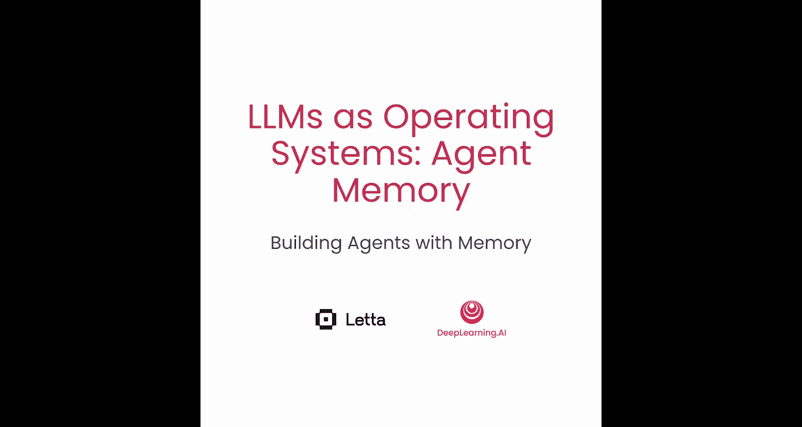

You can use Letta to create MeGPT agents MeGPT agents are stateful and have explicitly managed sections of their context window。

 and this lesson we'll go over a different parts of the Asian state and also archival memory and recall memory。

We'll also go over how you can design agents so agents can be designed by controlling these following knobs。

 so the prompt which includes things like the system prompt and the persona that defines the agent's behavior。

 the agent's tools， the way the agent manages and organizes its memory and also the content of the agent's memory both inside of core and archival these knobs define what's placed into the LLM context at each step。

 thereby defining the agent's behavior So we're first going to import a helper function that's basically just going to make the printing of MenGPT's responses more legible So first we're going to create a letter client。

This client can also connect to a Let server， but in this case we're just going to use an example of the local Letta client that will just run the agent reasoning locally。

We're also going to set the default config for this client to be G 40 mini for this lab。

 So to start off， we're going to go over creating a basic MEGT agent using Letta。

So we'll name this agent simple agent， you can also change this name to be whatever you like。

 so we're first going to call the client function to create an agent。

 so this will take in an agent name and then we also will pass in an instance of the chat memory class。

So this chat memory class basically represents what we learned about previously inside of core memory and you can see here that we're passing in a human string to represent the starter core memory for the human section as well as a persona string to represent the starter core memory for the persona section So for the human section I just put in my name is Sarah。

 but you can also change this to be your own name or also include additional information about yourself。

 And then for the persona we're telling the agent that you're a helpful assistant that loves emojis So this will define the personality of the agent。

 but then also still be editable because it's within the memory section So now that we've created an agent we can now message the agent。

 So we'll just message it something very simple like hello。

So this response is going to generate back two things。

 both the usage as well as the actual messages that the agent returned so this usage statistics object basically just shows you the number of completion tokens and prom tokens that was used to generate the response messages we can use the print function that we imported to print out the response messages。

So you can note here that the agent is generating an internal monologue that explains its actions。

 you can use this monologue to understand why Asian are behaving as they are。

 and this monologue also helps the agent have more time to think to generate better responses。

We can also see that the MGPT agent is actually using a tool to communicate so messages are sent back to the user by using the send message tool This actually allows the agent to communicate over different mediums So for example if you wanted to have the agent generate a text message instead and also allows the agent to generate between what information is sent to the end user so the content inside of this message as opposed to what content is actually kept to itself like the internal monologue So we're now going to go over understanding the different parts of agent state So agent state is what was returned when we created this agent so there's a lot going on here but we'll break it down step by step。

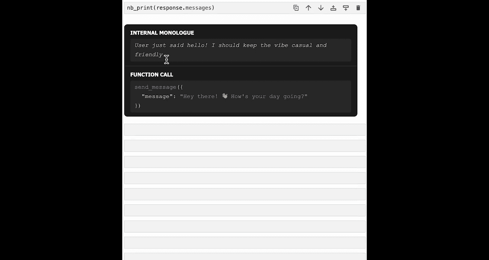

So the first part is the agent system prompt so this also defines what the agent's behavior is similar to the persona but is not editable by the agent So this is actually a really long system prompt that we design to basically get the best performance out of MGBT it's very long but you can see things like it tries to override who the creator of the agent is so this is because a lot of LLMs will have their own system prompts that will say things like I was created by openAI or Anthropic We also have other information like stuff about the control flow。

 we have different user events we also have basic functions like inner thoughts。

 the send message and we also describe things like the memory editing basically how this memory editing should happen and the instructions for that and then we also describe things like the recall memory conversational history。

 core memory and the different blocks of core memory as well as archival memory So this is a really long system prompt that I know I just skimmed over it but you can also read it in your own time if you're interested and sometimes it can be important to edit the system prompt。

If we want to really refine the behavior of the Asian。

Another part of the agent state is a list of tools that the agent has access to so you can see the default tools includes things like sending a message。

 pausing heartbeats to stop the agent loop， searching the conversational history。

 inserting into archival memory， searching their archival memory。

 and also appending and replacing core memory， so using these tools together。

 MGPT agents are able to control their memory。We can also look at what's inside of the core memory of the Asian。

We can do this by accessing the memory field inside of the Asian state。

So we can see here that this returns a memory object， which within it has multiple blocks。

 we'll go over in more detail exactly what these blocks are and what they mean in the later lesson。

Beyond the Asian state， we can also get a summary of what's inside of the Asian's archival memory by using the agent's ID。

So right now we haven't placed anything into the archive of memory nor has the agent so it's empty Similarlyly。

 we can also get a summary of the recall memory so here because we've exchanged a couple messages with the agent already。

 there are already some messages inside of recall memory We can also get the raw message history of the agent you can go and look at individual messages inside of this to understand exactly what the trace was of the agent so core memory is the in contextex memory of the agent and what's unique to menGT is that it can actually edit its own core memory with tools。

So here's an example of this， we can send a message to the agent using its ID and actually tell it my name is actually Bob。

 even though I previously told it that my name is Sarah。

 you can alternatively have the agent add additional information about you that you might not have included in the original human string。

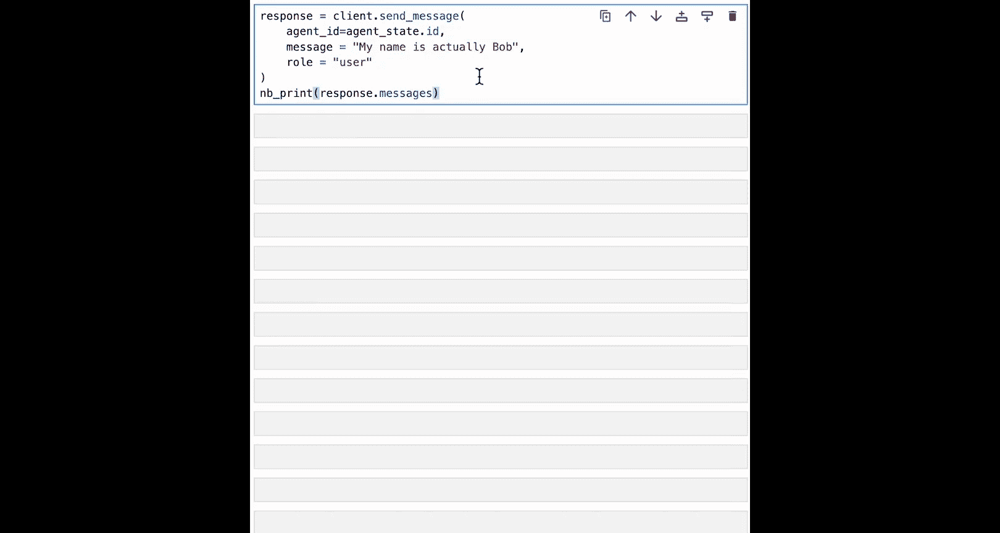

So we can use our print function to print out the response messages so we should update the memory to reflect this you can then see that it calls the core memory replace function so it knows that it needs to update the human section of memory and replace the content My name is Sarah was my name is Bob after it completes this function call it realizes that it successfully updated the memory and then knows the message to user so messages got it Bob what should we chat about today and of course includes an emoji。

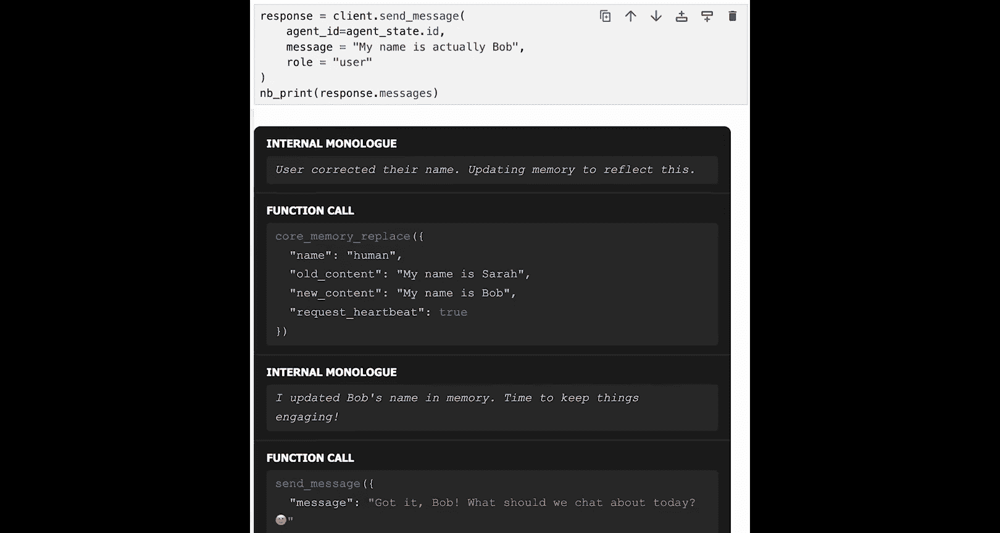

So the persona section of memory and the system prompt are very similar in the sense that they both are defining the behavior that we want from the agent。

 so what this means is that we can actually get the agent to edit its memory about what it should be doing。

So so far we've had a pretty friendly agent that's been using a lot of emojis in its messages。

 but after we give it this feedback， we expect it to never use emojis ever again in whatever messages that we might send in the future。

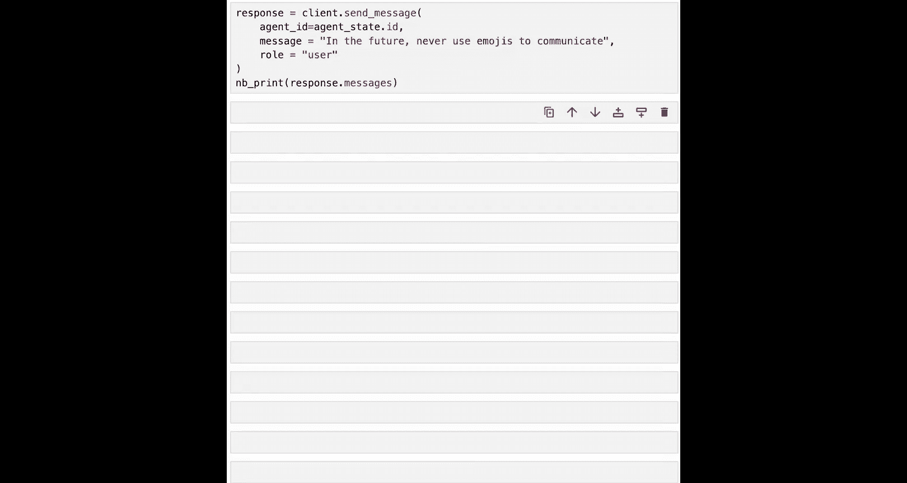

So now we have the response messages we can see that the agent realizes that the user prefers no more emojis to reflect this impeach interactions so similar to the last example we can see it calls core memory replace and it replaces love's emojis with does not use emojis based on Bob's preferences and so finally at the end it sends this message understood Bob will not use emojis anymore。

So what's really cool about this is that we can actually adapt the agent's behavior over time。

 so as the human our user gives feedback to the agent。

 the agent can actually improve using this feedback this feedback will also be included in all future messages to the LLM because it's inside of the memory which is sent every single time in the request。

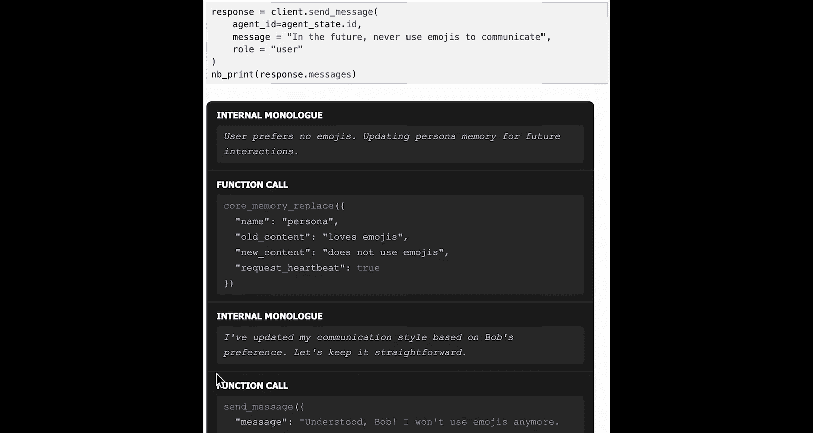

We can also retrieve the current memory of the agent using the agent ID and then grab the persona block to see exactly what the value of the string inside of the agent's memory is you're a helpful assistant that does not use emojis so this basically reflects a change that we saw happen previously。

So next we're going to go a bit deeper into archival memory MEGPT agents or long-ter memory and archival memory which persist data into an external database What this means is that agents can have additional space to write information to outside of its context window which is limited in size。

So we can see what's inside of the agent's archival memory by calling get archival memory so right now it's empty the agent will add archival memories as it sees fit over time。

 but we can also suggest to the agent explicitly that it should add something to archival memory So here we're telling the agent save the aration Bob loves cats to archival you can also change the string Bob loves cats to something specific to yourself。

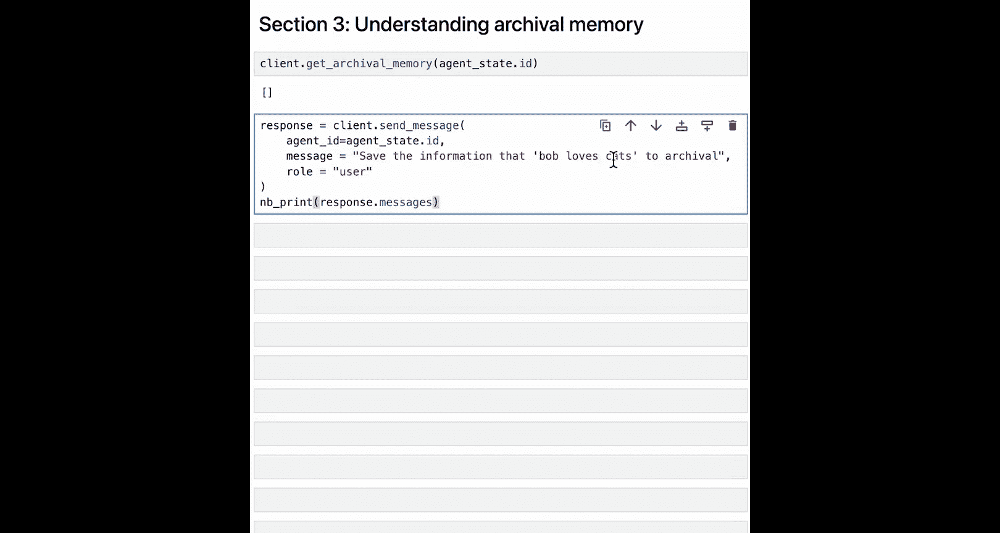

So just like in the previous examples， the agent again has internal monologue where it realizes that it needs to call the archival memory insertst tool and it does so and inserts the data of Bob Loss cats once it does this。

 it acknowledges that it's made this adjustment to the user and follows up with some relevant conversation with what kind of cats do you like。

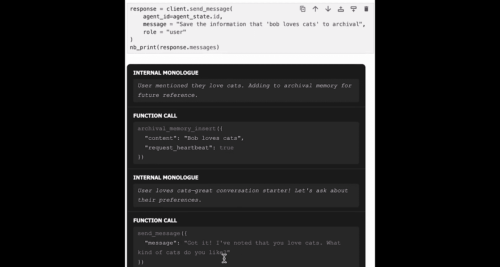

So now if we get the archival memory， we should actually see something inside of the archival memory。

 but we can also just get the text， so now we see that the first row in the archival memory has a text Bob loves cats so that data has been successfully added。

So we just saw an example of how the agent can insert into its archival memory。

 but as the user we can also manually insert memories into an agent's archival memory so using the agent ID。

 we can insert into its archival memory Bobob loves Boston terriers。

And this will return back the passage that was inserted。 This has the text。

 the information about the embeddings used and the date of added and some other things。

 So now the agent should have two memories inside of its archival memory and we can try asking what kind of animals do I like Bob loves cats and also Bob loves Boston terriers So given this result from the archival memory search。

 the agent has some internal monologue about continuing the conversation given these results and sends back a message you love cats in Boston terriers and then it also tries to continue to keep the conversation engaging with you have a favorite between them So this is an example of how the agent can use what's in its archival memory to generate more informative responses back to the user。

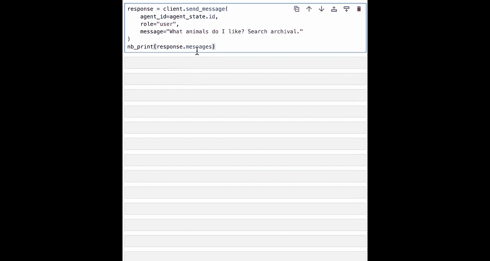

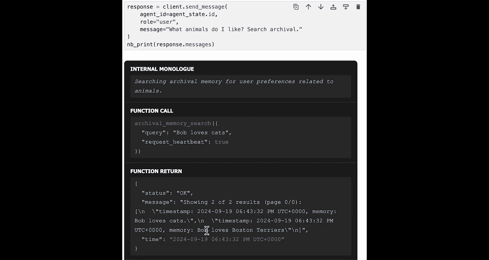

So we've now built an agent that has archival memories。

 core memories and also edited those core and archival memories。

 so congratulations now you are able to create a MGPT agent that has self-manage memory in the future lessons we'll also go over how to implement more advanced capabilities for core memory and also how to extend the RAG capabilities of MGPT agents。

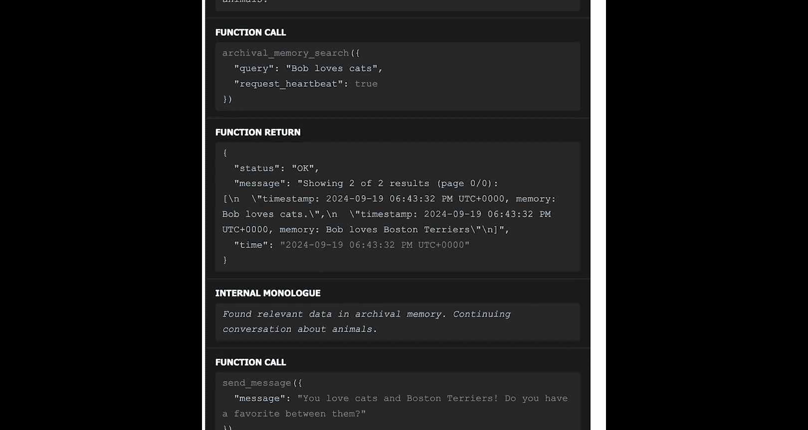