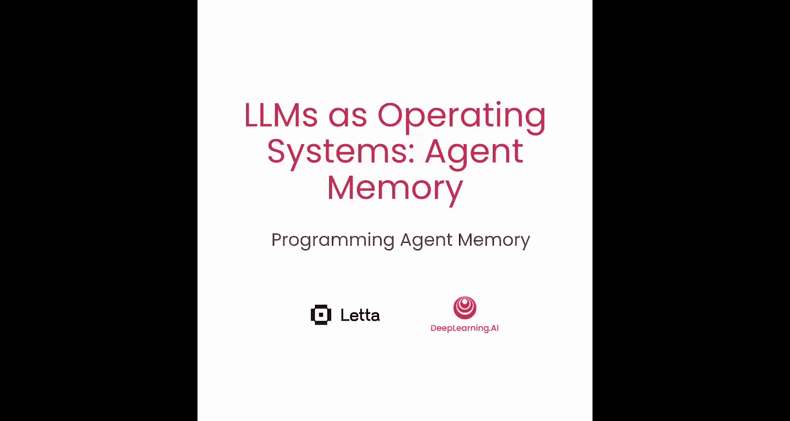
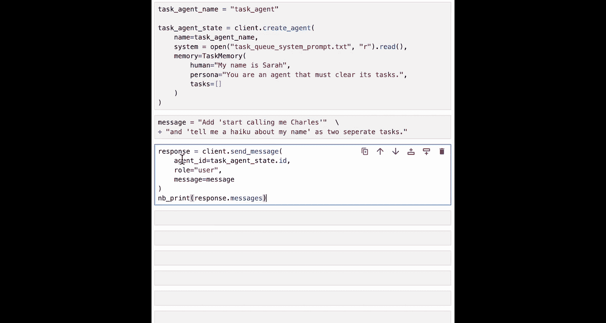
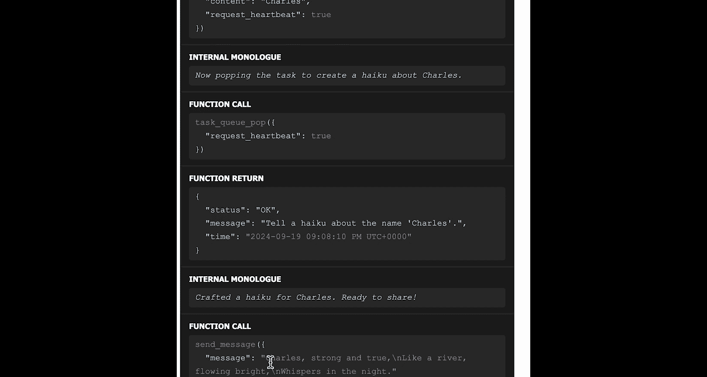
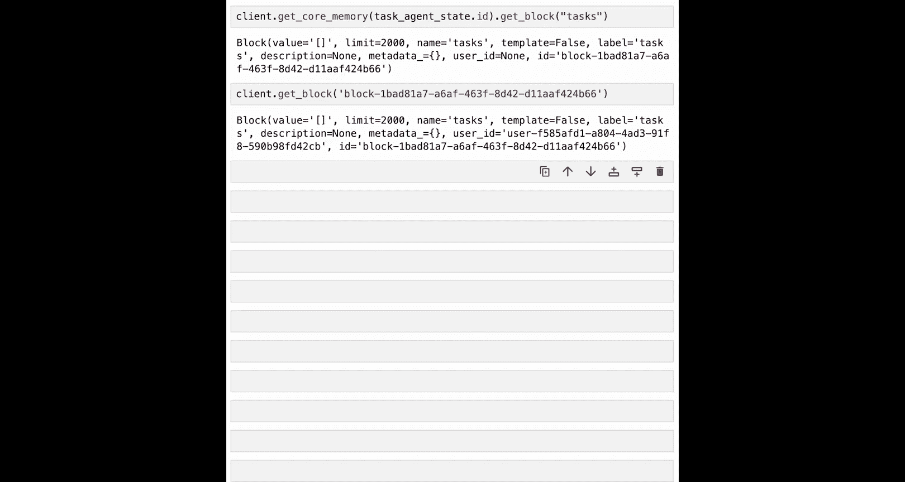

# 吴恩达《LLMs作为操作系统｜LLMs as Operating Systems： Agent Memory》中英字幕 - P5：5.Programming Agent Memory.zh_en - GPT中英字幕课程资源 - BV1PFmiYiEWn

This lesson will dive deeper into how core memory is designed and implemented。

 well also go through an example of how you can customize core memory with custom memory blocks and tools。

 let's get to it。

Core memory is defined by memory blocks， which are basically subsections of memory and memory tools。

 The core memory within the context window is actually divided into multiple blocks where each block corresponds to some kind of character limit。

 which defines how much of the context window can be used up by that block。

 The block also has a label such as human or persona， which can be used to reference the block。

 And finally， of course， the block has a value。 So this is the actual data that's placed into the context window。

 So， for example， the name is Sarah。In addition to these blocks。

 core memory also has tools associated with that memory。

 so for example you might have core memory replace where it specifies the block label in this case human as well as the old content Sarah。

 which is getting replaced by the new content bo B data is compiled to the context window at inference time to make up the core memory context So for example for the human block you might have the tag that shows the section human and then this tag will also include the number of characters out of the total budget that's being used so far in addition to the value memory blocks are synced to a database and have unique IDs so they can actually be shared across multiple agents by syncing the block value to multiple agents context window。

So to get started we're going to import the same helper function and then we're also going to create our Letta client just like last time we're also going to make sure to use GT40 mini for this lab When we previously created agents we use the chat memory class so we're going to actually go into what the chat memory class is once we've created this memory class what actually happens under the hood is that there's multiple blocks that are created we can see this by listing the block names inside of chat memory so you can see here it lists out persona and also a human block name。

We can also view the actual block inside of chat memory by getting the block human the block includes the value that's currently inside of the block。

 so this is what's compiled into the context window you can also see the character limit and then also the name of the block The chat memory class also includes two default functions for editing memory core memory append and core memory replace we're going to use the Python In package to view these functions。

So for example， we can look at the source for the chat memory core memory append function。

 so this function is actually added as a tool to the agent when the agent is created with a chat memory memory class。

So you can see here the definition of core memory append。

 it basically takes in the name of the memory block that it wants to edit。

 as well as the content to append。We also have to provide a doc stream that describes to the agent what the purpose of the tool is and then also what arguments it needs to provide and what it should expect in response。

And we can see here that we actually execute this core memory append by grabbing the block value。

 appending the data to the block value， and then updating the block value in the Asians memory Finally。

 we can also view the promptm template used by chat memory。

 so this basically is a template that defines how chat memory should be compiled into the context window。

So you can see in this compilation string here that for each block we're basically showing the block name as well as the number of characters being used in addition to the actual value of the block。

 so this is what's placed into the core memory section of the LLM's context window these memory classes that the agents have are actually intended to be customized for different applications so you can customize memory by defining custom blocks so these are additional blocks that aren't necessarily human in persona that are perhaps specific to your agent you can also define custom memory tools so instead of just doing core memory append or core memory of place。

 you can define different tools or additional tools to edit blocks。

And of course you can also edit the memory templates so change the way that memory dot compile represents the memory in string format。

So in this lab we're next going to implement a custom memory class TaskQe memory and TaskQ memory is going to extend chat memory to not just have a human and persona block but also have a task block that keeps track of what task the agent should currently be working on we're also going to add two additional custom memory tools so TaskQ push which pushes a new task to the T queuee and then also TaskQ pop。

So we're first going to start off with importing chat memory as well as the block class first we're going to define the initialization function for task memory so task memory is going to simply extend chat memory so there's also base memory class which you can extend as well if you don't want to have the human and persona blocks already defined and the initialization for task memory is basically going to take in the same human and persona string as chat memory but also take in a list of tasks and for human and persona we'll just pass this back to the parent class but then for tasks we'll create a new block with the name tasks and have the limit of 2000 characters and then have the value of tasks be JSON dumping this task list。

We'll also define two custom memory editing functions， so the first is going to be taskaskQ push。

 which pushes a task description。You'll see here that self is actually agent， not task memory。

 this a bit confusing， but when this tool is actually executed。

 this function gets attached to the agent class so that it can have access to its memory What this function will do is push a task queue stored into the core memory and it does this by taking in the task description and appending it to the list of tasks that we have。

We're also going to define two custom memory tools for a task memory so first we have task queue push which is going to push a task description to the task queue you'll notice here that one of the inputs is agent not task memory This is a bit confusing when this function is actually run It's being run by being attached to the agent class so that it can have access to that agent's actual memories This function will append the task description by loading back a list from the block value of tasks and then appending the task description to the list of strings that we have in tasks and then updating the block value to the updated list in the JSON string representation We're doing this JSON loads in JSON dumps because we only support string types so we have to make sure that we are storing the block values in the format of a string。

We'll also define a task queue pop， so this will grab the next task from the task queue。

 we'll print the task， and then we'll also update the current block value to no longer have the task that we just popped。

So now we can create an agent that has this custom task memory class to incorporate information about the task Cu memory rather than being specific to chat memory in addition to the system prompt we also pass in an instance of our task memory class so I wrote down my name is Sarah。

 but you should update this to reflect information about yourself。

And then we also pass into the persona， which is that you are an agent that must clear its tasks。

 and just for this example， we're going to pass it an empty task list。

So we now want this agent to add tasks to its task queue。So we can send a message like this， first。

 start calling me Charles and tell me a haiku about my name as two separate tasks。

We can now send this message to the task agent So in addition to the actual response print。

 we can see that the server actually printed out the current tasks since we added these prints into the task queue pop so going through this we can first see the internal monologue so the agent realizes that it should add task to its task queue So it first calls task queue push on start calling me Charles and then it also calls task queue push on teleahhaku about the name Charles and we specified in both the system prompt and also the persona that this agent should always make sure that the task queue is empty so now that it's actually added two things into its task queue it can see inside of its core memory that it has tasks that it hasn't achieved and so instead of immediately responding to the user it actually starts to pop these tasks from the task queue so you can see it calls T queue pop once and then gets this task start calling me Charles to core memory and then it actually runs this task so it calls core memory append So it's actually following instructions from。

Its own taskcu memory rather than instructions directly from the user。And so after it does this。

 it still again sees that it has more tasks in its memory because that's showing up in its context window so it caused Taskcu pop again and then it gets the second task which is tell a haiku about the name Charles And so finally across the Haiku and then now it can see that its task queue is empty inside of its memory since it's popped off both tasks and so it knows that it can finally send a message back to the user which includes a Haiku with the name Charles So this was a very long sequence。

 but I encourage you if you're going through the notebook to look at each step in detail to really understand how the agent is making decisions at each step This hopefully also shows you just how powerful these models are when it comes to multistep reasoning were able to run a huge number of steps to achieve something quite complex It's possible that you didn't get the same results that I just did and your agent was lazy and didn't actually run all its tasks when it was supposed to。

😊。

If this happened to you， then I recommend just suggesting to the agent that it actually complete its tasks。

Finally， we can make sure that the agent properly cleared out its whole task queue by actually looking at its core memory and getting the task block。

So if we call this with a client then we get back this block and indeed it's empty which means that our agent properly cleared out its tasks One last thing I want to mention is we talk about in the slides how all these blocks are actually persisted to a database so we can call client。

ge block and then copy paste this block ID。So this returns back the exact same block。

 and this is because it's persisted in a database， so even if you're on a different server or even accessing this from a different agent or notebook。

 you can actually still access the same block data。

You've now implemented a custom memory class that can control the way that your agent manages its memory you can use this to implement much more advanced agents that control the context in ways that are specific to your own applications。

