# 吴恩达《LLMs作为操作系统｜LLMs as Operating Systems： Agent Memory》中英字幕 - P6：6.L5 Agentic RAG & External Memory.zh_en - GPT中英字幕课程资源 - BV1PFmiYiEWn

In this lesson we'll explain the relationship between external memory and RAG we'll also implement agent RaG in two ways。

 first by copying the data directly into the Asian's archival memory。

 and second giving the agent access to a La chain tool to query the web。

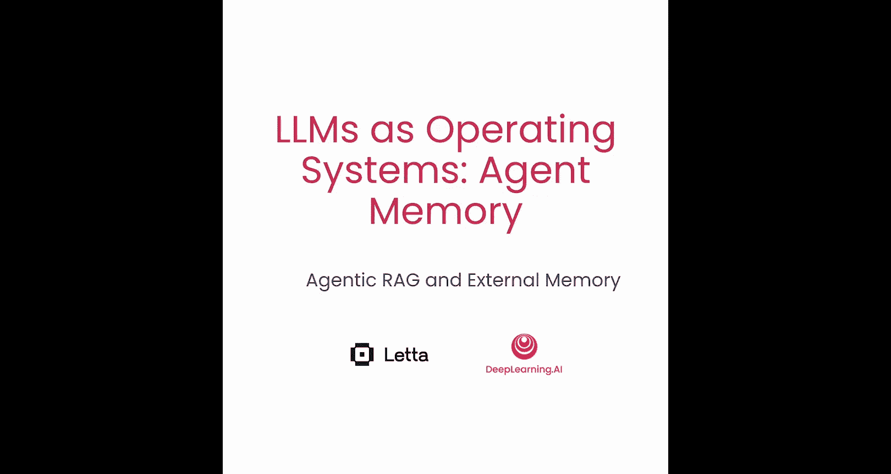

You'll build a research agent to demonstrate this， let's get coding。

We learned in previous lessons that MGBT agents can use their external memory so both recall and archival memory for agentic rag。

 so this basically means retrieving information from archival and recall to inform the new messages that it generates unlike traditional rag agentic Ra allows agents to define both when and how to retrieve the data so for example。

 with the archival memory search it also decides what the actual query into the search function should be。

 so you'll often see variations in what the actual query that the agent makes is。

 so for example here it chose the query dog。In MGPT。

 Asians have a general purpose archival memory that is the default external memory for the agent so data can be saved in here by both the agent and the user to be used for RaG so for example。

 rather than the agent explicitly storing memories you as the user can also do things like upload files like a handbook PDF into the archival memory Age can also have additional forms of external memory or retrieve sources for RaG via tools So in this lab we're going to implement an agent that has access to additional tools for RaG so we're first going to go over an example of accessing a fake external database and then also running a Google search using La chain。

So first we're going to import our usual notebook print tool and then we're also going to add some environment variables so that we can use Tvili search as always。

 we'll also create our Letta client。We'll also set the default LM for the letter client to be GBBT 40 mini。

We're first going to go over how to load data manually as a user into archival memory。

 so in a previous lab we went over how to insert a string into archival memory。

 but you may also want to load data sources so for example load data from a file into archival memory。

So we can do this using the client createate source function and specify a source name。

 so we name our source the employee handbook and so when this source is created you can see that it also is configured with an embedding config which specifies what is the embedding model that's going to be used to generate embeddings for this source data data within a source has to all use the same embedding config so that we can make sure that our embedding- based queries are accurate。

Next we're going to load a file into the source called Handbook。pdf。

 so this is just a fake handbook that I generated using chatGBT。

 and we're going to specify the source by the ID to tell the client to load data from this handbook。

 PDF and load it into the source。So now that data has been loaded into the source。

 we can actually attach it to an agent。So let's first just create a basic MEGBT agent。

 you can also specify a name if you'd like， but you don't have to。

And this agent currently has no archival memory since we haven't even interacted with it at all。

 but we're now going to attach the source data to the agent。

We're going to do this by using the client attached source function and specifying the Asian ID in the source ID。

When we run this， what's happening is that the data inside of the source is actually being copied into the Asian's archival memory。

 the source contains data that has already been pre-processed。

 so it's already chunked to the data inside of handbook。 PDF and also generated embeddings for it。

We can see what sources are attached to an agent using the list sources function。

Now we can ask our agent a question that relates to something like the company's vacation policies that's contained in the handbook you don't necessarily need to add search archival because ideally the agent does realize that it doesn't have this answer to the information and searches archival automatically but for the sake of this notebook I'm going to add this phrase to make sure that the agent definitely searches archival memory。

 so we first see that there's an internal monologue the user is asking about the company's vacation policies and so it realizes that it needs to do an archival memory search so it decides to query vacation policies into its archival memory。

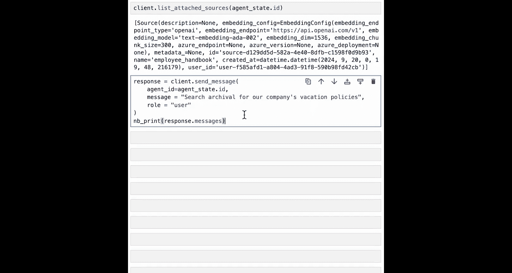

And since we loaded data into the archival memory store through the source。

 there's actually a bunch of data in here corresponding to the employee handbook that we loaded in。

 you can see that it returned five results in the archival memory research and then now it decides to respond to the user about vacation policies to keep the conversation engaging so just for fun I made the vacation policies in this handbook really horrible so it answers it looks like vacation policies in our company are quite specific。

 it'll need to provide an AI agent that can fully perform your duties during any lead and ensure that they've been tested and approved a month in advance what do you think about that process。

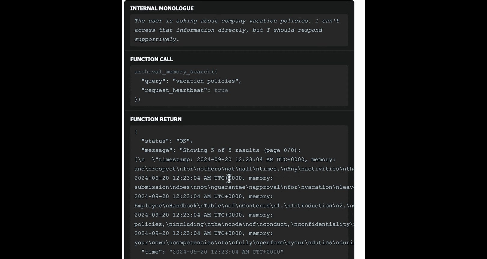

But of course， if you have a different employee handbook。

 you'll get a different response because the Asian is actually using this retrieved data to run ragG and give a response based off of that retrieved data。

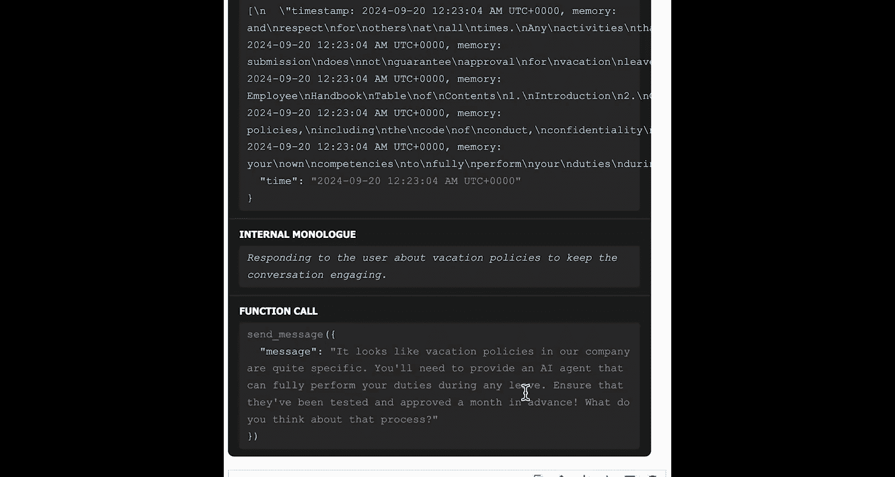

So we just saw how the agent can connect to external data using archival memory。

 but rather than using archival memory search， you can actually just also add your own custom tools so for example。

 if you already have your own RaG data pipeline that you're pretty happy with。

 you can actually just directly connect your MGBT agent to that as opposed to having to load data into archival memory。

So we have this fake Que B database tool that we made。

And so what this tool does is if given a name looks up the birthday of someone so the argument is a string and then the birthday is returned as the function response and so our quote database is actually just a dictionary。

 but for the sake of this example， let's pretend that it's a database so all this function does is look up the name in the dictionary and then return the data if it finds it returns then if it doesn't so the way that we can connect this function to MGBT is to create a tool with this function we can do this by calling client do create tool and simply passing in the function。

When this function is passed in， Letta will actually parse the functionss docstream to generate an open AI JSON schema for the function automatically。

So we just created this tool and we can also look at the tool object that it created。

 so this is a bit difficult to parse at a high level。

 it'll include the actual source code as well as the JSON schema to pass open AI。

So now we can create an agent that has access to this birthday database。

 we'll call this agent birthday agent and give it access to a tool birthday tool。

 and then we'll also give it the standard chat memory where in the persona we tell it that they're an agent with access to a birthday database and that they can look up information about the user's birthday so now that we've created this agent。

 we can now ask it a very simple question when is my birthday and since it knows my name or your name if you changed it。

 it should be able to look up this information and the tool。

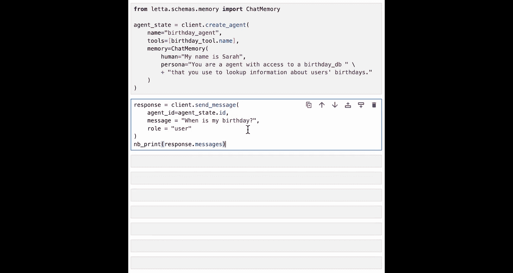

So looking at these responses， we can see that the agent's internal monologue decided to fetch the birthday。

 so it callsQury Bir databasease， gets the responsepon， which is March 6， 1997， my birthday。

 and then now it responds including the birthday。So this is a very simple example。

 but hopefully it shows you how you can connect external data tables that you might have to a MGPT agent by specifying a tool that has a query function。

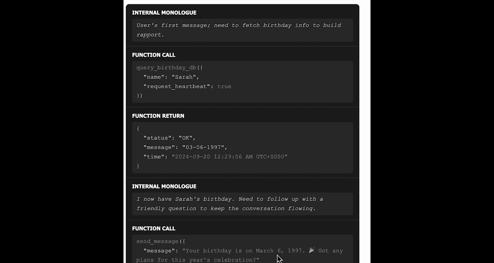

Now we're going to go over a pretty similar example。

 except we're going to use Lchain to search the web using a L chain tool Letta actually supports tools from both La chain and Care AI so if there's tools that you want to use from those packages you can use them along with Letta agents In this example we're going to create a research agent that is able to search the web to answer a question and then also include citations。

So first to make sure that we can get set up with Tivli， we're going to import our Tvili API key。

 and then we're going to import the Tvili search results tool from Laangchain。

So just to make sure this is working， you can enter some kind of query。

 so I'm going to do what's Obama's first name， also feel free to enter your own query and then we're going to see what the output is。

😊，So this is the response that the tool generates， a lot of text actually。

 but it provides a URL also and some kind of summary of the content。

You can try running this tool by calling dot run on some kind of query and then you'll get results back like this which include both the URL and the content This is a lot of tokens so it might actually overflow an LLM's context window but in Let framework we actually will automatically trim the responses of functions that return results that are too long。

We can import this La chain tool into Letta by calling the tool dot from Laang chain function and passing in the La chain tool。

 so this will create a Let tool object once we create the tool we need to actually persist it so that we can add it to different agents。

Now we can create a research agent that uses a Tivli search tool first we're going to define the research agent persona this is basically telling the agent that they can use the search tool by its name in order to search the web and then we also instruct the agent to generate references or to provide links to its sources so here's an example here of if the user asks what's Obama's first name。

 even if the assistant answers in their response they should also include sources。

Using this persona we can now create the research agent。

 so we'll name the agent research agent and we'll pass in the search tool name and then we'll of course also create the chat memory class which uses the research agent persona so now we can ask the research agent a question like who founded OpenAI。

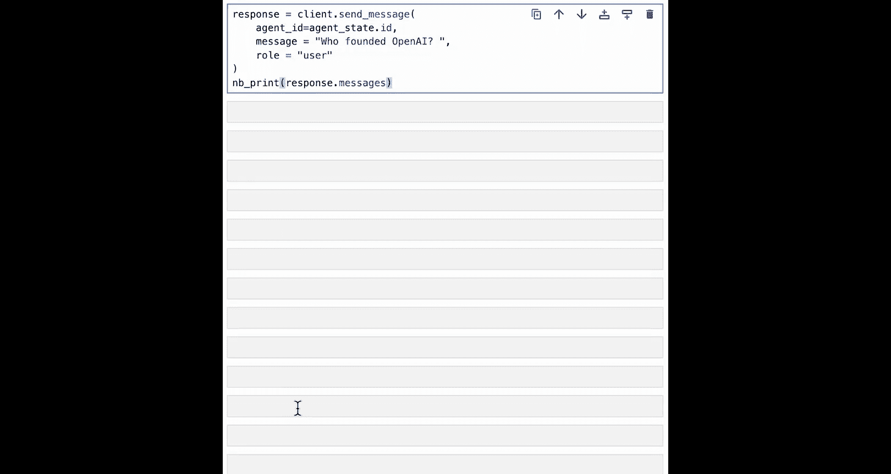

So we can see here that because the function return was really large。

 it actually got truncated by Letta。

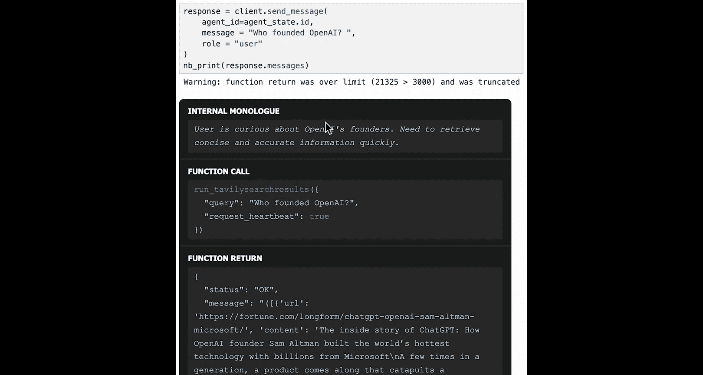

Looking at the response messages， we can see that the agent successfully called the imported La chainin tool to run a Tvi search of who founded OpenAI。

 and then it uses this information to respond to the user with the send message function to provide both the answer and then also citations。

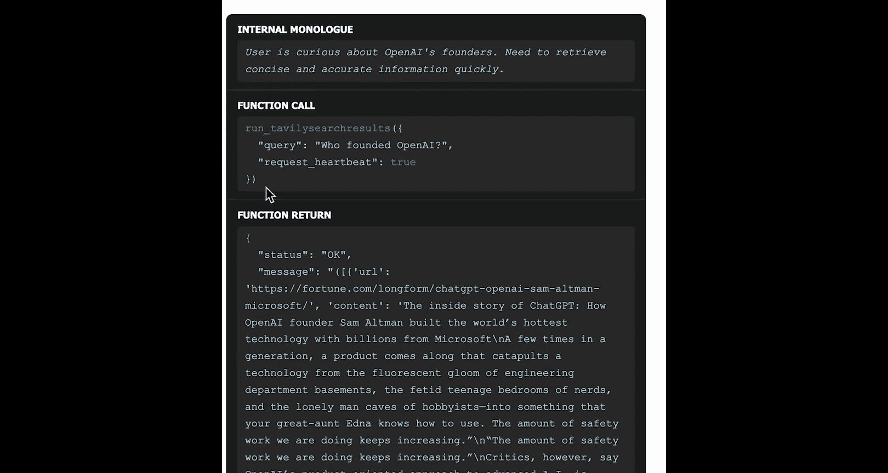

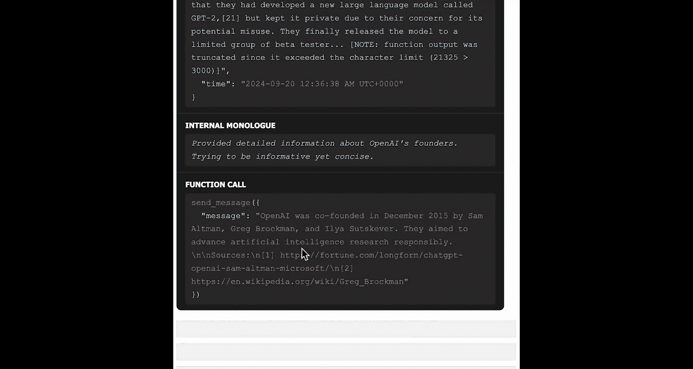

I have actually had some trouble with GT40 minii where it doesn't always do this so if you were unlucky you can also run this same query with a GPT4 based agent instead。

 but you should make sure to only run this once or twice because it's very expensive and we don't want you to run out of open AI credits so to do this you can actually import an LLM config object from Letta then we can create an agent this time we'll just name a GPT4 search agent which uses the GT4 config you can also pass in your custom LLM configs here as well if you're running this locally。

And now we can ask the same question， but this time it'll run with G4 instead of G40 minii you'll probably notice that the query runs much more slowly。

 this is because GB4 is a much higher latency and more expensive model at the same time the results are usually a lot more consistent so if you didn't get good results with the previous example you can try this out just like it was supposed to it provides both a response as well as the links。

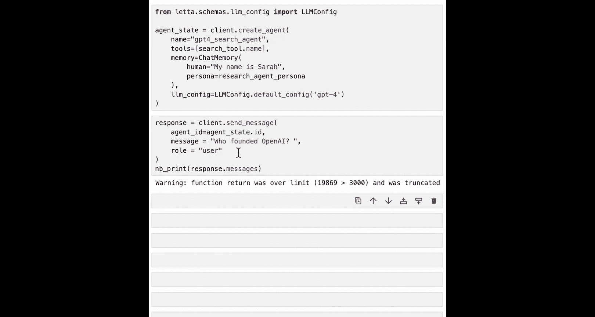

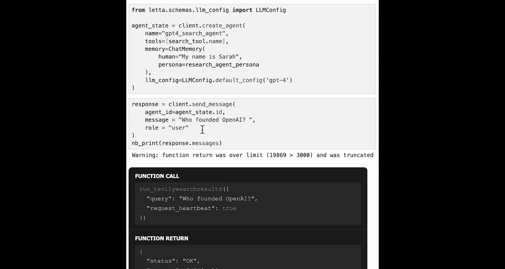

So now we've successfully implemented a MGPT based research agent using Letta as well as Lang chain tools。

 so congratulations， we've implemented an example where we copy data into the Asian's archival memory and then also examples where we define a query into an external database as well as using Lang chainin based tools。

If you already use frameworks like Laang chainin and CareI。

 you can use those same tools but also get the memory capabilities of MGBT by using Letta。

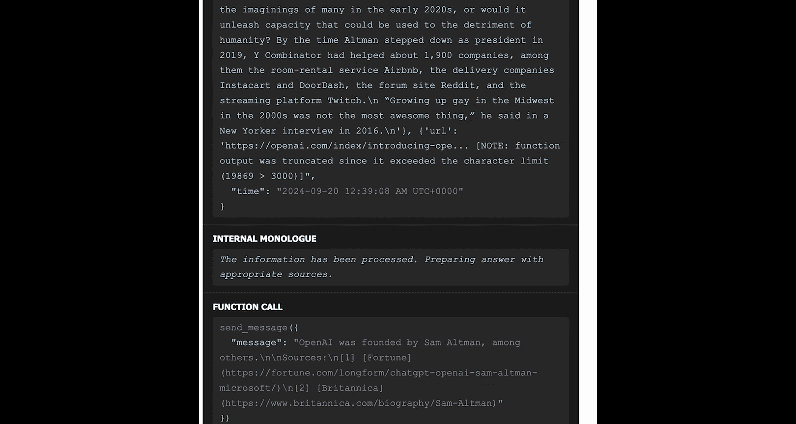