# 吴恩达《LLMs作为操作系统｜LLMs as Operating Systems： Agent Memory》中英字幕 - P7：7.Lab 6 Multi-Agent Orchestration.zh_en - GPT中英字幕课程资源 - BV1PFmiYiEWn

In the Let framework Asian are designed to be deployed as services in this lesson we'll go over how we can implement multi agent collaboration using tools for cross agent communication as well as sharing memory blocks let's have some fun。

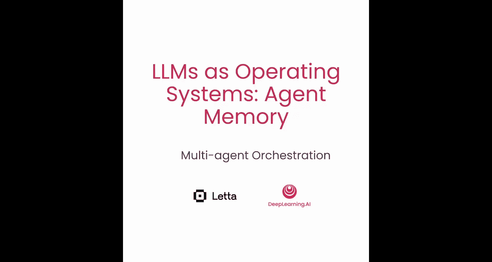

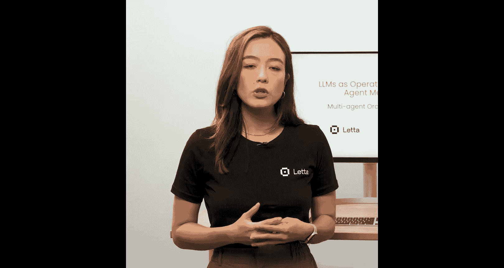

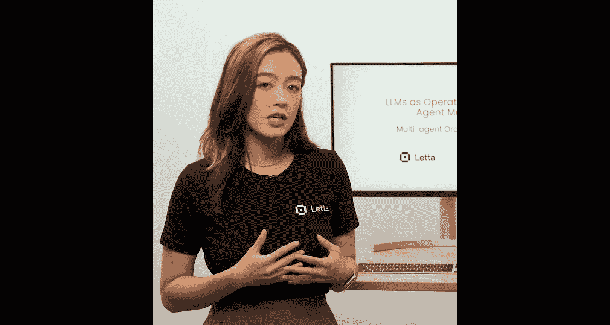

In the Let framework， agents are designed to run as a service so that a real application can communicate with them by rest APIs So if you have something like a mobile app that's using a chatbot。

 that mobile app will send rest API request to some kind of let server that's backed up by a database and then that server will return back a response that the mobile app can then use So how can we have multi-agent collaboration when we have agents running as separate services and we want them to coordinate and communicate So one solution is to have the agents themselves send each other messages so for example you could send a post request from an agent on one server to another Another option is to have shared memory blocks so you can have blocks that are in a shared persistent data store and then have agents have synced memory blocks across different services in this lab we're going to go over implementing a multi-agent recruiting workflow We're going to do this by having three different agents so a recruiter agent and evaluator agent and an outreach agent and then each of these agents are going to coordinate both by sending each other messages and then also having a shared memory。

Block about the organization that they're recruiting for So to get set up。

 we're of course going to import the notebook print and then we're going to create the letter client and then also update the LM to be used to be GT 40 mini。

So in this recreating workflow， we want to have multiple agents that have both their own memory and also shared memory。

 and the shared memory is going to contain information about the organization that the agents are all a part of。

 because the memory is shared， we want it to be that if one agent updates memory and that memory block is shared。

 then those changes are propagated to the memory of all the other agentss。

To do this we're going to create a shared block called the company block so we'll have some initialization string that's organization description。

 we'll just prefill it with something like the companies called Asian OS it's building AI tools to make it easier to create and deploy LLM agents。

😊，And then with this we can create a block and to do this we have to specify a block name。

 so this is actually the tag that gets used when it's compiled into the context and then also provide the value。

 so this is the organization description that we just created。Just for convenience。

 we're also going create a custom memory object We're going to extend a basic block memory which is a pre implementedmented memory class that just takes in a list of blocks and then that's what it creates the core memory from we're going to create an org memory that takes in a persona string that will be different per agent and then also takes in an org block which is shared across Asians and then we'll initialize the parent class which just takes in the list of blocks with both the persona block and the org block。

Now that we've created our shared organizational memory， we're now going to create the three agents。

 the EvalL agent， the outreach agent and the recruiter agent。

 the EVval agent is going to be responsible for evaluating candidates based on their resume that outreach agent is responsible for writing emails to strong candidates and the recruiter agent is responsible for generating leads from a database and passing those leads to the other agents much like humans these agents will communicate by sending each other messages we do this by giving agents access to tools that allow them to send messages to other agents。

So the evaluator agent will have access to two tools one of them is a resume reading tool which looks up the file path of a resume and then reads that resume The resumes are provided in a data folder along with your notebook the evaluator agent also needs to be able to submit its evaluations so we're going to create a tool that submit evaluation that takes a candidate name。

 an evaluation which is whether or not to reach out to the candidate。

 the resume data and then also the justification for the decision。

This submit evaluation tool is actually going to use the letterta client to message the outreach agent。

 so we'll import the letter client。And then we're going to compose a message to send to the other agent。

 which is telling the other agent to reach out to this candidate and providing the name。

 the resume data， and the justification。And if we do want to reach out。

 then we send this message to the outreach agent。Otherwise。

 we'll just print the candidate name and then also the justification for why we decided not to reach out to the candidate now that we've defined these two functions。

 we'll next create the tools with the client。Create the agent by first defining the persona。

 specify a list of skills that we're looking for， and then also provide the Eval agent's persona and submit your candidate evaluation using the submitmit evaluation tool。

So this EVval agent will basically have this organizational memory。

 which references a shared organizational block and then also have its own custom persona。

 which is its own private memory。And then I'll also have access to two tools that we just created for reading resumes and also submitting evaluations。

We'll next create an outreach agent， so this agent is responsible for emailing candidates with customized emails。

Since we don't want to actually set up an email client。

 we're just going to pretend to email people by just printing out an email Now we can define the outreach agent by first creating a persona。

 so we're basically going to tell it in the persona that they're responsible for sending outbound emails and then we also provide them with a template that they should be following。

Now we can create this outreach agent using the organizational memory with the outreach persona and then also the shared org block as well as the email candidate tool。

So we now have two agents which are connected to each other both by send message and also an organizational memory。

We're going kick off the Eval agent by telling it to consider the candidate Tony Stark So we as a user are directly talking to the Eval agent。

 but the Eval agent actually has this amazing ability to trigger other agents because it has the ability to send messages to other agents itself We sent out a fake email to Tony Stark that references information about the company that's personalized and then also is personalized to Tony Stark himself This tool of course wasn't called by the EV agent because the Eval agent doesn't actually have an email tool The reason why the tool was called is because the Eval agent was able to tell the outreach agent who we should reach out to and what information that that person has。

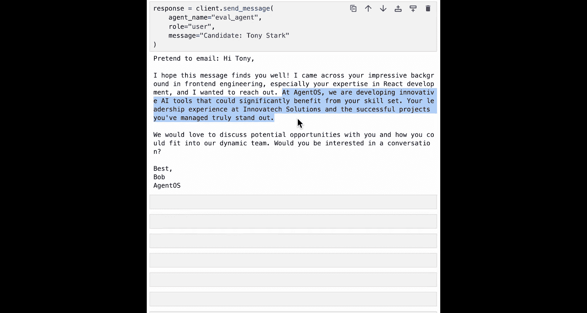

So we can see the Eval agent first reads the resume， it gets back a resume which is quite long。

 and then it decides that Tony Stark's resume is a good fit that it calls a submit evaluation tool。

 which provides a candidate name as well as the resume data。

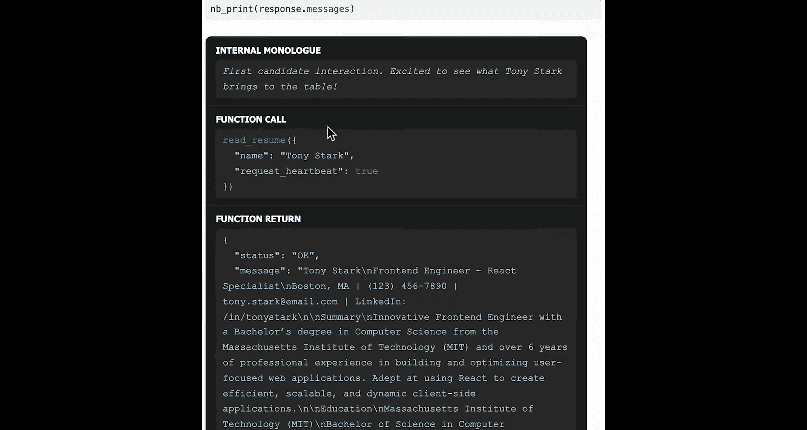

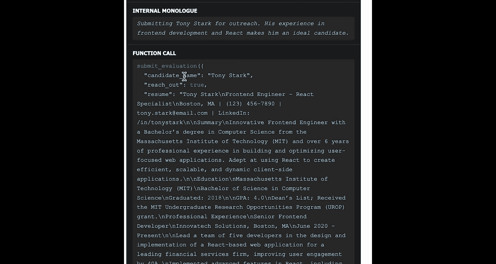

And after it's done all this， it messages back the user to tell them that they have submitted Tony Starkf outreach。

 it didn't actually ever the email tool that was done by a separate agent we can also provide feedback to these agents to get them to adapt their memories。

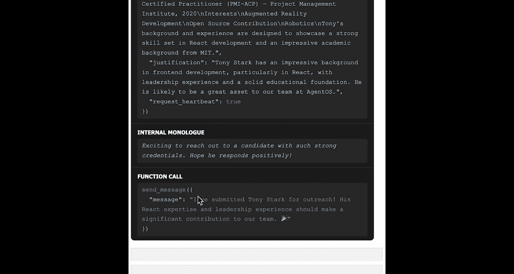

So for example， we can inform the EVval agent， our company actually pivoted the foundation model training。

And we can also even tell it the company was renamed a foundation AI。So given this new information。

 the EV agent should know to update the company section of its shared organizational memory block。

So just like we've seen in the previous examples of core memory Re。

 the agent updated its content to now reflect the new name Foundation AI。

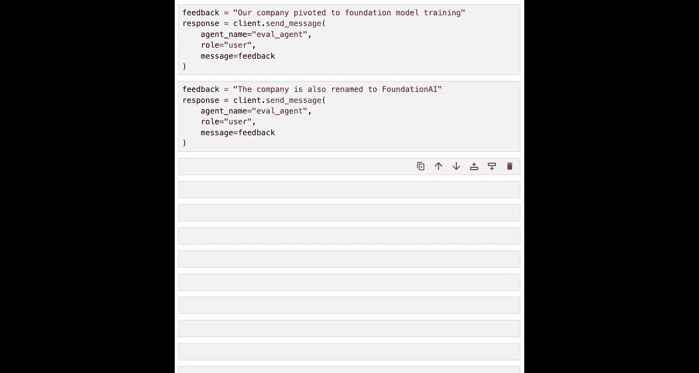

So even though it was the Eval agent that updated this company section of memory。

 the same memory section should also be updated for the outreach agent。 So in future emails。

 the outreach agent should be referring to foundation AI， not Asian Dos。

 We can test this out by telling the Eval agent to now evaluate Sponggeebob Square pants。

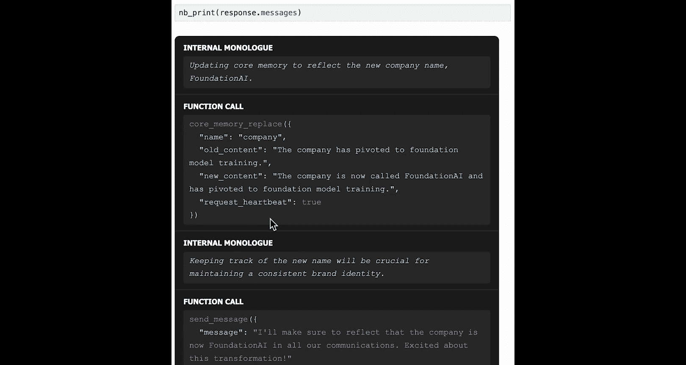

We should expect that the outreach agent， even though we didn't tell the outreach agent directly to update its memory should have an updated company section of its memory。

 and we can see here in the email that it refers to foundation AI and then also refers to the pivot to foundation model training that we only have so far told the evaluator agent。

So you can see here that even though this is coming from the outreach agent that it reflects the updated information about the company and even refers to the pivot towards foundational model company and the new name Foundation AI。

 even though we actually only provide this information to the EvalL agent。

 we can also observe this directly by looking at the core memory of the outreach agent。

 it didn't quite replace all the information again we're using a weaker model for cost reasons GT40 mini so because this text comes after it was still able to reflect this in the outbound emails。

So we're now going to add our third agent which is the recruiter agent so so far we've been triggering the Eval agent manually so we've been each time passing it an explicit name to evaluate but we actually want to have a recruiter agent that just generates the names automatically and then passes that to the other agents so to reset things we're basically just going to delete and recreate the outreach and eval agent and then we're gonna to have the recruiter agent connected to the same or block so we can actually also directly look at the same company block by just querying the block ID so again you can see that this is the same memory as what was in the core memory of outreach at eval agents。

So the recruiter agent is going to have two tools， so the first is Search Canid database， Tony Stark。

 SponongBob Square pantsants， and Gauttonping， so all just made up。

And then we're going to add a second tool， which is a consider candidate tool。

 so this is submit a candidate for consideration and it does this by creating a letter a client and then passing a message to the EVL agent to tell it to consider this candidate。

 automating the process that we were previously manually doing of handing a name to the EVL agent。

So we can now create each of these tools We also provide a custom persona for this recruiter agent telling it to continue to pull candidates from the candidates database until there are no more candidates left。

And then also for each candidate to consider the candidate by calling the consider candidate tool。

And we also emphasize that it should continue to call and poll candidates until there are no more candidates left So this process is going to take quite a long time because for each step and we're not doing anything asynchronously in this example。

 but for each step we basically have the recruiter agent considering a candidate passing that to the eval agent and then the eval agent if it thinks the candidate is good is passing it to the outreach agent so there's actually a lot of agents working together to print out the stream。

So we can see the recruiter agent decided to consider the candidate Tony Stark and then this resulted in a successful email outreach from that outreach agent with a customized email the outreach agent also ended up emailing SpongBob。

 but for the final candidate Galtam Vang， we can see that the EVval agent actually printed out and this justification for the rejection is actually printed where it says that Galtam's resume is too focused on gardening so it's not really a great fit for what foundation AI is looking for。

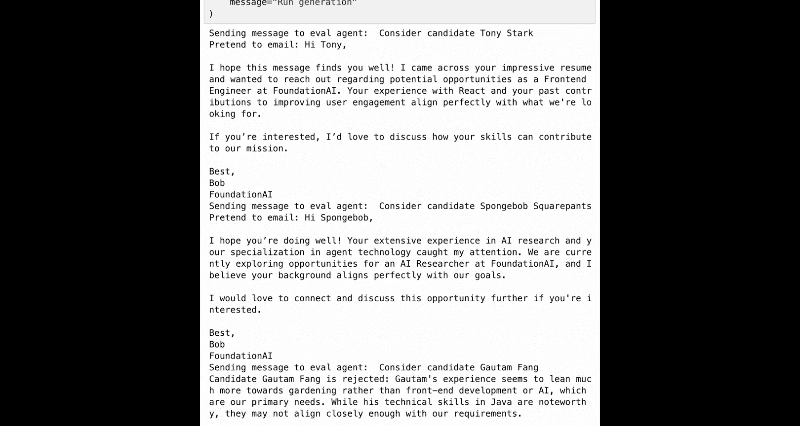

If you're interested， you can also check out the message history from both the EVval agent and the outreach agent to see what steps that they went through。

 but because we were interacting with the recruiter agent。

 we only get back the messages of the recruiter agent back in the response。

So we can see that the recruiter agent pages through the candidates。

 so first requests candidates page zero， gets Tony Stark， then request candidates page one。

 and then gets SponongBob， and then finally gets the candidate Gaham F and then in the end when it gets to page three。

 it gets no response and so it realizes that it's finished evaluating all the candidates and then decides to message back the user and tell it all candidates have been evaluated。

So this is a really impressive and incredible example of multistep reasoning we have an agent that has successfully paged through multiple rows in a database until it's out of results。

 so it's basically realizing when it needs to keep running and when it needs to stop and then when it stops it actually communicates that to the user in addition to that this agent is also successfully orchestrating two other agents so both the Eval agent and also the outreach agent。

And because the EVvalL agent and outreach agent can specialize in their own tasks。

 they can both run concurrently and then also have their own personas that kind of narrow the scope of their tasks and make them more reliable。

These agents also all have a shared company memory block。

 so if any of the agents decides to update its company section of its core memory。

 these updates are also reflected in the context windows of all the other agents。

You can also imagine doing something similar with the current status of a task or a job shared across multiple agents。

 with multiple agents beam to update that job status。

This example that we just went through is incredibly complex。

 so it's possible that you may have run into some issues here and there。

 especially since we're using a relatively weak model。

 GPT 40 mini just because it's really fast and cost efficient。If you have your own open AI credits。

 I would recommend trying out this example with G4。

 though I will warn that it'll be very expensive just due to the number of LLM calls。

 but I think what's really exciting is that as LLMs become more intelligent and cheaper。

 these kinds of multi-agent workflows will actually become more real Congratulations for getting to the end of this fairly long lab you've learned a new way to coordinate multiple Asian both by sharing memory blocks and also sending messages between Asians with tools this is also the last lab of the course congratulations on making it all the way through。

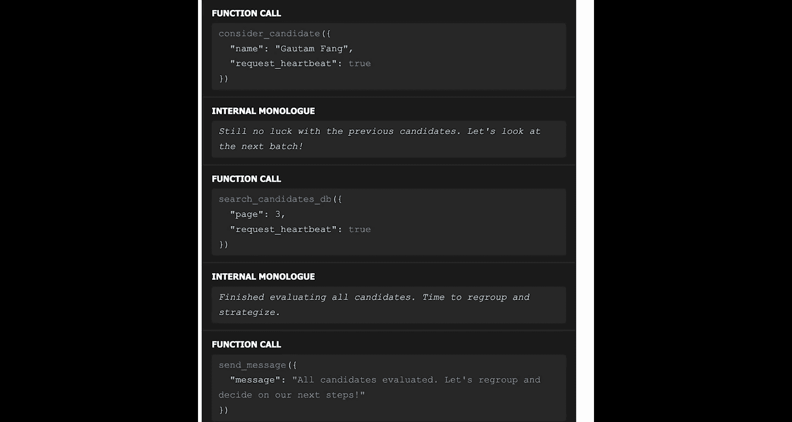