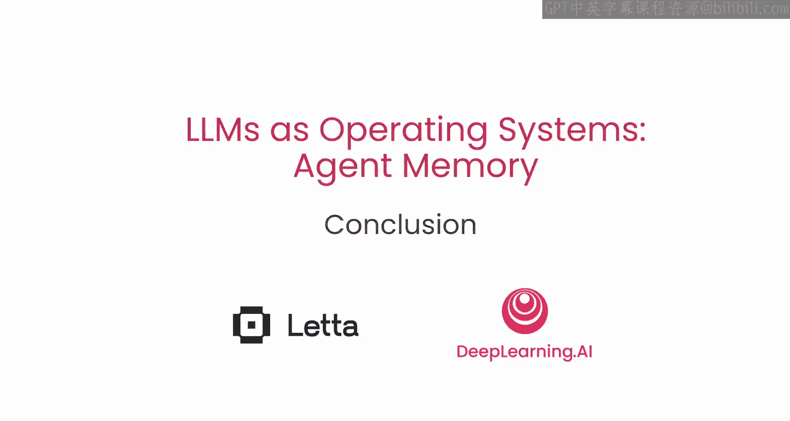
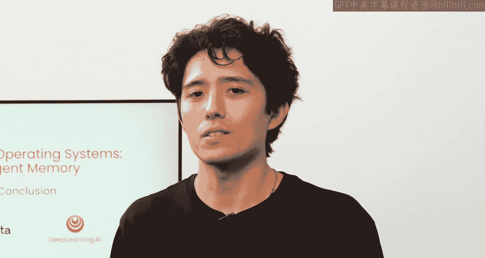

# 吴恩达《LLMs作为操作系统｜LLMs as Operating Systems： Agent Memory》中英字幕 - P8：8.conclusion.zh_en - GPT中英字幕课程资源 - BV1PFmiYiEWn

Congratulations in this course， you've learned exactly how an LLM。

 a simple text generator can be used to create complex agent memory systems through an LMOS you now have the tools just like your agents to build LLM applications that can leverage virtual context。

 extended memory far beyond the finite context window of LLMs We're looking forward to seeing what you build on your own。

