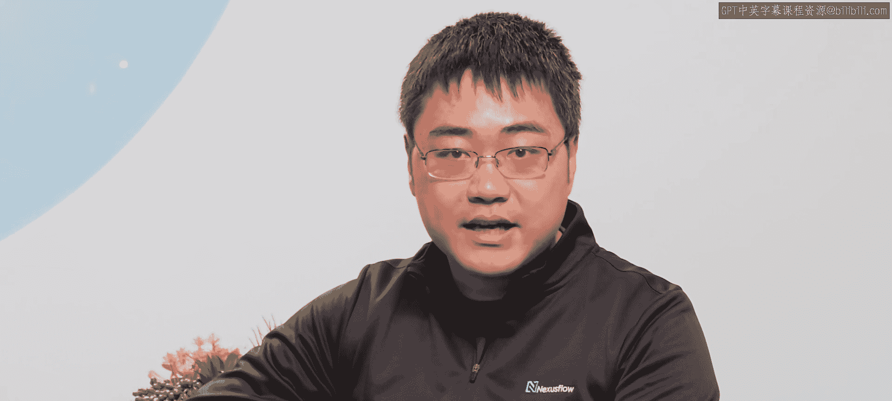
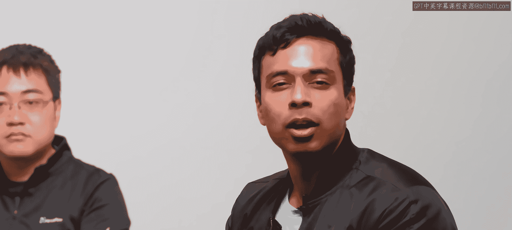
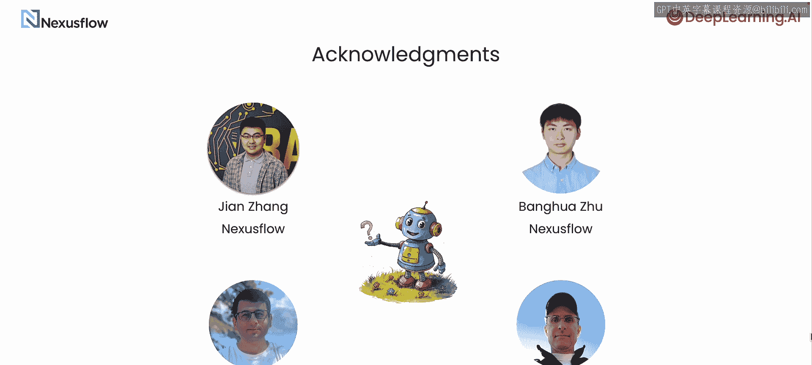

# 吴恩达《LLMs的函数调用和结构化数据提取｜Function-Calling and Data Extraction with LLMs》中英字幕 - P1：1.intro.zh - GPT中英字幕课程资源 - BV1pw4m1e7U3

Welcome to this short course built in partnership with NexusFlow and taught by Dian Tazhao。

 who is cofounder and CEO of NexusFlow， as well as assistant professor of ECSN stats at UC Berkeley and then Ka Srinivasin。

 who is founding an engineer at NexusF La language models are trained on text。

 which is a form of unstructured data， but are computing infrastructure is largely built on structured data with rigidly defined interfaces like APIs that expect data in a certain format。

Function calling bridges this gap。Here's how OOMs and function calling works。

In the prompt sent to a function calling capable LM will include descriptions of functions that are available to the LM to use。

 These descriptions include text describing what a function might do。

 so the LM knows when they should use that function， as well as additionally。

 information needed to call that function， such as that function's name and the description of its arguments。

When the LM has a query that the determineminants is best served by calling a function。

 theLM will then generate the needed parameters from the query and return a string that could be used to call that function。

Notice that the OM doesn't call the function directly。

 It just returns a string that could be used to call that function。

 These functions are often referred to as tools and can be used。

 extend the capabilities of a chatbot or to build agents， For example。

 such as a research agent whose tools might include web search or Wikipedia lookups。

 but function calling has proven useful in many applications that go even beyond chat。 For example。

 deep learning do AI uses a simple AI agents that we build internally to analyze learner feedback to keep on improving our course。

 Of course， our team does read your feedback and appreciate your taking the time to provide it。

And to gather statistics， we provide an OEM M with a prompt that includes a description of a function called record learner feedback that can record the sentiment and rating。

 as well as report any technical problems to strip。

 The OEM M that we use for this is actually a special purpose O M called Nxus Raven V2 13 B。

 fine tune for function calling by Nxuslow。 Andrew， I'm glad to hear that。😊。

Next Ri V213 B is an open source model you can download from hugging face。

 You can also use a hosted version available on our site。Here。

 there's a model you'll be using in this course。Many applications do not require the full capability of a general purposese foundation model。

Next driven V213 B has only 13 billion parameters， but can output GBBT4 in some function calling benchmarks。

This driven version 213 B and other finding the smaller models are small enough to be locally hosted。

This eliminates latency and cost barriers that might prevent you from adding a natural language interface to your applications。

There are many instances where you may want to convert natural language inputs into structured output like a function call。

 your business may have a library of functions that perform dashboard operations。

 and you would like to add a natural language interface。

Or you might have applications that need to process transcripts， notess。

 or proceedings and store them in a database。Every business has its own unique applications In this course。

 Lca will be showing you how you can add function calling capability to your applications。😊。

We'll start by taking a deeper dive into what function calling is and how you can use it。

 You will form prompts with function definitions， as Andrew described。

 and then you'll use the LLM response to call those functions。

 Once you have mastered that will kick things up a notch by defining and calling multiple functions。

 you will call nested functions where arguments to one function or themselves functions。

Many services on the web have APIs defined using an open API description。

 you'll also learn to convert these specifications into functions callable by your LLM。

 you'll finish the course with a practical application which takes a customer service transcripts and build SQL calls to store selected data to a database。

Many people have worked to create this course。 I'd like to thank from Neexus though。

 Jian Zhang and Bang Huazhu from deep learningning AI。

 Jeff Ludwig and Eshma Gogari have also contributed to this course。

 Lots of exciting things with function calling in this course。

 Let's go on to the next video to get started。 And I hope this course will help you make your applications highly functional。

