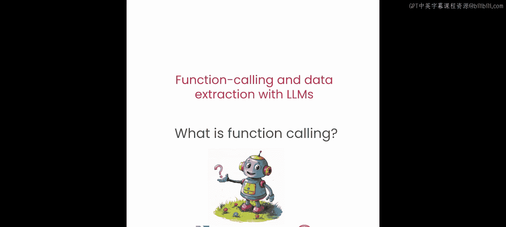
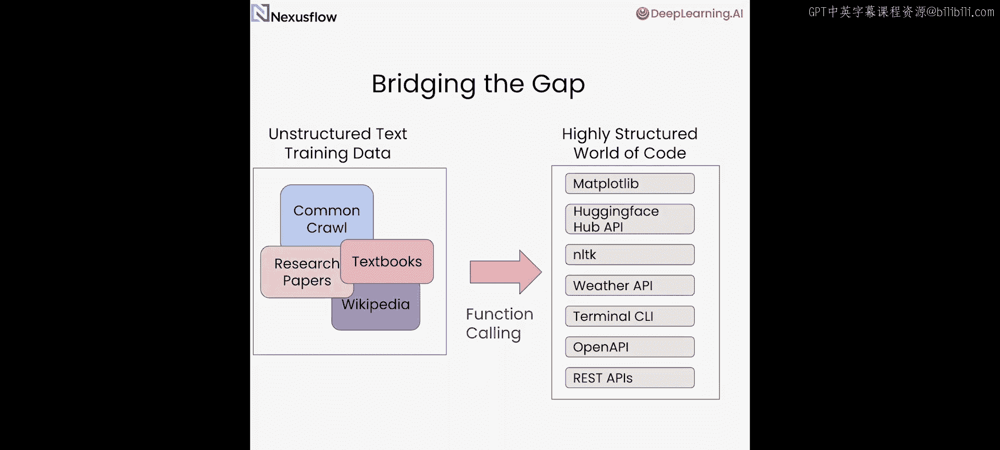

# 吴恩达《LLMs的函数调用和结构化数据提取｜Function-Calling and Data Extraction with LLMs》中英字幕 - P2：2.Introduction To Function Calling.zh - GPT中英字幕课程资源 - BV1pw4m1e7U3

In the introduction you learned a bit about what function calling is in this lesson we will describe it in more detail and you will get some hands on experience let's dive in。

So what is function calling， as described in introduction。

 function calling is the capability of an LLM to take in a natural languageguish query along with a description of a function。

 and output a string that can be used to call that function。 Consider this example。

 You would like to know the temperature in New York。

 and you have a function getdemp that can provide you that value， but without function calling。

 your LLM can help you out。 with a function calling LLM。

 you provide the query and a description of the function to the LLM。

 The LLM has been trained to recognize that it can use function defined in the prompt to answer the query。

 It will generate a strength that can be used to invoke that function。 In this case， get damped。

 with the city argument set in New York。 You can now execute that function and return the result and the query to the LLM。

😊，LM can now properly answer the question。 note here。

 even though they're called function calling LLMs， they only generate a string。

 they don't actually make the call。 You have to do that here。

 it's worthwhile to draw a distinction between the general purpose LLMs and the special purpose LMs。

 General purpose LLMs， respond to all types of queries。

 which can also include function calling queries。 On the other hand。

 special purpose LLMs are fine tuned to focus on a single or a small set of tasks。

 In example of this is necessaryus rayn13 B which can be tuned to provide function calling services and will always try to return a function call given a user query。

 Special purpose LLMs can be smaller and offer better latency than general purpose LMs。

Because they are fine tune for this task， they can often outperform general purpose models for the tasks that they' are trained for。

 such as function calling。 Now， I've used a couple of different terms here。

 terms including function calling， tools and so on。 What is really the difference。 Well。

 function calling is the name that's given to the LM capability of forming the string containing the function call。

 Tos are the actual functions that are being called。 With that being said。

 let's make it more concrete。 And let's build some tools。😊。

Let's start by building local Python tools。 Let's try the tool that relies on Matplotlibb。

 It dates in two inputs， adds and y and plot coordinates that are specified by adss and y。

An example of this tool is if a user says that they want to plot Y equal to 10 ads for a certain set of values for ads。

You can use this tool to answer the user query。The way you would do that is to run a function call that looks roughly like this。

 In this function call， you would pull out the details for x is equal to 1，2，3。

 And because of the transformation function requested。

 you will map those values to 102030 on the Y axises。While you can do this。

 we want the LLM to do this for us， so the way you would do this is to provide the tool description and the user query to the LLM。

Let's start with the Q description。You start by providing the prototype of the function you're using earlier。

Ravven， the LLM you'll be using， uses Python formatted functions， So you'll be utilizing that。

 you'll also add some descriptions on what the tool does。

 This will tell the LLM what this function or this tool is meant to do and will improve its reasoning about if it should use this tool to answer the user query or not。

 You will also provide the user query to the LLM。 recallca the user query was to plot wise equal the 10 ads。

 which we can simply add here and then we're done。 So this is essentially our tool descriptions。

 right， You have provided a tool and the user query。

 You will call the function called the LLM named Raven。

 You can do this through the query raven function。 The result is a strength。

The function name came from the function prototype。

 the arguments came from the user query with the LLM actually doing some math to generate 10 times the inputs Co now you can execute the strain like this。

Great， exactly what we expected， try this on your own， here's a user query and a call you can modify。

 try changing the query to produce different results。So let's dive deeper into what you just did。

 you told the LLM via the prompt how to format the function you've defined earlier by naming the functions in a pythonic format。

 and you've also provided in the form of pythonic arguments。

 the information you want the LLM to extract from the user input。

You have also provided the description the information necessary to understand when a tool is relevant for a user query。

 It's important to note that the L L M has been trained to recognize function calls。

 This format is very specific to such L Oms。 The L O M will respond to your user query with a string that you can use to call the function。

 Now， let's take a look at more complicated examples。Similar to earlier。

 you will use a function that relies on Matpl lid， but you will make a do more。

 Youll write a function that draws a clown face and you will parameterize it using three arguments that control the clown's face。

 eyes and nose color。 The exact implementation of this function isn't you critical。

 So allow me to quickly implement it and we can move forward。Similar to earlier。

 what you will do is to provide the prompt that will contain the tool descriptions and the user query to your LLM。

Let's say that you want the LLM to draw a pink clown face with a red nose。

 format this and create the prompt。Finally。Take a look at the prompt you have。As you can see。

 you have the function description identified with the function tag。

 you can see that the LLM can identify from the function description and the user query first that it should invoke this function and second it can fill in the arguments。

 face color eye color and no color from the information in the user query。Here and here。

Now call the function calling yellowLM。And you need to look at the qua string that it has generated。

 It has extracted the necessary information from the user prompt。

 which is the face color being pink and the nose color being red。Now you run it。In this case。

 it's a pink cl face with a red nose， which is exactly what we expected。

Now let's try writing your own clown， here is a framework where you can enter your own query or change the prompt and create your own planown。

 give it a try。So Raven is not the only LLM that's capable of issuing function calls。

 Let's try using open AIs function calling on the same example。

 You'll import the necessary attributes， and it's true to use the GPT 3。5 per model for this example。

You'll build a client， and you'll also build a helper function that wraps around everything that will allow you to kind of query the open AI API。

 So the thing is， with the open AI API， youll provide the description of the tool and its arguments in a Json format。

 While the description and the arguments will be identical to the pythonic format you had earlier。

 the weights presented will be a bit different。 please pause the video and take a moment to compare the two。

😊，What you'll notice in the response is that the attributes are in a format that's not directly usable for us。

 It's extractive functioning by the arguments using the following approach。Yeah。

At the conclusion of this， you get a Python call that you can now directly execute。With this。

 you can see how you can utilize Open AI's function calling API to also build a clown that addresses the user query from earlier what you did was actually bridge a gap between the unstructured world of textactual training data that the LLM used in training with the highly structured world of code in the next lesson you will focus on variations of function calling including parallel multiple and nested calling a lot of exciting things are coming up so let's go on to the next lesson。

