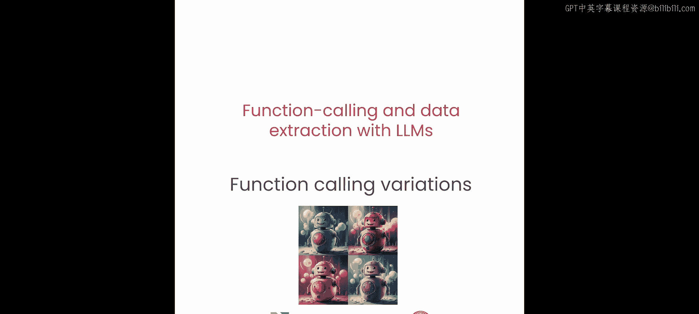
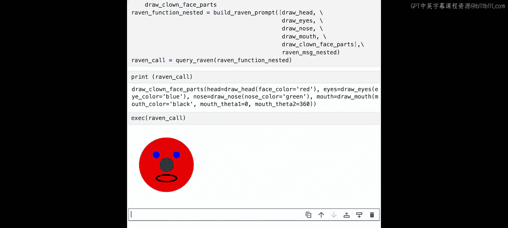

# 吴恩达《LLMs的函数调用和结构化数据提取｜Function-Calling and Data Extraction with LLMs》中英字幕 - P3：3.Function Calling.zh - GPT中英字幕课程资源 - BV1pw4m1e7U3

In the last lesson you use an LLM to invoke a single function in this lesson we're going to cover all of the variations of this al right。

 let's go。

There are a lot of different permutations and combinations of functions and calls that an LLM is capable of issuing。

 These include single calls， parallel calls， no calls， multiple functions， and nested functions。

 Let's start with parallel calls。😊，Before we get started。

 let's do some housekeeping In the last lesson， you created a function and then created a prompt with a description of the function embedded within the prompt。

 you can actually be a bit more efficient about it by using the definition itself to create the prompt automatically。

To show this， you define a generic function called a function。

You can actually use the name and dot attributes like this to pull out the relevant information。

And you can use the Python inspect module to get the signature or the arguments of the function like this。

You can put all of the together in a utility that you can use to create prompts for a given list of functions。

 such as this utility called buildraven Pro here you're accepting a function list and a user query for every function in your function list you're using the trick we discussed earlier to pull out the signature or the arguments of the function as well as dot strength and you're using that to create the function annotation for each of the functions in the function list and then adding the user query at the end。

Let's cry on our example。Great， that prompt looks fine。 Okay， now in this example。

 you will use the function from the first lesson。 We have defined this in the Utula P Y file to keep our node small。

 If you wish to view this file， please click on view。😊，Under view。

 please click on fileile browser to open the list of files available。

Please click on U orpyy to open Util file that contains all the functions we'll be describing。

This function now has more parameters to make it more complex。Previously， we had the face color。

 eye color and the nose color。 However， we've now extended it to include more parameterizations of the clown's face。

 such as the eye size， mouth size， mouth color， eye offset and the mouth data。

 these control various attributes， such as the width and the height of the clown's mouth。

 as well as starting and inang angles。😊，They also control the offsets of the eyes as well as the size of the eyes now back to parallel calls。

Pllel calls are when the LM has to issue in the same turn。

 multiple function calls strings to either the same function or to a set of functions。

 Let's take a look at one example。 You will use a user query that while similar is more complex than the user query we used in the first lesson in this user query。

 youre asking for two planss， one with a red face and one with a blue face。

1 with a blue nose and the other with a green nose。 And the first lounge should have a sad smile。

 and the second cl should have a happy smile。You will soon see why we specify the numerical representations instead of just saying happy or sad。

 But for now， let's just keep it as it is。 You saw that the new clown phase function is far more complex than earlier。

 You can now build the raven prompt by passing in the clown phase function and your user query。😊，不。

Yes。This looks as we would。Here's the function delineator。Here is the function itself。

And here is the description of the arguments of the function。And finally。

 a description of what the function does。That's call raven。Great。

 you can see that there are two function callss here。 Here's one， and here's the other。

 The first calls for a clown with a red face， The second one for a clown with the blue face。

 The first one calls for a clown with a blue nose， The second one with a green nose。😊。

The first one for a sad smile and the second one for a happy smile。

And we see that the planown matches the descriptions we asked in the user query， try it yourself。

 try requesting three or more faces with different features。That was parallel functions。 Now。

 let's talk about multiple functions。 You can provide the LLM with multiple functions such as F1。

 F2 F3， F4， all the way to FM and the LLM should be able to pick the right function or functions out of the list。

 Indeed， you can also present a no relevant query function。

 which the LLM can use if it decides that none of the functions youve provided is relevant to the user query。

 Let's take a look。😊，In this example， there is a new function called the D tie function。

 which draws a tie。This is also in the Ut subPY file to keep your notebook from getting to you cluttered。

 here is what it looks like。You will specify a user query that asks Ran to just draw a tie， however。

 you will provide both the functions to Raven， the DLown face and the draw tie function。

Here's the prompt， you can see that both the functions are present， Dt Cloud F and Drt tie。

 and we have the user query， let's send it to the LLM。Yeah。Great。

 what you notice its raven has only used the D high function。

 and it has ignored the D cl phase function and see what it's bad。Let's now execute the call。Great。

 a tie。 were ready for a formal dinner。 It's also important to note that it's possible to combine multiple functions and parallel function calling At the same time in this example。

 you will ask Raven to draw a planlown and a tie。😊，As before。

 you provide Raven with the draw tie and draw count face function。Let's take a look at Raven's call。

Since Raven was not given any concrete requirements when it comes to the clown phase。

 it has made best guess assumptions， but what arguments would word best based on the default values for the functions provided in the dot string。

 such as for the face color and for the eye color， let's call it。G， a clown with the dye。

It is at this point that it's worth talking about the significance of the dot strength of the functions that you have provided。

 especially as the complexity of the function grows， and you provide multiple tools to Raven。

 The significance of the dot strength becomes more important。 Let's show a failure case。

 Let's ask Raven to draw a sad plan with a green head。😊。

When you take a look at the call that isn't luqui right， it gets the face color right。

 but the clown is happy， it's possible that the reason for this is because the dot strains for the functions are not sufficiently detailed。

 therefore we would need to iterate a bit to make it clear what the arguments of the function does。

You can take the pro from earlier and replace a description for the argument that has the most impact on the perceived emotions of the clown。

You previously had its state that the starting and ending angles of the MaA is what this controls。

 however， because this is very vague and doesn't clearly link back to the essence of the user query。

 Raven was unable to understand what this actually means what you will do is simply replaced this with a more clear description of what this argument does。

Yes。Yes。嗯。Such as by adding this line。Okay。You will now query raven with this new prompt。

 What you now notice is that there is a new argument present。 This looks great。

 Now we have a sad plan as requested。 In this example。

 we observe the impact of good dot strains as it can help raven understand how best to address the user query When you notice the prompts are failing。

 You can sometimes address this by editing the dot strain to add pointers to make these failures more understandable to the model。

 On the other hand， you can also add in a few short examples to convey this as well。

 We have now touched on multiple functions， So let's talk about nested functions。

 An outcome of multiple functions is that you can now define independent functions where the input to one of the functions such as say F2。

 depends on the output of a function， such as F1。 the L M can utilize function F1 first。😊，First？

Call it with the arguments that it extracts from the user prompt。

 Take the output and feed that back into F2。 This capability can sometimes avoid multiple calls to an LM。

 Some agented solutions create intermediate results with one call。

 and then final results with the second call。With nest the callss， this can be done in one step。

Let's take a look at making this more concrete。In this example。

 the clown function has been split into many， many parts。

 You now have multiple functions that draws various parts of the clown， such as the head， eyes。

 nose and the mouth。 And you have a function to combine all of them together。

 You will find these functions in the uil sub P Y file。😊。

You have simply asked Raven to generate the clown with a red face， blue eyes。

 green nose and a black open mouth。 This is a prompt that was addressable with the old function。

 But let's take a look at how raven handles the multiple functions。

 We will simply provide the drawaw head， Draw eyes， Draw nose。

 Draw mount and the combination function to raven， along with the user query。😊。

You'll notice that the response is first called the drawaught cl face parts， such as for draw head。

 draw eyes， draw nose， draw mouth and so on。With the necessary arguments。

 it has then combined the output of all of these calls by passing that into the combination function that we have defined。

Let's run it。G， there's our clown。Try some variations on the prompt yourself。

 maybe try to add parallel nested clowns。This concludes our lesson on function call variations in the next lesson you will use external functions such as functions that rely on open API specifications and API endpoints that will enable you to add web service to your function call in LLM。

