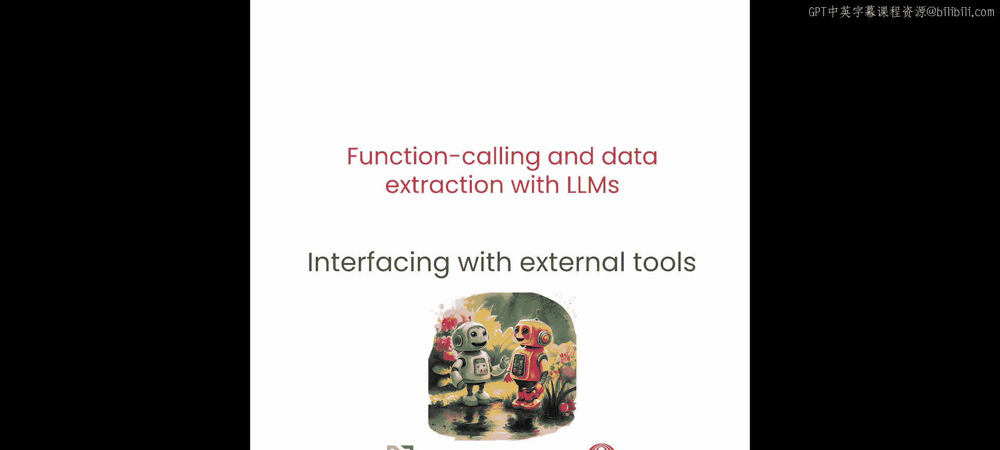
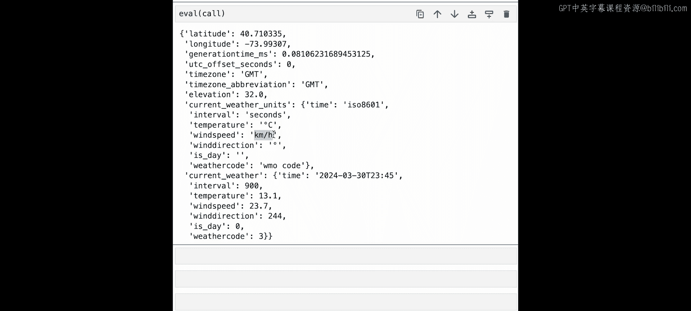

# 吴恩达《LLMs的函数调用和结构化数据提取｜Function-Calling and Data Extraction with LLMs》中英字幕 - P4：4.How Do We Interface With External Resources.zh - GPT中英字幕课程资源 - BV1pw4m1e7U3

The last lessons have in both local functions， but there is a worldwide web of services that you may want to use。

 This lesson will describe how you can use them。 Alright， let's use the web。

Many restful services are available online。 Their interfaces often described using API standards such as the Open API specification。

 It's very helpful to be able to integrate our function calling LLms with such services。

 So let's take a look at how you can use them。 In this simple example。

 what you've done is you written Python code to interface with the Jo API usingreful methods。

 you'll simply submit a gat request to the endpoint of the joke API。

 And you'll get back a response Json that contains many keys。

 But the most relevant keys or the setup and a delivery of the Jo。 Let's run this to see。😊，Okay。

 great。 You're able to interface with this external resource using simple Python。 However。

 it is not possible to call this directly with an LLM。 Instead。

 what you need to do is to write a tool to wrap around this endpoint。 Let's give it a try。

 You'll simply write a Python function with a single argument for the category。

 You'll provide a dot string。 And the main thing is you'll make the URL more dynamic。

 whereas the category that you'll pass to in the URL will be the argument in your Python tool。

 And then after that， you'll write code to submit a gett request to your dynamic URL。

 and then you'll print out the setup and the delivery of the response JO。😊，At this point。

 you're ready to try it with your LLM。 here's a user query， and here's the raven prompt。

You will provide the function definition and the user query from earlier。

Now let's call the yellow lab。Great， what says oh， oh oh， thats Santa walking backwards。 A。

 we do out a joke that's in theme for December。Try running it again yourself。

 We have not been able to use Raven to generate the Jote using the Jotes API。 The core idea， however。

 is that you're adding an adapter around your external APIs that converts the Python arguments that you generate using the L LM into the external API argument format。

 A lot of external assets use different kinds of API specifications。 Open API being one of them。

 W tools allows you to unify them together。 So just a practice。

 Let's write a tool that uses the open API API specification。 For this example。

 you'll be using the open Mateo weather API。 You will first download the open API specification in a Yal format。

😊，Let's take a look at what you just downloaded。What you downloaded was a YaAMl file that describes the OpenMeteO APIs。

 it provides you a list of descriptions of how the API will behave。

 including high level descriptions of the API itself。Most importantly。

 it provides a list of pads that you can send requests to to get different kinds of responses。

 for example。Sending a gett request to this URL with the slash V1 slash forecast pad。

Will'll provide you the seven day weather forecasts for certain ords。

There are also parameters that you can add to your getT request that you send to this pad。

These parameters are described here。And have certain types such as arrays and the elements within the arrays having the type strains。

With different enumerations allowed。This allows you to change the way the API will provide you responses for the seven day forecast by changing the parameters that you specify in the gett request you send to the endpoint。

Since this is a YaAl format， you will need to convert the YaAML into a JSON to user tool。

 you will first load the Yaml。You then need to convert by hand some of the data types such as integers and floats。

 and then you would save the content back into a JSO。

You can then use the open API Python generator utility to convert the JSON that you just saved out to disk into Python code that's capable of querying the endpoint。

From here， you'll import the Python code that you just wrote out in the previous step。

You can then provide a user query that depends on the API。

 such as asking for the current weather and the wind speed in New York。

Then you can use the inspect approach that we discussed in the previous lesson to construct the raven prompt。

Notice that in the prompt， we have the function definition。

 which was automatically constructed from the output of the generator step and the dot strain。

 which you wrote in the previous cell， as well as the user query。

 which you provided in the cell before that。 you can now send this to Raven。

You can now run this call。 Running the call will give you the output Json from the API that will provide you the temperature New York。

 which currently is 13。1 degrees Celsius and New York has a wind speed of 23。7 km per hour。

 Try yourself。 try to city you are in currently In the next lesson。

 you'll be using Raven to do structured extraction， such as attracting insights。

 as well as detailed structured data from unstructured tests。

See you there。