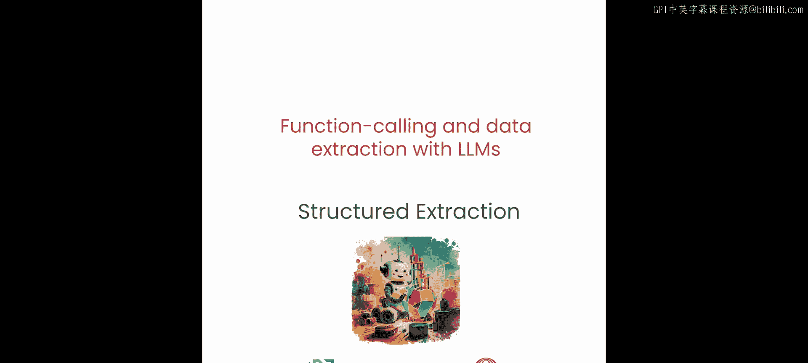
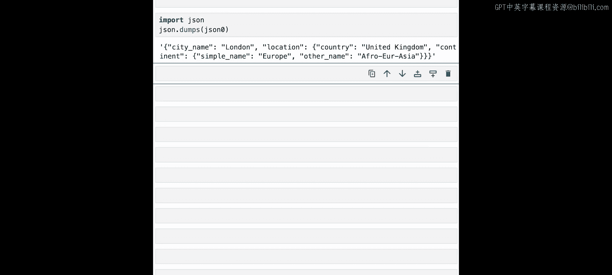

# 吴恩达《LLMs的函数调用和结构化数据提取｜Function-Calling and Data Extraction with LLMs》中英字幕 - P5：5.Using Function Calling For Structure.zh - GPT中英字幕课程资源 - BV1pw4m1e7U3

So far， you have been using function calling to well， call functions。

 but function calling can also be used to its structured data from an actual language input。

 let's dive into structured abstract。

In the previous lessons， we used function calling as a way of interfacing with tools both internal and external in this lesson will actually extend the ability of function calling even more to do something called structured extraction。

 structured extraction is when we need to extract details and insights from unstructured text。

 For example， if we have texts like Mary had a little M whose fls was white as know。

 and we wanted to extract the person mentioned in the text as well as the object that's owned by the person we can use function calling as a means of extracting that information。

 the way you would do it is we would simply provide a function with the person name and the owned object as the arguments that the LLM needs to extract from the unstructured text。

 Remember， this is very similar to the behavior that the function calling LLM used to fill in the arguments from the user query When interfacing with both Python。

As well as open API tools in previous examples， we will simply use its same behavior。

 but here we will just annotate the kinds of information we want to be extracted and allow the LLM to extracted information from the unstructured texts。

 In this example， the LLM will extract Mary as the person's name and lamb as the owned object。

 Let's take a look at making this more concrete through an example。

 Let's look at a simple example of address extraction。

 You have a very small passage here with various names and addresses associated with each name。

 Supp you want to extract the names and map it to the addresses that the names are associated with。

 You can use function calling to do this。 You will simply provide a raven prompt with the function annotation indicating that you want raven to extract the names as lists of string and the addresses of the names as another list of string。

 You will mention to raven that you wanted to give the name。And the associated addresses。

 and you'll provide the text from earlier。You can now call Raven。Great。

 you've called Raven with the prompt you had earlier。

 and you've just printed it in this tool that you've defined here。

 and the print matches what we had expect。 we have the names as well as the associated addresses of the name。

For more complex ways of doing structured extraction。

 there is another method you can use to pull out the information。

 You can use data classes to communicate to raven about the different ways you want to associate the information you want raven to extract data class is a python class decorator。

 it signals the variables or fields that will follow and defines it with type annotations。 the LM。

 which has been trained on Python， will understand this and discrete creates a new and convenient way to define parameters。

 say in this example， you have unstructured text yet again。 here。

 even though you have names and addresses， certain names are associated with multiple addresses such as Gent being associated with 555 s3777 data drive and  one to3 digital domain The previous approach will not work well。

 because we have an unbalanced mapping of names to addresses in such more complex。

You can use the data class method。You will simply define a data class called Record with a name as one of the attributes and a list of strings as the address attributes。

Keep in mind the name of the data class isn't too important。

 but it is how Raven will understand your intentions， so it's better to keep meaningful names。

 you will define a function annotation that takess in a list of the data class as the argument and you will provide the unbalanced text from the first cell。

You'll run this。And the output will have raven issue a function call with the argument values being instantciations of the record data class。

 You'll notice that some of the names are mapped to multiple addresses。

 such as jate being mapped to the three addresses we listed earlier。

 This is exactly what we wanted and shows a better way of attracting more complex insights out of your unstructured that's using function calling。

 Another really powerful implementation of function calling isnt generating valid Jsons。

 Sometimes it's very hard to get small Lms such as 70 or 13 bllms to generate valid Jsons。

 Fun calling can help here。 Suppose you want to generate a Json that looks like this。

 with the first level of the Json having the city name。

 The second level of the Json having information regarding the country and the third level of the Json。

 having information regarding the continent。 You can now define tools with。😊。

The same level of hierarchy here you've defined the first tool， which contains a city info。

 which is simply a city name with the function annotation indicating a location dictionary is required as one of the arguments。

 You will define another function called construct location dick that dates in the country information and a continent dictionary as one of the arguments you will define a third tool that provides the continent dictionary。

 that dates in two arguments such as a simple name and the other name for your LLM to successfully call this function。

 it will need to first construct a dictionary for location。

 which it will do by issuing a nested call to the location dictionary。

 which in turn will require a continent dictionary。

 which it will hit by issuing a nest call to the continent dictionary function。

 This will allow you to convert the nested callss。Into the same hierarchy that you want in your JSO。

It is at this point where it's beneficial to talk about what the locals does。

 It simply returns the current variables defined in the current scope back as a dictionary with the variable name and the variable values provided。

 because of the way it's used here。 It will simply return the argument values back as a dictionary。

 Let's take a look。It just returns back to two arguments we passed it as a dictionary with the argument name and the argument value as being the key value pairs。

It is at this point where we can talk about how to use this approach to convert nested calls into valid Jsons let's give it a try。

 you will simply provide the three tools you have created earlier in your raven prompt and have a placeholder for your question。

Here， you will define your question saying you want the city in full for London。

 which is in the United Kingdom， which is in Europe or Africaurasia。

 this contains the necessary information for your JSO。However， by passing in the tools from earlier。

 you can now force your LLM to generate the nested hierarchy that you need。

 you will issue a call to Raven and you will print the JSO。Great。

 we've gotten back at JO in the exact format that we want。 Would you now generate the valid Json。

Great， we now have a Val Json out of our LLMs more predictably。

