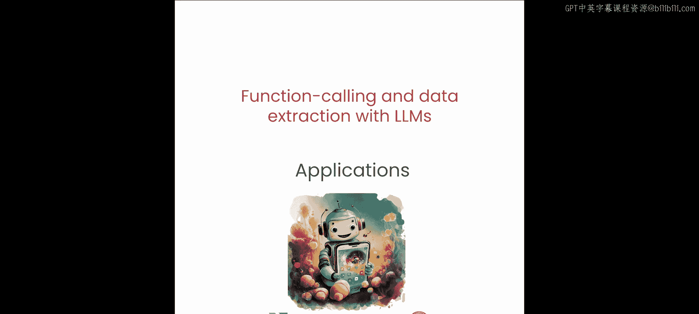
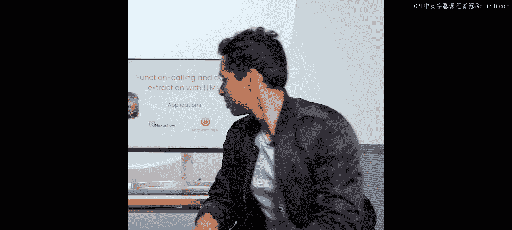
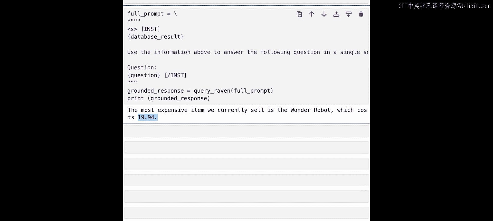

# 吴恩达《LLMs的函数调用和结构化数据提取｜Function-Calling and Data Extraction with LLMs》中英字幕 - P6：6.Adding Web Search To Your LLM.zh - GPT中英字幕课程资源 - BV1pw4m1e7U3

In this lesson， you're going to try your hand at a few typical applications of function calling lets start applying function calling。

Traditional LLMs are trained on static data sets and lack the ability to access or process information that has emerged after their last training update。

This leads to outdated or irrelevant responses， especially in rapidly evolving fields like technology。

 medicine or current events， function calling allows LLMs to retrieve current data from the web or from your company internal databases in real time。

For example， a function can be called to fetch the latest news。

 stock market updates or weather forecasts ensuring train that the information provided is up to date This capability is crucial for applications where timeliness and accuracy of information are essential。

 lets dive into a few examples。Suppose you're interested in the events that took place after you've finished training your LLM。

 How would you adapt your LLM to this new information For example。

 let's ask about a recent product announcement We will first load the dot EV file。Great。

 now you will ask about this Rabbit R1 device， which was announced well after the conclusion of the training of the LLM。

 so just post a question asking about this Rabbit R1 thing to the LLM and submit your query。

You'll notice that the L L La reject it saying it doesn't have the information necessary。

 Let's try a web search， instead。Deefine a utility called do web search which accepts a user query and the number of results to circumscribe your search to。

 and within the tool you will query the search endpoint for a web search API which would contain a payload that wraps around your API key as well as the user query。

 submit a post request and collate all of the content from the responses into a single string and return that string。

Similar to earlier， you will define a function call imp prompt that Raven will use define the function annotation for the web search utility that youve defined earlier。

 which specifies the function signature as well as a function dot string。

 you also provide a oneshot example for an example user query and function call that you want raven to use as a reference when understanding the tool that youve built。

 you will then provide the user query that you've been using since the first cell。

 and you will get back a raven function call。whichch you can execute you to get a list of information that your tool returns。

 you will then provide an information returned by your tool back to the LOM。

AlAone with the user query you've been using since the first cell。

Provide this pro back your LLM to get back a grounded response。Taking a look at the response。

 notice that it's far richer and contains far more details， such as the product dimensions。

As well as the capabilities of the product， this is information that the LLM had no idea about since the product was released well past its training day。

 however， because we provided access to the internet via the search tool。

 the LLM was able to find this information and then digest the results and provide you with a very concrete answer。

 please try this yourself with your own queries。 Next。

 let's take a look at chatting with your SQL database。

Oftentimes for a lot of companies there are insights that are a lot behind company internal databases and knowledge bases because these are data that public models will not have access to a lot of the public open source language models will not be able to give you any meaningful answers for questions that depend on data that's locked behind sources a good way of resolving this is to provide access to your database to your LLm using function calling Let's take a look at making this more concrete first create a random database in the upy file found within the same folder you will find a utility called create random database This utility will create a database called toy database or Db which will be populated with random toy names and random toy prices The database will create a table called toys which contains the name of the toy as well as。

Price of the toy you will define another utility called execute SQL within the same ua PY file this will simply take in some SQL code and execute it against your toy database or DB which is the database you define in your previous utility you will import the create random database utility and run it。

You will then pose a question such as what is the most expensive item that your company currently sells answering this question depends on data that's locked behind the database that you created earlier。

 so let's try running it and gathering some information。

Since the LLM doesn't really understand the schema that you've defined earlier。

 let's make it concrete and provide this sma to the LLM This schema once again just tells the LLM that you created a database called toys which contains the name of the toy and the price of the toy。

 you provide this schema in your raven prompt along with your function annotation。

You will also provide the user question or the user query that you had earlier again to the model。

 you will then run the model to get the output。Great。

 you see that the model has returned a SQL call that selects the name and the price from the database table called toys。

 and it orders it by the price by descending and limits it to one。

 which gets the most expensive item that's currently defined in your table。

 which is the query that we want answered。You provide the results you got earlier from your database back to your LLM。

 along with the question that you had earlier。And you get back a response that says that the most expensive item your company currently sells is the Wnder robot。

 which costs nearly $20， which is directly in answer to the question that you posed earlier。

 But you'll notice that you had to allow the LLM full access to your database。

 You allow the LL M to generate the raw SQL code directly。😊，But what if you didn't want to do that。

 What if due the security purposes， you didn't want the LM to generate raw SQL code that you can execute against a database。

 There is a more gated version that you can use for more added security。

 Instead of asking the yellowM to generate native SQL， which could be problematic。

 we can guard the access to a database more carefully。

Let's define a few functions to make this a reality。

We can allow for safer interactions with databases。

 you will define a function to wrap around the operations that you had in mind。First。

 let's define a function to connect to your database。

 youll define a function to list all toys in your database and implement the SQL behind the scenes。

 similarly to find toy by the prefix and to find toys in a price range。To get random voice。

To get the most expensive toy。To get the cheapest to。And finally。

 you will provide all of the functions you defined earlier to Raven using the function annotation format。

😊，Since Raven doesn't have direct access to your database。

 you need not provide Raven with the database schema that you've designed earlier。 Rather。

 Raven will just use the templates that you've provided to it to answer the user query。

Let's run this and see the output。Great， Raven was able to interface with your database and pull out the information necessary to answer the user query。

And you can provide the results back to Raven to get your original answer to your original query。

 which is the Wonder robot， which costs nearly $20。Cick。

 createreate a query to use one of the other functions We've defined several。

 Please try queries that can leverage some of these other functions that we've defined earlier Now you've seen how you can use Raven and other function calling LLms and grounded with access to the internet via web search or your database via native SQL or via the safer templated approach to get concrete answers to your user queries which might depend on company internal data or the most up to date happenings in the nexts lesson。

 we will start taking a look at further pushing the capabilities of function calling LLms by taking a look at structured extraction we've learned a law through the entire progression of discourse in our nexts lesson well put everything we've learned together to create a course project。

😊。

See you there。