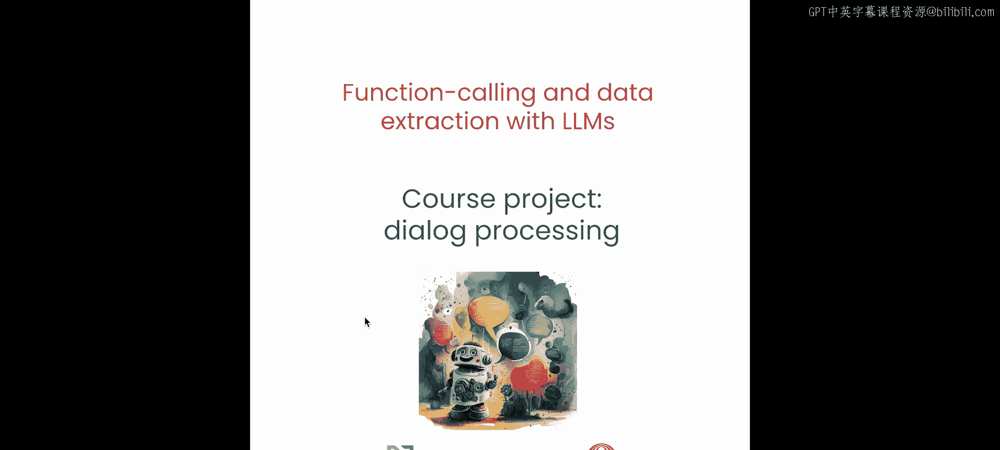
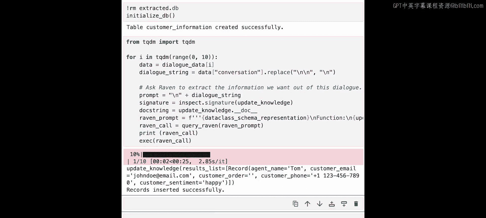
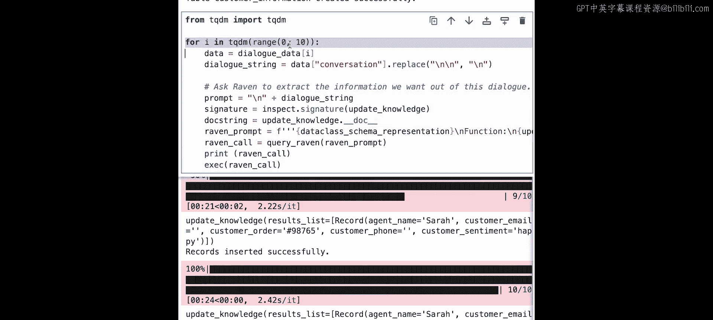
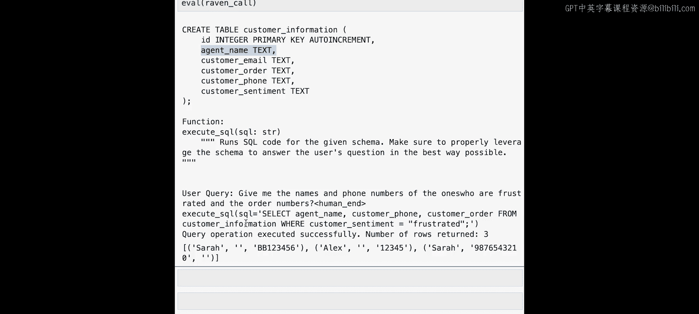

# 吴恩达《LLMs的函数调用和结构化数据提取｜Function-Calling and Data Extraction with LLMs》中英字幕 - P7：7.Building A Dialogue Feature Extraction Pipeline Using Function Calling.zh - GPT中英字幕课程资源 - BV1pw4m1e7U3

Al right， this is your last lesson where you will apply your new function calling skills on a more significant project。

 let's take a look。

In previous lessons， we looked at using function calling as a way of interfacing with external tools such as APIs and internal Python tools。

 We also looked at using function calling as a way of doing structured extraction where we extracted insights about data that was in an unstructured format In this lesson。

 we will be combining all of them together into a single lesson and build a dialogueg processing system as a course project。

 specifically， we will be taking transcripts of customer interactions which are dialogue exchanges between a customer service representative and a customer and extracting insights such as the agency product I and customer information from the dialogueg data。

 we will then be storing this into a database using an LLM and then extracting insights from the database regarding aggregated queries that requires the LLM to generate SQL code Let's get started first。

Take a look at the type of data we're dealing with。

 What you'll notice is the data is a list of exchanges between an agent and a customer。

 The customer provides various insights such as their phone number。

 Their email as well as their overall sentiment embedded in the verbiage that they use。

 The agent also provides details， such as their name。

 We would want to ideally extract all of this into a structured format and store it into a database。

 This will allow us to do aggregated insights， such as analyzing how many customers specific agents have pleased or how many customers。

 specific agents have not been able to address their requirements for。

 Let's first start by building the tools required to build this system。

 We first define the specific insights that we want to label as important insights we want extract。

 We will be using the data class approach， because this is a far more complicated abstract task。

 This approach was。cused in an earlier lesson， and we will be using that here。

 We will specifically be attracting the agency， the customer email， the customer order。

 the customer phone number， as well as a customer sentiment。

 We will be also calling Ed Zac on this data class just so that the Python interpreter is able to understand our new format。

We will also build a database。 The database will essentially just contain a few different columns。

 such as the agent name， the customer email and the various attributes that we want to extract。

 We will store it into a database called extracted or DB and name the table customer information。

 This tool just initializes the database。Let's initialize it。Setting。

 we would also need to create tools to populate the database。

 You will define a tool called update knowledge that dates in the list of records。

 records being the data class that we added to our interpreter earlier。

 and you will just iterate over every record in your results list and insert it into your database。

 Youll give a try using some dummy data。 here， you're just defining a single record object with some dummy data such as the agent name a dummy customer order number。

 as well as a dummy sentiment。 Great， you are able to insert the records successfully。 Now。

 you will also need to pull information out from the database Here。

 you will define a tool called execute SQL that dates in a direct SQL strength that you will run against your earlier database stored in extracted ODB specifically。

 you will be running your SQL against a customer information table that you created earlier。😊。

Let's do this a try。You'll define a SQL strain where you'll pull the agent in where the customer is happy from the table that we've been discussing about。

Running the Sequel gives you the information that you need， such as agentnt Smith。

 This matches what we expect。 Great， now let's start building the pipeline。

 Let's first delete the sample database we had earlier， and let's reinize the database。 Next。

 we will be downloading the customer service chat bo data set from hiking phase。

 This data set contains a list of traces of dialogue between an agent and a customer。

 We will be using this data set for this course project。 Let's download the data set。

 Let's print just one sample dialogue from this data set。😊，Here。

 we will take the sixth element and print it out。 What we notice is that the format of the data has a lot of similarities to the sample data that we saw earlier。

 It's worth while to note that the agent's name here is Als。

 The customer's details include an order number pointing into 1，2，3，4，5。

 and the customer seems frustrated。 Let's pass this to Raven。

 You will use the inspects approach that we discussed earlier。

 You will simply pull the function signature。 Clean up the function signature to remove some of the extraraneous details that Ins might have added。

Pull the function dots string and build a raven prompt。

 The raven prompt simply contains your data class。That you defined in the first cell and its function and the entire test from earlier。

 Let's pass this to Raven。Great， Raven was able to generate the function call where it notes the name being Alex。

 The order number being 1，2，3，4，5， and the customer sentiment being frustrated。

 which is exactly what we had spent。 We can run this and insert it into our database。

 Let's quickly run another example。 This time， the tent sample in the data set。

 And let's also insert this into our database。😊，It's important to note here that the agent name in this sample is John。

 The order number is B B 7，8，9，0，1，2。 and the customer sentiment is happy。

 Suppose we want to put some insights out of this。 We can actually do so using SQL。

 such as selecting the number of customer sentiment details we have that matches the requirements where the agent name is John。

 and the customer sentiment is happy。 This is essentially querying the database to see how many customers John has made happy。

 Great， we were able to run the query and get back a result， which is one。 which matches。

 because this corresponds to the sample we inserted in the previous cell。 But this is a bit manual。

 Can we make this more automatic。 Yes， we can pass the execute SQL tool that you defined earlier to raven to get the output。

 You will simply write a prompt， asking how many customers John has made happy。

 Use the inspect approach described earlier to。😊，Puout the function signature。

 pull out the function dot string， and provide the SQL schema to a raven in a raven prompt。

Passing this to Raven， you get back SQL code that you can now execute。

And get the exact result that you had earlier。Great。

 you're now ready to run this over the entire data set。 Let's give it a try。

 Let's first re initialize the database。Let's iterate over the first 10 samples in the data set using the same approach detailed earlier to build a Raven prompt and call Raven。

You have now populated a database using 10 different samples。

You can now try running some aggregated queries。Here， using the In approach。

 as well as passing the same schema as earlier， you're simply asking how many happy customers are there over those1 samples。

Let's feed this。 Raven， Raven was able to successfully query and answer your question， which is7。

Next， you can ask to get the names and phone numbers of the customers who are frustrated。

 as well as their order numbers。 Great， And you were able to see Raven generate the SQL code where it gets the agent name。

 the customer phone number and the customer order number from the table where the customer sentiment is frustrated here。

 it gives you back the customer items， including the phone numbers， if it exist。

 as well as the order numbers and the associated agent name for customer who are frustrated。😊。

Please give this a try by adding in an additional requirement such as asking for the customer name。

 in addition to the agent name， hint， you will need to modify the initialization of the database。

 the insertion into the database and the data class and SQL representations。Please give it a try。

 In this course， we have touched on so many different things， and function calling is very versatile。

 We hope you had a great time exploring the different applications of function calling。😊。

