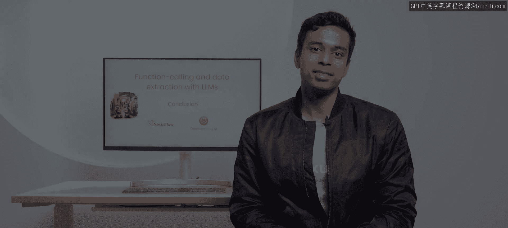

# 吴恩达《LLMs的函数调用和结构化数据提取｜Function-Calling and Data Extraction with LLMs》中英字幕 - P8：8.conclusion.zh - GPT中英字幕课程资源 - BV1pw4m1e7U3

Congratulations on completing the course here are some skills you picked up during the course。

 you created prompts that can allow an LLM to perform function calling。

 you used an LLM with multiple function calls， even nested function calls。

 you invoke web services using function calling， and you used an LLM to attract structured data。

Thank you for taking this course， I hope you will find many uses for function calling in your applications。

