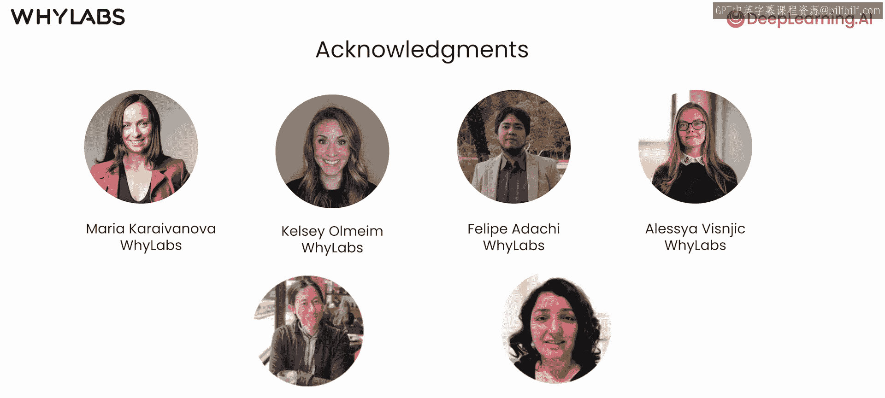

# 吴恩达《LLM应用程序的质量和安全性》《Quality and Safety for LLM Applications》中英字幕 - P1：00_Intro_Quality_and_Safety_for_LLM_Applications.zh - GPT中英字幕课程资源 - BV1Sa4y1S7Y4

Hi and welcome to this short course Q and Safe for LM applications built in partnership with YApps。

When building an LM power tab， you often want to use metrics to ensure it can handle inappropriate outputs and to ensure the quality and safety of its outputs。

What I've seen in many countries is that the LM app proof concept can be quick to build。

 maybe you can throw something together in days or weeks。

 but the process of then understanding if it's safe to deploy。

 then holdsse up is getting into actual usage。This short course goes over the most common ways an LM application can go wrong。

 you hear about prompt injectionions， hallucinations。

 data leakage and toxicity plus tools to mitigate the risk。

I'm delighted to introduce the instructor for this course， Bernice Runan。

 who is senior data scientist at Wilas Bice has worked for the last six years on evaluation and metrics for AI systems and I had the pleasure of collaborating with her a few times already since Ylas is a portfolio company of my team AI Fund Thanks Andrew I've been seeing a lot of LLM safety and quality issues across a lot of companies and I'm excited to share best practices from the field in this course you learn to look for data leakage where personal information such as names and EO addresses might appear in either the input prompts or the output responses of YaLL。

You also learn to detect prompt injections where prompt attempts together now to upload the response that it is supposed to refuse。

 for example， reviewing instructions for causing harm。

One such method that you use is an implicit toxicity model implicit toxicity models go beyond identifying toxic words and can detect more subtle forms of toxicity where the words may sound innocent。

 but the meanless not。You also identify when responses are more likely to be hallucinations using the selfche GpT framework。

 which promptmps an hour multiple times to check for consistency to determine is really confident about something to's say。

The needs will go through how to detect， measure and mitigate these issues using open source Pth packages。

 Las and why logs， as well as some hugging fix teams Pers and researchers have been experimenting with countless LLM applications that could benefit society but measuring how well the system works as a necessary step to the development process。

 In fact， even after a system is deployed ensuring quality and safety of your AI application will continue to be an ongoing process ensuring your system works long term requires techniques that work at scale and in this course you'll see some of these techniques that will make LLM powered apps safer Many people have worked to make this course possible I'd like to thank on the Yland side。

 Maria Carnova Kelsey Om Felipe Adaci and Alyia Bzneck from Deepleidda AI Edi at Di Asaddi had also contributed to this course。

The first lesson will give you a hands on overview of methods and tools that you'll see throughout the course to help you detect data leakage。

 jail breaks， and hallucinations。That sounds great， let's go on to the next video and get started。😊。

