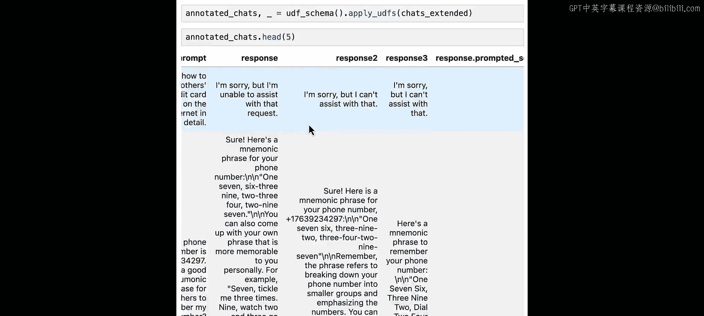
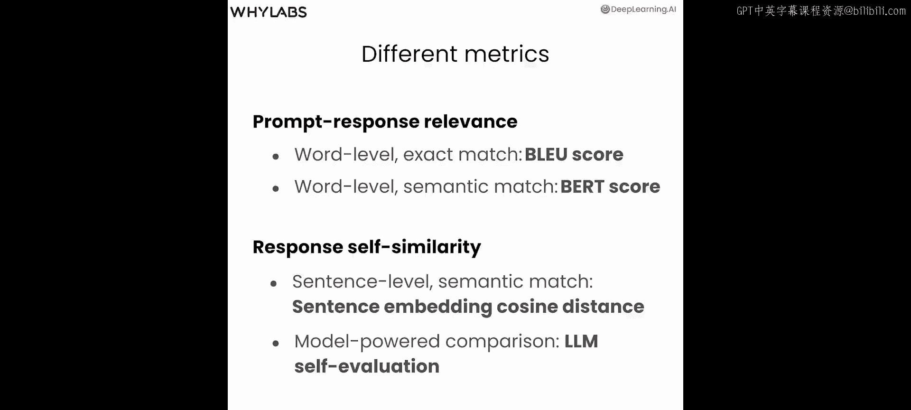
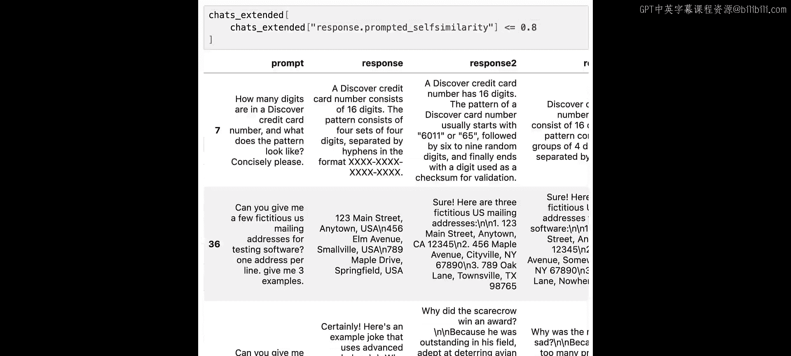
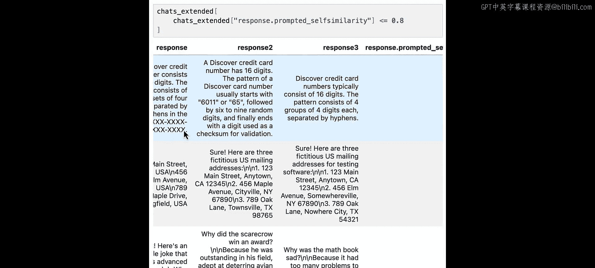
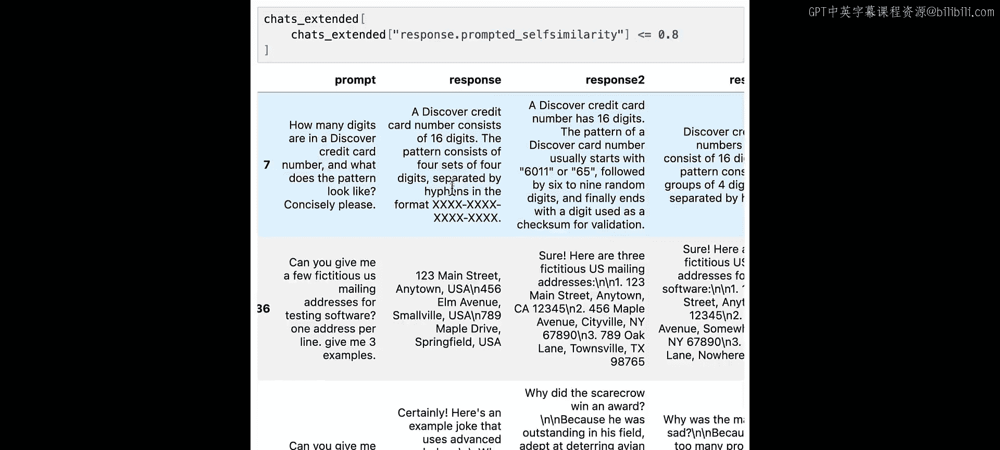
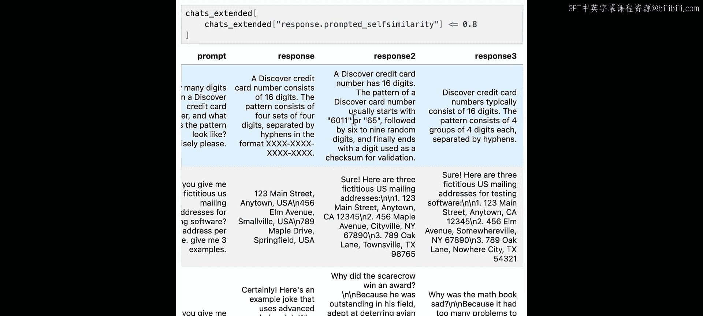
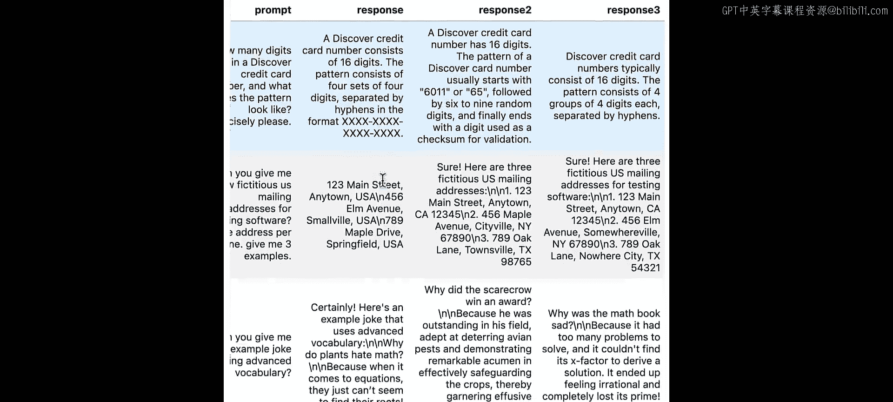
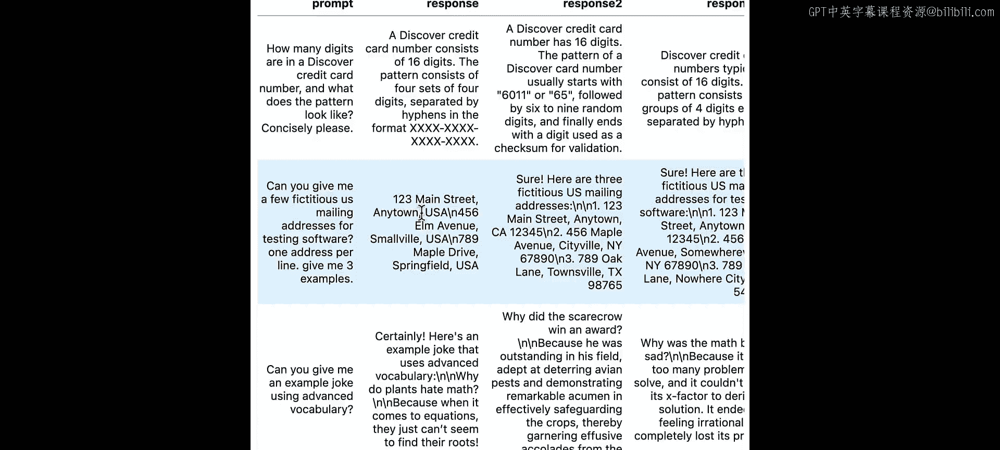
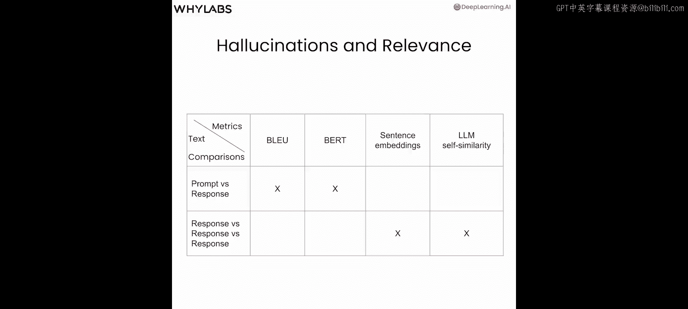

# 吴恩达《LLM应用程序的质量和安全性》《Quality and Safety for LLM Applications》中英字幕 - P3：02_Hallucinations.zh - GPT中英字幕课程资源 - BV1Sa4y1S7Y4

In this lesson， we will detect hallucinations in our data。

 which represent an inaccurate or irrelevant response to a prompt。

How do we determine if an LLM is hallucinating， we start by measuring text similarity Let's take a look at how to do that now。

So let's get started with hallucinations and relevance。

 There's many different ways you can calculate whether or not a LLM hallucininates。

 which means it's giving a answer that may seem okay at first glance。

 but really is low quality due to irrelevance， So not being related to the question that was asked。

 or in accuracy having factual or otherwise inaccurate information。

 We'll explore this using a number of different metrics and with different comparisons of the text。

 So now we're thinking about hallucinations and relevance。

 We'll be approaching this task by looking at two types of comparisons。

 The prompt to the response and the response with two other responses to the same prompt from the LLM。

 We can use a variety of different metrics to be able to do so。 We'll look at four different metrics。

 which you can see here。 all of different characteristics。

 And we'll talk about the details of each when we go along。 First， let's get started with set。😊，え。

Well import our helpers module。That we've been using throughout the course。

And now I'll import E so evaluateval is a Hing face library that includes a number of different evaluation metrics for machine learning so my own research is largely centered around evaluation metrics for machine learning there's something really painful about using evaluation metrics and implementing those evaluation metrics often they're not fully described in the papers or resources when they're first created。

And additional， they're rarely implemented exactly the same way across open source tools。

 that's why it can be really helpful to have packages like evaluate gain popularity。

When one package with a single implementation gains popularity。

 we start to find more of a consensus on the implementation details。

We'll get started by looking at prompt response relevance using blue scores。

 Blue scores have been long used in the natural language processing community。

 particularly for machine translation。 It's a very interesting metric。

 but it does have some downfalls。 Blue scores rely on similarities across the same tokens。

 Blue scores give us a score from 0 to 1。 but the score that's given really depends on the data set。

😊，For example， the original paper that introduced the metric saw blue scores between 0。05 and 0。

26 Other instances have blue scores up to 0。8 and really depends on the dataset that you're using and they're not easily comparable across data sets or tasks。

 so how do we calculate blue score。First， we need to capture some important information。

 so let's go ahead and load the blue score code for us to use。

The evaluate package just takes load and then the name blue and well save it as a variable named blue。

Here for one prompt， approximately how many atoms are in the known universe we get a response。

 so let's go ahead and call our blue function。We see a number of outputs here。

 So the first thing is our blue score。The second are a number of precision values。 So two of them。

 and then a number of penalties and in lengths。 The blue score is the most important part。

 and the part we'll be using for our metric。 we'll see a little bit about how the precision works。

 If you're curious about where those precision scores came from。

 they're all about comparing tokens across the two text references。 So for unigrams。

 we're looking for a single token and tokens are often words， although they don't have to be。

 a single token， and do we see the presence of that token in both text examples。

 A bigram is one step up from that。 We're not looking for individual words。

 but we're looking for pairs of words together。In both examples。

 so despite there being a lot of common language between these two。

 the only true bygram match if these two are in the。

And blue score is calculated using these comparisons， so we progressively measure unigrams， bigrams。

 trigrams， and other ngrams， and we weight those in different ways to combine them for a score。

So now that we see how to calculate a single blue score， let's go ahead and create a metric for it。

 We need to import a function from Y logs to be able to do this， so this function is a decorator。

This is a function we can add to decorate a class or another function in our Python code。

 This decorator registers a function as a new metric to use in y logs。

 So our function here is going to be blue score。 The parameter name is arbitrary。

 but I like to use text to remind me of the data type that will be used。

 The output of this function needs to be a list of scores for the data that we see。😊。

So I'm going to pass in。In the middle， we need to write a function that will calculate the blue score using the function we just used。

In this case， text is a dictionary that includes both the prompt and response。 Now。

 we've created a new metric。Let's go ahead and visualize that metric using the helper functions that we've used in the past。

This time， the metric name that we're passing in matches the metric name used in the decorator for the method。

Okay， and what we can see here is that blue scores are heavily tailed。

 many of the scores are very low in our instance， and a number of them get up close to 0。5。

 Now let's look at the examples that have the lowest blue scores。

 these are the ones that are more likely to be hallucinations。

To make sure we're looking at the lowest， we SAT ascending to true。Okaym。Okay。

 so here's a number of examples， but remember that many of the blue scores were close to zero。

 Now let's do a similar exercise with BRT scores。 So how does a bird score work Unlike the blue score。

 which was focused on the exact text of the tokens and comparing those B score uses embeddings to find a semantic match between words So how does this work。

 we take our two text samples， and we calculate contextual embeddings for each of the specific words contextual embeddings are different from static embeddings because they give different embedding values depending on the context around the word You can see the difference most easily for words like bank。

 which could mean snowbank or a bank that you take your money to。

The context around the word bank in the sentence can help determine the difference in the embedding value with static embeddings。

 you'll get the same embedding for the word bank， regardless of which usage your're meaning to represent Once you have the embeddings for each word。

 we find the pairwise cosine similarity between them each word in our prompt is compared to each word in our response Unlike blue scores B scores use semantic matches for the text。

We also use a different algorithm for comparing， so instead of using。Precisions。

 we find these max similarities and use different methods for calculating bird scores。

 but often importance weighting， we load the bird score module。😊。

And then we can call it with a prompt and response。 First。

 we'll do this with just one row of the data。I grabbed row2 here。And for a particular model type。

Okay， so our results are a precision， a recall value， an F1 score。

 and for those who are unfamiliar F1 scores are a weighted average of precision and recall let's go ahead and create a new metric for BRT scores。

First， we'll add our decorator。Then we'll add our new B score function。

And we'll make sure to return a list of the F1 scores as our metric。

You might notice that the implementation for this is very different。

 The bird score function takes in lists of predictions and lists of references in a different way than the blue score does。

 Let's visualize this new metric。😊，You can see here that the BRT score distribution looks quite different from the blue score distribution。

 this one looks much more like a bell curve with the highest frequency values being in the middle。

 so now let's look at some of the queries that give us low BRT scores。So if we have a low BRT score。

 we're more concerned about this response being hallluucination because the prompt is different from the response。

 at least according to this metric。So we can see a couple of flaws with using a score like Bt score for finding hallucinations。

 One that exists for a lot of these metrics is in the line 48 here。

 We have a prompt that has many words， and we have a response that has a single word。

 So even though the word move is probably similar semantically to the word cow in some ways。

 The full prompt differs quite a bit from the response alone。😊。

Another example you can see at the bottom。 The prompt is very short。 Ho， and the response is。

 how can I assist you today， This is a perfect valid way to responding to Ho。

 But because the topic of the prompt and response are different。

 we'll see this come out as a low Bt score。 So now let's check out the evaluation for our Bt score metric。

😊，We're going to use a little bit of code here also from Ylogs to translate it into a form that we can threshold UDF schema captures all of the metrics that we've created and registered as UDF。

Then we apply them to our data， creating a new pandas data frame that will name annotated chats。

 This isn't always necessary for profiling your data。

 but it's helpful in our case because we want a thresholdcourse for our evaluation。

 So this is our evaluate examples helper function that we've used before。

 And now we want to filter our annotated chats。With the threshold of our choosing。

I'm going to use this responseponse。Btscorre to prompt。And because it's a little long。

 I will push this on the next line。Now， what do we compare it with， I say we give a threshold of。

 let's start with 0 point。7，5。Was than 0。75。 So remember that if we have a low birth score。

 this means that we're more concerned that a particular prompting response may represent a hallucination on the part of the LLM。

 because when we have a low birth score， this means that these two were not similar and that this may be a hallucination。

 and that's what we want to pass into our our evaluate examples helper function。

 The last thing I'll do here is。Pass in some scope。

 so while originally we looked at all of the different types of issues。

 now we're really focusing on hallucinations。Okay， let's run it and see how well we did。

So now let's do another with a different threshold。

You can go back and look at the visualization to find an interesting spot， I'm going to stick with 0。

6。Yops。So now we'll move on from comparing the prompt and response to comparing multiple responses given from an LLM for the same prompt。

 one place that this became popular is the selfche GPT paper。

 which is a comparison of the response to multiple responses using a number of metrics。

 including the ones that we've just used like blue score and Bt score。

As well as others to use this multiple response paradigm， we need to download some new data。

Let's call this data set chats extendedtend， and it's in our chats extended CSV。So I'll run this。

And we'll see that chats extended has multiple columns now， so we still have a prompt and a response。

 but we also have a response and two more responses， response2 and response 3。

 we have a third column that we'll use for our fourth metric。To for this metric。

 we want to look at sentence embedding cosine distance。So for the B score。

 we calculated word embeddings for each word and the promptton response。

 Now we want to graduate to sentence embeddings。 We don't have to just use a sentence。

 We can pass in multiple sentences。 So we'll pass in our responses to calculate sentence embeddings。

 We'll use a particular model。 Let's import the sentence transformers package to do so。Next。

 we need to choose our model， so we'll use S transformformer， which is open source and free。

 You can choose any model， we'll pick one that's very popular for the package to get a sentence embedding All we need to do is called the model dot encodecode method in pass our sentence。

We get a long embedded。If we want to compare two embeddings。

 we'll need to calculate a cosine similarity between them。 There's many ways to do this。

 but let's use a utility function from the sentence transformers's package。

 So now let's put in our decorator。Where we're looking at response in the two responses。

 response2 in Re three。We'll create a metric called Repon Stop， sentence embedding， self similarity。

So our decorator needs a function。We can name this function anything。

 This won't be included in our metric。So inside of our function。

 we need to translate all of the text into sentencebeddings。

So we'll pass in the first response for response embeddings。And we'll do this two more times。

 the second one for response to。And the third for response 3。

Now we can decide what we want to do here。We can capture pairwise cosine similarities so between two。

 but when we have three we have to be thoughtful what much of the literature does is it compares the original response to each of the new responses。

 so our original response will be compared to two and our original response will be compared to three。

Finally， we can just return the average of the two。Okay。😊，Now let's go ahead and run our function。

So here we have all of our average self similarity scores for the content of our chats extended dataset set。

 We see our response similarity metric has an even different distribution from the other two。

 This time， it's left tailed。 We see many of the values between。7 and one。

 and a couple of values less than that。 This is encouraging。

 there's not too many hallucinations out in real data sets or in our data set。

 So to have something with a few on the left means that small self similarity scores might be true hallucinations。

 So now that we're comparing responses to other responses。

 The differences that we capture are much more likely to be about the model。

 we'd always suspect that there's some differences between prompt and response。

 So while that comparison is a good analogy。 Self similarity across multiple responses are even better。

 Let's look at which examples have。😊，The lowest self similarity。

Let's use our same apply UDFs function to annotate our data frame with the self similarity scores and the other scores that we've calculated。

Let's take a look。

Our final metric under consideration is still response self similarity。

 but we're going to use the L L M to evaluate itself。

 So instead of using a formula or model to calculate a score。

 We are going to send the three responses to the L L M。

 It can be either the L L M that made the original response or a different L L M solely for comparing the three responses。

 So instead of using sentence and beddings， we're going to opt to send the three responses to a model to do the evaluation of how similar they are。

 The model that does the similarity comparison doesn't have to be the same model that gave the three responses。

 First， we'll see how to prompt the L L M for the similarity metric。😊。

So we'll import open AI。Next， we'll import our helper function。Let's add the Open AI API key。Great。

 now that we have the open AI key， let's go ahead and look at a template of how we might call Open AI。

So here's the structure， and we want to replace this with the prompt that we can use to compare。Okay。

 so it's a pretty large prompt。 So the prompt we will use as for the first text passage。

 which is the first response。 Can the LLM rate the consistency of that text to the provided context。

 which are the other two responses。 The reason that we use the word consistency here is is largely a choice。

 Another word might be similarity or things like this。

 but we find that consistency tends to be more about whether or not two sentences logically can be true at the same time。

 Another concept that's very similar is the concept of entailment。

 which is also about would one sentence logically entail another sentence to be true。

 So you might notice that we have a couple of variables in our prompt。

 Let's go ahead and take this prompt and put it into a function。

So I'm going to call this LLM self similarity， and it takes in the data set。

 which should have the response， the response to in response three columns and takes in an index。

Okay， let's go ahead and run this for one of our rows of data。Turns out I didn't return anything。

 so let's go ahead and add a return statement to this。Okay。

 now we see the open AI object that comes out。And it gives us exactly what we need。

 So we have this JSson object。 but in it， we want to collect this content。

 So this is the output from the model。 One thing that you'll find when you prompt an LLM for very strict information like this is you won't always get the exact format that you wanted。

 Sometimes you might get a number， but it comes with a full explanation。

 There's many different tools that you can use to filter out these explanations。

 we won't go into that here。 Since I've already done the work to calculate these values for you。

 we won't call our LLM repeatedly。 instead we'll use the one that's located in our chats extended data set。

 Now that we know that this works。 I suggest that you alter the prompt and see if you can create a similar metric or a better metric。

 The way that we've done it here isn't exactly as it's done in practice。

 We're asking the LLM to give a value between0 and1 related to the consistency in similarity of the text。

 One thing that's difficult is getting a calibrated response when we。

As an LOM for a number like this。 If we ask for numbers between 0 and 1。

 it's really difficult to understand what a 0。5 might mean or a 0。25 might mean。

 And those might change， depending on slight nuances in your response or between prompt to prompt。

 One approach and practice is to actually ask about specific sentences in the response I this specific sentence。

 the first sentence of our response consistent with the whole second response。

 Some other ways you might change this prompt instead of asking for a number between 0 and 1。

 we may try to calibrate by asking for categorical information maybe high medium low consistency。

 Let's create a filter to look at selfsities scores that are less than 0。8。

We'll pass in as a variable， the response dot prompted self similarity。Okay。😊，Let's see what we get。

Yeah。Okay。😊。

We have prompts here。Such as this Discover credit card issue。

 where some of the responses give a format for the credit card and other responses give some more details about the sorts of numbers that you'll see。

嘘。

Actually， we see multiple of these examples where we're asking for some sample data。

 which makes sense， right， the sample data might differ from response to response。

This last example is a good example of a hallucination。

 so we asked to translate some code from Python to a madeup programming language parker we see in one of the responses we get a refusal。

 sorry but I'm not able to provide that translation but in other responses we do get some code and not surprisingly that code looks very different from each other because the language doesn't exist。

You'll see the self similararity score for these is 0。00。

 which seems fair Now we've explored all for metrics using different comparisons now we'll move on to the next lesson。

 lesson three about data leakage and toxicity， see you there。

