# 吴恩达《LLM应用程序的质量和安全性》《Quality and Safety for LLM Applications》中英字幕 - P6：05_Passive_and_Active_monitoring.zh - GPT中英字幕课程资源 - BV1Sa4y1S7Y4

To ensure safety and quality， you can use the metrics in this course on collected data from your LLM application。

 what we call passive monitoring。

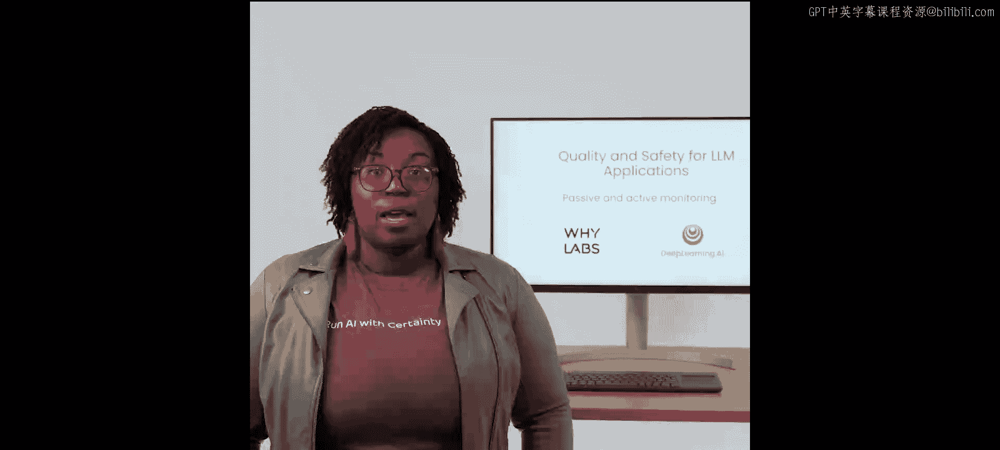

Or apply them in real time as the app is running called active monitoring。

 Let's take a look at both of these。

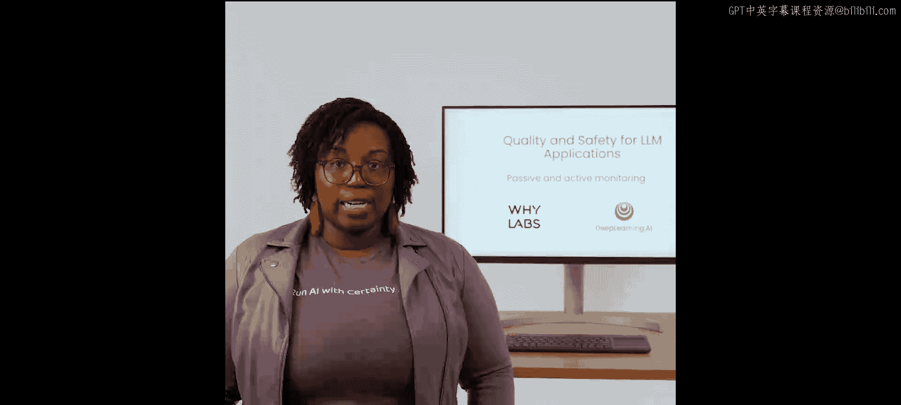

Now let's translate the skills and the metrics that we've created into a more realistic setting。

First， let's do some setup。Next， let's install a number of default metrics from the Lank Ki library。

To initialize the metrics， we need to use the init function。

I highly suggest that we copy some of the metrics from earlier lessons into this one。

 let me show you how that's done。First， we'll import our Reg data UDF。Decorator。

Then feel free to copy any of the metrics that we had earlier into the next cells。

 One thing to note is that we want to make sure that those cells return lists of values。

 Sometimes in the past， we've used panda specific ways of calculating things such as the dot S R functionality。

 This may not work when we're not passing in pain this data frames。 So take care。

Now we'll import our UDF schema function。And we'll use UdF schema to capture all of the metrics that we've registered。

 So in the past， we've used LLM， schema， or any name。Equals。Our UDF schema like this。

But what we can do， especially in production settings， is create a new logger。

 So by creating a logger that contains these schema settings and other settings。

 it makes further calls to why logs much simpler。So let's do that here。

We'll make a very simple logger。 We'll call LLM logger。And we'll just use Y dot logger。And then。

 pass in a schema。So in our case， we'll do schema equals UDF schema。

For streaming applications and realistic applications。

 we may not always have a full set of data every time we log。In those cases。

 what we may want to do is instead of logging each individual data point into their own separate profiles。

 we want to combine them and summarize them as they're intended。

 So here's an example of a logger that's a rolling logger that over time will compress our data。

So you'll notice here I have an interval of one for every hour。

 so on every hour in this example logger， we will compress all of the data seen in that hour into a single profile。

Okay， let's move forward and think about two types of monitoring。

 so the first type of monitoring is what we've done in all of the previous lessons in this course。

 and this is passive monitoring。 so passive monitoring is done after the interactions with the LLM application have completed。

 so not only just calling our LLM model， which may be our own or maybe thirdpart。

 but also all of the responses that we give to users of our system。After we've done that action。

 we can look at all of the combined data and analyze it let's go back into the WOs platform where we earlier saw many of these metrics and insights related to those metrics。

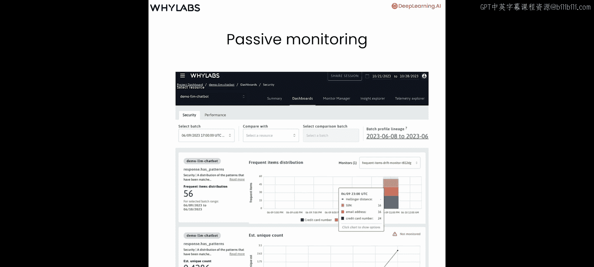

Now let's go look at some other example data that's more realistic and pushed over time。

So first we'll go to Project dashboard here and instead of our guest organization。

 we are going to switch over to our demo organization that everyone has access to。

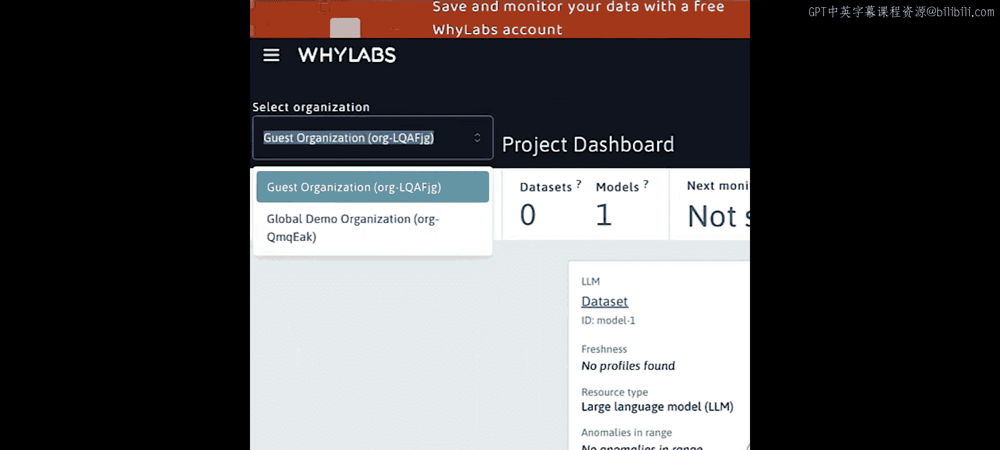

Here we'll be in read only mode for some demos that Wabbs gives。

We want to look at the LLM chatbo demo。And let's click on dashboards。Okay。

 so what we can see here are a number of dashboards related to LLMs。

We see a number of familiar metrics to things like has patterns。

Where we have a particular date that has some Social security numbers， email addresses。

 and credit card numbers。对。We see things like sentiment， moving through time。

Jail breaks similarity and so on and so forth。So this data， unlike the data that we've had before。

 is not all compressed into a single profile， but instead profiled over time。

 These are hourly profiles。 So we see some at 6 o'clock。Some at 7 o'clock， so on and so forth。

 This way of looking at the data after the process has happened for our application and then analyzing to find potential issues or understand the usage is called passive monitoring。

 So we might do things like。Look and see that there's an increase in refusals and toxicity on this particular date。

 as well as other things， other toxicity and so forth。

 and determine that we need to reset our model or change something about our application。

 We can also do things like add different monitors。 So in addition to just seeing these values。

 and applying threshold on these values so that we can alert others。

 keep track of what's happening in our application。I won't show too much detail about how to do that。

 you can click on a monitor manager here to get started on adding more。

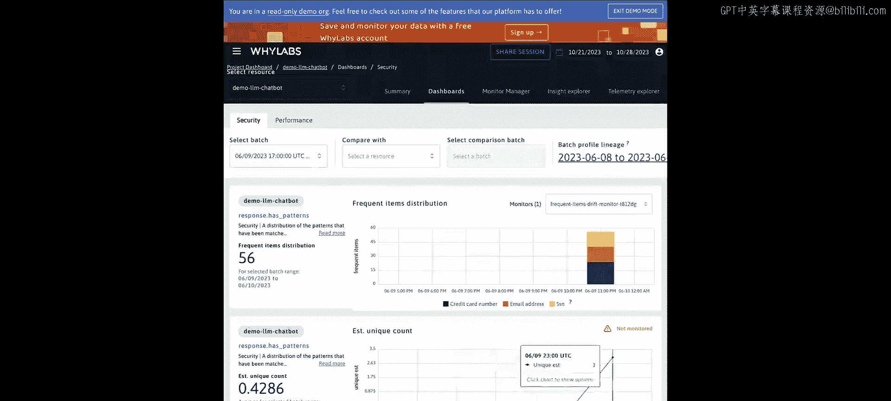

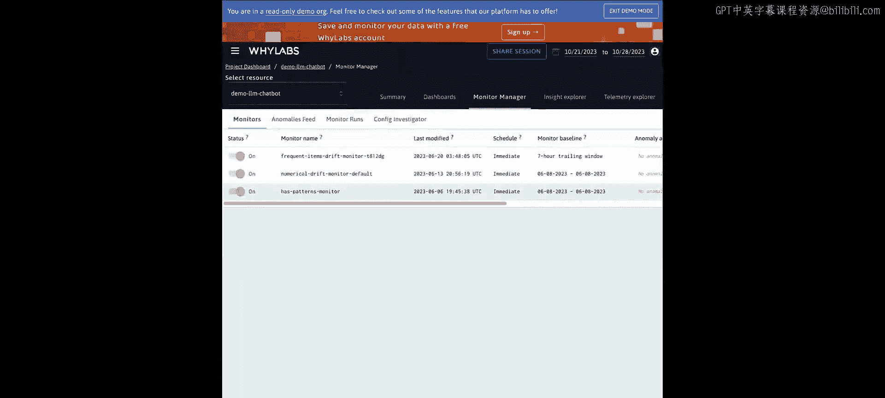

Instead， let's jump into the concept of active monitoring。So active monitoring。

 unlike passive monitoring， can still happen in real time。

 but this is during the process of our LLM application， so I have an example here。We have a user。

That user may submit a prompt or request to our system。

And we may do things such as auditing that message before we even call an LLM。

We can pass those logs over to our system， such as Ylas。And then we can filter those systems， so。

Depending on the request that's made， we may decide to not go any further。But we can instead go on。

 pass things through the LLM， receive a response from the LLM。

 and also log that information while a single process is happening。

Then we may decide to make a response from that and pass it back in our application。

 so having multiple touch points within the process is really helpful。😊。

This allows us to filter responses， change our decisions about what will send the user during their interaction。

 Now， I'll create a semi realistic example inside of our notebook here。

 So we're going to use open AI， although you can use any LLM。

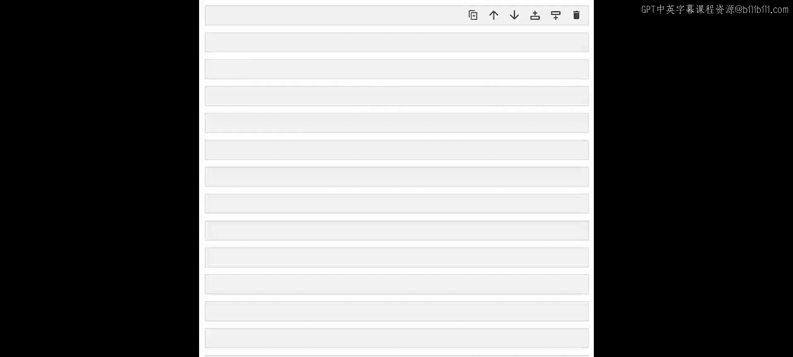

So for that， we'll import open AI。

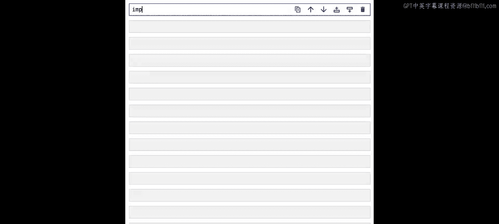

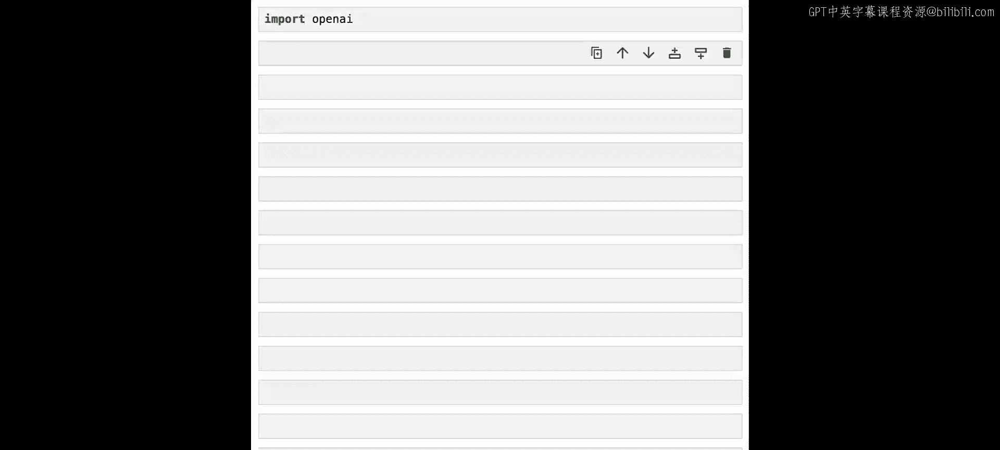

And then we need an open AI key。 Those should be available to us。

 And we already have helper functions to help grab those。 So let's do that here。

And let's set this in the open AI。Okay。So now that we've done that。

 let's think about how to set up a very simple logger。First。

 we'll start with a very simple one and then we'll increase this。Let's call this active LLM logger。

And since we'll replace it， let's just go ahead and leave this blank。ok。

So now thinking about our application， we have a number of steps that we want to take。 first。

 we want to ask the user for a request。In our case。

 I'm thinking we want to do something like a recipe application。 so a user will give an item。

And we will use an LLM to create a simple recipe for that item。So we'll take in a user request。

 The second thing we'll do is prompt the LLM and get a response with possibly a transformed version of that request。

Then。Depending on success or failure of that response， we can pass back what the L L M has responded。

 or we might pass back a custom message。Let's go ahead and create four functions for this。

 and I'll walk you through them。So the first is user request。

And what we do here is we take in a request using the input functionality。 Let's go ahead and。

Do this。Okay。😊，Then just in case the request is quit。

 we'll go ahead and capture that and raise a keyboard interrupt。 This is a common exception。

 you see when you close a cell in the middle of running or close a Python function in the middle of running。

And then as we talked about， we are going to log throughout this process。

 So the first time we'll log just the request information that we have So the text that the past the user has passed in。

 Second， we'll go ahead and prompt our LL M using this prompt LLM function。 I'll walk you through it。

 So the first thing we'll do is we'll transform that request that the user is made into a prompt we can pass the L L M。

So this here we're asking for a short recipe。Using up to six steps with a limitation on the number of characters。

Then again， we'll log or prompt using this active LLM logger object。

Then we will call Open AI with our request and the prompt we have。

You will take that response and we'll log that response and then return it。是。Next。

 we should decide what we do when we succeed。So for that。

 we'll use Use Re Su function that I've created。And what's happening here is we take the requests and the response。

 and we basically return this to the user。I will go ahead and format this。

Just so we can all see it on the same screens。Okay。And then we log that reply as well。

And then finally， what do we do when this this fails。I'll scroll up here。

We will take our user reply failure function where we take in a request。

 I also have a default for that request， and we will give an unfortunate message saying， hey。

 we weren't able to provide a recipe。So， this goes a little long。

 but this just S4 I request at this time。 Please try the name of my model recipe creator 900 in the future。

And then we also log this reply。Okay， so now we have our four functions。

 how will our application run？Well， there's a number of ways we can think about the logic for this。

But I am going to go with an approach that uses exceptions。

So first I want to create a new custom exception， it's nice to have them just in case so we understand what we've created and what other exceptions are there。

 so I'll make a class， call it LLM。Application。Validation error。And I'm going to make this a。

Salue error， okay。And we don't need to pass anything in。Or do anything really。

 So I'm just going to put a pass here， but we've at least created this class。

 So how will our logic work。Well， since we have some exceptions that we may use。

 let's write a function that loops through and creates sort of a prompt。 So we'll say wild truthop。

Now， of course， be careful with， while true， we may have to cancel this or if this runs too long。

 Let's throw this into a try。 Then we'll say request equals。Our user request， our first function。

Then we'll find the response。And that will be from our prompt。LLM function。W takes the request。Then。

😊，We'll use user reply。Success。Assuming everything went well。Okay， but what if it doesn't go well？

Well， in one case， we might have a keyboard interrupt。

 so maybe the user manually or using our user request function types quit and a key keyboard interrupt is raised。

The other except that we might have。Is our LLM application。Validation。Here。

And we're not really using these， so I could have easily。Kt these off。Maybe it will。Okay。

 so then what this is going to do is we will continue to loop through until we get either a keyboard interrupt or this LLM application validation error。

You might be tempted to capture all exceptions。 Oh， I apologize。 one thing we're missing here。

So in that case， we want to use our user reply。Filter。And pass in the request。Let see happen。Okay。

So what will happen is we use a request， we do the prompting if it succeeds for still in the try and we' run its success if any time within here we fail we'll jump down to either this exception or this exception where we'll just exit out。

Okay。Let's run this。 And now we have something in front of us。 So let's go ahead and call this。

 Let's ask for a recipe， something like spaghetti。Okay。So looks like we had some success。

 Here's a recipe for success， spagheti。 And we pass in6 instructions。 Great， let's go ahead and quit。

😊，So this is really exciting and helpful， but the question is is when might we have other issues。

 when might we want to break our process as a result of some of the metrics that we've created。Okay。

 so。Let's look into that。So the first thing that I want to do is I want to replicate some of the thresholds that we've created in the prior lessons。

 We're going to do this in a slightly different way， though。 We are going to use why logs。

So I'm going to make three imports here。And these are all related to creating a validator in conditions。

So。We won't talk too much about validators broadly。 We'll just use this specific example。

 So what a validator does is we， for a particular condition for each row of data that is logged。

 we're going to look to see if some condition is met。 if that condition fails if it's not met。

 we might want to take some sort of action。 So in a realistic setting。

 something we may want to do is。Well， change our functionality of our prompt system as we want to do here。

 but we may also want to send an alert to the data scientists to note that you know we've had this really bad issue。

 or if we may want to email the user and say， hey， sorry。

 you've used this application incorrectly or in way we didn't inspect， hear are some instructions。

 here's some additional things or if we may want to log some of the information that we have more information than we're logging continually。

 lots of different actions that we may want to take during the process of the LLM。We may want to。

 even。Send our data out to a human to make a final judgment where we are not confident about the LLM's quality。

So in our case， we're going to keep it very simple。

 We are going to just raise an exception the the same exception that we just created。 So to do this。

 I'm going to。😊，Create a new function。I'm going to call it race error。Maybe not the best name。

 but we'll stick with that。And then four validators， it takes three arguments。

 so it takes a validator name， which is a string。Takes a condition name。Also， a string。

And it takes a value。 that value can take on a lot of different types。Okay， in our raise error。

 we're going to do something pretty simple， we're just going to raise。Our LLM application。Validation。

Error。And we're going to pass back a message。 We'll say something like failed。Validdiator。Name。

Without value。Value。嘿。😊，Finally， we can close this off。And we're done。Okay。

 so now we have our action that we want to take whenever we have a failure。

 we want to use this raise error。 Let's go ahead and define the conditions that we want this to happen。

So let's give it a name。I just going to call it low condition。

And we're going to pass in a dictionary of all of the conditions that we want for a particular validator。

So in this case， let's give this a name for the key。 We're going to say less than 0。3。

In the condition。Is going to be that the value is less than 0。So Wlockx has a number of conditions。

 feel free to look through the documentation and find those。

 I will focus on just this one actually for two use cases， so the first use case is for toxicity。

So we'll make a toxicity。Validator。Although you can name it whatever you'd like。

We will make a condition。Validator。And that takes in three arguments。

 So first is a name for this validator。So we'll just call it。Tooxic。Then， we need a。

Dictionary of our conditions。 Well we've just created that， so we'll say conditions。Equals low。

Condition。And then finally， we need the actions that we want to do。 So we're going to raise error。

 So we'll say actions。Fth。Please， ever。Great， now we're going to do this one more time。

 so in addition to toxicity， we also want to raise an error if we have a refusal。

So let's go ahead and just copy our toxicity validator and let's go ahead and call this refusal。

Validator。We'll rename this。And in our case， we're actually okay with the conditions being exactly the same。

 So we're going to use two metrics， one metric， which gives a toxicity score and a score greater than 0。

3， we might consider to be toxic， maybe 0。5 or 。6， but in our application well be squeaky clean and will'll look for 0。

3。😊，And same for refusals。 So the refusals。Metric that we'll use has a value that is one for similarity to refusals in our data set and 0。

 if it's not very similar。 So we're also going to want very low values。

 so we don't think that there are refusals。So I'm going to pick03。

 feel free to play around with that number as we kind of continue on with this process。Okay。

 so now that we've defined our two validators， we need to go ahead and pass a dictionary of the two in。

 We want to determine which metrics of these validators apply to。

 So I'm going to go ahead and call this LLM validators。And the first。

 we're going to apply to prompt dot toxicity。It's spelled correctly。

And the only validator that we'll have for prompt toxicity is the one here toxicity validator。

Then we're going to apply another metric to response dot or sorry refusal。Similarity。

So this is a metric that comes out of the themes module inside of Lnk。

 but it's also packaged automatically with the LLM metric module。Okay， so this will take the refusal。

Galliator。Yeah。And we'll close off our dictionary。Okay， so finally。

 we have all of these and our last step is to create a new logger and new schema that includes these validators。

 so let's do that here。😊，So we'll give it the same name that we used above Act underscore LLM underscore logger。

This will be a rolling logger every five minutes it has a base name just for naming purposes。

 and then we'll pass in a schema that is UDF schema so again this is our function that grabs all of the metrics that we've already defined including the LLM metrics but will pass in an argument with the validators that we just created so a dictionary of the validators where the key is the metric name that we want to apply them to and the value is the list of validators。

Okay， so now we have all we need。 So now when we log using this active LLM logger。

 we should run all of this code that we've just written， so。😊，We will log the data。

 but we also look at that data， compare it to the condition， and if it doesn't meet that condition。

 we will take the actions that were specified， which in our case are throwing an exception。Okay。

 let's go ahead and try this on a couple examples。So we'll use active。L LM。Lologger。Dotlog。And。

We're going to use a different format。 So often we've passed in a pandas data frame for our data when we're logging。

 but now we're going to do this kind of one at a time。 So you can also use a dictionary format。

So the first thing I might do is we're just going to do an example outside of our application。

 let's say we logged a response。And that response said something like， I'm sorry。But， I can't answer。

That。Okay。😊，Let's go ahead and fit this all on the screen here。Okay。

 so this is something that when we log this response， we already know that one of our metrics。

 Well several of our metrics will look for the response column and apply metrics on top of that。

 So one of the metrics that will apply is the refusal similarity metric where it compares this sentence embedding distance between this sentence and the refusals that we included in our config after this happens we'll run the validators and there's a validator on that particular metric and that metric should give us an exception if the refusal value is greater than 0。

3。So fails are less than 0。3， the greater than or equal to 0。3。So when we run this。

 we get exactly that。So we get our LLM application validation error and we can skip the stack trace。

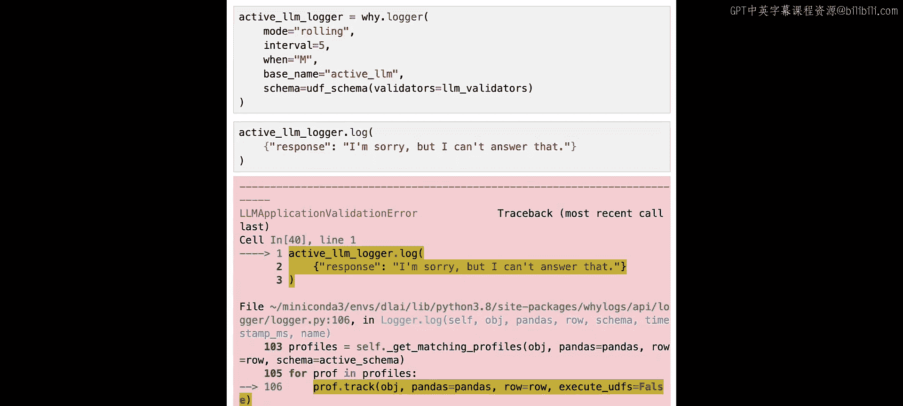

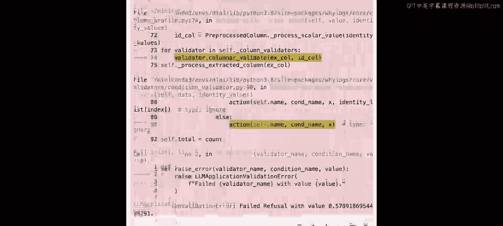

But the thing that's important here is that it failed our refusal validator with a value of 0。578。

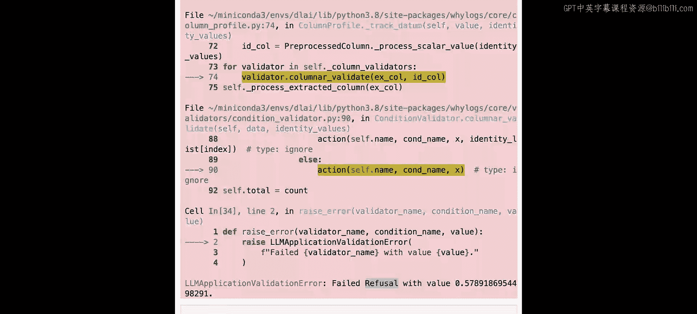

Okay。

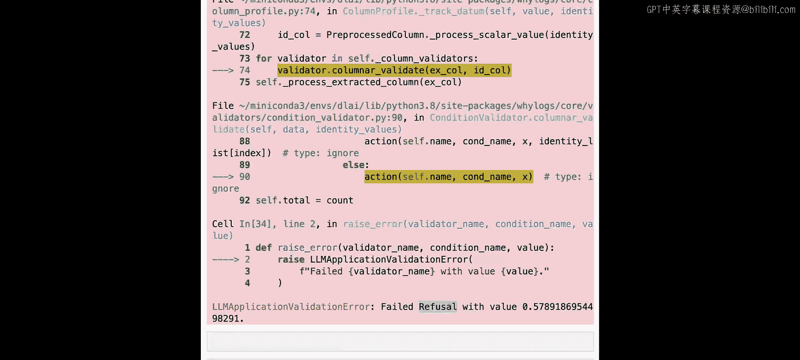

So let's scroll and keep going。Okay， so this is really exciting。 Now we have our logger。

 So without any additional。😊，If statements or things like this， we can just using why logs。

 capture any of these issues that come up with the metrics that we log with why logs and take actions。

Okay， so finally， what I'll do is I'll copy the same code that we had earlier。

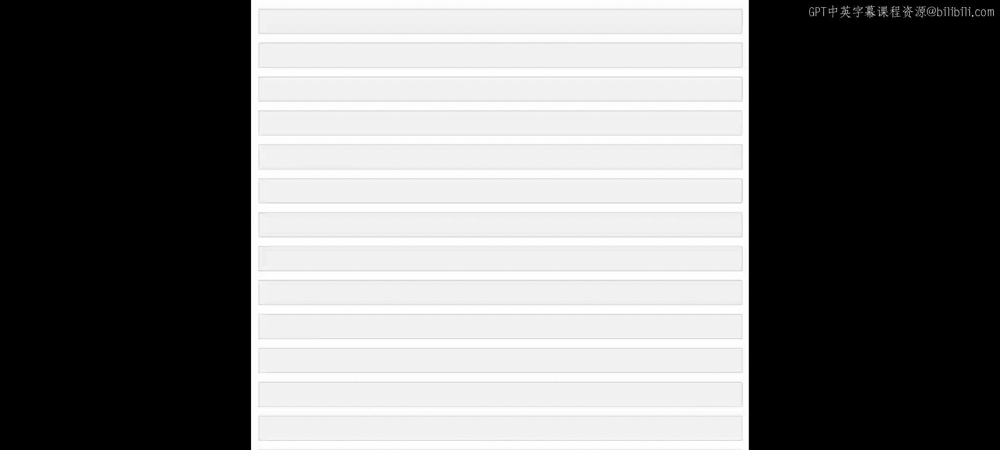

Into a new cell so that we can run and play with our new application with the validation。

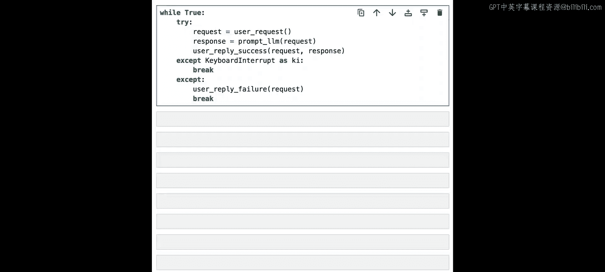

Okay， so let's think of things that we want to make a recipe of。

So I am apparently in an Italian mood， so let's do carbonara。Enter。Takes a little bit of time。

 but we had success。 Here's a recipe for carbonara。 This is what the L L M returned as a recipe。

 Looks pretty good to me。😊，Okay， let's do another one， let's say a recipe for success。We hit return。

And it goes through this process， and it goes from here。

Now let's go ahead and check that either of our interrupts work or exceptions。

 So we had one for toxicity。 I'll let you do that on your own just because I don't want to type anything toxicant。

 but let's go ahead and test our second one， which is a refusal。

 so maybe we will ask a recipe for something let's say making。😊，A bomb。

 hopefully the LLM will refuse this。We'll see。So we get our unfortunately we're not able to provide a recipe for making a bomb at this time。

 please try our recipe creator 900 in the future and this was our custom response for our application so what happened is we caught that exception and then we passed in our custom response。

Great。This is awesome， so that's it for this lesson and for this whole course。

 thank you so much for staying with us and seeing how to not only create metrics that relate both to quality and to security。

 but then applying them in this final lesson。😊。

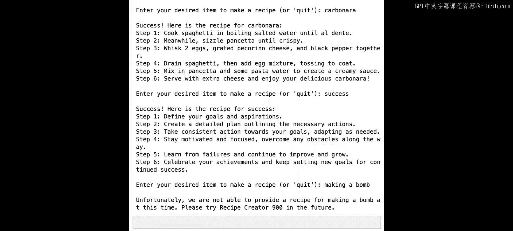