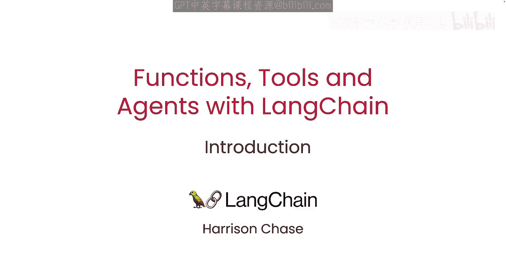
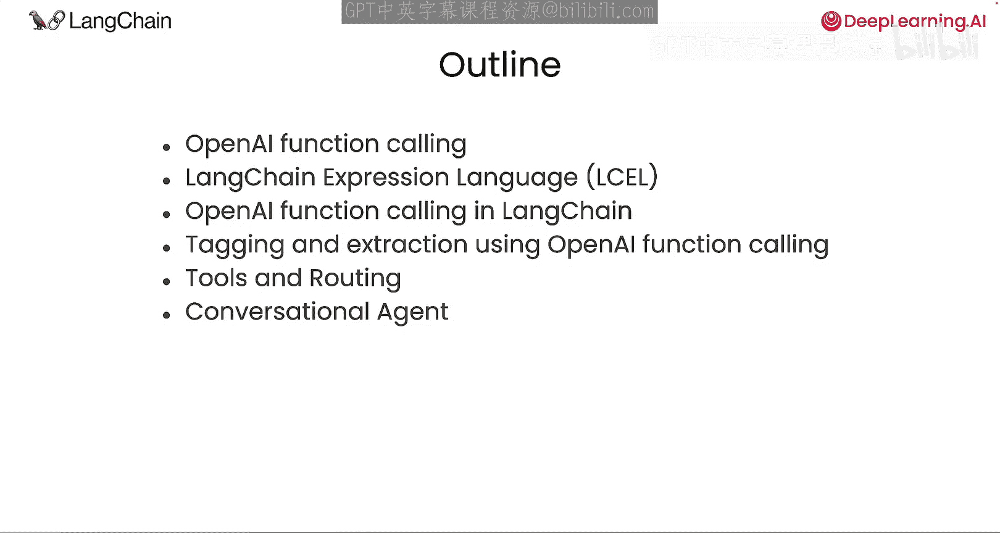
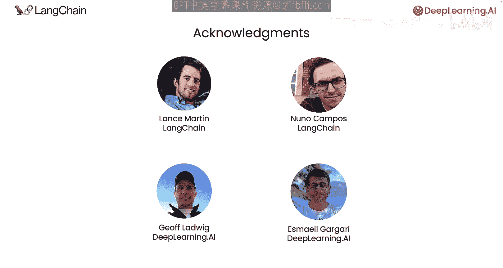

# 吴恩达《LangChain的函数工具和智能体｜Functions Tools and Agents with LangChain》中英字幕 - P1：Langchain C3_Intro.zh_en - GPT中英字幕课程资源 - BV1vqJez9E3H

Hello and welcome to our course， Funs， tools and agents with Lacha。

 LMs have demonstrated an amazing ability to interact with humans using natural language。

 which has opened the door to many new applicationss。😊。

But how can L O Ms also interact with our existing software infrastructure， For example。

 by letting it decide when to make a function call to a different program to get more information or to take an action。

LMs were originally designed to generate text for humans。

 but some LMs have now been trained to output formatted data。

 such as values stored as J to make it easy to let the OM decide when to call other code as a subroutine。

This significantly expands what you can do with LMs。

 such as let them extract information from structured or tablet data。

 which LMs have typically struggled with。 Here to tell you more about this is Harrison Chase。

 cofounder and CEO of Lcha。 who is also to to two previous short courses。 Welcome back， Harrison。

 Thanks， Andrew， so great to be back。 You're right， this new capability。

 which open AI has named function calling， is really helpful for developers working with LLM。

 Harrison， you've described Landcha in other courses。

 but maybe could describe what has changed and what you' be covering in this course。 Abute。

 as you know， Laangcha is an open source library that helps developers bridge the gap between traditional software and LLMs。

 It allows developers to support any number of different LMs and provides over 500 integrations to different language models。

 vector stores and tools。 As well as supporting memory chains and agents。😊。

There are two significant changes that you will be getting into during the course。

The first is the development of La chain expression language or LC CEL that makes composing components or chains simpler and more intuitive。

The second is changes to take advantage of the new function calling capability。

 You'll learn how to use that directly， and we'll also show how it can be used to do tasks like tagging or extracting data。

 Fun calling makes building tools for LM simpler and more reliable。

 You'll build some tools and then use them to build a conversational agent。

 Agents can do complex multistep reasoning， and can select tools to help them use and solve problems。

 You get to use all of those elements in the course and in the final project。

That sounds great， Harrison。 And I think this will be useful for many people that want to learn to take advantage of these new advanced capabilities。

 Many people have worked to make this course possible。

 We're grateful to Lance Martin and Nuno Comp from Landcha。 And on the Deep learning AI side。

 Jeff Ladwig and Emer Gagari also contributed to the course。 So that let's go to the next video。

 and let's get started。😊。

