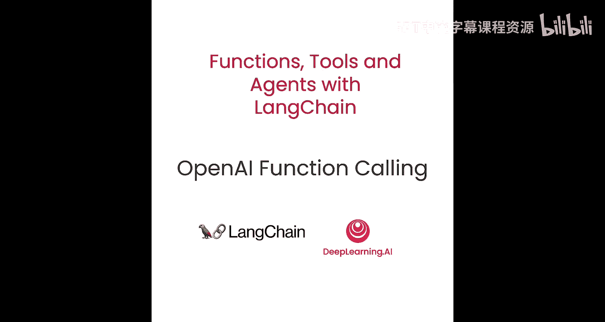
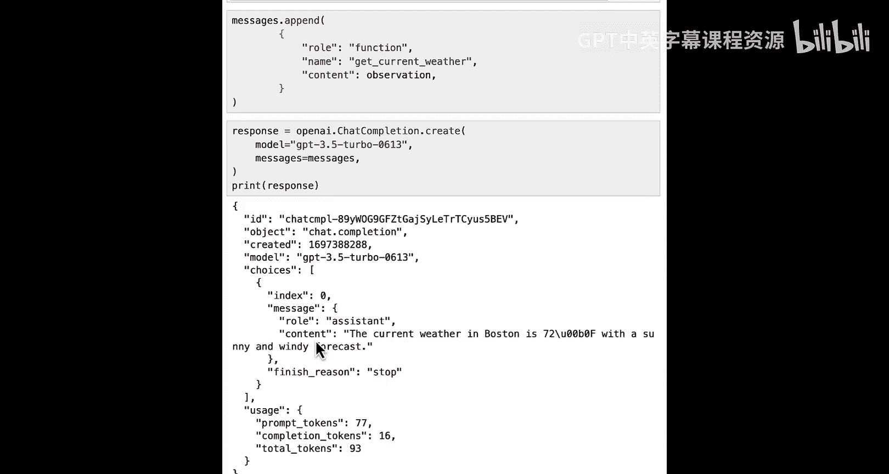
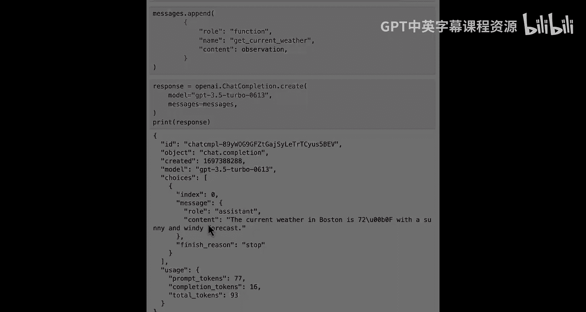

# 吴恩达《LangChain的函数工具和智能体｜Functions Tools and Agents with LangChain》中英字幕 - P2：Langchain C3_L1.zh_en - GPT中英字幕课程资源 - BV1vqJez9E3H

In this lesson， we will go over function calling a new capability added to the open AI API a few months ago。

We'll go over how exactly to use this and some tips and tricks for getting best results。

Open AI has fine tuned some of the most recent models to accept additional parameters for function calling。

 These models are fine tuned to determine if it's relevant to call one of these functions， and if so。

 what the parameters to those functions should be In this lesson。

 we'll use the open AI SDK directly and show what these additional parameters are and how to use them。

First， we're going to set up our environment by loading in our open AI API key。

 to walk through this example， we're going to imagine that we have a function that we think is interesting to provide to the language model。

 and we'll go over what interesting means later on because there are a bunch of different use cases for this new parameter。

Here， we're going to define a get current weather function。

 This is an example from Open AI themselves When they first released this functionality。

 This is a good example to use， because getting the current weather is something that the language model can't necessarily do by itself。

 And so we often want to connect language models to functions like this one to augment it with current information。

 And we'll talk more about that later on in the lesson。In this example。

 we hard code the information that's returned。 but in production。

 this could be hitting a whether API or some external source of knowledge。

So how do we pass this information to the language model。

 Open AI has exposed a new parameter called functions。

 through which you can pass a list of function definitions。

The full function definition for the above is right here。 As you can see， it's a list。

 And then the element in the list， there's only one because we're only passing one function。

 And here it is this Json object with a few different parameters。You've got a name parameter。

 and this is the name of the function。You've then got a description parameter。

 and this is a description that we're going to give the function。And then next。

 you have this parameter object。And in here， theres properties。 Properties is itself another object。

 and we can see that there's two elements， location and unit。Each of these elements has a type。

 string， and then a description。Unit is an enum because we want it to be either Celsius or Fahrenheit。

 and so we can reflect that here。We can also convey that the only required parameter is location。

We're going to pass these functions directly to the language model。

 The description parameter here and then also here on the properties are really important because these are going to pass directly to the language model。

 And so the language model will use these descriptions to determine whether to use this function。

Any information you want the language model to have in order to determine whether to call a function or how to call a function should be in the description。

Here or here。Now that we have these functions defined。

 let's use them in a call to the language model。First。

 we're going to create a list of messages to pass to the language model。

Let's make the first message we pass something that's related to the above function。

 So let's make it a question about whether， what's the weather like in Boston。

Less than import the Open AI SDK and call the chat completion endpoint。First。

 we're going to specify the model。 We're going to make sure to specify one of the more recent ones that has this capability。

Next， we're going to pass in our messages defined above。

Then we're going to pass in the functions we defined above using the functions parameter。

Let's run this and see what we get。Let's look at the full response。

 We can see that the message we get back has role of assistant。

Has null for content and instead has this function call parameter。Which has two objects。

 name and arguments。 Name is get current weather。 This is the same name as the function that we passed in。

 And then arguments is this Json blob。Let's take a closer look at the response message。Again。

 content is now empty。And function call is this dictionary。

The arguments parameter and function call is the Json dictionary itself。

 so we can use JSson dot loads to load this into a Python dictionary。

The arguments that it passed back can be directly passed into the get current weather function。

As you can see， function calling with openaiI doesn't directly call the function。

 we still have to do that ourselves。 Rather， it just tells us what function to call。

 That's the name and what the arguments to that function should be。

 It's also worth noting that although this is trained to return a JSsonN vlob。

 it's actually not strictly enforced。 So if you're decoding it with JSsonN do loads。

 and you run into some error。 That's actually an issue on the model side。

 And so you might want to put in some safeguards around that。

 And we can talk about how to do that later on in the lessons。

What happens if the message that you pass in isn't related to the function at all。

 Let's try it out and see what happens Then。 Let's create a new set of messages。 This time。

 ones that aren't related to the weather at all。When we call it this time。

 we can see that the message that's returned has content has normal。

 and it doesn't have that function call parameter。 What's going on under the hood is that the model is determining whether to use a function or not。

There are additional parameters that we can pass in to force the model to use or not to use a function。

 Let's take a look at those。That additional parameter is the function call parameter。 By default。

 it's set to auto。 This means that the language model chooses。 This is what we've been doing so far。

There's two other modes that we can use it in， in the first mode， we can force it to call a function。

This is good if we always want to return the function and we'll see some use cases for that later on in the lesson。

As you can see， because we're using auto and we're letting the language model choose what to do。

 here it recognizes that it doesn't need to call the function。

 and so it's responding as before with role and content only。

Another mode for function call that we can use is none。

This forces the language model not to use any of the functions provided。In this example。

 it doesn't really matter because the content high doesn't need the function call anyways。

 so we see it's not used。But what happens when the messages should call function here？

Here we can see that the message we passed in should call function。

 it should call the get current weather function， but when we look down。

 we still see the usual role in content， that's because we're forcing it not to call the function。

 and so it's getting confused it's trying to call the function。

 but this isn't the correct function call parameter that will be returned if it actually is calling the function。

The final option for the function call parameter is forcing it to call function。

 Let's see how to do that。Here we specify name， get current weather。

 and this will force it to use the get current weather function。And if we look at the response。

 we can see that， in fact， we do get this function call object returned， and it's got name。

 get current weather with some arguments。Just for fun。

 let's see what happens if we pass in a message that doesn't need to call the function。

 but we force it to。Here we can see the language model is getting confused and making things up because it's forced to call the get current weather function。

 but there's absolutely nothing in the user's message that provides any information about how it should call that function。

So here it's making up San Francisco， California if we run it again。

It keeps on calling San Francisco， California。Now is a good time to take a pause and play around with different functions that you want the language model to call。

 different input messages， different values of this function call parameter。

 and see how the language model responds。Some final things to note。 First。

 the functions themselves and the descriptions count against the token usage limit that you pass to open AI。

 So if we run this， we can see that we get back。Prompt tokens 89。

If we comment out functions and function call。We can see that prompt tokens goes down to 15。

In this particular example， the function definition and the function description are taking up a lot of the tokens。

 This is important to note because open AI models have a token limit on them。

 And so as you're constructing your messages to pass to open AI。

 you now not only have to be aware of the length of your messages。

 but also the length of the functions that you pass。Finally。

 let's now take a look at how you can pass some of these function calls and the results of actually doing the function calls back into the language model。

This is important because oftentimes you want to use the language model to determine what function to call。

 then run that function， but then pass it back into the language model to get a final response。

So let's run this again。And we'll get back this response。That has this function call parameter in it。

We'll then take this message。And will append it to our list of messages。

We can then simulate calling the get current weather function with the arguments。

That the language model provides。Let's save this to a variable。

 and then we can append a new message to the list representing the response from the function that we just call。

We do this with a new type of message。 Notice that it has a role equal to function。

 This is used to convey to the language model that it's the response of calling a function。

We then also pass in the name， which is the name of the function and a content variable。

 which we can set out equal to observation， which we calculated above。

If we then call the language model with this list of messages。

 we can see that the language model takes the response of the observation。

And convert it into a nice natural language response。

 The current weather in Boston is 72 degrees Fahrenhet with a sunny and windy forecast。😊。

Now is a good time to again stop and go back to some of the functions that you created earlier and try them with this pattern of calling the language model。

 getting the function to use in the inputs， then running that function on those inputs and then passing it all back in to the language model that's all for this lesson where we introduced Open AI function calling and how to use it with the Open AI SDDK directly。

 And the next lessons we're going to cover how to combine this with La chain primitives to make it easier and faster to use this functionality。

