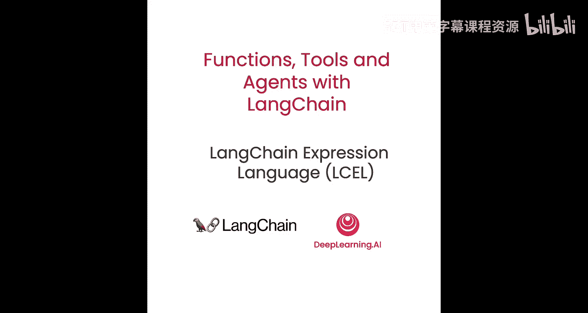
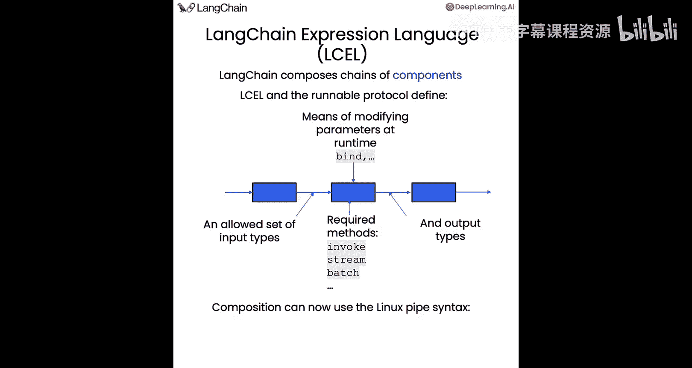
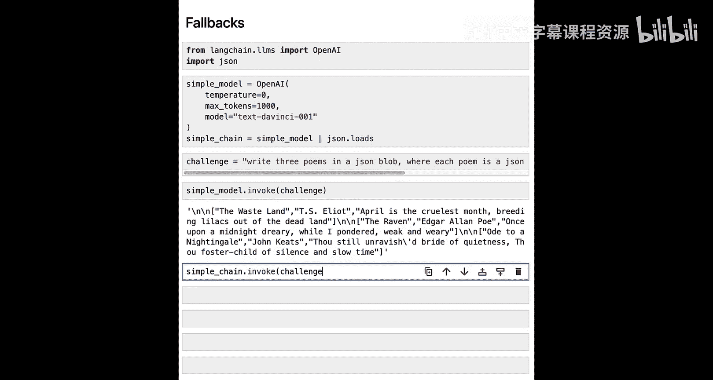
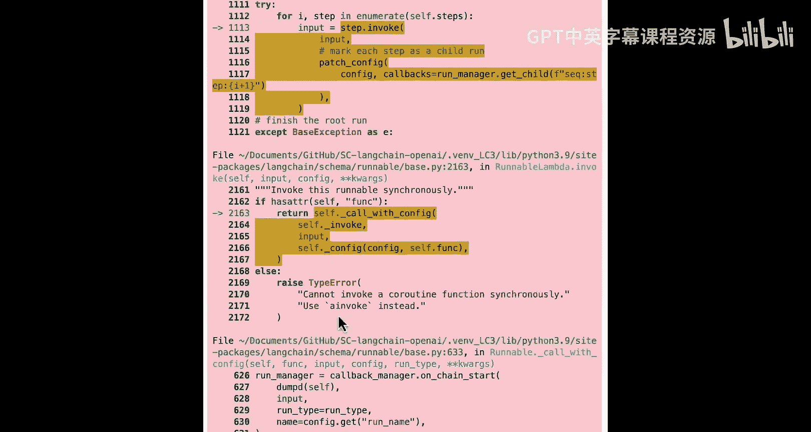
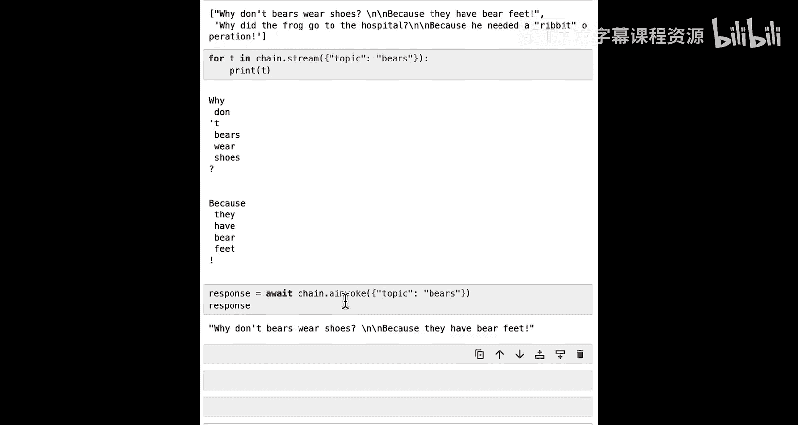

# 吴恩达《LangChain的函数工具和智能体｜Functions Tools and Agents with LangChain》中英字幕 - P3：Langchain C3_L2.zh_en - GPT中英字幕课程资源 - BV1vqJez9E3H

In this lesson， we'll introduce La chain expression language or LC CEL。

 This is a new syntax that makes it much easier and more transparent to construct and work with different chains and agents。

 Let's get to it。

A lot of the power of lane chain comes from composing chains of different components together。

 And we have a new way of doing this。 And this is L C， E， L and a runnable protocol。

 which define a few things。 First， it defines an allowed set of input types and a corresponding a allowed set of output types。

 There's then a bunch of standard methods and will go over all of these。

 But these are standard methods that all runnables will expose。

 So you can call them all in the same way。 There are ways of modifying parameters at runtime。

 and adding other options like fallbacks。And you can do all this。

 You can do all this composition using the Linux pipe syntax。

So it'll look something like this。What is this interface that we expect all runables to expose。

 First， there are a few common methods。 There's invoke， which calls the runnable on a single input。

 There's stream， which calls it on a single input in stream's back a response。

 And then there's batch， which calls it on a list of inputs。For all of these synchronous methods。

 there's also a corresponding async method， so there's a invoke， a stream， a badge。

There's common properties that all runnables have， namely an input schema and an output schema。

 and you can see a list of the input and output types for common components below。Why use LC C E L。

 There are a few benefits that this gets you。First。

 you get async batch and streaming support out of the box。

 so even if you're writing your code and testing it in a synchronous version。

 you can easily port it over to production server that needs batch or needs async or needs streaming。

Second， a big part of working with L L Ms is that they're a little bit unpredictable。

 Sometimes they don't always respond how you want them to respond。

And so you can easily attach fallbacks not only to LLMs， but also to entire chains。

 so you can have a fallback safety mechanism。Third， parallelism， LM calls can be time consuming。

 they often take a while， and so it's really important to run them in parallel if you can。

 and the LCCEL syntax makes it easy to do that。And fourth。

 logging is built in as these chains and agents get more and more complex。

 being able to see the sequence of steps and the inputs and outputs becomes crucial for building an LLM application。

And we've added things into the open source library， and then we also have Linksmith。

 which is a platform for logging and debugging steps。

And LCC I'll natively log all of these things and all the inputs and outputs correspondingly。

With that， it's time to get to the code and see what this actually looks like。First。

 let's set up our environment as before。We'll then import a few different components that we're going to compose together。

First， will'll import a prompt template。Next， we'll import a language model and will be using open AI。

And finally， we'll import an output parser。 And this is a really simple output parsel。

 It's just going to take a chat message and convert it into a string。

Let's now use these components to create a simple chain of prompt template to language model to output parser。

 So first， let's create a prompt template。And we'll create one that asks the language model to tell us a short joke。

We'll then initialize the language model that we're going to use。And finally。

 we'll create the output parsor that we're going to use。

Now to combine these all together into a chain， all we have to do is connect them with this pipe syntax。

And we can now call this chain using the invoke method。

On some inputs and the inputs here are going to be the inputs to the prompt template。

 So that's going to be。A dictionary with a keyword of topic。

 And let's tell some joke about bears to start。 And so if we call this。

 we can see we get back a joke。 Why don't bears ever get caught in traffic because they always take the bariest best routes。

Now is a good time to pause a little bit， pass in some other arguments to this function。

 maybe change up the prompt， play around with it and get a sense for these different components and also combining them with this pipe syntax。

We'll now create a slightly more complex chain。 In the previous short course。

 we went over how to do retrieval augmented generation。

 And so we'll replicate that same process using Li chain expression language。First。

 we need to set up our retriever。 We're first going to create a really simple vector store We're going to do this by initializing it with two texts。

 First， Harrison worked at Kencho， and next Bears like De E Honey we'll then also pass into an embedding model。

 open AI embeddings， and then we'll create a retriever by doing vector store do as retriever。

As a reminder from the previous lesson。We can now call doc get relevant documents on this retriever。

 and we get back relevant documents。 So we call it with， where did Harrison work。

And we get back a list of documents。 And we can see that Harrison worked at Kencho is the first one returned。

 If we call it on something different。If we call it on what do bears like to eat？

We can see that the first result that we get back is bears like to eat honey。

 So this is a simple example because there's only two documents。 And so it's returning both of them。

 But the important thing is that you can do this on a larger number of documents。

 and it will turn the most relevant documents， which we will then use in our retrieval augmented generation pipeline。

In order to create this pipeline， we're first going to create a prompt that basically asks the language model to answer the question based only on the following context and has two variables here has context in question。

 and so we're going to be passing in two things。 we're going to be passing in the question。

 which is going to be the user question， and then we're going to be passing in the context。

 and these are going to be the documents that we fetch from the retriever。

So how are we going to think about creating this chain？

We want the first and only input to the chain to be the user question。 from then。

 we want to fetch relevant context， and then we want to pass that into the prompt。

 and then we want to pass that into a model， and then we want to pass that into the output parsel and convert the chat message into a string。

So the first thing that we're going to do is create something that takes in a single question and then turns it into a dictionary of two elements。

 context and question。To do that， we're going to use a runnable map， which we can import this way。

We want this runnable map to have two elements。 First is going to be context。

 and the context is going to call the retriever。We can write a Lambda function that calls Rer get relevant documents and passes in the question parameter。

We also want to pass along the original question parameter。

And we can do that by just using another simple lambmbda function。From here。

 we want to pass it into the prompt， and then we want to pass it in to the model。

 and then we want to pass it into the output par。 So we can just compose all those together with pipes。

 We can then name this。As our chain， and we now have a new runnable。

And now if we invoke this with a question， like， where did Harrison work。

 we can see that it responds with Harrison work Dec Kencho。

If we want to take a closer look at what exactly is going on under the scenes。

 we can just look at this runnable map directly。So let's create this as its own variable called inputs。

And then if we just run this on the same thing。We can see that we get back context。

 which is a list of documents。And then the question as well。 So that's both elements there。

 This is then getting passed into the prompt， which is then creating a prompt value。

 which is getting passed into the model， which calls a model， returns a chat message。

 which gets passed to the output parser， and that finally returns a string。

One of the other things that we can do with runables is we can bind parameters to them。

So we'll do that with an example of open AI functions， which we just covered。

 So if we have this list of functions， we want to call the language model with those functions。

And so normally this would look like a prompt and then a model。But where do the functions go in。

 And so in order to insert the functions， what we can do is we can do bind。

 and then we can do functions， equals functions。 And what this will do under the hood is that when the model is called。

 it will pass any parameters in bind along to the invocation。

So now if we create a runnable by doing prompt and then pipe model。

When we call the runnable on some inputs。That should use。The function like what is the weather in。SF。

We can see that way we get back is an AI message which has this additional quaords parameter。

 and in there we see the function call that we expect to be returned。If you wanted to change that。

 you would just overwrite it。If we add in another function and let's name this one sport search。

And it's going to search for。It's going to search for news of recent sport events。

And it's gonna take in a team name。And it's going to take in a team name。

 and now we have these two different functions here。

We can just update the model by binding it with new functions。

And then when we call this new runnable， which we're using the new model in。And we call it。

 how did the Patriots do yesterday， we can see that it now knows to use Sports search。

One of the really powerful things about LinkIn expression language is you can easily attach fallbacks。

 not only the individual components， but to entire sequences。

So let's take a look at that when we're trying to get a language model to output JSON。

In order to create a situation where this is going to fail。

 we'll actually use an older version of a language model from Open AI that isn't quite as good。

To do that， we're going to import an openaiI language model from Lachain。 LLMs。

 This is different than the chat models， the chat models are newer types of models。

 and so they're generally pretty good at things like outputting JSON， but older models。

 which is Laangcha。 LLMs generally aren't。We'll now create a simple model and a simple chain。

In this simple model， we're going to be setting temperature equals 0。 So we get some determinism。

 And then we're also going to be using this model， Tex Da Vinci 001。

 This is a really early version of an open AI model。

 Our chain is just going to be calling this language model and then piping the result into Json dot loads。

This will break if the result of the language model isn't valid Json。

 Let's now create a challenge problem statement for the language model。

 We're going to ask it to write three poems in a JSson blob where each poem is a JsonN blob of a title。

 author and the first line。 This is a pretty challenging problem。

 and we want it to respond in valid Json。 And so if we run the simple model on this。

We can see that it responds with some structured format and it's kind of close。

 but if we take this and we try to decode it with JSON。

We can see that we get a JON Decode error because what that model's output in isn't actually valid JSON。

The new models from Open AI are pretty good at outputting valid JSON。

 so we're going to create a model called chat OpenaiI。

 and then we're going to create a chain by piping that model with an output parser that's basically taking the chat message from the model and converting it into a string。

 and then we're going to pipe that string into JON dot loads。

If we use the same challenge with this model， we can see that it correctly outputss valid JO。

In order to use fallbacks， what we can do is we can create a final chain。

And we can start with the simple chain， and then we can add fallbacks by using with fallbacks。

In with fallbacks， we'll pass in a list of other runnables。 And basically。

 what will happen is that first。The core runnable tries to get run， if an error is raised。

 then it goes through this list in order， in this case there's only one element。

 but if there was more we would go through this in order and would call those until it succeeds。

If we now call this chain on the challenge， we can see that it responds in the correct format。

So what happened was that it tried on the simple chain， it failed。

 and then it went back to the good chain that's using chat open AI， and it succeeds。

 And so that's what we're getting back from this final chain。Finally。

 let's talk about the interface that these runables expose。

 Let's go back to the chain that we had before。 we're asking it to tell us a joke。

 And let's take a look at a few different elements of this interface。

The one that we were using from the gego is invoke。

 This is a synchronous method that calls it on one input。There's also batch。

 which is going to call it on a list of inputs。 So here we pass in two different inputs。

One with bears， one with frogs， and we call chain dot batch。And under the hood。

 this is actually executing them in parallel as much as possible。We can also stream back responses。

 So chain dot stream is going to return and iterable。

 and we can loop over that iterable and print out the different elements。 So if we run this now。

 we can see the response streaming to back to the user。

 This is really important for LLM applications because sometimes LLM applications can take a while。

 And so it's very， very nice to stream back some of these responses。

 So it's not just an empty screen that the user is looking at。😊，And finally。

 all of these methods have corresponding asynchronous methods。So chain。

 a invoke calls it in asynchronous manner， and so that's why we have this await here because we want to see the response。

 and this does the exact same thing as invoke， but it's just asynchronous。That is it for this lesson。

 But there's a lot of different ways that you can combine all these elements and put together really complicated types of。

 of chains and sequences。 We sometimes see sequences that get up to 300 or 400 components in a row。

 And so before moving on， I would definitely take a moment to pause and try this out on some sequences of your own。

 Can you do 2，3， even four language molecules in a row。 What does that look like。

 Lots of fun things to explore。😊，In the next lesson。

 we're going to combine what we just learned here， La chain expression and language with what we covered in the previous lesson。

 Open AI function calls， and we're going to show how to use those two things together。

