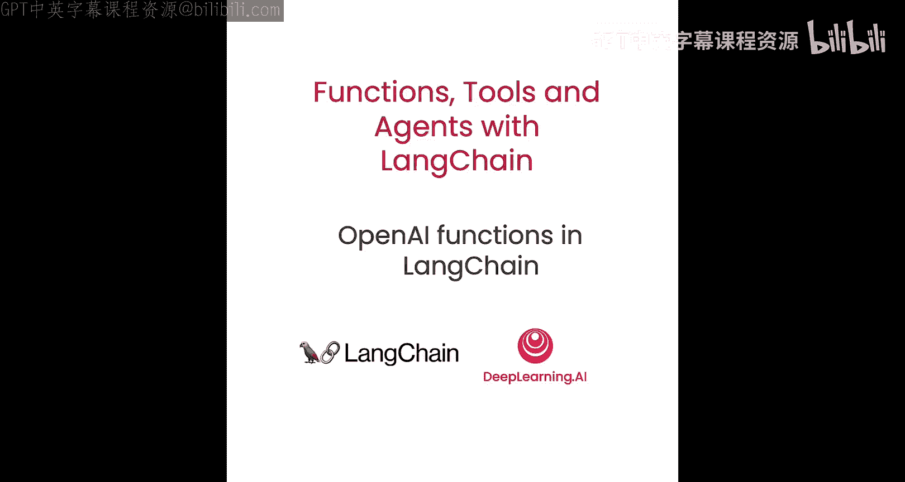
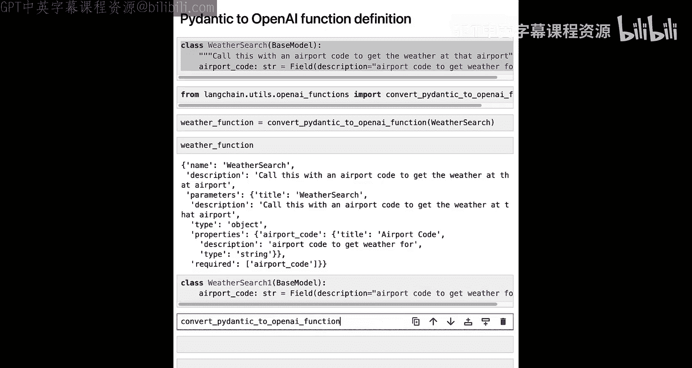
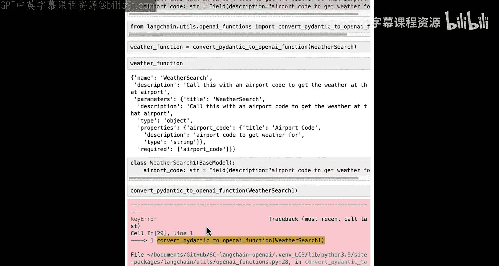
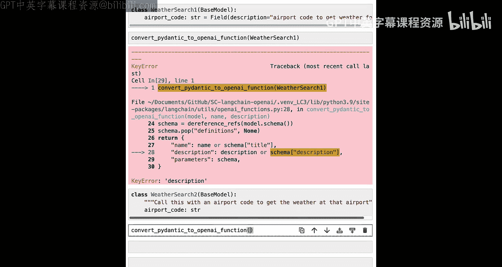
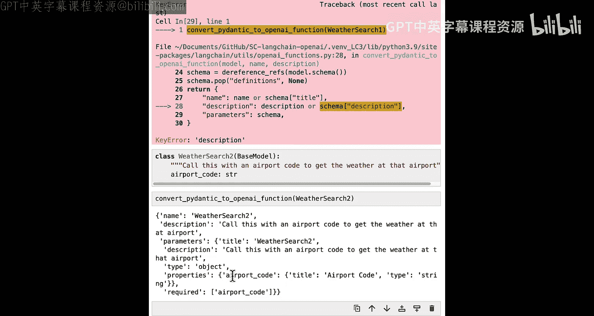
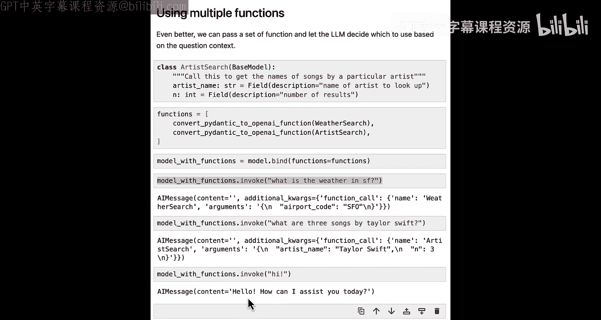

# 吴恩达《LangChain的函数工具和智能体｜Functions Tools and Agents with LangChain》中英字幕 - P4：Langchain C3_L3.zh_en - GPT中英字幕课程资源 - BV1vqJez9E3H

In this lesson， we'll combine what we learned the previous two lessons and go over how to use open AI functions with La chainin Express and language。

 We'll also introduce Pedantic， a Python library that makes it easier to construct open AI functions。

Let's get to it。So what is pedantic。 Pyedantic is a data validation library for Python。

 It makes it really easy to define different schemas。

 and then it also makes it really easy to export those schemas to JSson。

 that's going to come in handy because we can use the pedantic objects to create the open AI functions descriptions。

 If you remember those open AI function descriptions where a big blob of Json with a bunch of different components。

 And so rather than having to think about all of that， we can use pedantic。

The way that we'll do that is we'll define a pedantic class。

 It's very similar to a normal Python class。 So you can see them side by side here。

 And the main difference is， rather than having an internet knit method。

 we're just going to list the attributes and their type under the class definition。

 We're not actually going to use these classes for anything。

 We're just going to use it to create that open AI functions。 JO。

 Let's take a look at what this looks like in practice。First。

 we're going to load in all our normal environment variables。

We'll then import a few pant classes as well as some type pins that we'll use later on。

We'll start with just a normal Python class， so this is a normal Python class for user。

 it has in a knit method， and we pass in name， age and email。And so if we create an instance of this。

咩士。That we have a normal Python class， and we can access those elements accordingly。

If we pass in an invalid value for age， so here we have bar， which is a string。

 and we expect it to be an integer， if we can see that it creates it okay。

And if we look at the element， we have it accessed。

 And that's actually not good because we do want to have some validation that if we say it's an integer。

 it actually is an integer。Let's now take a look at doing this with pedantic。

 We can now have our class init from base model， and this is imported from pedantic above。

 and then we can define our attributes just right under the class definition with various tyends。

 So we're saying name is a string， age is an integer， email is another string。

We can create an object as normal， and if we inspect this object。

 we can actually see that it prints out nicely all the different elements。

 and so this is a nice benefit of pyedantic as well。 Similarlyly。

 we can access individual elements like that。Now， if we try to pass in an invalid argument for age。

 if we try to pass in a string of value bar， we can see that it raises a validation error。

 So this is something that pedantic is doing under the hood。

 is's actually doing some additional validation on the inputs that we pass in。

 which is another nice benefit of pedantic。One other thing we can do with pedantic is we can actually nest these data structures。

 so here we're going to define a class type and this is a peddantic model so it's inheriting from base model and then the only element on this class is going to be students and students is going to be a list of P user which we defined above。

And now we can create an object that has this exact structure。

So we're passing in a list of students in this case， one。And we're getting an object back。

 And if we look at what this object looks like， we can see again that it's printed out nicely。

 And so the point here is that you can nest pedantic objects。

 This is a brief introduction to pedantic。 If you want to learn more。

 I'd encourage you to go look at their docs。 Or now is also a good time to play around with it a little bit。

 Try out some different type hints， see what it ends up looking like。😊。

Now we're going to talk about how to use Pedantic to create these open AI function definitions。

So what we're going to do is we're going to create a pyedantic object that we can then cast to that JSON schema that we went over in lesson one。

 Importantly here， the pedantic object that we create isn't actually going to do anything。

 We're just using it to create this schema。We'll create a class called Weather search。

 and this lines up with the function that we created earlier。We're inheriting from base model。

 you can see also here that we're adding a doc string and we'll see how this gets reflected in later on。

 and then we're having a single argument called airport code， which we type in as a string。

 and then we also add in this field description for airport code to get the weather for。

Field is a pyantic module that we can use to set things like the description of various fields。

From there， we're going to import a function from L chain from L chain Us， open AI functions， import。

 convert pyantic to open AI functions。 This function is going to do exactly what it sounds like。

 It's going to convert a pyantic object to the JSON schema that's expected for an open AI function。

And so if we pass the class in here and notice that we're passing in the name of the class。

 we're not initializing it with an object， we're passing in the class type。

 we get back weather function， If we look at what weather function is。

 this is a JSON schema in the same form as what we pass into Open AI in the first lesson。

We can see that it has name We search， so this is the name of the Python class。

 we can also see that it has a description， and this is pulled from the dock string here。

For parameters， we can see that it has a list of properties， one of which is airport code。

 or the only one of which is airport code， and this is pulled from the arguments that are listed here。

 Airport code itself has a description and that's pulled from the field description here and then it has a type。

 which is string。We've made some assumptions about how people would want to create open AI functions。

 So one thing in particular that we've done is we've made。

This dock string here required because that gets put into to the description of the function。

 And as we talked about earlier， the functions really are prompts。

 And so if you're passing in a function， you want to give a good description of what that function is doing。

 And so we've added some checks that enforce that you are passing in the description。

 So if we have a separate class called weather search 1。 And if we call， convert。

Piedantic to open A function on this。

We actually get an error。

Because of this enforcement that we're using a description。

We don't enforce descriptions for everywhere though。

 so if we remove the airport code description and create a new tool called We searcharch 2。

 and then we call convertt Panttech to open AI function on this。

We can see that it succeeds Now， however， you'll see that there's no description for the airport code argument。

 Des to arguments are optional in LinkedIn， they're not required。

Let's now look at combining open AII functions with La expressionant language。So first。

 let's import the chat model。We'll then create an instance of this model。And for now。

 we'll just interact with it directly。 So specifically。

 what we're going to do is what we're going to call invoke on this model。

Let's ask a question that's going to require the weather function， so what is the weather in SF？

Today。😊，And then we can also pass in。Keywordd arguments。So we'll pass in。

This weather function that we defined above。And so here。

 what we get back from the model is going to be a content message that's nu。

 And then in the additional quarks field， we're going to have this function call parameter。

Which returns a function call with name We search， and then arguments， airport code， SFO。

 so it's using the function appropriately。What we can also do is we can bind the function ins to the model。

 and one reason for doing this is so that we could just pass that model plus functions around together and not have to worry about always passing in these function keyword arguments。

So here， if we do model with。Function and set that equal to model dot bind。Functions equals。

Weather function。We can now call this model with function directly。And we can just pass in。What is。

Weather in。SF。And now you can see that it responds and it's still using the function call。

 and that's because it still knows that the function calls exist because we've bound them to the model like that。

We can do the same thing and we can force the model to use a function。

And so we can bind the weather function as above。And then we can also bind this function call argument。

 and we set this equal to。Name。And then the value of the function that we want to call， which is。

Weather， search。And now if we call this。We can see that it's， again， calling the function call。

 Again， this is actually expected and and and desired because it's a question about whether。

 And so we should be calling it。 We can maybe see exactly a better representation of this if we just say hi。

 And then we can see that it's still forcing it to call a function。

 And it's just calling it with airport code L A X。We can now use this model。

 which has the function bound to it and the chain， like we'd normally use a model。

 and so in order to do that， we're going to import a prompt template。

We'll create a really simple prompt template， so we'll do something like。Chat prop template from。

Messages。We'll create a really simple system message。And then we'll add our user input here。

We'll then create a chain by just piping together prompt。And the model with the function。

 so we'll still let it decide what to do。And now we can do chain dot invoke with input。 What is the。

Or there。SF。And it pipes it through the prompt and then to the model at the end。

The next step up is we can pass in a list of functions and let the language model decide which one to used based on the question context。

So here we're going to create another pedantic model， this one called artistist Search。

 and we're going to have the description in the usage be called this to get the names of songs by a particular artist。

We're going to add two arguments， the artist's name， and then n。

 which is an integer corresponding to the number of results to look up。

We'll then create a new list of functions。 in this time there's going to be two weather search and artist search。

 and we're going to use convert Pantec to open AI function on both of them。

 and we're going to create a new object called model with functions。

And we're going to do model dot bind。And we're going to attach the functions here。

And now let's try invoking this。With different inputs and see what happens。So first ask it。

 what is the weather in SF？And here responds， it's going to do a function call。

 it's going to call the weather search tool。Let's try this again， But let's change it up。

 Let's ask it something about music。 So let's say， what are three songs by。Taylor Swift。

And here we get it' calling the artist search， artist' name is Taylor Swift。

 and then n is equal to three， so it recognizes that we want three songs。And again， here。

 we're not forcing it to call a function。 So if we just say， hi。

 it should respond with something that doesn't use functions at all。 So hello。

 how can I assist you today。Now is a good point to pause and try this out。

 try passing in a few different pyedantic objects to convert pyedantic to open eye functions。

 getting a list of multiple functions， binding those to a model and then passing in various inputs。

 and seeing what the response turns out to be。That's it for an overview of using L chain expression language and open AI functions together。

In the next lesson， we're going to talk about one of the main use cases for this type of functionality。

 tagging and extraction。

