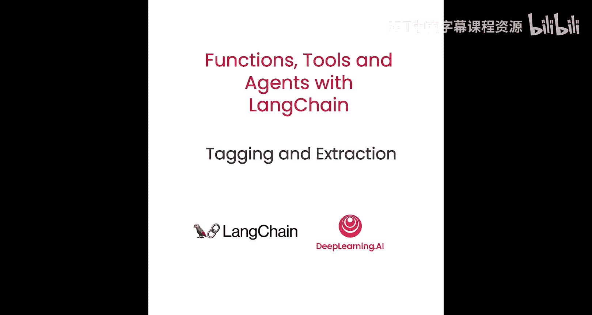
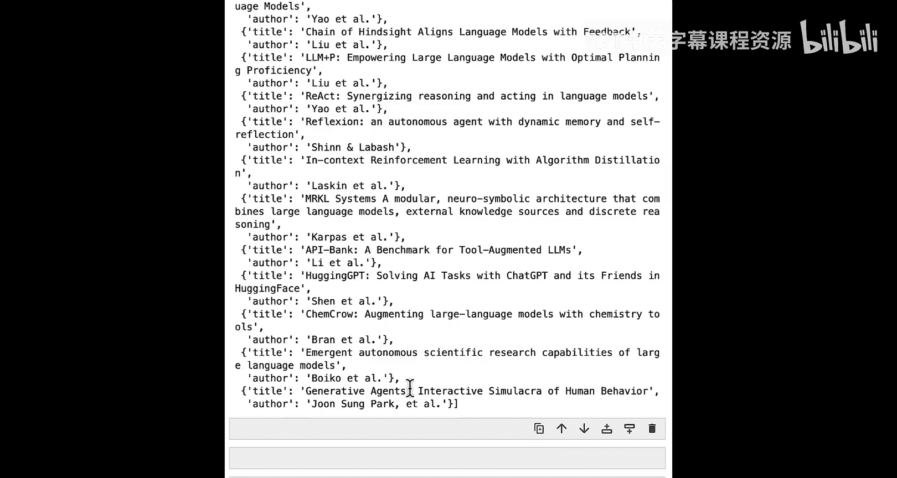
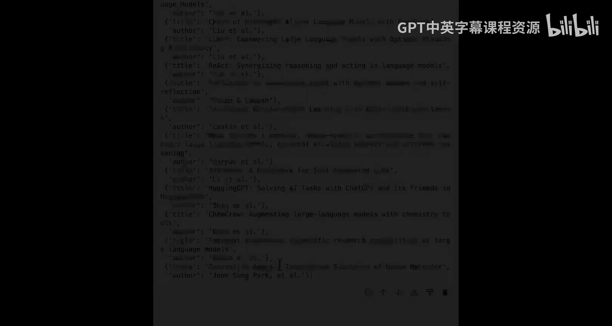

# 吴恩达《LangChain的函数工具和智能体｜Functions Tools and Agents with LangChain》中英字幕 - P5：Langchain C3_L4.zh_en - GPT中英字幕课程资源 - BV1vqJez9E3H

In this lesson， we'll go over one of the main use cases that we see developers using open AI functions for。

 tagging and extraction。This allows us to extract structured data from unstructured text。

 let's have some fun。

The first use case that we'll cover is tagging in tagging。

 we pass in an unstructured piece of text along with some structured description。

 and then we use the LLM to generate some structured output to reason over that input text and create some response in the format of the structured description that we pass in。

So here in this example， we know that we want to be generating an object that has a sentiment of the text and also has a tag for the language of the text。

And so when we pass in a piece of text， we'll pass in a structure description saying， hey。

 extract some sentiment， extract some language， and the LLM will reason over that text and respond with an object that has a sentiment tag and a language tag。

This is similar， but slightly different from the second use case that we'll cover。

 which is extraction。In extraction， we're going to be extracting specific entities from the text。

These entities are also represented by a structure description。

But rather than using the LLM to reason over the text and respond with a single output in this structure description。

 we're using the LLM to look over the text and extract a list of these elements。

 So we might ask it to look over an article and extract a list of the papers that were mentioned in that article。

 Let's take a look at doing this in code。First， we're going to import our standard setup。

We're then going to import some of the functions and classes that we learned about in the last lesson。

 so we're going to import list from typing to help us with Ts。

 we're going to import base model and field from pedantic。

 and then we're going to import our convert pedantic to open AI function。

Let's now create a pedantic model that we're going to use for tagging。

 So we're going to call it tagging。 We're going to have a description where we just say tag the piece of text with particular info。

 and then we're going to have a list of the attributes that we want to tag the text with。

 So first sentiment。And we're going to have the description be the sentiment of the text should be pause。

 neg or neutral。 So we're defining some values that the sentiment field should be。 And remember。

 this gets passed into the language model。 So this is how we're telling the language model what the shape of the data that we're extracting should be。

 And then， and then we also have a language tag。 And here we have the language of the text And。

 we're again saying it should be in this Io 6，391 code。If we then call。

Or convert pantic to open A function method on。This class， we can see that we get back。

A nice JSON blob with a lot of the name and description and parameters and properties that are necessary to pass into open AI functions。

So let's now use this to actually do the tagging。 What are we going to need。

 We're going to need two more things。 We're going to need a prompt in a language model。

So we're going to import a chat prompt template in our chat open AI model。We' create。Our model。

Really simply by setting temperature equals to zero。

 and we're going to do this because when we're tagging things。

 we generally want it to be pretty deterministic。We're then going to create our tagging functions。

 which are just going to be a single one at this point。

And now we need the prompt that we're going to use to tell the language model how to do this。

 So we're going to have it be a chat prompt template。

We're going to add in a pretty simple system message to start。

And we can also use the system message in the future to convey more interesting and more detailed instructions。

And then we'll add in a spot where we're going to pass in the user input。

We're then going to create a model with functions。 So we're going to bind。The马咯。

To the tagging functions。And we're also going to add this function call parameter because we know that we're always going to do tagging。

 and so we're going to try to force it to always do this tagging function。

We can then create a tagging chain by just combining the prompt。With this model。

And then we can call this。And then we can call this on a piece of text。

And we can get back a response。 And so we're calling the tagging function。

 We can see that the function call is there， and then we can see the arguments that are passed in。

 and we can see that sentiment is positive。 and language is English。

 We can do this for another piece of text。 We can vary it up and try a different language。

 in a different sentiment。😊，So let's do some Italian known。이 비아체。Qusto Chibo。

 which means I don't like this food， and so this should be negative and it should be an Italian。

So as you can see， we're getting the language model to respond in this format。

 but it's still kind of nested here in this additional quaggs bit。

 and we know that we're always going to be extracting the structure。

 And so what we really want to do is add an output parser that takes in this AI message and basically parses out the JSson and just says that because that's the only interesting thing here。

 we already know that we're going to be calling this function。

 So the fact that content is nu that's not interesting to us。

 the fact that there's a function calls made， that's not interesting to us。 we're forcing it to do。

 The fact that it's calling the tagging function， also not interesting to us because we know that it's going to be calling the tagging function because we force it to。

 And so here what we really want is just the value of arguments。

 which is JSsonN blob and it'll be really convenient if that was parsed into JSson because it's Json in this JsonN blob。

 and we want to be able to use the individual elements and so we have a nice little output parser in link chain that can help with exactly that。

It's called JSO outputput Functions parser， and so we'll import it from La chainin output parserss Open AI functions。

Then we can then recreate our tagging chain and we can do this as the prompt。

 We can then combine it with the model with functions。

 and now we'll add in this output parsor as the final element。Now。

 if we take the same thing and we call it again。We can see that what we get back is just this dictionary。

 which has been parsed from the JON Glob。And so this is much more nice and convenient to work with downstream。

Let's now go into extraction， an extraction is similar to a tagging。

 but we want to use it to extract multiple pieces of information。First。

 we'll define the piece of information that we want to extract。 And this is a person's schema。

 So we'll have information about a person， We'll have the name， which is a person's name。

 and then we'll have the age， which will mark as an optional integer。

What we want to do is we want to extract a list of these objects。

 and so we'll define another class called information。

 which is just the information that we want to extract。 We'll add an attribute， which is people。

 and then this will be a list of the person type。 This information class is going to be the one that we're passing in as the open AI function。

So here we can convert that class to open eye functions and we can see that we have information properties。

The main property is people。 And then if we look at the description of people。

 we can see that we now have the person description here。

 So under the hood in this convert pedantic to open AI function method。

 we take care of resolving any any mentions and putting all the relevant information that's needed into this JSson blob。

So now we're going to set up our extraction chain first。

 we're going to define some extraction functions。 we're going to call convert panttic to open AI function on this information class。

Next， we're going to set up the extraction model， so we're going to bind functions equal to extraction functions because we want to use those。

 and then we're going to bind function call with name set equal to information because the name of the function that we want to force the model to call is information。

After that， we can try it out。So let's try it out on a simple sentence。

And we can see that it extracts people as a list of one with name Joe， age 30。 We can add in more。

 We can make it。Slightly more complex。His mom is Martha。 So now there's two people here。

 and we can see that what it extracts is name Joe， age 30。

 gets a second person this time Na Martha age 0， so we don't actually mention Martha is aging here。

 And so the model seems to think that when it doesn't know a person's name。 it should just put zero。

 which probably we can do better。 We can force the all to respond in a more educated way。

And so what we're going to do is we're going to add a prompt that's going to tell the language model to do that。

So now we're adding a prompt and we have a system message where we say extract the relevant information。

 if not explicitly provided， do not guess， extract partial info。

So hopefully what this should do is this should force the language model。

 or this should allow the language model to not respond always with an H。

 It's not going to make up this age equals 0 so we can create a new extraction chain。

As this prompt and then the extraction model。And then if we call this extraction chain on the same thing。

 we can now see that in the arguments， we have name， Martha， and there's nothing mentioned about age。

 so it's correctly reasoning that it doesn't need to pass in information about age。Again。

 we can probably do better than just this AI message。 We can try to parse it into some structure。

 So let's add back in。That JSON output parser that we had before。If we call it again。

 we can see that it's parsed into this dictionary with people and then the list of names。

For extraction， though， there's again， some extraneous information here that we don't really need。

 We don't really care that there's this list of people here。 because remember， when we defined it。

Information is just a vehicle to allow us to extract multiple elements of this person field。

 What we really care about is just this list of person。

So we can use a different output parsel for that。We can import JSON key output functions parser。

 and what this will basically do is it will look for a particular key in the output and extract only that。

So now we modify our extraction chain slightly。We pass in。This new album parser。

 and we pass it in with a key name。Equals to people。

 because this is the field that we want to extract。Now if we call this on the input again。

We can see that now we just have this list。So it's a minor improvement。

 but it will make it easier to use downstream if extraction is truly what we care about for this purpose。

 Now is a good time to pause and play around with both tagging and extraction。

Add some different models， try some different input text。

 There's a lot of cool things you can do here。We're going to put this all together into a slightly more real world example。

So what we're going to do is we're first going to load。A real article from the Internet。

So we're going to use a web based loader， which comes from L chain document loaders。

 and we cover what this is in a previous course。And so we're going to pass in。This URL here。

 which is a great blog post about autonomous agents。 We're going to call dot load。

 And this is going to load a few documents。 It's going to load one document in particular。And so。

 we're going to create。A single document object to represent that。 And then。

We're not going to print it all out because this is a rather large document。

So what we're first going to do is we're going to get the first 10，000 characters of this。

 if we print out the first few bit of this page content， again。

 we're not going to print it all out because it's pretty long。But if we print out the beginning。

 we can see that it's an article about LLM powered autonomous agents。

And then we could probably do a little bit better cleanup of this。

 but we'll work with this text as is so we can see that it starts to finally get down into some introduction or some overview section。

 And so we're going to work with this text to do both tagging and extraction。First。

 we're going to create a class describing what we want to tag。

So we want to get an overview of this article。 And so we want to extract a summary。

The language that's used and any keywords。 And so we're going to create this nice model that we can use to describe all that。

We're then going to set up the chain。 And this is all very similar to above。

 So we're going to create the overview tagging functions。 And this is just converting one base model。

 the overview base model to open AI functions using this method。

 We're then going create our tagging model。 So we're going to bind the functions that we created above and force it to call this overview。

 And then we're going to create a tagging chain。 So we're doing a prompt。

 which is the prompt that we used above。A tagging model， and then JSON output functions parser。

Putting that all together， we can now call。Tgging chain， dot invoke。

And we can pass in the page content that we extracted above。

And so we can see that extracts a summary of the article。

 This article discusses the concept of building autonomous agents powered by LOMs。

Fs in English and extracted a bunch of keywords， LLM， autonomous agents， planning， memory， tool use。

 task， decomposition， self reflection。Now we're going to try to extract all papers that are mentioned by this article and this article is very good and very academic。

 and so it mentions a lot of papers and we're really interested what the papers that it mentioned are。

So we'll create some base models here， first up is paper。

 we want to know the title of the paper and then the author of the paper as well if it's provided。

And then we are going to put this inside another class called info and we're going to have papers。

 be a list of paper so that we can get a lot of them back。

We're then going to set up our extraction chain。 And so here we're creating the functions that we want to pass in。

 which is just info。 We're then binding that for the functions parameter。

 We're then binding function call and setting name equal to info。

 We're going to force it to call this info function。

 And then we're setting up our chain prompts into extraction model into this Json key Out functions parser。

 and we're going to set key name equals to paper。 So we're going to create that And then we can run it on the page content once again。

And so we can see that we get one result back， title， LLM， Powered autonomous agents。

 author Lillian Wen。And so this is a little bit confusing because this is actually the title of the article that we're passing in and the author of the article that we're passing in。

 it's not the papers that are mentioned within the article， it's the article itself。

 and so the language models probably getting any confused because if you remember the initial page is a lot of this is the article title。

 this is the author and we haven't really instructed the language model too clearly that it should be extracting rather than the information about the article itself it should be extracting the papers that are mentioned within and so in order to fix that。

 we're going to give it a slightly better system message。

So we're going to tell it more explicitly an article we past you extracttract from it。

 All papers that are mentioned by this article。 do not extract the name of the article itself。

 If no papers are mentioned， that's fine。 you don't need to extract any。 Just return an empty list。

 You do not make up or guess any extra information only extract exactly what is in the text。

 And so we're going to create this prompt that is much more descriptive in how the language model should behave。

 We're going to use this prompt in our new chain。 other than that， it's the same。

 So it's got the same extraction model， the same output parser。

 And then we're going to call this new chain on that page content。 And we're going to get back。

A list of articles with titles and authors， and these look much more reasonable。

 And so these are all great papers in this space that are not the article itself。

 but rather the author is using to make some points。

We can also do some sanity checks to make sure that it's performing okay so we can pass in a simple message like hi。

 we'd expect this to return an empty list。 and indeed it does。

 And so here are instructions about just returning empty list。

 if there's no papers that are mentioned， they're working okay。

 So it seems to be doing a reasonable pass here。Remember， though。

 this is just the first 10000 characters of the article。

 What if we want to do it on the whole article and extract all the papers that are mentioned in the whole article。

In order to do that， we'll use some more concepts this time around text splitting。

 so we're going to define a text splitter。And we're going to use the recursive character text splitter。

 We covered this in the previous course on deep learning。 So if this is unfamiliar。

 I would check that out。 and the reason that we need to do this text explaining is that this article is really。

 really long。 And so we we try to pass that article to the language model directly。

 It's actually going to be too big for the token window。

 And so what we're going to do is we're going to split it into smaller pieces of text。

 and then we're going to pass those pieces of text to the language model individually。

 and then we're going combine all the results at the end。

So let's create some splits by calling split text on the page content of the document。

And if we look at how many splits we have， we can see that we have 14 different splits。

 And so what we're going to try to do now is we're gonna create an entire chain using link chain expression language that does everything that I just said。

 We're going take in this page content。 We're then going split it up into splits。

We're then going to pass all those individual splits to the extraction chain that we've defined above。

 And then we're going to join all the results together。

 And so one thing that we'll definitely need to do is we'll need to create a function that can join lists of lists。

And so we're going to create this flatten function here。

 And this just very simply takes in a list of lists and flattens them。 So if we do flat in on。

Let's do a list of one，2。And then we have a second element， which is a list of 3，4。

 and we call flatten。 It returns a flatten list 1，2，3，4。

 And this is useful because we're going to extract a list of papers mentioned for each split and then merge them all together。

 The other thing that we're going to need to do is have some method of preparing the splits to be passed into the chain。

So remember， the chain takes in an input variable， and specifically you need use a dictionary with an input key。

This list of splits， if we look at the first one。It's just text。

 so we're going to need some way of taking this list of texts and converting it into a list of dictionaries where that text is now the input key。

We're going to do that by defining a function for that。

 because this is going to be the first function that happens in the chain。

 We're going to wrap it in a runnable lambmbda。 So a runable lambda is just a simple wrapper in L chain that takes in a function or a lambda and then converts it into this runable object。

 This is necessary to do when you have functions that are the first element in the chain so that they can be successfully piped together。

😊，So we're going to define this preproing function here。

So this is constructing a Lada where it takes as input， and we want to pass the document。As input。

 or rather the page content of the document as input。 So the X here is going to be a string。

 And what we're doing is we're creating a function that takes that string。

Splits and constructs a list of dictionaries where each dictionary is an input corresponding to the split。

If we play around with this and see what it does， we can call it on a string。And we get back。

A list of dictionaries here， there's just one dictionary because the text splitter doesn't split it up because this text is very short。

 but basically it's taking in this string， splitting it up and creating a list of dictionaries。

 And the reason that this is necessary is because this is going to be the input to the next part。

 the extraction chain。 And so we want to create a bunch of inputs there。

So now we can create our chain。So we're going to have this prep。Function。

We then want to pass this to the extraction chain。But remember。

 the extraction chain operates over a single element。

 and here we have a list of elements that we want to pass in。

 So what we can do is we can call dot map on the extraction chain。 And this is basically saying。

 take the previous input， which here is going to be a list of elements and map this chain over them。

And so that's going to lead to a list of lists because， again。

 this extraction chain is returning a list as we defined it。

 And so we're going to call flatten on it and fly in here。

 this can just be the normal function that we defined above。

 We don't need to wrap it in a runnable lambda because it's not the first one in the sequence。

 we could if we wanted to， but it's not necessary。So here we have this chain and if we call chain do invoke。

 then we'll pass in the whole page content of the document。We can see that it will take a little bit。

 but it will respond with the answer。 And so what it's doing is first it' splitting it into 14 sections。

 and it's then passing that to the extraction chain。When it passes it to the extraction chain。

 it's actually paralyzing a lot of those calls automatically。

 The default that it paralyzes by is five calls。 So it's not fully paralyzing。

 but it's speeding up a significant amount。 When all of those calls are done。

 it will then get passed into the final flattened function。And there we go。

 It returns a list of papers that is extracted。 So it's got the title and it's got the author。

 If we skim through， we can see that it's leaving the author empty for some of them。

 If we really wanted to tell it to just admit that completely。

 we could go back and change the prompt。We can scroll down。

We can see here that seems to be making some up， so there's paper A author a。

 this appears to be incorrect， but if you actually look at the article that this is referencing。

 this article is itself an article about prompting and about and covers among other things。

 extraction retrieval augmented generation and citing things and so there's actually a bunch of language in there that's imitating some fake papers and having the response cite those。

 and so it's actually picking this up correctly。 One really interesting thing is that when you do extraction or even when you do question answering over articles that talk about prompting or talk about language models and have examples of prompts in there。

 sometimes the language model can get confused and mess things up。 but that's an inside。

That wraps up the end to end example here。 This is a good time to pause and try it out on other real world examples。

Try it out on a Pdf and extract some information from that。 Try it out on another web page。

 messs around with what you want to extract。 tagging and extraction are some of the most popular use cases for this structured data extraction。

 And so gaining familiarity with this will go a long way。 And the next class。

 we'll talk about something slightly different。 We'll talk about using open AI functions。

 not for extraction， but for deciding what functions to call。 See you there。

