# 吴恩达《LangChain的函数工具和智能体｜Functions Tools and Agents with LangChain》中英字幕 - P6：Langchain C3_L5.zh_en - GPT中英字幕课程资源 - BV1vqJez9E3H

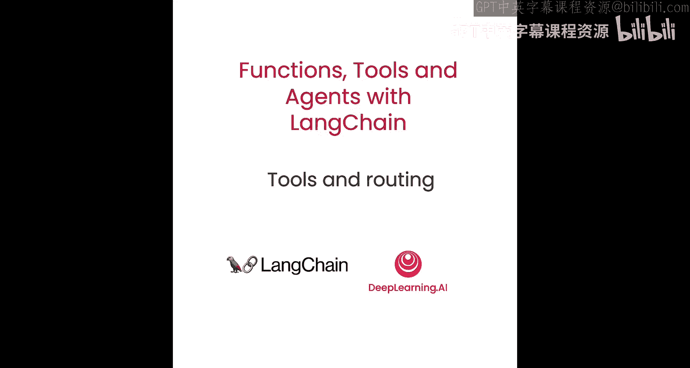

In this lesson， we'll cover a second big use case of open AI functions。 tool usage。 In this lesson。

 we'll first introduce the lane chain concept of a tool。

 and then we'll go over how to use open AI functions to choose which tool to use。

 and then execute that。 Let's dive in。

When we think about having a language model use functions， there's actually two components to it。

The first is having the language model decide which function to use and what the inputs to that function should be。

The next component is actually calling that function with those inputs。

 Lang chain combines those two ideas into something called a tool。

 which is basically a schema definition for the function。

 which we can then convert into the open AI function spec and a callable so we can actually call that model as well。

 We have many of these tools built into the package， search tools， math tools SQs tools。

 But in this lab， we'll largely focus on creating our own tools。

 One thing that we've noticed is that when you create your own chains and agents。

A lot of it relies on actually creating your own tools because what you're trying to do is probably pretty specific to your particular task。

So we're going to go over how to create our own tools easily。

 and then we're going to go over how to use a language model to select which tools to use and then also call those tools。

Let's jump into the code and see what it looks like。We're going to get started with the usual setup。

 and then we're going to import a tool decorator from Langin。

So this decorator we can use to put on top of the function。And then when we define the function。

So this tool decorator， we can put on top of a function that we define。

What this does is it then automatically converts this function into a link chain tool that we can use down the line。

 So this。Search thing now has a name。It now has a description。And it now has。Arguments。

 and so all of these will be used when creating the open AI functions definition。

We can also improve upon this by defining a more explicit structure for the input schema。

 This is often important because again， the description of the input is what the language model uses to determine what the input should be。

 And so having a really clear definition for the input becomes important。

 we can do this by defining a pyantic model。 And then when we define the function。

 we can add in arg schema equals search input。 So search input is this class that we created up here it's got the same structure as the function。

 So it's got a query parameter， which matches the query parameter there。

 the main difference here is that we're adding a description for that query parameter。

 And so this is a way of passing descriptions and other information。

 should we want to include that in the field to the arg schema of the tool。

 And so now if we run this。And now， if we do。And now if we do search。orgs。

 we can see that we get the description of what we passed in。And again。This is still callable。

 so if we do this。And we pass in a string， we get back the value。

 and this isn't actually doing anything under the hood。

 but we'll see later on how you can actually do stuff。

The first real tool that we're going to create is a tool that gets the current temperature given a latitude and longitude。

So first， we're going to define the input schema。 So latitude， longitude。

 and we're going to give it a description。We'll then define this function。

 we'll decorate it with this tool decorator， and we'll pass in Ag schema equals open media input and open media is the API that we're going to use under the hood。

 so we're calling API。opmedia。com We're calling the forecast endpoint， so we're getting the forecast。

And we're getting one forecast day ahead， we're passing in the longitude and latitude and these are passed into the function。

 where're specifying temperature is what we want to get back。

We're then making this call with the requests library， we're then parsing out the response into JSO。

 then what we're doing is we're getting the forecast for the next day。

 and we're finding the point in the forecast that is most close to the current time。

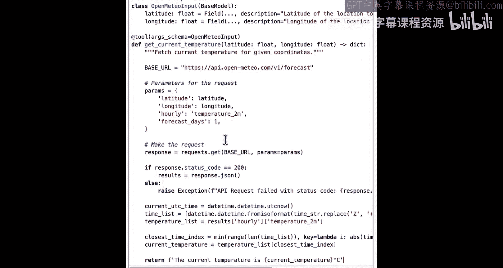

Once we do that and we have that temperature， we're going to respond with the current temperature is blank degrees Celsius。

If we look at the name and description for this。We call it get current temperature。

 If we look at the description， we can see that the description has the signature in there。

 as well as the dock string。And then if we look at the args。

 we can see that it has longitude and latitude。What we can also do is we can convert this tool into the exact open AI functions definition。

 and we can do this by doing from L chain dot tools dot render import。

Format tool to open AI function。 And so when we call this。On a given tool。

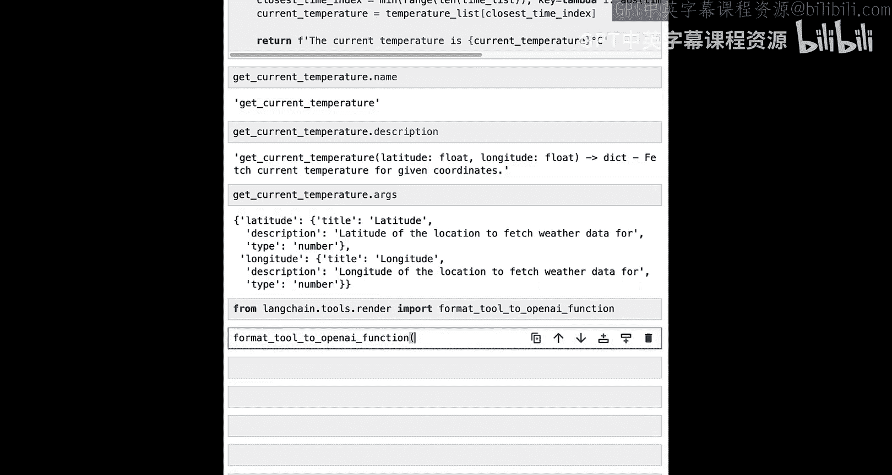

We get back a JSO bb which combines all those elements so you now have the name， the description。

 and then the parameters which include the properties of the longitude and latitude。

 and this is the format that open AI functions expects。

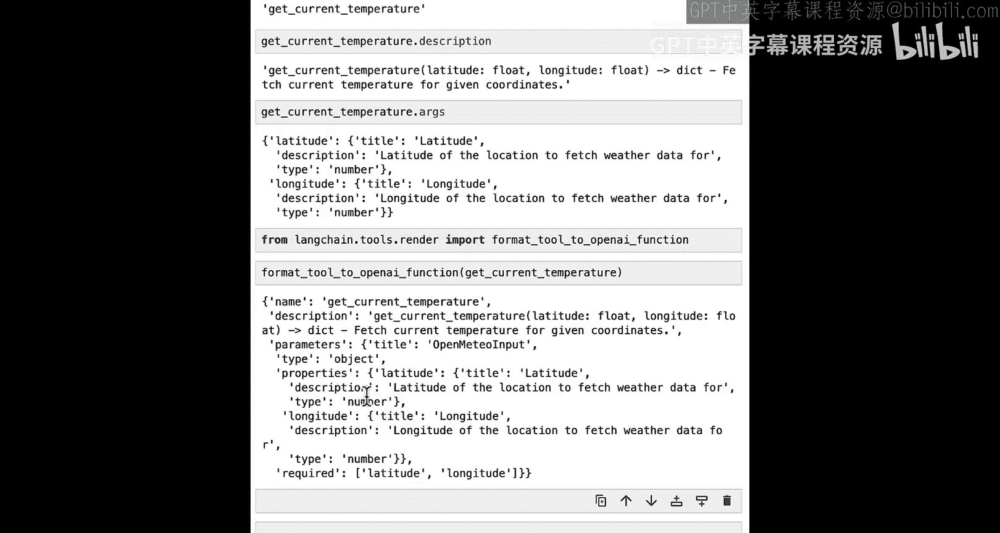

And again， this tool is callable。 So if we pass in latitude and longitude there。

 this is now making a real request to the open media API and getting the accurate response。

The second tool that we're going to define is a Wikipedia tool。

 and so this is going to search things in Wikipedia。So it's going to take in a query。

And it's first going to call the Wikipedia Python Library do searcharch。

 and it's going to get back a list of pages。It's going to iterate through the first three elements in that list。

 and it's going to get more information about that page。

 So it's going to call Wikipedia dot page with the page title that we got back。

 and it's going to get this wki page element。 What we're then going to do is we're going to construct a list of summaries。

 So we're going to put page in the page title and then summary in the summary of the page。

And we're going to create that list。 And then what we're going to respond with is just a concatenated list of those summaries。

So if we take a look at this tool， we can look at the name。We can look at the description。

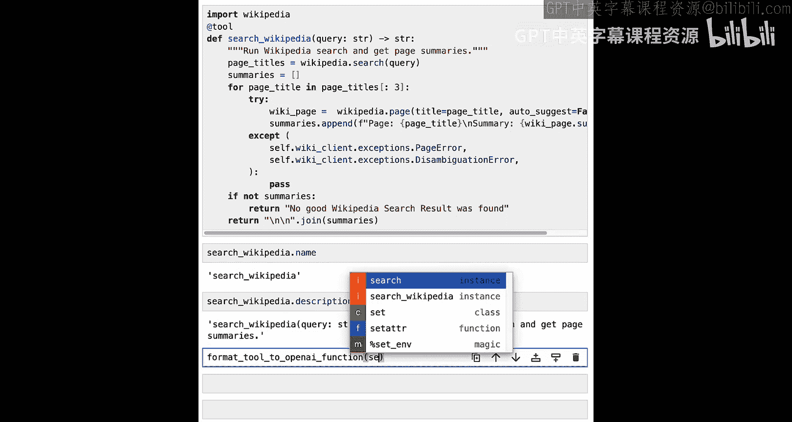

We can convert it to an O A functions definition， and then we can also call it。With a given query。

So let's look up L chain， see what Wikipedia knows about L chain。 and it returns a bunch of things。

 The first page that it returns is the L chain page。 It's got the page in the summary。

 If we look down， we can see that the next page of those returns is about prompt engineering in general。

 And then the third page that it returns is about sentence embeddings。

 So it's returned three different things in this largeish text blog。

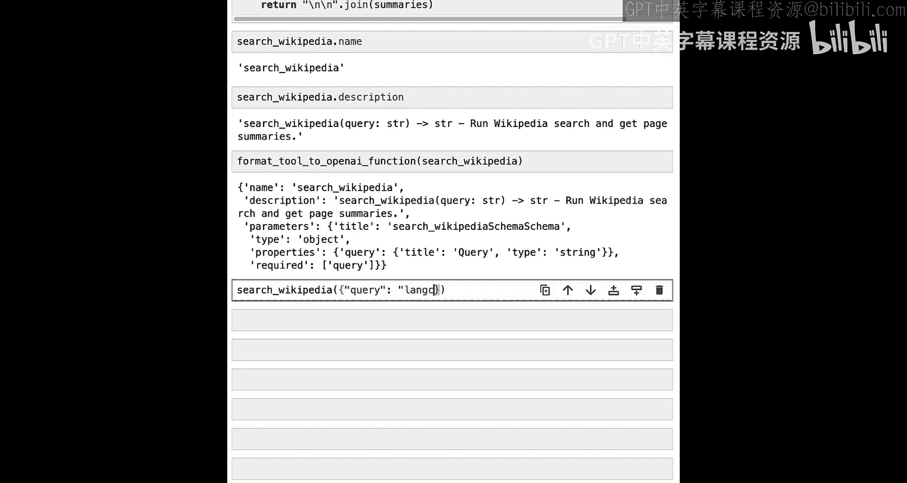

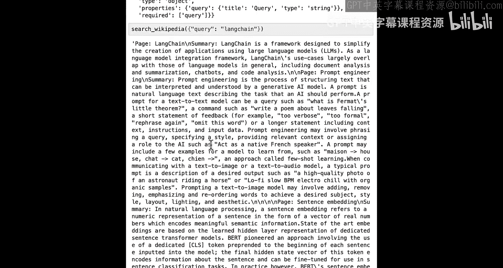

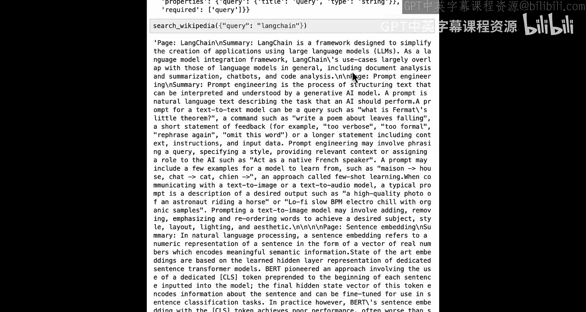

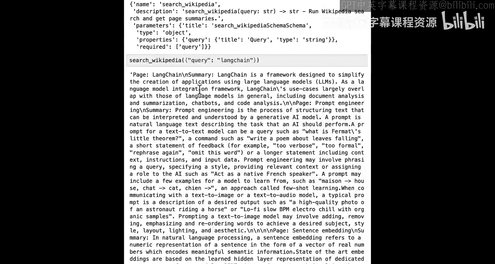

So far， what we've done is we've created functions in our notebook and then created open AI function definitions for those functions。

 Oftentimes， functions that we want to interact with are exposed behind APIs。And oftentimes。

 APIs have a specific specification for their inputs and outputs called an open API specification。

And so what we're going to show now is we're going to show how you can take one of these open API specs and convert it into a list of opening eye function calls。

 and again this is really useful because a lot of functionality is behind APIs and so having a general easy way to interact with those APIs is going to prove very useful。

So we're going to import two things。First， we're going to import。

A function called open API spec to open AI function。

 And this is going take in an open API spec and and return a list of open AI functions。

 And then we also have。And then we also have this open API spec class。

 and this is going to be used to load the open API spec in the first place。

Let's take a look at this example， Open API spec。We can see that there's a few paths defined。 First。

 we have the pets path， and there's a get end point。 and this lists all pets。

We can then see that there is a post endpoint for this same path， and this creates a pen。And finally。

 we can see that there's another endpoint， which takes in a pet ID。

And then it gets information for that specific pet。

We're going to load the open API spec from this text。

 and we're then going to pass that spec into the open API spec to open AI function。

 And we're going to get back two things。 First， we're going to get back。The function definitions。

 the open AI function definitions that we can use。 And then second。

 we'll also get back a set of callables that we could actually call to invoke those functions because this is a made up spec。

 those callables aren't actually going to be real。 But if this was a real functioning spec。

 those would work。If we take a look at what's in this list。We can see that we have three functions。

 We first have the list Pes function， then we have the Create pets function。

 and then we have the show pet by ID function。We'll now show how we can use a language model to determine which of these functions to call。

 So we're going to import our open AI model。And we're then gonna create a simple version of this model。

 And we're gonna pass in temperature equals 0 again， because when we're choosing between functions。

 we probably want to do that in a pretty deterministic way。 And then we're also gonna bind in。

The functions argument to this。

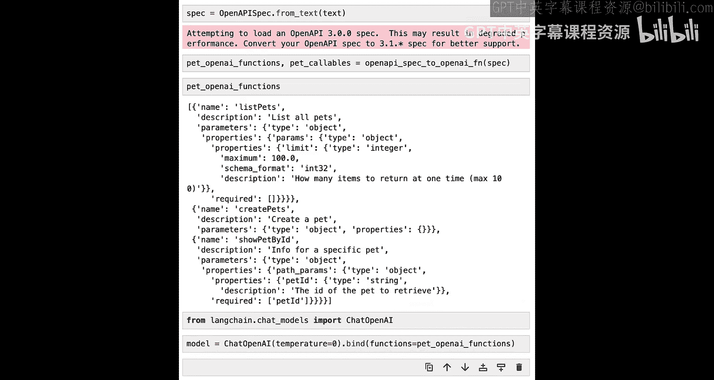

We can now try this out on a few different sentences and see what happens so we can pass in。

What are3。Pets names。And we can see that it will recognize that it needs to call the list pets function with parameters limit equals 3。

 We can try another one。We can call it with tell me about PE with ID 42。

 and we can see that it calls the show pett by ID function with pet ID 42。

Now is a good time to pause and try this out on a few more sample sentences and see what happens。

In the example above， we showed how you could use the Open AI model and choose between different functions to take。

Now we're going to make that a bit more applied。 We're going to use that on the two real functions that we created earlier。

 the weather tool and the Wikipedia tool。 We're going to use the Open eye model to decide which function to invoke。

 and then we're actually going to do the step of invoking that as well。

 This creates something called routing， which is where we're using the language model to determine which path to take and also the inputs to that path。

First， we're going to create the list of open AI function specs to use。

 so we're going to call format tool to open AI functions on our two tools。

 search Wikipedia and get current temperature， and then we're going to create a model setting temperature equals to zero and binding those functions。

Let's then call that model on a few sentences。 So let's call it on what is the weather in SF right now。

 We can see that it uses the get current temperature tool with arguments for the latitude and longitude。

If we call it on what is L chain， we can see that it uses the search Wikipedia tool with the query equals to L chain。

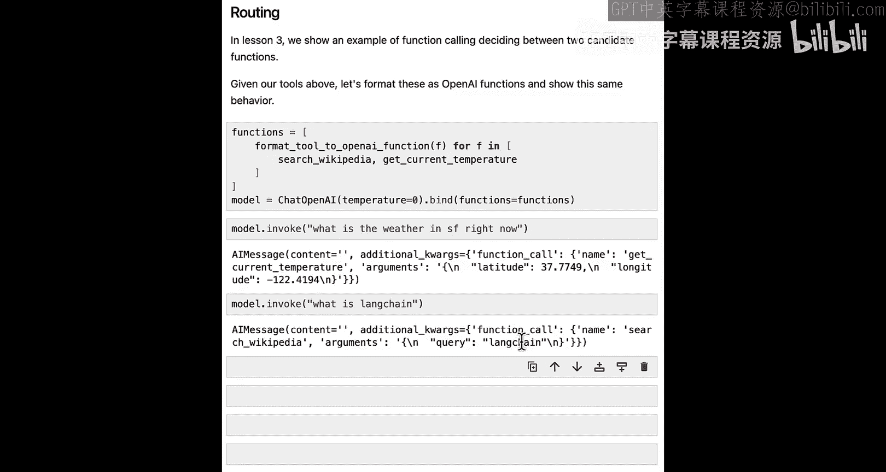

We can then take it to the next step and add in a prompt before the language model call。

 And so we're going to create a super simple chain where there's just this prompt and the model。

 the prompt is going be very simple。 It just as a system message which says you are a helpful but sassy assistant。

 but we're showing this because when you do need to customize the prompt to make it more specific to the type of task that you're trying to solve。

 this will show you how to set up that pipeline。And now if we invoke the chain on the same inputs。

 we can see that we get back the same responses。 This is good and useful。

 but it's still a little bit annoying because we have this AI message and we have the content。

 which is null。 We have the additional  quags， which are themselves a dictionary。

 which then has function calls， which is itself a dictionary。😊，And so what we want to do。

Is we're going to convert this into a slightly more usable and workable format？

As well as think about the possible end states for this response from the language model。

 the two main ones are first when it decides to call a tool and second。

 when it doesn't decide to call a tool。When it doesn't decide to call a tool。

 the main thing that we're interested in is the value of content here。

When it does decide to call a tool， the main thing that we're interested in is the tool that it decides to call。

 as well as the input to that tool for the input to that tool。

 it would be really nice if it wasn't just a string of this Jsonmbbob。

 but rather parsed out into a dictionary like we saw done in the tagging an extraction section。

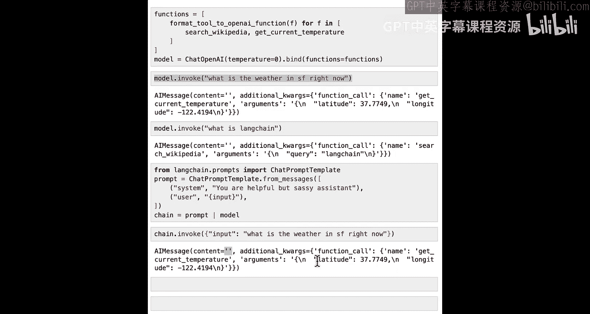

We can do this with a new output parser。 The open AI functions agent output parser。

This is going to take in the output and parse it into a format， which has that information。 First。

 whether it's just a function call or whether it's a response。 And then second。

 if it is a function call， what is the function that should be called and what is the input。

We'll create a chain by combining the prompt above with the model in this new output parser。

And then we'll invoke the chain on the same input as before。

 Let's now take a look at what result looks like。 So if we look at the type of result。

 it is an agent action。 And that's because what it's doing is it' going to be calling one of these tools。

And so if we call result dot tool， we can now see exactly what that tool is。

 And if we call result dot tool input， we have this dictionary of inputs that we want to pass the tool。

From there， we can do things like pass that tool input into the function itself。

So we can pass this in and we can get back the response for the current temperature in SF。

What about when there's no tool to call， What about when we're just saying hi。

 if we look at this and we look at the type of this result。

 we can see that we get back in agent finish。If we then look at result dot return values。

 which are on all agent finish classes， we can see that we get an output of hello。

 how can I assist you today？So we've shown here how depending on the input。

 it could either be an agent action or an agent finish。 what exactly is going on under the hood。

What's happening is quite simple。 If a function is called， then we take that as an agent action。

 If a function is not called and it's just a normal response。

 then we represent that as an agent finish。We've shown how we can use a language model to determine what action to take or whether to take an action at all and have this represented as an agent finish or an agent action。

The last thing we're going to add in is actually taking that action if appropriate。

 in order to do that， we're going to define a route function。

 This route function is going to act on the result of the language model and do the corresponding step。

 So we're going check if it's an agent finish and if it is an agent finish。

 we you're just going to return the values of output， if it's not an agent finish。

 So if it is an agent action。 we're going to look up the correct tool to use。

 And then we're then going to run that tool with the tool input as specified。

Let's create a new chain， which is the same as before。

 except now we're adding in this last step of this route function。We're going to construct a prompt。

 We're going to pass it to the model。 We're going to parse that output into an agent finish or an agent action。

 which we're then going to pass into this route function。

Let's now call an example where we're asking what the weather is。

 So what is the weather in San Francisco right now， If we look at the result， we get back。

 the current temperature is 22。9 degrees Celsius。Let's now do it on an input where we want it to call Wikipedia。

 So let's invoke it with what is lane chain if we look at the result when it's passed back。

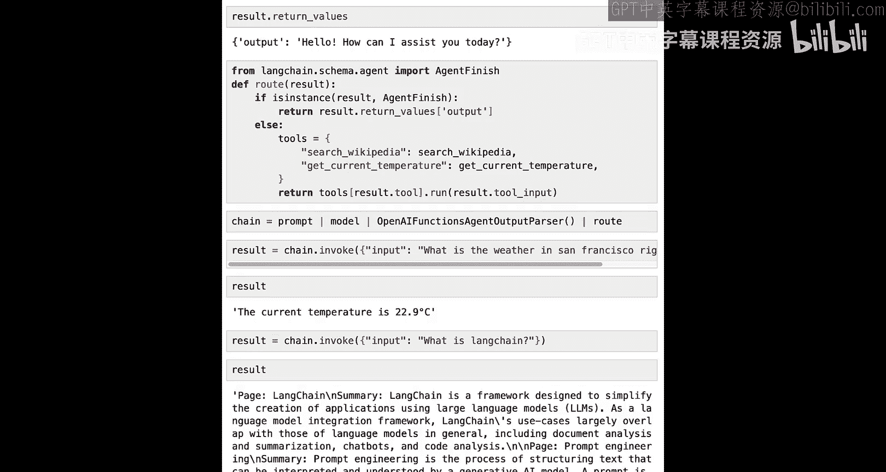

We get back this big blob， which is what we got back in the beginning when we were looking up what La chain is in the Wikipedia tool。

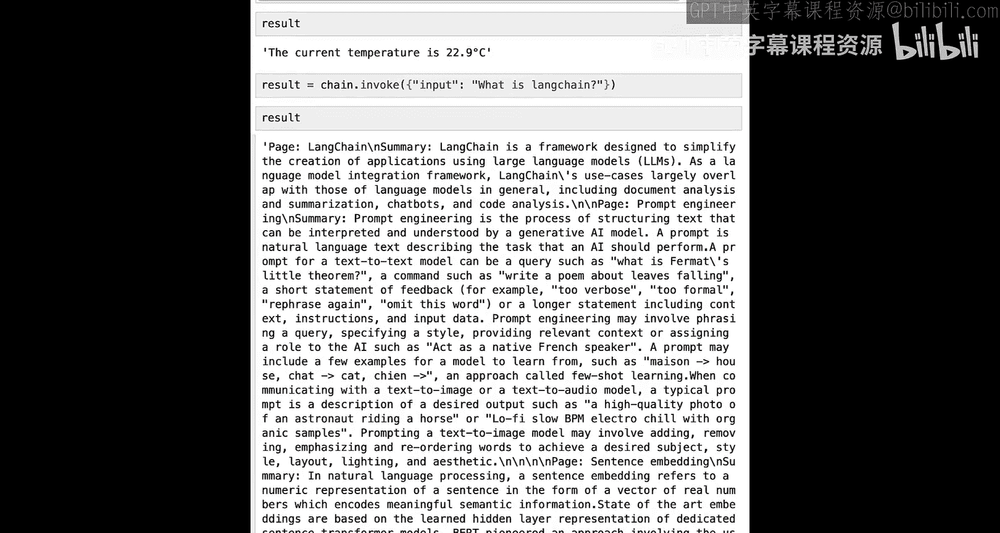

And then finally， let's try it out on something really simple。 so if we just do chain andvoke。

And pass in some simple input like just high。We'll just get back a nice simple， hello。

 how can I assist you today？Now is a good time to pause and try this out on a few different inputs of your choice。

 It's also a good time to try creating new tools and add those into the list of functions that could be called。

😊，That wraps up the end of this lessonson。We've covered what tools are and shown how we can route between them。

 not only using the language model to determine what actions to take。

 but then actually adding in a routing step that takes that action。

What we'll show in the next lesson is how we can combine this into a loop that continues to iterate until we reach the agent finish。

See you there。

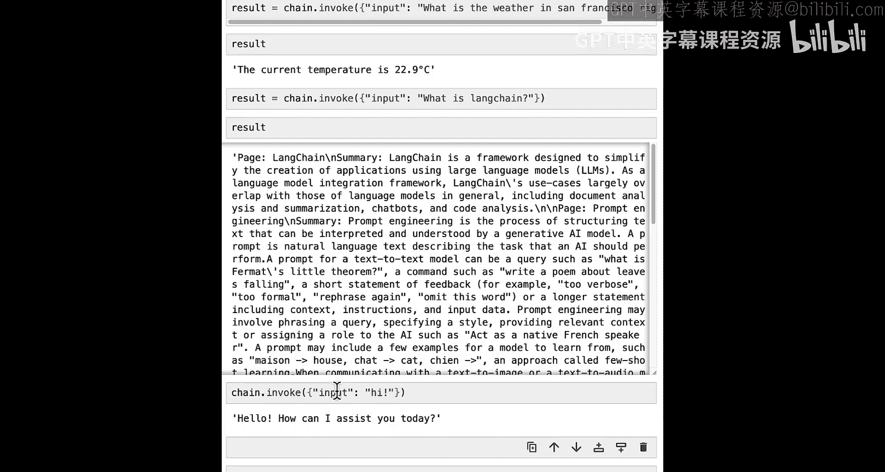