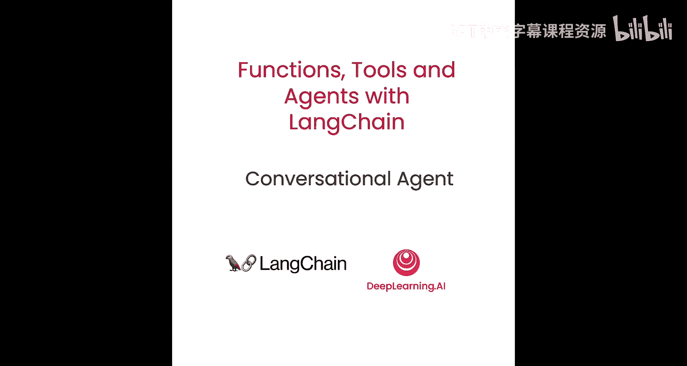
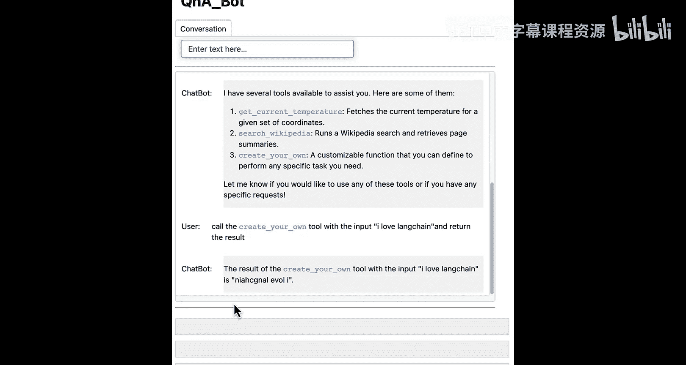
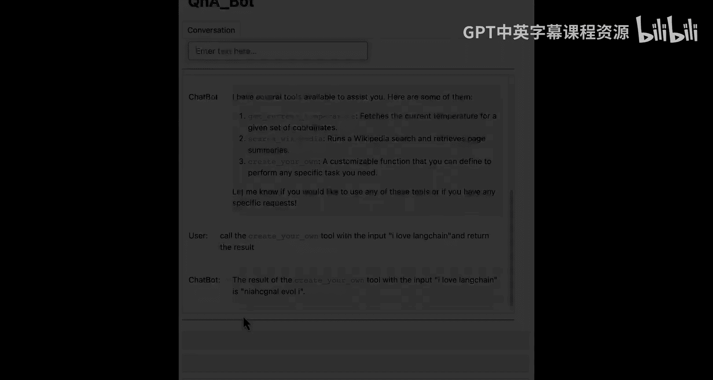

# 吴恩达《LangChain的函数工具和智能体｜Functions Tools and Agents with LangChain》中英字幕 - P7：Langchain C3_L6.zh_en - GPT中英字幕课程资源 - BV1vqJez9E3H

In this final lesson， let's take what we learned in the previous lesson and add on to it to create a conversational agent。

 This will combine tool usage with chat memory and let us create something that ends up looking like chat GptT。

 Let's chat about conversational agents。

In this lesson， we will be building a conversational agent。 First。

 let's go over the basics of agents。 So what are agents。

 They are a combination of language models and code。

 So the language model reasons about what steps it take and what the inputs to those actions should be。

And then there's an agent loop which basically uses that agent to choose the tool。

 and then calls that tool， observes the output and that repeats this until a stopping criteria is met what are these stopping criteria。

 they could be several things， the first and most popular one is just using the language model to determine when to stop。

So if you remember the previous lesson we talked about the idea of an agent finish。

 this is when language malologist just responds， this is one such stopping criteria。

 but you can have others like hard coded rules such as the maximum number of iterations or something like that。

In this lab， we're going to use the tools that we built in the previous lesson。

 we're going to take that concept of routing and choosing and then calling the tools。

 and we're going to put that into our own agent loop using the Lank chainin expression and language。

We're they' going to use the agent Executor class in Ling chain and show how that corresponds to the agent loop。

 but also adds in other things like error handling， early stopping and tracing。Let's code it up。

First thing we're going to do， we're going to set up the environment per usual。

 and then we're also going to set up the same two tools that we used in the previous lesson。

 so we're going to import the tool decorator。We're going to create our current weather tool。

We're going to create our Wikipedia tool， and then we're going to create our list of tools as just a list。

And these two。Tos。We're they're going to go ahead and create the logic that takes in the input and determines what tool to call and so we did this in the previous lesson。

 so we're importing a model， the prompt template， the formatting of tools to open AI functions。

 and then this output parser， where they're going to create functions by calling format tool to open AI function on our list of tools。

 we're going to create our model setting temperature equals to zero and binding it with functions equals functions。

 we're going to create our prompt again pretty simple with just a single system message you are helpful but Sassy assistant and then we're going to join this all together in a chain。

 adding on to the end， the open AI functions agent and output parser。

And so if we call this on some input， we can get back。Tool that it recommends using。

And the tool input， and again， that's because the input here is specifically aimed at calling one of the tools。

So what we want to do is create this loop that determines what tool to use， then calls that tool。

 and passes it back in and repeats until some stopping criteria is met。If you look at the prompt。

 what that means is we need a place in the prompt to pass back in this history of tools that are called in the corresponding outputs。

 so we're going to have to change the prompt a little bit to add that in。Specifically。

 we want to add in a place where we can pass in a list of messages。

And that's because we're going to convert this tool selection to tool observation into a list of messages and pass it back in。

 so we're going to use messages placeholder to be a placeholder for this list of messages。

 and then in our prompt template， we're going to have the same first two elements。

 but then we're going to add in this agent Scpad messages placeholder。Basically。

 what this is saying is we're first going to have a system message， which is this again。

 short system message， where we're going to have the user input。

 and then after that we're going to pass in the action and observation pairs。We create that prompt。

 we create a chain now with this prompt。And let's call it again on the same input。 And this time。

 we also need to pass in agent Sc pad because this is the variable here that we need to pass in。

 We're going to pass in this being an empty list because we haven't taken any actions yet。

 We'll call that and we'll get result1。Then what we can do is we can see。

What function result one wants us to call， we can then call that function and get back an observation。

If we look at this observation， we can see that it is a string。And of course， we have result one。

 which is this agent action message log。So now how are we going to take these two things and convert them back into a list of messages that we can pass into Age ScratPat？

In order to do that， we're going to use this function。Format to Open AI functions。

 which we import from Lachain。ags format Scp behind the scenes what's going on in format to Open AI functions。

What's happening is that we're going to take result one。

And specifically we're going to take the message log on result one so the message log is a list of messages that makes up how we arrived at this current agent in action。

 so if we look at it， this contains the chat message that has this additional quags with this function call saying get current temperature and then the arguments with the JSON string that the exact response from Open AI。

And so we're keeping that around in this message log because now when it comes time to construct this agent scratch pad。

 we can just put it right back in there， and then what we're going to do with the observation。

 which is just a string， is we're going to use the function message type that we went over in lesson one。

 and we're going to pass that in。So we're going to call this function and we're going to call it on a list of tuples corresponding to the agent action。

And the observation and the reason that this is a list of tuples is that if we add in more steps for the agent to take。

 we can just keep on passing in a list of tus and it will keep on generating this list of messages。

 so here we have an AI message and this corresponds to what was outputted by the language model to make it take this agent action and then we have this function message with the content being the observation and the name being get current temperature。

If we then take that and call the chain again with the same input and now with Age Sct pad set equal to this format to open AI functions parameter。

 if we look at what we get back from result2， we get back in agent finish with the output being the current temperature in San Francisco is 22。

9 degrees Celsius。So let's bundle all of that up into a function。

So what we're going to do is we're going to create this run agent function。

 this is going to take in the user input。It's going to initialize an empty list。

 This is the intermediate steps。 And then it's going to enter into a while loop。

 And while this loop is running， it's going to call a chain with this user input。

 And with this agent scratch pad And each time we're calling format to open eye functions on this list of intermediate steps and we'll see how that's constructed later on。

 If the result is an agent finish， we're going to return with that result。Otherwise。

 it means it's an agent action。And so we're going to look up the correct tool to use。

We're then going to call that tool with that tool input and get back in observation。

 and then we're going to append that tuple of result in observation to intermediate steps and continue on our way。

We're going to make one minor modification to this chain before continuing to make it a true agent chain and basically what we're going to do is we're going to put this format to open AI functions logic in the chain itself that's going to make it a little bit more portable so it just has to take in the user input and the intermediate steps。

We're going to create this agent chain by using a runnable pass through What a runnable pass through does is it basically takes the initial input and passes it through What we're going to do is we're going to add this assigned variable here。

 this assign method here is creating a new argument to the dictionary that's getting passed through this argument as the name agent Scpad and this is where we call format to open AI functions on intermediate steps。

 where they're going to pipe the result of that which is a dictionary into the chain and we're going to get a full endtoend chain that now takes in the input in intermediate steps。

 does the necessary preprocessing of the intermediate steps to create the agent Scpa then passes it to the prompt then to the model and then to the agent output parser。

With this change， we can now create a slightly more simple loop here。 where if you notice。

 we're just calling the agent chain on。The inputs directly because now the preprocessing is inside the agent chain。

Let's now run this agent， so let's call it on what is the weather in SF。

And we get back the current temperature in San Francisco is 22。9 degrees Celsius。

 let's now call it on another question what is L chain， if we run the agent now。

 we can see that we get back a response， L chain is a framework designed to simplify the creation of applications using large language models。

And let's also call it on a simple input。 Let's call it on just。Hi。Hlo。

 how can I assist you today That seems right。😊，So we've created this run agent function。

 which is this loop that loops over the LLM decides what to do， then takes the next step。

We have a class for this in L chainin called agent Executor。

 which is a souped up version of this run agent function， so it adds in a few things。

 it adds in some better logging， it adds in error handling。

 so if the language model outputs something that isn't valid JON， which remember it can still do。

 we handle that nicely。And it adds in also error handling for tools。

 so if you call a tool in the tool errors， we then handle that nicely， we catch that error。

 we pass it back into the language model and ask it to correct it。

We can use this pretty simply by just importing agent executor from Laangchain。ag。

 we can then initialize this with agent equals to the agent chain。

 we pass in the tools because it needs to have the tools to be able to call it。

 and then we pass in verbo equals2 to get some nice logging。If we now call this on what is L chain。

 we can see that we get some logs of what's going on。

 We call search Wikipedia with query equals to L chain， we get back this result。

 and then we get back this result from the language model which is synthesizing it。

 and this is the result that we get back as part of the agent finish。

This agent executivecut earn this loop under the hood is very similar to a lot of what's powering chat GT。

 So if you've interacted with the code interpreter there or the plugin system there。

 you'll notice that the language model often thinks about what to do。 then it calls a tool。

 then it gets back the response。 then it maybe calls another one。

 then it gets back the response from that， and then it returns to the user。

So this is a really powerful loop and technique that can be used to create something like Cha GBT。

 Of course， what chat GBT can also do is it can also have a conversation with you so can we do that with our current agent executor let's try it out So let's try it out with something simple like my name is Bob So it responds hellello Bob。

 how can I assist you today。Let's then ask it a follow up question that any good chatbot should be able to answer。

 so let's ask it what is my name？And I've just told it that my name is Bob。

But it doesn't seem to remember that。 So what's going on。

What's happening is that we haven't added any mechanism to actually pass in previous messages。

 so it actually doesn't remember the my name is Bob message。

 Let's add that in and see what happens after that。In order to add that in。

 we're going to add another Me placeholder this time for chat history。

This is going to be before the user input because we want to put messages that have appeared before。

 and so we're going to put it in between the system message and the user question。

Will then create the same agent chain as before with the updated prompt。

And we're now going to create a really simple memory object called conversation buffer memory。

 What this is going to do is just going to keep a list of messages in memory。

 We're going to return these messages in message format。 And basically。

 what that means is that we're returning it as a list of messages。

 which is important because we have this messages placeholder here。 If this was set to false。

 able to return it as a string。 And so if we wanted to do。

 we could get a string representation of all these messages。

 This would be useful if we wanted to put that in a normal string template。 But here we don't。

 We want to pass it in as a list of messages。 So we're setting return messages equals true。

 We're then also setting memory key equals chat history。

 This is just lining up the messages that are returned with this variable here。

 So it's keeping those in sync。And then all we have to do when creating our agent executor。

Is passed in the updated chain。Pass in the same tools as before。

 we're going to step verbose equals to true as before。

 and then we're also going to pass in memory equals to the memory object above。

Let's now run this on the input as before， so we're going to say hi， my name is Bob。

If we now ask what my name is， it realizes my name is Bob， good。And， of course。

 we can use it as before and ask it about the current weather。 and'll know how to use a tool。

 It will call that tool， and then we'll get back the response。

 So this has the same functionality as before。 But we've added in this memory component that just remembers previous interactions。

 Now is a good time to pause and try it out on some questions of your own。

 Try adding in some new tools。 Try adding in a different system prompt。

 There's a lot of different things you can play around with here。😊，For our final bit here。

 we're going to put it all together and create a nice looking chat box that we can interact with。

What's added in another tool， you guys should feel free to replace this with whatever you want。

 remember to update this description here when you're done for us here。

 we're just going to have a really simple reverse operator that's taking in the query and just reversing the string。

We're going to update our list of tools， so we're going to have the same current temperature tool。

 the same Wikipedia search tool， and then this new tool that we created。Using a tool called panel。

 we're going to create a nice little UI for this chatbot And so taking a look at this very briefly。

 we can see here that we have our functions， which is calling the same function as before format tool to open AI functions we've got our model。

 which is the chat open AI model and we're binding functions to it we've got memory。

 which is same as before we've got our prompt， which is same as before so it's got system message chat history。

 user input and then agent Scpa where're then creating the agent chain same as before and then we're creating the agent executor same as before with that in place we can now run panel and create a nice little dashboard with a Q&A bot and so we can start having a conversation with it so we can again do hi my name is Bob。

Press enter and we can see it pop up。What's my name？Your name is Bob。

 We can ask you questions about the weather。 What's the weather in SF。

See it takes a little bit longer because now it's calling a tool but it manages to get the current temperature okay。

We could ask you some fun questions like what tools do you have available？

So we can see that lists out the tools that it has available， get current temperature。

 search Wikipedia， create your own， let's now force it a call the Create your own。

So we're going to tell it to call the Create your own tool。with the input i love link chain。

And return the result。So if we look at what happens。

The result of the create your own tool with the input I love L chain is。

Something that's unpronounceable， but it looks right。This is the end of the lesson。

 so now's a great time to add in more tools， try it out with different inputs。

 you've got a chatbot that's similar to chat GPT， it can have a conversation， it can take actions。

 you can see the results of that， try making it do multiple hops。

 theres a lot of amazing things that you can try out and build and I really look forward to seeing what you guys build with this technology。

