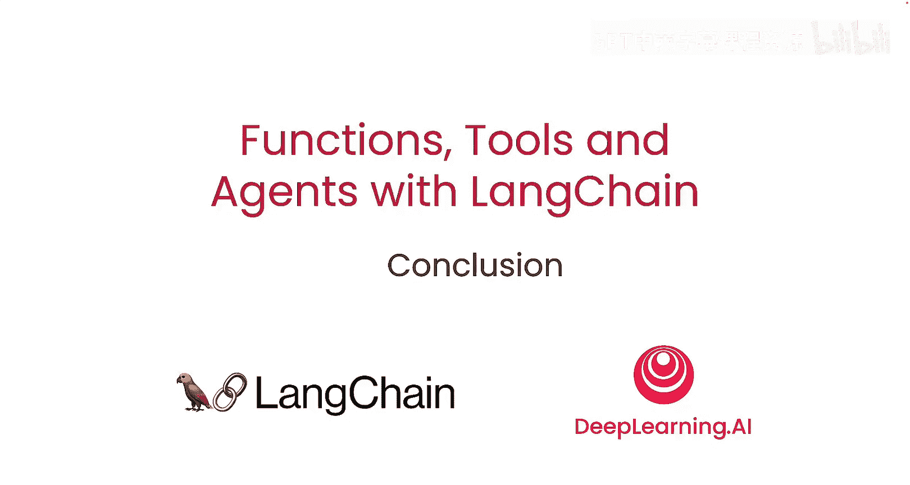

# 吴恩达《LangChain的函数工具和智能体｜Functions Tools and Agents with LangChain》中英字幕 - P8：Langchain C3_Conclusion.zh_en - GPT中英字幕课程资源 - BV1vqJez9E3H

And that brings this course to a close。 It's a really exciting time in AI。

 and there's lots of advancements happening。 In this course， we covered two of them。

 open AI function calling and L chain expression language。

 We then showed how you could use those to do structured data extraction and then also tool usage and tool selection。

😊，And we put that all together by building a conversational agent at the end。

With all these learnings under your belt， the only thing left to do is go out into the real world and apply them to your use cases。

