# 吴恩达《Llama2的提示工程｜Prompt Engineering with Llama 2》中英字幕（英字可关闭） - P10：10.conclusion.zh_en - GPT中英字幕课程资源 - BV1um411f7Lm

Thank you for staying with me all the way to the end of the course。

I hope you had so much fun getting to know the Lama models and I hope you are excited to try to use Lama model in your day today life and work you wrote a birthday card for a friend while formatting your prompts in the recommended way with instruction and start tags you ask the model for advice on fun things to do and use prompting methods for multitone chats to enable you to ask follow-up questions。

 you classified the sentiment of text messages and summarized an email while applying prompt engineering best practices。

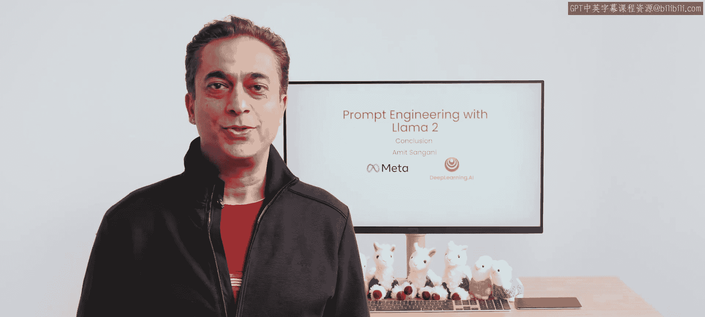

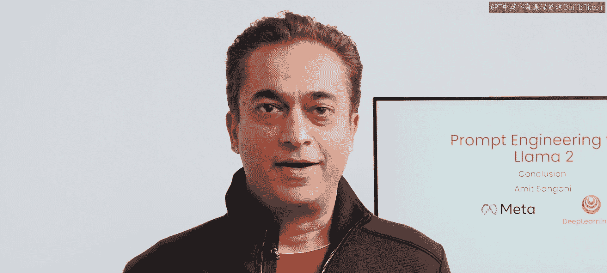

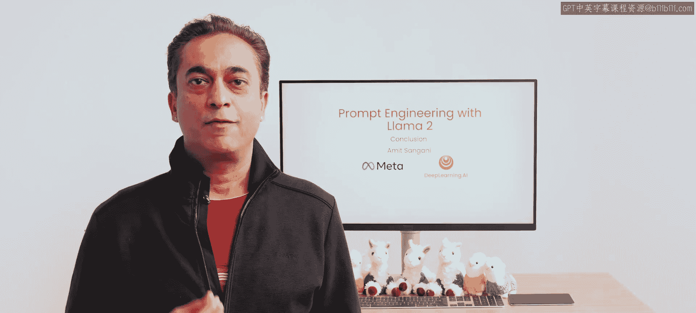

Some of these include giving examples of how you want the model to respond called in contextex learning。

 you also applied and defined chain of thought reasoning by asking the model to think step by step。

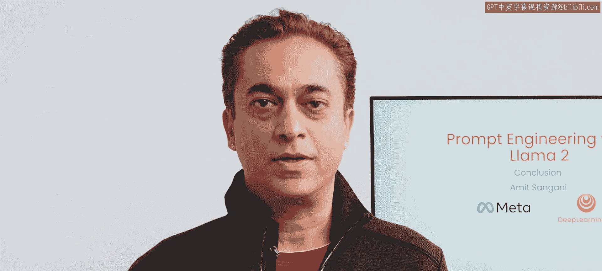

Next， you compared the small 7b medium 13b and the large 70b Lama models on the same task and even prompted the large model to compare and evaluate the performance of the three models you ask code Lama for help with writing。

 learning and defining code and you even made use of code Lama's really long context window to perform non-coding task that need to take in a very long prompt Finally you check the restaurant review to verify if it's safe by using Lama guard which is part of the purple Lama project for AI safety all of the Lama models are available for free use with an open commercial license That means you can use any Lama model in your applications without licensing restrictions you have the flexibility to finet the model host it in your infrastructure and resell the finet model Finally my colleagues at Meta and I would love to hear your feedback about Lama and your experiences using it in your work the Lama models are made for the AI community so your feedback。

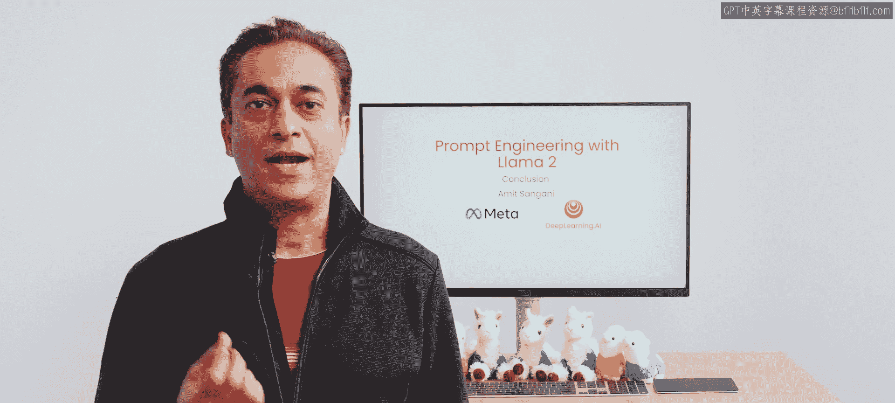

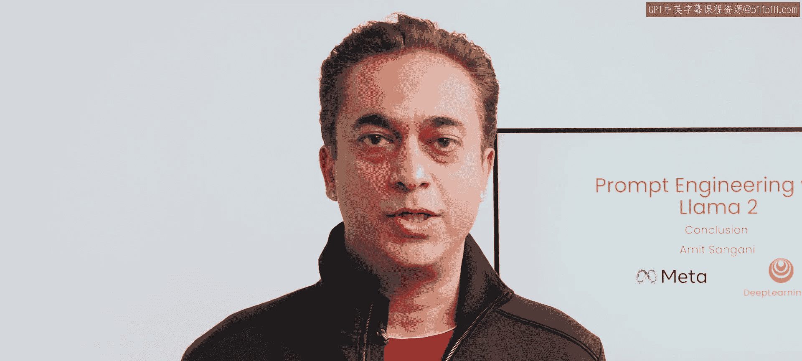

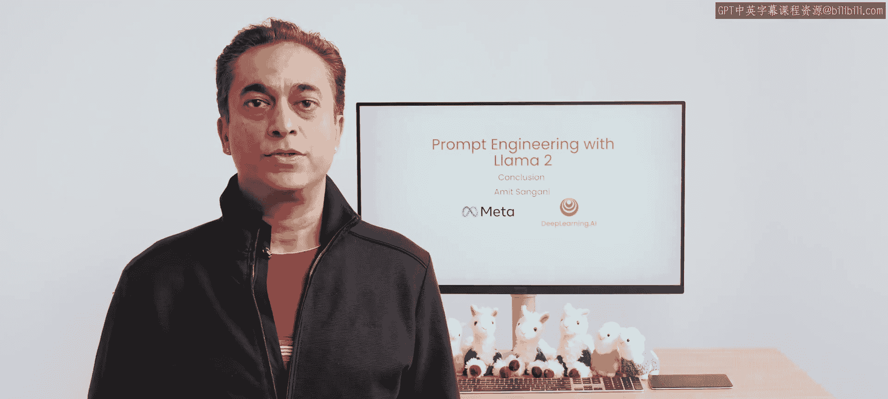

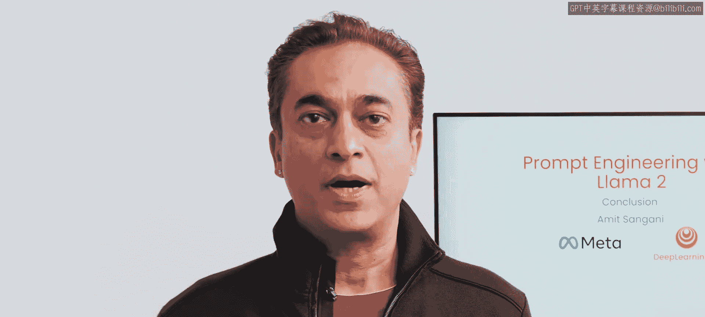

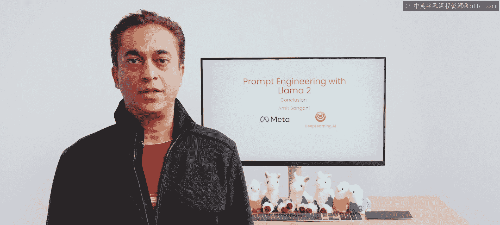

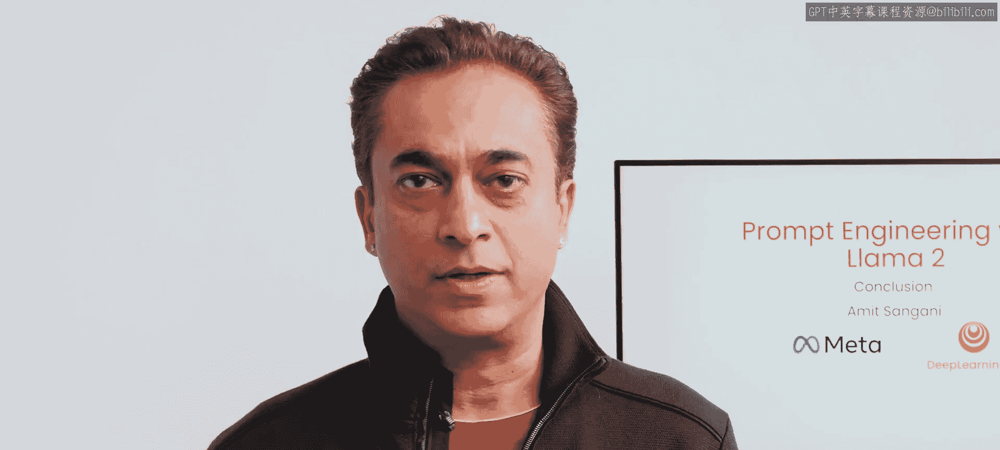

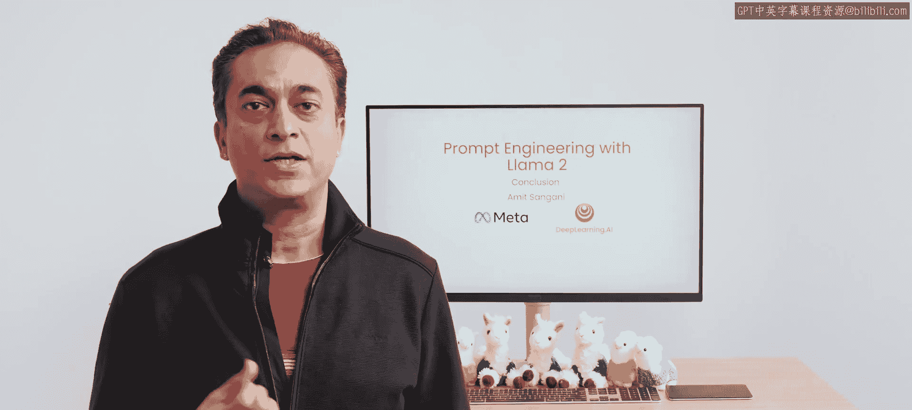

And contributions will help all your other fellow developers who use these models for more ideas of fun things to do with these models。

 please check out our Lama recipes Github repo。 thanks again for joining me。

 I really hope that youll use what you have learned in this course and build some great applications Oh hi Ahmed how Sharon I was wondering where myllmas went Oh they just showed up。

😊。

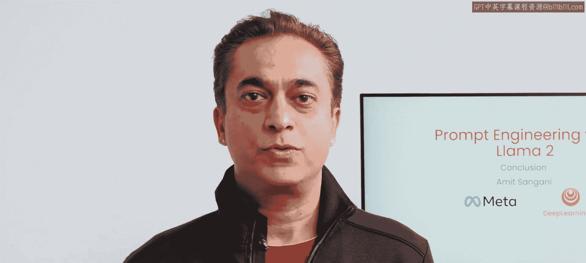

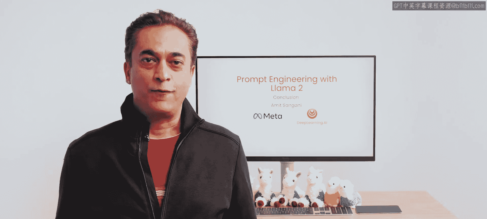

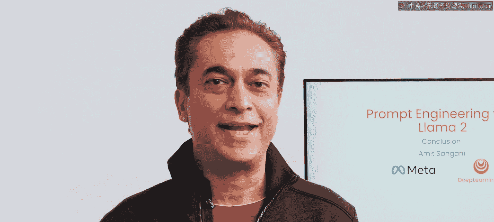