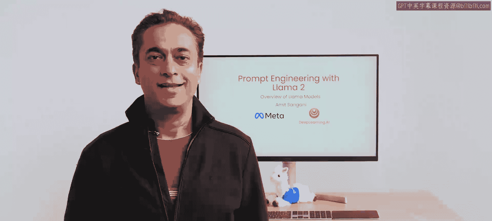
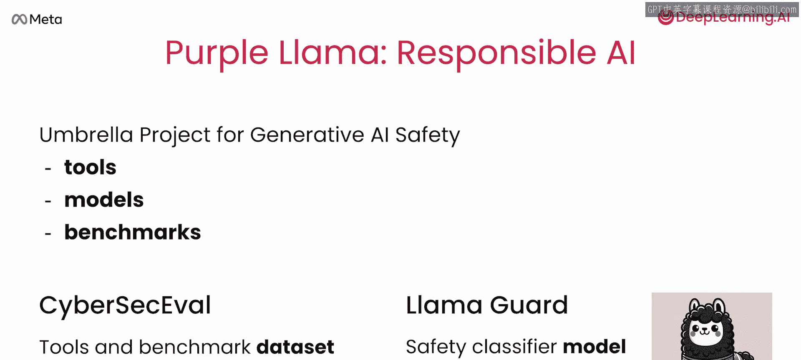

# 吴恩达《Llama2的提示工程｜Prompt Engineering with Llama 2》中英字幕（英字可关闭） - P2：2.L1_overview of Llama models.zh_en - GPT中英字幕课程资源 - BV1um411f7Lm

As Andrew mentioned in the introduction， Lama isn't a single model。

 It's actually a collection of models of varying sizes and training strategies。

To set the scene for the rest of the course， I want to give you more details about the various models and how they were trained。

 Let's dive in。

Lama models built by metatas research teams are large language models based on the transformer architecture。

 Lama comes in three different sizes。 There is a small 7 billion parameter model。

 a medium size 13 billion parameter model and a large 70 billion parameter model。 In general。

 the larger model is the more capacity it has to learn from its training data。 However。

 larger models are also more computationally expensive to train and deploy than the smaller models。

 Each of these models can be used for different application scenarios and purposes。

 The instruction tune models are created by taking the base models also called foundation models。

 and running them through additional training called instruction tuning。

 This enables instructiont models to better follow human language instructions such as summarize this or tell me a joke。

 These three instructiont Lama models are called Lama chat models。 depending on your use case。

 you can take any of these models and。Further fine tune them for your application needs。

 although it's been more common to use the base foundation models for fine tuning with all the large language models out there。

 you may be wondering how does Lama fit in Lama2 has pretty comparable performance to other popular models such as Falcon 40 and G3。

5。 It's also worth noting how you are able to access these large language models。

 Lama2 is free to download on your personal computer or you can host it in your cloud environment。

 or you can access it from thirdparty services， same with Falcon 40 and other open source models。

 This may be helpful if you have certain privacy requirements for yourself。

 or if you're building an application for users who have certain privacy and security requirements。

 G 3。5 is accessible through API calls to open AI， which may also be fine for many of your use cases。

 Another cool thing about Lama models is the ecosystem of open source libraries and tools that the developer community is building around it。

 For example， Some wonderful developers developed。😊。

Everybrary that makes the small Lama2 model fit and run on a typical personal computer。

 It's called Lama CPP。 In August of 2023， we released yet another Lama code Lama。

 code Lama was created to help more people write code and also learned to code more easily。

 It was created by taking the Lama2 model and training it for coding tasks。

 code Lama also comes in three sizes。 a small 7 billion medium 13 billion and a large 34 billion parameter model for each size。

 there is a base version and also an in version。 The base code Lama models are derived from the non-chat Lama models。

 They primarily generate code， and so they can be used for autocomplet or filling in existing code。

 In contrast， the code Lama instructorstruct models were created by training the Lama chat models。

 So the code Lama instruct models like the Lama chat models exhibit more humanlike behavior。

 They can respond to human instructions such as help me write some code to build a web page or please。

Debug the following code that I just wrote the code Lama chat models generate code too but are also able to write human explanations of what that code is doing。

 So which languages do code Lama and code Lama instruct support pretty much all the most popular languages including Python jascript C+ plus Java htMl and more and there is one more Lama code Lama Python which is specialized for Python coding Pur Lama is an umbrella project that brings together tools and evaluation benchmarks to help the community build responsibly with geneative AI Currently purple Lama includes two key projects。

 one to ensure that AI generated code is safe against cybersecurity attacks and one that checks if LLm inputs and outputs are safe honest and harmless The first is called cyberseec Eal It's a set of tools and also benchmark data set that many are using to check if their code completion tools are generating secure code that guards against viruses。

or cyber threats the other is yet another Lama model called Lama guard which shifts the input and output of any large lineage model to detect harmful or toxic content again purple Lama is an initiative to help developers build responsible generative AI applications and we at metaA plan to contribute more projects such as these two in the near future in the next lesson you'll get to start using the Lama models let's go on to the next lesson。

