# 吴恩达《Llama2的提示工程｜Prompt Engineering with Llama 2》中英字幕（英字可关闭） - P3：3.L2_getting_started.zh_en - GPT中英字幕课程资源 - BV1um411f7Lm

Now you'll get a chance to try the Lama2 model yourself。

You'll explore some of the options for prompting Lama2 models。

One of the things that makes prompting Lama 2 models unique is how you format the input prompt before you send it to the model。

 you'll apply the recommended formatting methods using something called instruction tags。

 You'll get to ask Lama 2 to help you write a birthdayic card for your friend。 Let's get started。

For this course， we have created a helper function that can make an API call to any Lama model。

So let's access this of a function。You can treat the Lama model like your personal assistant and ask it to help you write a birthday card for a friend。

 so let's write a simple prompt。Which will tell the Lama model to write a birthday card for my dear friend Andrew。

And we all。Create a response。Call the laman。Function。And passing the prompt。

And we'll print the response。Great。😊，It's written a nice birthday card and it also addresses my friend Andrew。

 now let's discuss how this works， so you just wrote a prompt， help me write a birthday card。

 and sent it to the Lama model。It returned a well returned birthday card letter。

 but how does this actually happen？ How did you actually access the model The way this happened just now was by using a hosted API service。

 So a service provider is hosting and running a Lama model when you call the helper function it' sent an API request over the Internet to that service。

 the service fair your prompt into the Lama model which output this birthday card then the hosted service sent that response over the Internet back to you。

 the hosted API service makes it easy to access more than one model In this case。

 you just prompted the small 7 billion parameter model but as you'll see later。

 you can also access the medium and large model as well as the code Lama model。

 Another option since Lama models are open for commercial use is to host the model yourself on your own cloud environment such as Amazon Web services。

 Microsoft Azure or Google cloud and third option at least for a compress version of a small Lama model is to actually download the model and run it on your own personal。

Computer point here is that since Lama2 is open for commercial use。

 you have many options for how to access the Lama models。

 although using a hosted API service is recommended in part because it's much easier way to get started and to easily switch between multiple models So what are the examples of some of the hosted API services there are quite a few companies that are hosting Lama models these include Amazon byrock any scale Google Cloud Azure and many more in this course you are using together AI to access the Lama models Together AI currently allows you to access all the variations of the Lama2 models including the small medium and lot size and the code Lama models something I would like to draw your attention to is the recommended way to format your prompt when using Lama models The prompt is surrounded by instruction tags at the start and end of the prompt these instruction tags use square brackets and the end instruction tag。

Includes a forward slash the helper function that you use was written to add in these instruction tags to your prompt before it gets sent to the model。

 let's take a look at the code to see that more clearly our helper function has a parameter which you can set that lets us see the actual formated prompt before it gets sent to the model so let's try that。

Let me copy the prompt。And let me copy the call to our function。

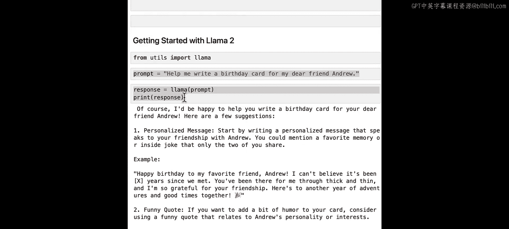

And let's set the parameter， were Bruce。It goes to true。And let's see runs this and see the prompt。

 It outputs the prompt and you can now see the start and end instruction tag surrounding the original prompt。

 It also prints the model that you just use remember from earlier in the course that there are regular non-chat Lama models as well as Lama chat models for most use cases we recommend using the Lama chat models instead of the base foundation models Let's see what happens by asking each model what is the capital of France The helper function lets you explicitly choose which Lama model to use by default。

 the helper function uses a small 7 billion chat model but let's set it explicitly here for clarity。

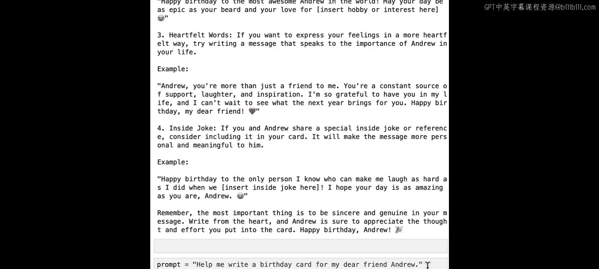

And let's run this。Okay， so now you see our prompt has instruction tags and the model call is 7 billion chat model Now let's print the response。

It says the capital of Francis Paris， which is good now let's change the API call to choose the foundation model。

We'll just modify the model name。To this， the model name is similar just without the dash chat in its name。

 Lama dash 2 dash7b， also for the foundation models they do not understand the instruction tags to avoid adding the instruction tags。

 set the helper functions Add instruction variable to false。So let's do that。

It didn't answer our question about the capital of France。 Instead。

 it asked us similar questions about the capital of other countries。

 Foundation models learn to predict the next word， given the words that came before it when it sees what is the capital of France a logical continuation of that is to ask similar questions about the capitals of other countries。

 remember that the foundation model wasn't trained to understand instruction tags So it's not recommended when using foundation models If you are curious you can pause the video here and set the add instruction variable to true and see what happens In summary。

 we recommend using the chat version of the Lama 2 models such as Lama 27 B chat Now let's look at the temperature。

 if you are building an LLM application where you would like the application to provide consistent responses Given the same input prompt then you can set the temperature to0 to have the Lama model behave deterministically by default our helper function。

For this course sets temperature to zero， so this means that if you give the model the same prompt twice。

 you can expect nearly an identical response each time here we are going to add a bit more detail to make the birthday card more personalized to my friend Andrew。

So let's start by writing the prompt。And I'm going to。Right。This。In the prompt。

 Help me write a birthday card for my friend。 Andrew。 Here are details about my friend。

 He likes long walks on the beach and reading in the bookstore。

 His hobbies include researching papers and speaking at conferences。

 His favorite color is light blue， and he likes pandas。 Let's call the Lama function。

 and get the response。😊，And let's set the temperature。Explicitly to0。And let's print the response。

All right， so you got a response。

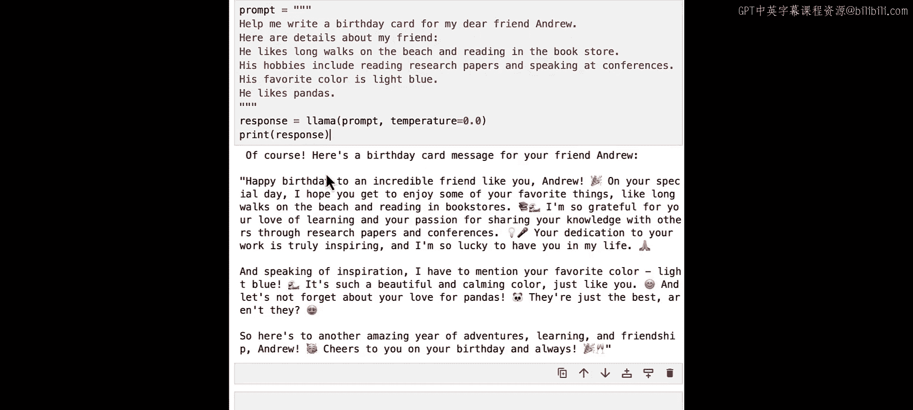

The response looks pretty good。Let's run it again to see if we are getting exactly the same response。

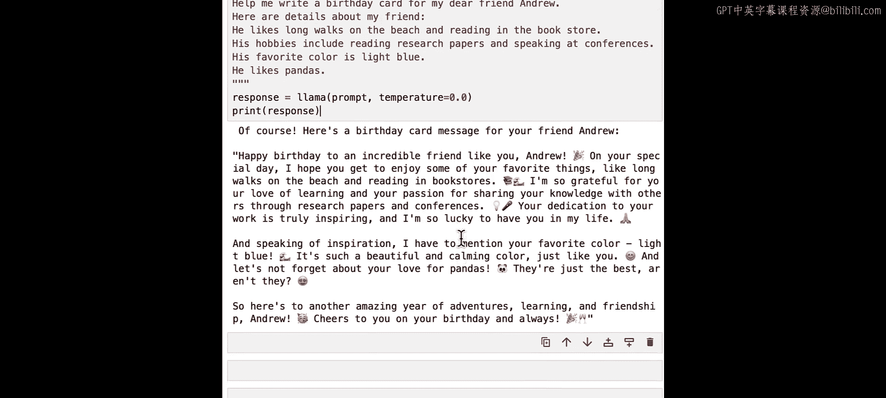

They' are highly likely going to be the same。So let's copy this。

We are not going to make any changes and run this again。Okay， so now let's see it seems， yeah。

 it is exactly the same。It ends with， I'm so lucky to have you in my life here you see it。

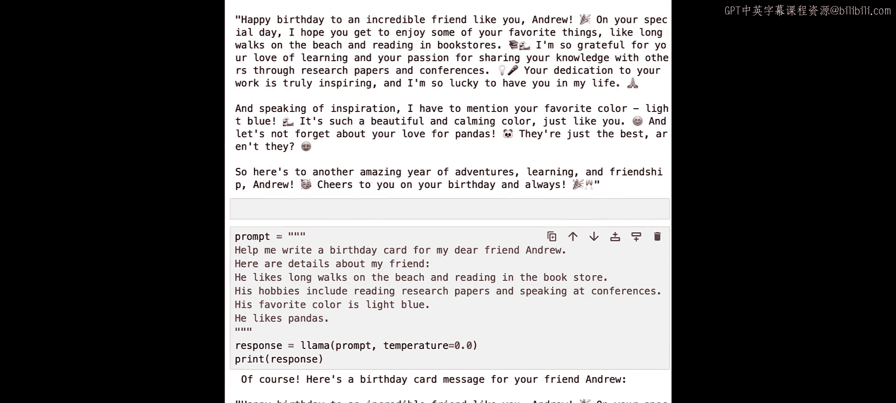

And then speaking of inspiration。

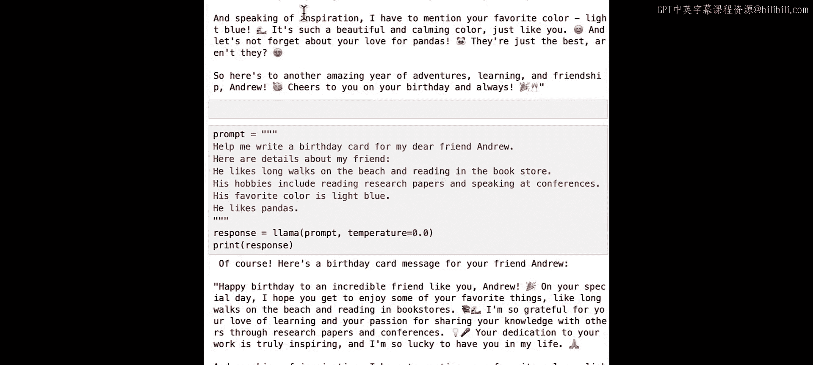

That's great。 So now we know how to get。Consistent output。

 deterministic output from Lama models by setting the temperature to zero。

 Now let's try increasing the temperature for more variation for use cases where you would like more variation。

 for example， for brainstorming jokes you can increase the temperature up to 1。

0 to have more random and nondeterministic output so let's increase the temperature and see what happens So I'm going to copy。

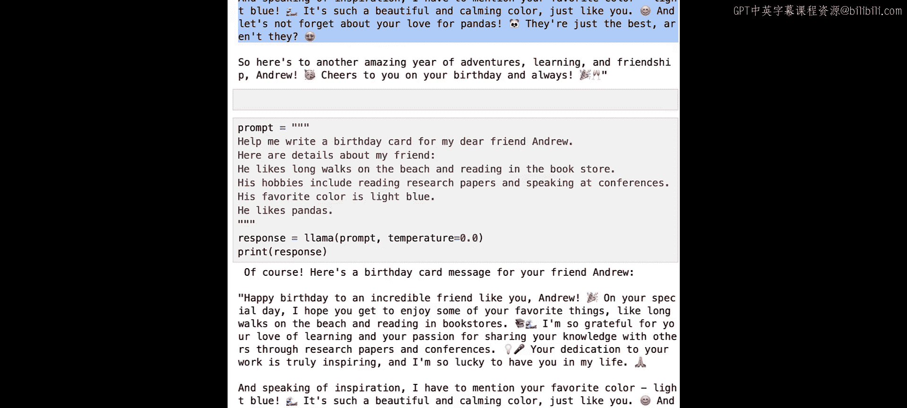

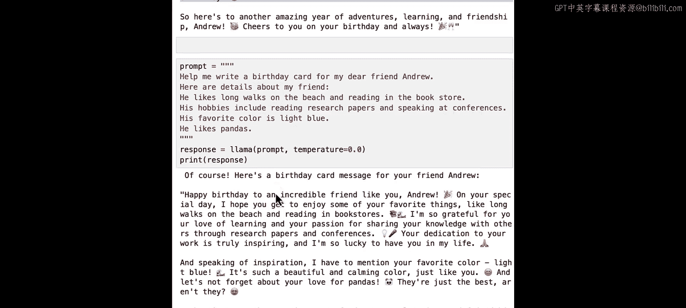

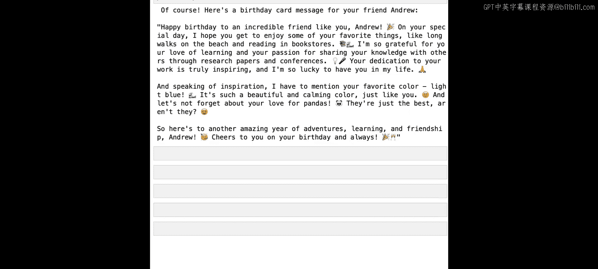

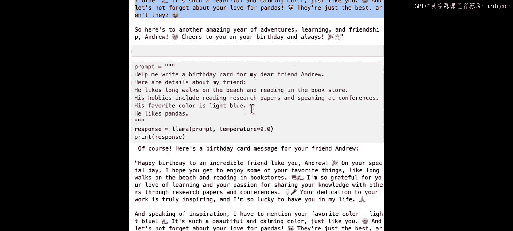

The same。Proud。And the response。

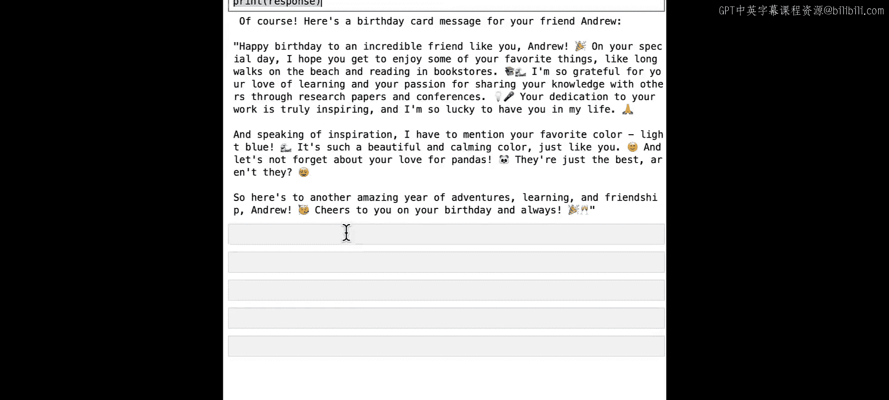

And the're called， but I'm going to set the temperature to 0。9。And run this。Okay。So。

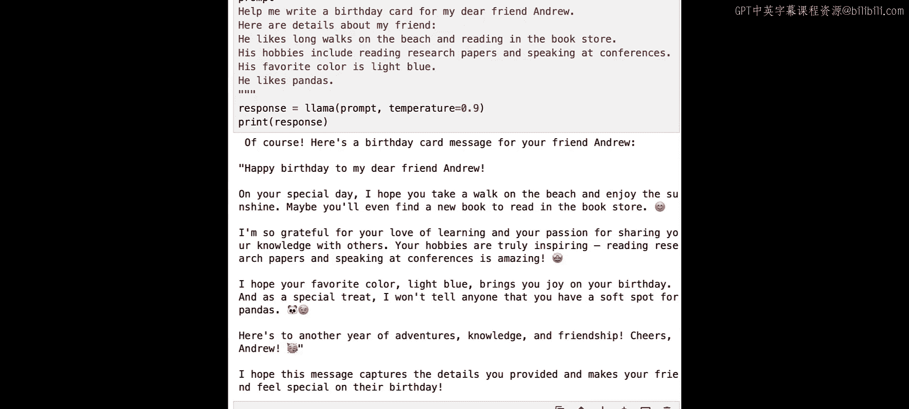

It gave us a response back。 Now I'm going to again run this and see。

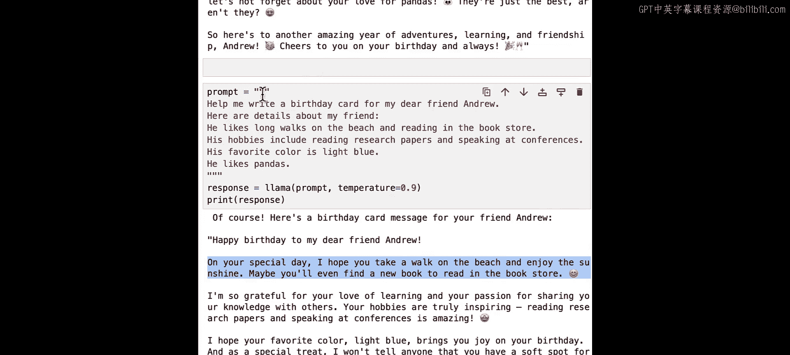

Whether my response changes， ideally， it should change because we have set the temperature greater than zero。

Okay。So that's see。Yeah， so you can see our first response started with， of course。

With an exclamation mark。And then it says， here's a birthday card message for your old， Andrew。

 and here we have a different text。

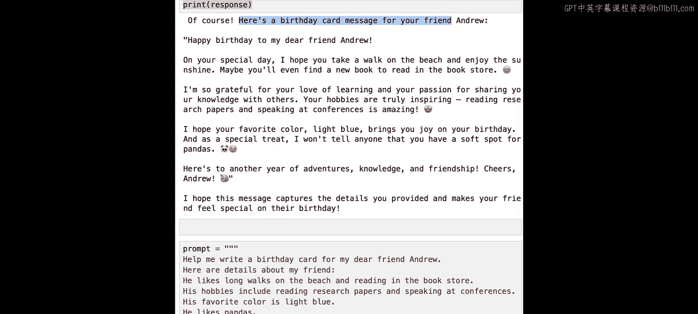

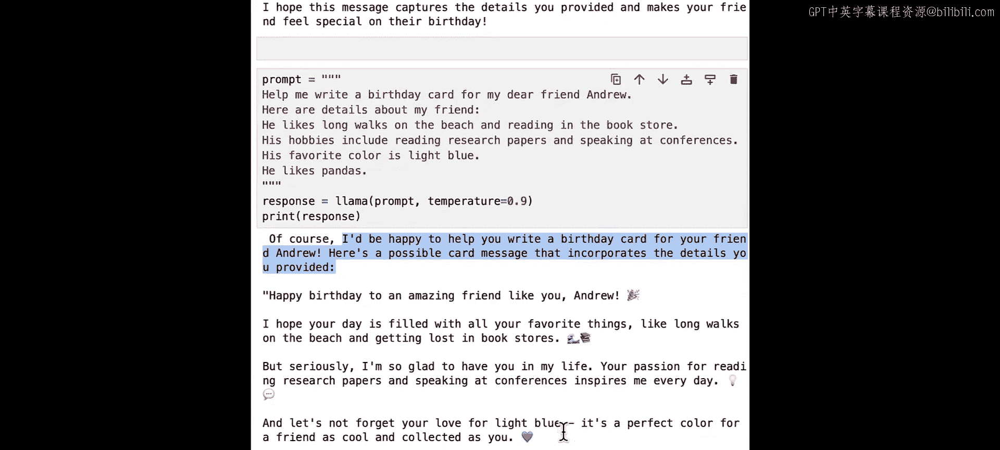

So as you can see as you change temperature， you may get different kinds of responses if you want consistent responses。

 set temperature to zero if you would like more variety increase the temperature to1。

0 Now let's look at max tokens you can choose how long you want the models's output response to be the helper function sets max underscoreco tokens to 1024 by default a token can be a word and is usually a part of a full word and on average one token is about  three fourthth of a word So1024 tokens is about 768 words let's decrease the models output response length by setting max tokens to 20 and see what happens So again I'm going to copy the same prompt which we had and now I'm going to set the max tokens。

220 and I'm going to remove the temperature by default， it is set to zero。And let's see。

By printing the response。Notice how setting a smaller number of tokens doesn't make the model give its complete answer more succinctly。

 It just stops partway through its answer。 La two models， like any other large language model。

 have a limit to how many tokens they can take in as input as well as output in their response。

 Let's give the model a really long input。 In this case。

 some text from a children's book called the velvetine rabbit。

 You will ask it to summarize that book for you。 Okay， so I have written a prompt。

 where I am asking the model to give me a summary of following text in 50 words。

And I've embeddedbe the text， which I got。Shuang。This the velvetine Grit text file。

Let's print the response。And let's look at the response。

So what happened the model doesn't give a response instead it returns this error message which says that the input tokens plus the max new tokens which are the number of output response tokens must be less than or equal to 4097 tokens it further notes that there are 3974 input tokens and 1024 max new tokens which are the output tokens。

 so let's add these two numbers， so I have3974。Plus。1，0，2，4。So that's。4，9，9，8 tokens。

 which is more than 4，0，9，7 max tokens that Lama models can handle。 So for Lama 2。

 the sum of the input prompt plus the output response can be at most 4，0，9，7 tokens。

 So what does this mean in practice。 This means that if you have really big input prompt。

 you would get a smaller output response。 Similarlyly， if you ask for a long output response。

 then you may need to be mindful of how long your input prompt is。

 Let's see if we can stay within the 40，9，7 token limit so that we can still summarize that book。

 we can reduce max underscoreco tokens in our helper function。

 max underscoreosco tokens is set to 10，2，4 by default， but we can choose something else。

 recall that the input prompt had 3，97，4 tokens。 Let's calculate 40，9，7-3，9，7，4123。

 So that means we have 123 tokens left to use for the models response。

 Let's set max underscoreco tokens to 123。And just a quick note， the parameter name is max tokens。

 The error message earlier referred to this as max new tokens。

 but the variable name in the helper function is just max tokens。

 So we'll use the same prompt as before and we'll copy that。But this time。

 we are going to add max underscore Stokens。And we are going to set it to 123， and we are going to。

Brennt the response。All right。This works。We get an output response instead of an error message notice that since we set the max tokens to 123 the output response is fairly short。

 This is limited to 123 tokens， let's check what happens if you set the output response to be longer than 123 tokens so if you set the max tokens to 124 what happens let's set this to 124 run it。

And we got an error message。Which is what was expected Later in the course you will see a set of Lama models that can handle over 20 times the token length of these Lama models So what happens if you ask a model a follow-up question if you are chatting with the Lama model as if it's a person you may ask a followup question or request let's see what happens if you ask it to add one more detail to the birthday card so let's run this。

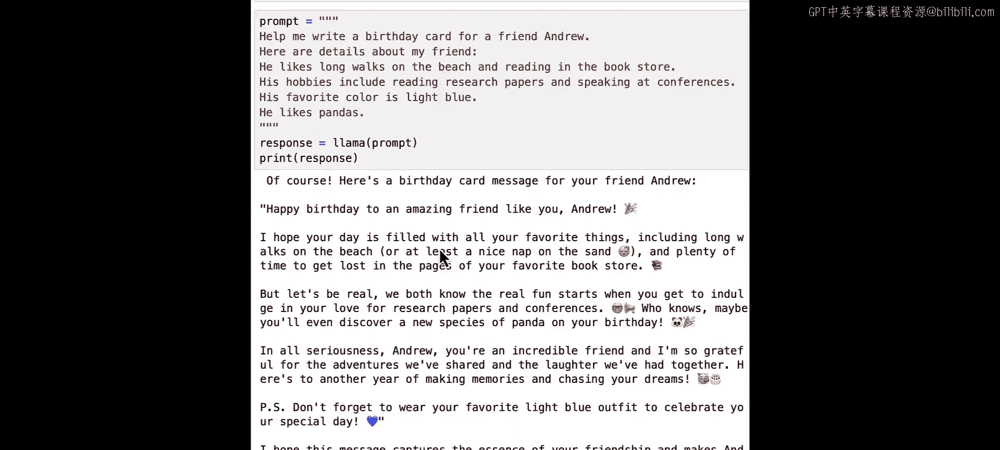

Now let's ask the follow up question， see what happens。So we'll create a prompt2。

So we are adding this prompt， oh， he also likes teaching， can you read it to include that？

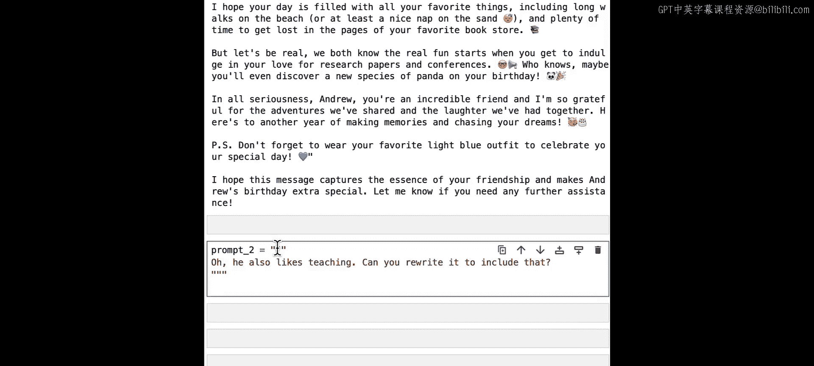

We can see the LLM's answer doesn't have any memory of Andrew and his other hobbies and interests。

 It also doesn't remember that we are asking it to write a birthday card In the next lesson。

 you'll see how we handle this to give the model the proper context For now。

 try asking the model to help you with some other writing task。

 Maybe you could ask it to help you draft an email that you are sending to customer service about some product that you have a question about。

 or maybe you would like some help with writing a speech that you will give at a friend's wedding。

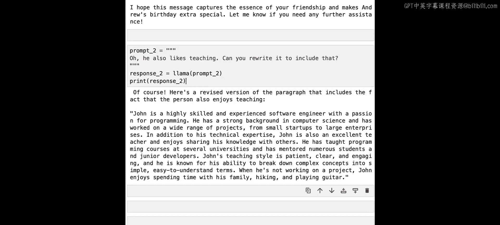