# 吴恩达《Llama2的提示工程｜Prompt Engineering with Llama 2》中英字幕（英字可关闭） - P6：6.L5_comparing_llama_models.zh_en - GPT中英字幕课程资源 - BV1um411f7Lm

Remember that there is not just one， but a collection of Lama models。 A question you may have is。

 which one should I use。

That's what you'll explore in this lesson。 You will try out the small。

 medium and large models and compare how they perform on the same task One of the tasks will be to summarize an email。

 another will be to solve a reasoning problem。Comparing how models perform is in itself an art because you are comparing free form responses to openend questions。

 In fact， you can ask the model for help with that too。

 you will ask it to compare the responses of the three models and explain how each performs。

 Let's see how this works。

As you saw earlier in the course， Lama2 models come in three different sizes， 7 billion， 13 billion。

 and 70 billion。These numbers indicate the number of parameters in each model。

 each model also comes in two versions， a base model。

 which has been trained with using a trillion tokens of text so that it can predict the next word and a chat model。

 which has undergone an additional round of training called instruction tuning to make it better at following instructions。

 This table gives you highlevel comparison of the different models。

 All Lama models are very large and require a lot of this space to store the weights alone require 13。

5 gig for the 7 billion parameter model to almost 140 gig for the 70 billion model。

 models of this size are hard to manage and use on consumer hardware like your home computer or laptop。

 This is why hosted API services like the twoge do AI service that you are using in this scores。

 are so important and really make it much easier to get started using Lama models。

 So you might be wondering how you compare the performance of one LLM to another in general。

The research teams who develop the models use sets of benchmarks to grade LLMs。

 These benchmarks consists of many tasks often expressed in the form of questions with known correct answers。

 which the LLM is asked to complete The models's outputs are compared to the correct answer and a score is determined。

 This table shows you three tasks that assess the models common sense reasoning。

 world knowledge and reading comprehens skills， the score out of hundred is shown for each model size。

 As you can see， the larger model， the higher the score， although the differences vary by tasks。

 one of the main differences between the models is how much knowledge they have of the world so far in the course we have mostly been using the chat models。

These models have undergone additional training called instruction tuning to make them better at following instructions。

This training also increases the safety and reliability of the models compared to their base versions。

Here you can see the scores on two benchmarks that are used to assess the honesty and toxicity of LLMs。

 The truthful QA benchmark measures whether the LLM generates truthful answers to questions。

 the toxicgen score indicates what percentage of models responses can be harmful and toxic as you can see the chat models are more truthful than the base models。

 perhaps most strikingly， they are also significantly less toxic。

 so much so that these models will almost never generate a toxic response。

 For this reason we at MadA recommend the chat models for most use cases。

 but if your application needs a fine tune model， then we recommend that you start with one of the base models Let's head back to the notebook So you can explore more of these differences for yourself。

 As you have seen in previous courses we start with importing our Lama and Lama chat functions from UTs。

 So let's make sure we do that。 Okay so I'm going to。Put in my prompt， which I had used previously。

And the prompt says。Three different messages。With three different sentiments。

 and I'm asking the model to give me a one word response。So， let's see how this。Behaves。

And I'm going to use the 7 billion parameter model。嗯。And let's print this。

So it gave us a one word response， but it's incorrect because we were expecting either positive or negative or neutral and it said hungry。

 Now let's see how does this same prompt works with 70 billion parameter model。

 So I'm going to change it here。270 billion， and I'm going to rerun this and let's see。Okay。

 so we got a right sentiment and this clearly shows that our 70 billion parameter model is able to find the sentiment are able to guess the sentiment better than our 7 billion parameter model。

 So let's look at sumization task。 So I'm going to copy my email which Andrew sent me。

 and you can see it's。Rather long。But he talks about LLMs， he talks about promptmping。

 he talks about fine tuning， pretraining， and he also has a fun fact。

So let's ask our model to summarize this。So， I'm going to start。And I'm also going to ask my motto。

To give me specific information。 So I'm going to ask， what did the author。Say about。Lma models。

And I'm going to include the email， and then I'm going to ask my 7 billion parameter chat model and then print the response。

好right。So we got a pretty good detailed response。And。

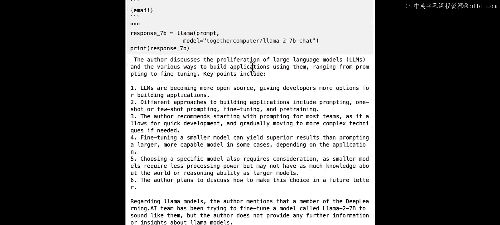

It seems like a good summary now let's look at how does this compare to our 13B model。

 so all we will do is we'll copy from here and paste it in this new cell and just change our response to 13B。

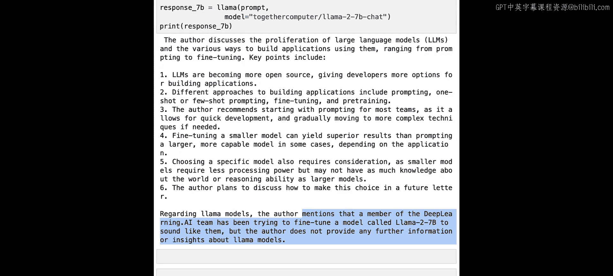

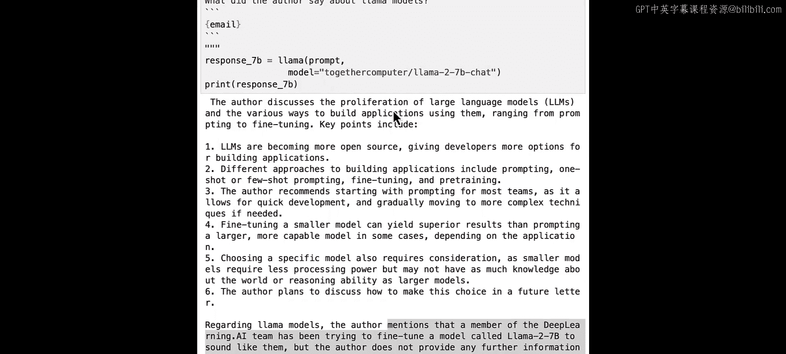

And let's see。

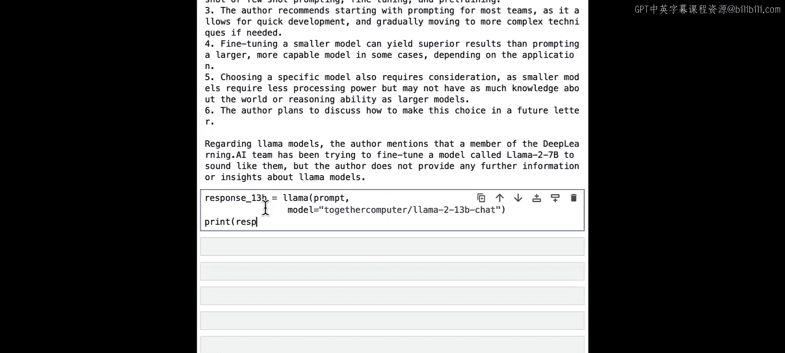

What the response looks like。O。

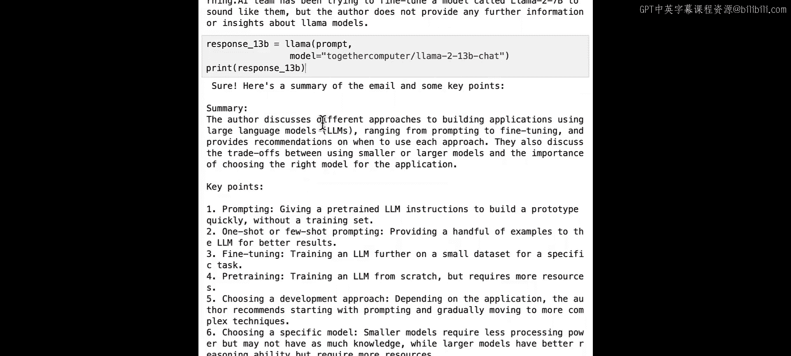

So here we are getting two different sections， One is summary， summarizing what was in the email。

 and then we are getting some key points。 So this also looks pretty good now let's。

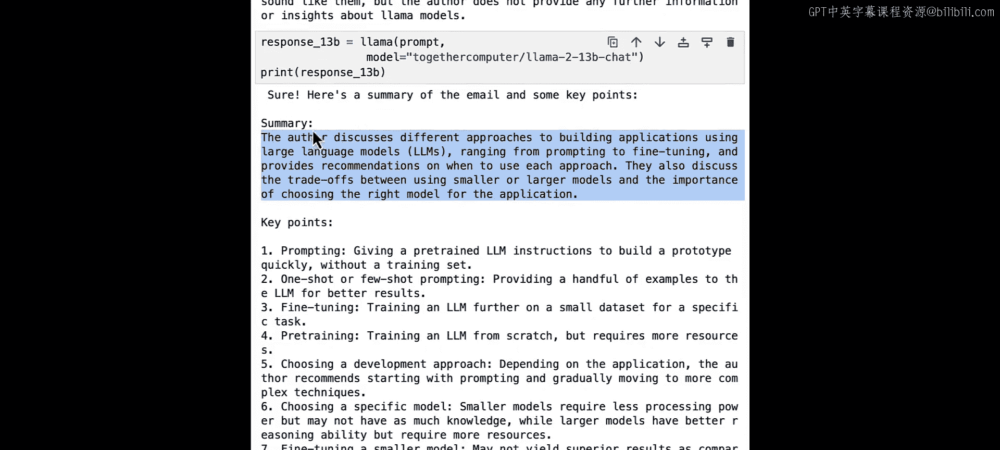

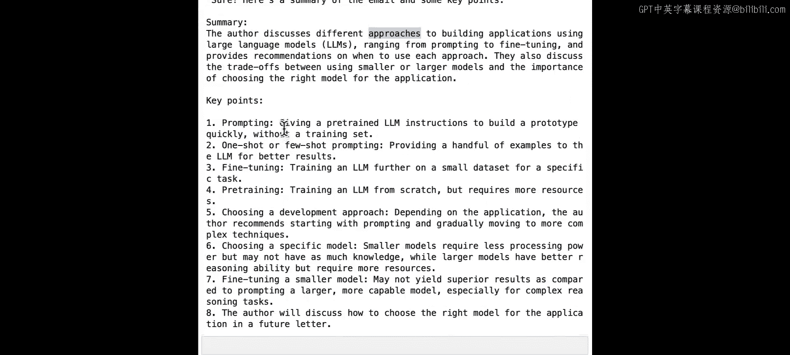

See how this our 70 billion parameter model gives us a response， so I'm going to again copy this。

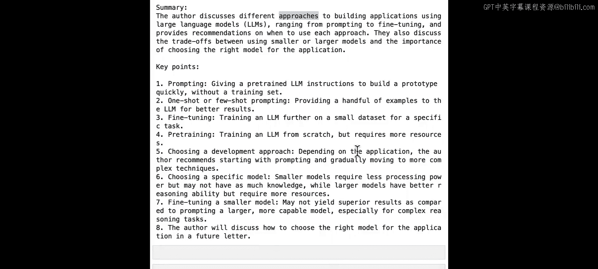

Change。Response variable。 and change our model。To 70 B。

And make sure that we print the right response。

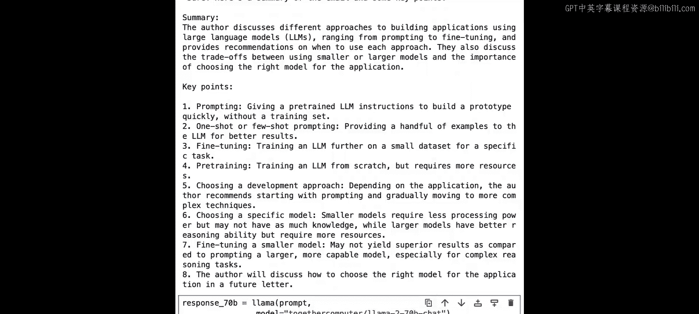

And let's see why that happens。All right， so here。

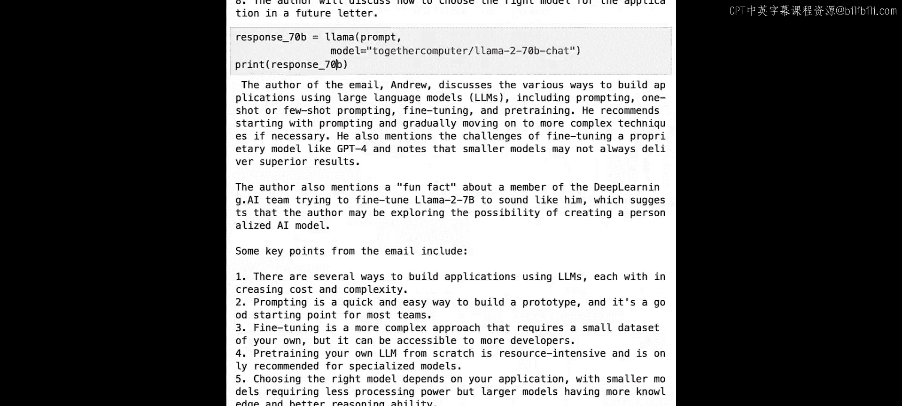

The one difference I can see。Is it's mentioning the author of the the name of the author。

 which in this case， Andrew。

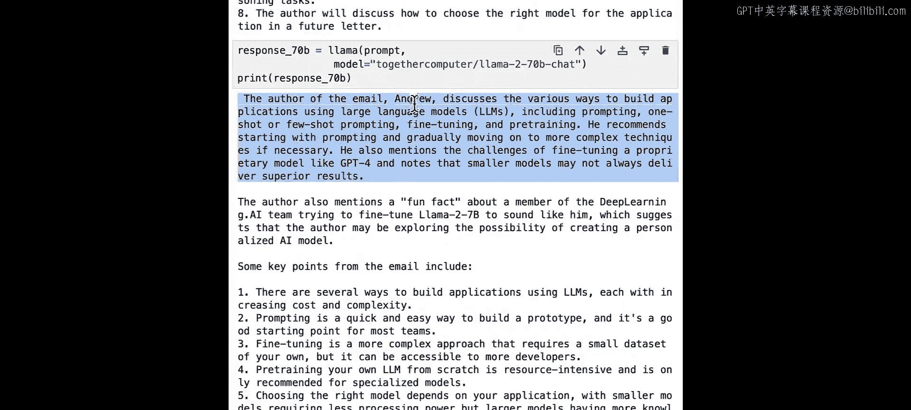

And it's also mentioning the fun fact which Andrew wrote in his email。 So that's pretty cool。

 It gives me a lot more details Now you can see that we can manually compare this。

 but it's hard to know which one is the best sumization amongst all these three model so you can ask an LLM to evaluate the responses of other LLMs。

 This is called model graded evaluation， let's use the large 70b model to evaluate these three responses so how do we do that so we'll have to write another prompt instructing our 70b model to evaluate these three responses so let's do that so we are going to first ask given the original text dennotated by email and the name of several models。

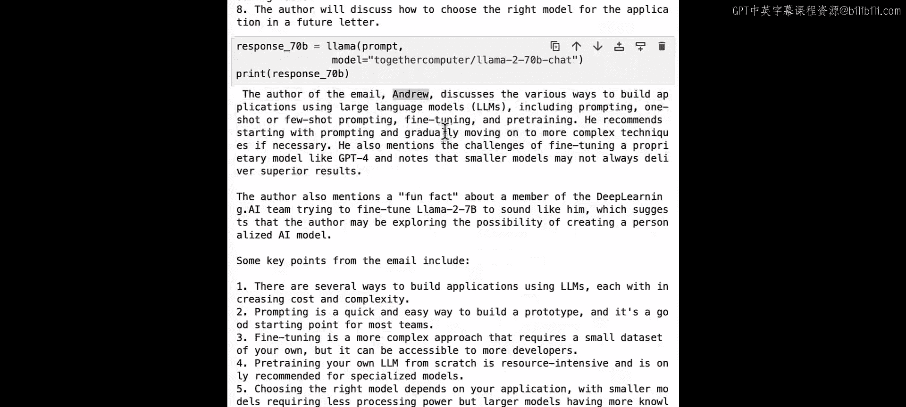

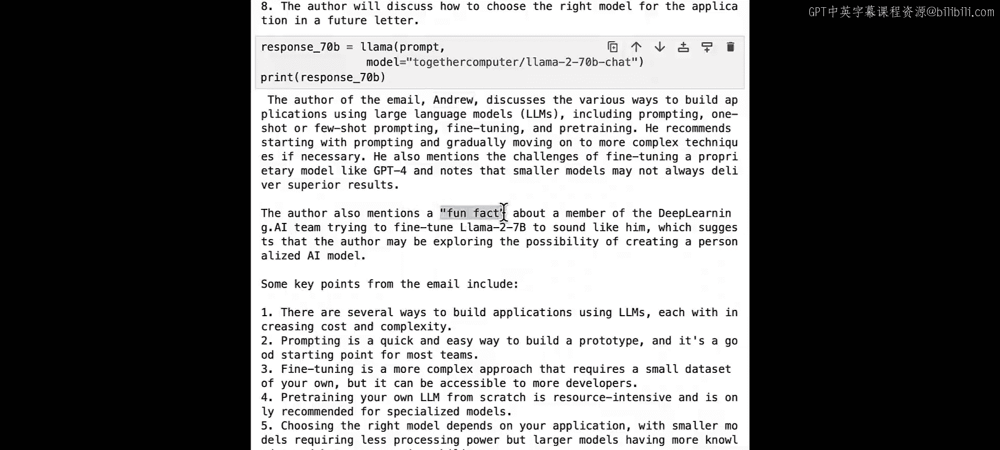

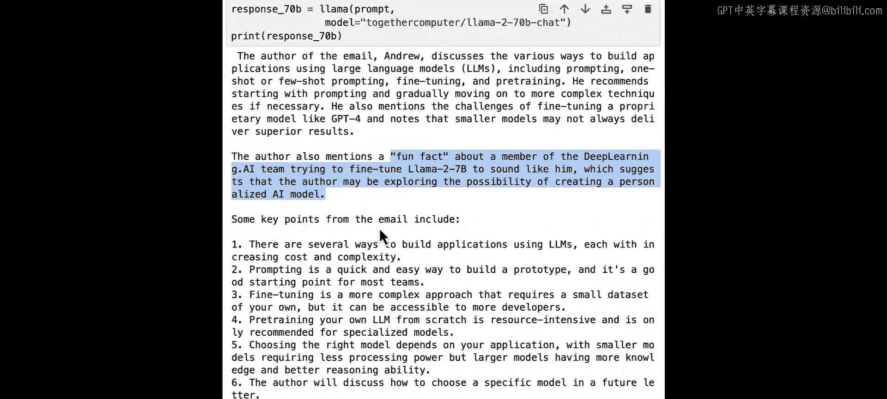

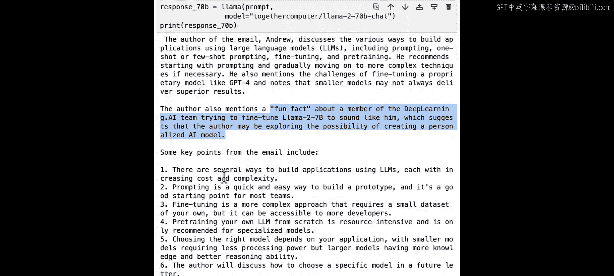

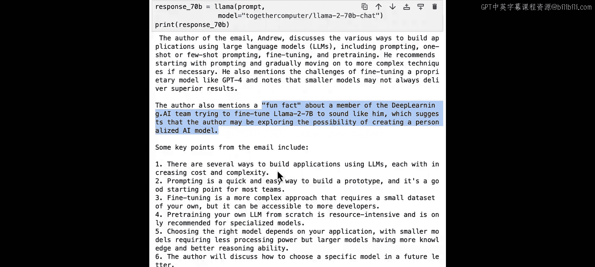

We are going to provide the summary which was output by each model。

And we are going to ask the model with few questions。

So here are the three questions we will ask does it summarize the original text， well。

 does it follow the instructions of the prompt？Are there any other interesting characteristics of the models output then we'll add in the prompt asking let's compare the models based on their evaluation and recommend the models that perform the best and we will then add our original email which Andrew wrote to us we will add the responses from each of the models which we got in our earlier execution。

So we added the email， we added the model。Name， And then we are adding the summary。

 which we got from the previous execution， the response from 7 billion parameter model。

 and willll do that same thing for 13 B and 70 B models as well。 And now we will。

Remember to use the 70 B model。We want the largest model to evaluate and compare the responses from the previous models。

And or print。The upper。ok。So let's see what this does。And what kind of comparison it gives us。

Okay so it seems that all three models were able to capture the main points of the email。 However。

 there are some differences in the way information is presented and the level of detail provided。

 so here's the information about 7b model is the shortest and most concise focusing on the key points of the email it does not provide any additional information insights beyond what is mentioned in the email here's the summary from chat 13 B model is slightly longer and provides more context。

 including author' recommendation and here's the 70 Bs chat summary is the longest and the most detailed providing a comprehensive overview of emails content it includes all the key points mentioned in the other two summaries and so forth。

 and then we get a full summary or all three models seems to have performed well in summarizing model but it seems like 70B performed the best providing the most comprehensive and informative summary。

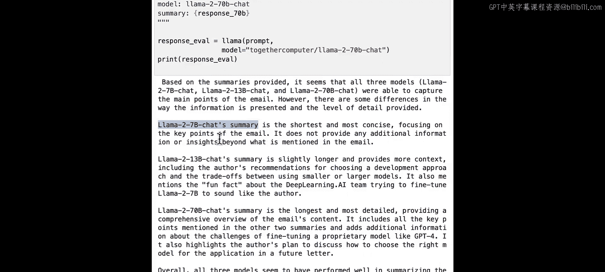

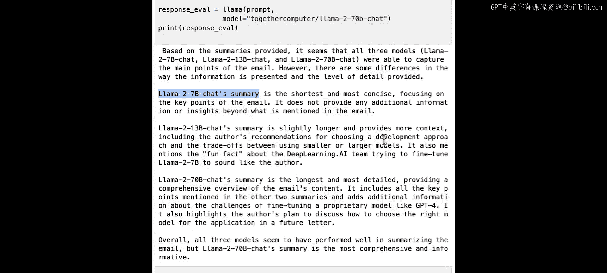

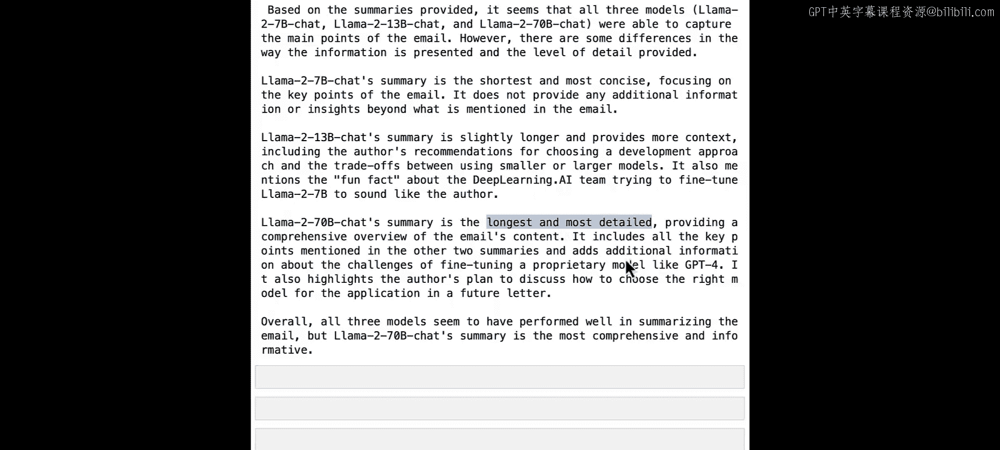

So it seems like the 70b model was best note that it's still best for you to include your own judgment when evaluating these models。

 asking an LLM to evaluate the output of LLMs can give you insights into what criteria you are looking for when evaluating them yourself okay let's move on to reasoning task humans can perform reasoning tasks without needing many examples of similar tasks。

 but reasoning has always been a challenging task for AI models to perform， so let's take an example。

 I'm going to write a simple prompt。

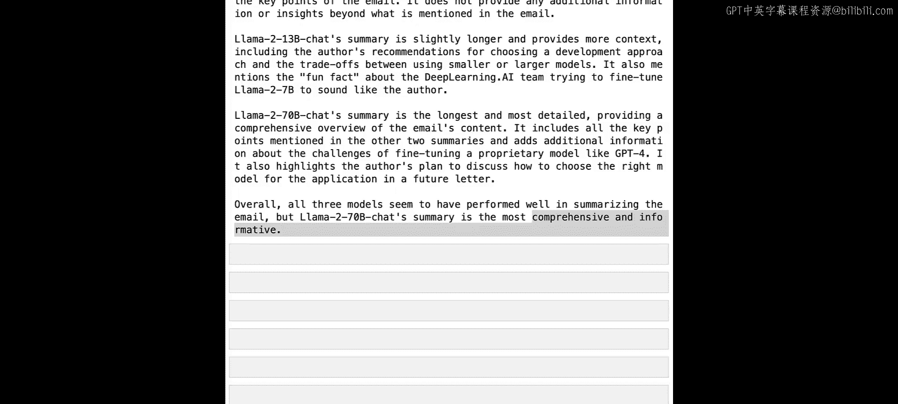

Jeff and Tommy are neighbors， Tommy and Eddie are not neighbors。

 and I'm going to ask a query to our model are Jeff and Eddie neighbors now what do you think？

Are Jeff andite neighbors。Let's ask our LLM that question。K。Yeah。So we'll write a prompt。

Given this context。And please notice the syntax and how I'm appending text into my prompt。

 So this time I'll append the query， which we created before。 So I'm going to ask。

Please answer the questions in the query and explain your reasoning because we want to understand how the models think。

 and I'm also going to ask the model if there's not information。To answer。Please say。

 I do not have enough information to answer。This question。

 so we are basically asking the model explicitly to be truthful， okay。

 so let's run this and see what the output is。Here it looks like a small 7 billion model concludes that Jeff and Eddiedie are not neighbors。

So it's making that assumption that when people are neighbors。

 they live near each other and when they are not neighbors， they live far apart。

The medium size 130b model says it doesn't have enough information。

 so we can see that the model is not making the assumption that Jeff and Eddie can or cannot be neighbors。

 In real life， this may be the case as well。 The point is。

 looks like the 3b model is not making the same assumptions as the smaller 7 B model。

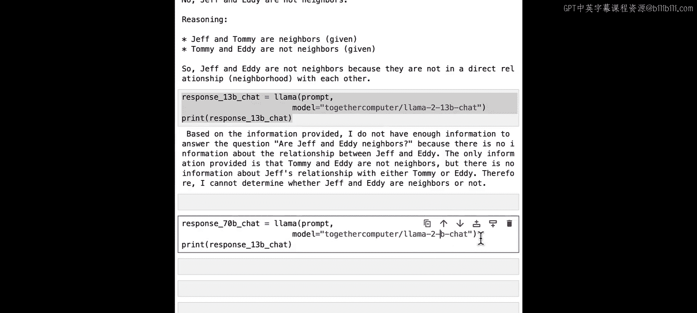

The La 70b model concludes that Jeff and Eddie are not neighbors， so similar to our small 7b model。

 the large 70b model makes an assumption that neighbors live near each other and non neighborighs live far apart。

 So now I'm going to ask our model to compare the three responses。

 and I'm going to write the prompt for that。Like the way we have done it in the past。

Given the context。And also given the query。Yeah。AndLike we did before。

We are going to ask the model to evaluate the responses。

And so we are going to ask some questions to the model。 Then we will add context， and then we will。

Copy paste。From previous prompt。Are three miles。And the response format。Okay， so this looks good。

 Now， let's move forward and。Make a call to our Lama model。

 let's use the 70 B model and let's print the response。And see what do we get？Okay。

 so we get evaluation for each model's response。and。You can see that。

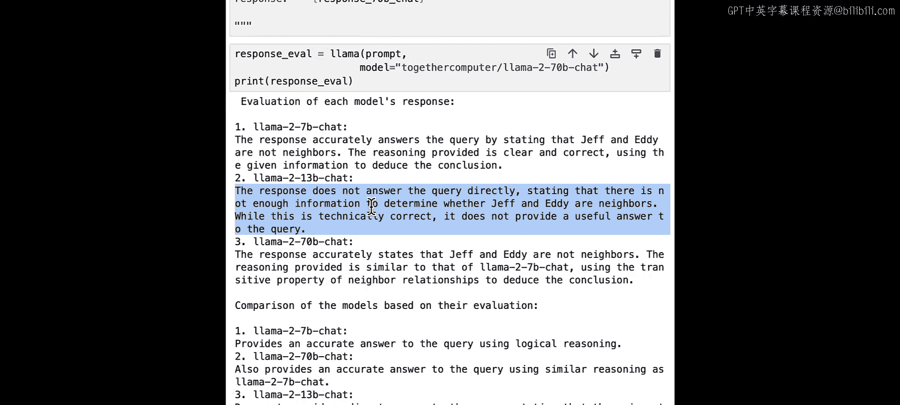

For 7b it does say that the response accurately answers the query and the reasoning provider is clear correct for 13b does not answer the query directly stating that there is not enough information to determine whether Jeff and Ed are neighbors and 70b model response accurately as well and then it's giving us the comparison of the models based on their evaluation which looks pretty good。

 so as we concluded before by giving more instructions 7b and 70b are the top performing models here。

 they both accurately answer the query using logical reasoning and 13b did not provide a direct answer to the query so far you've seen how these models can perform basic reasoning and logic task oftentimes it's probably more reliable to do these tasks with code but wait there's a Lama for that too it's called code Lama and that's what you'll see next let's go on to the next lesson。

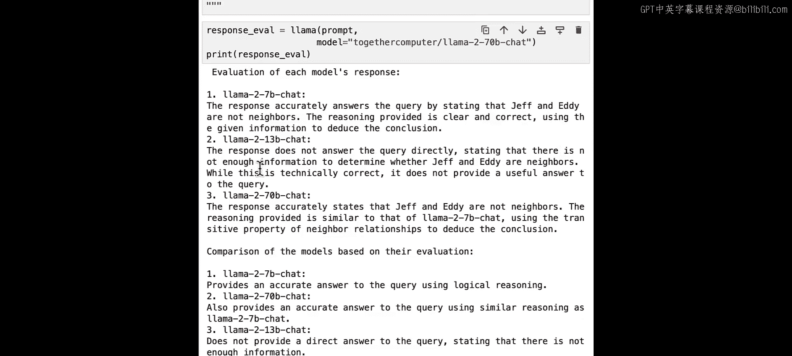

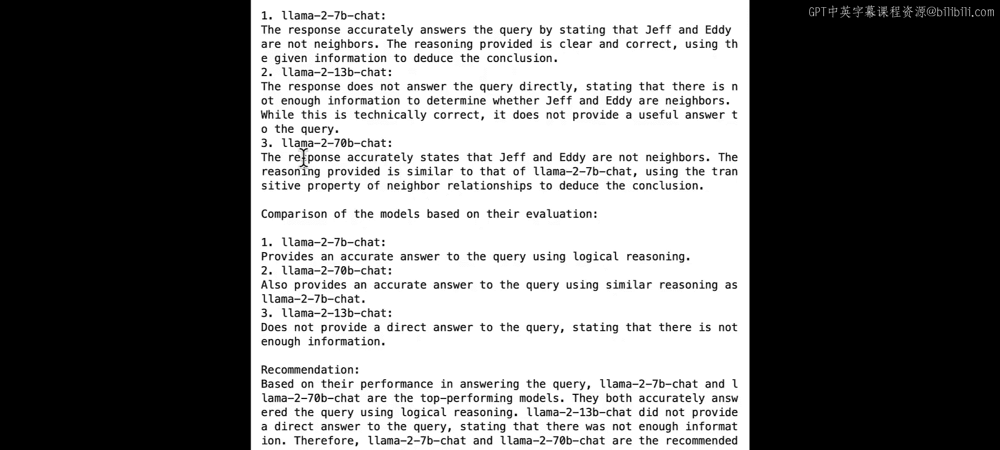

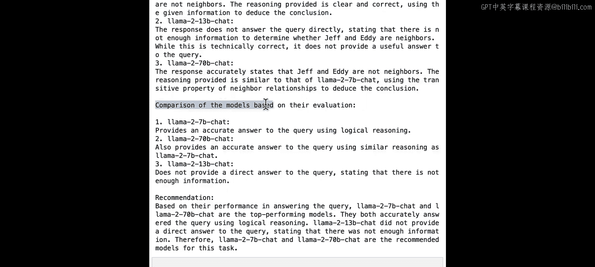

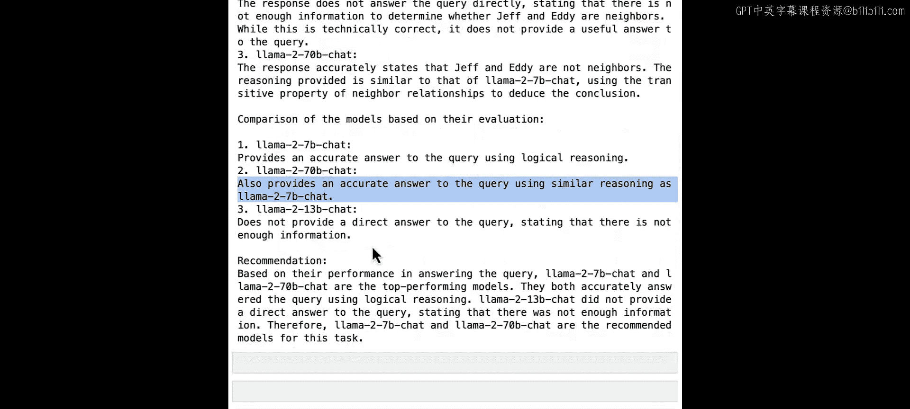

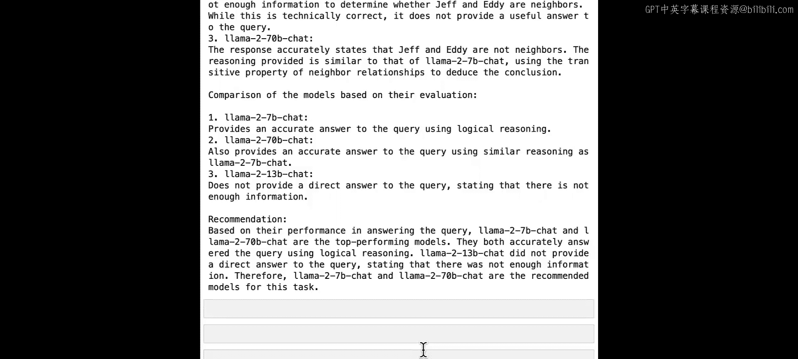