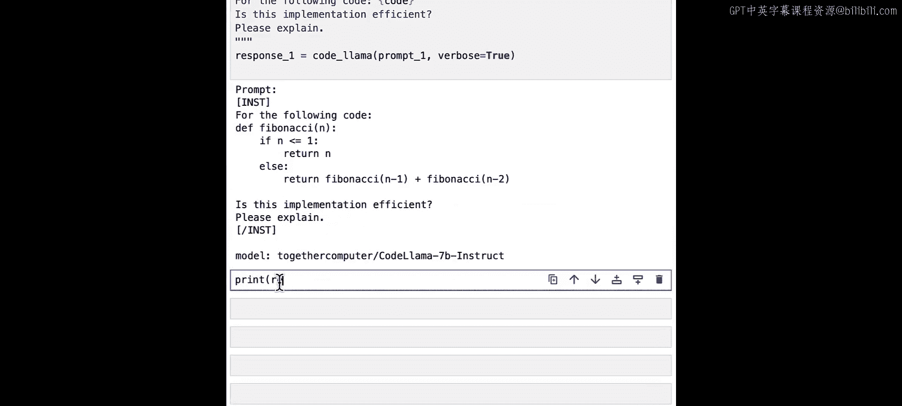
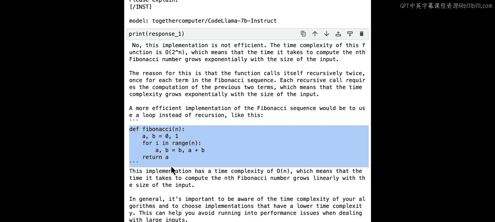
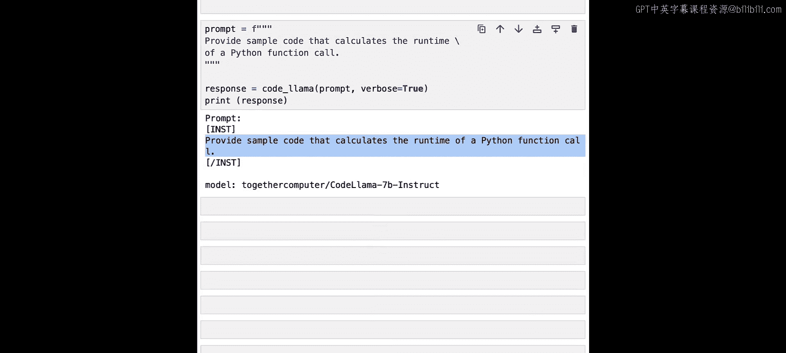
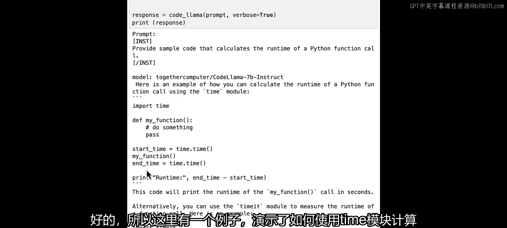
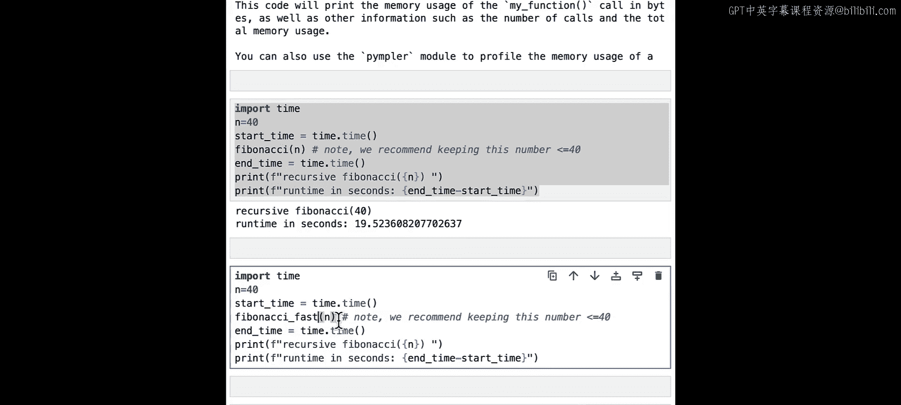
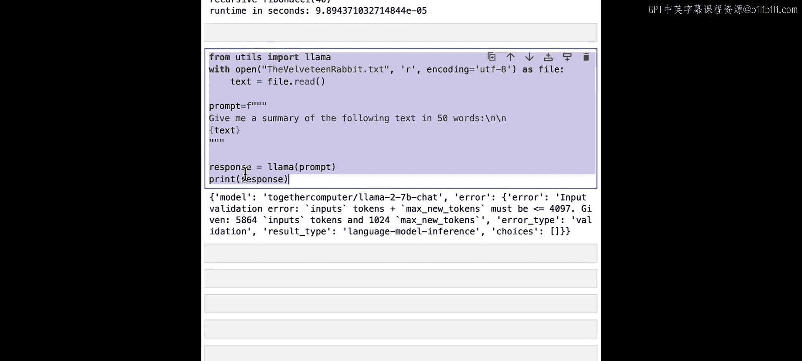
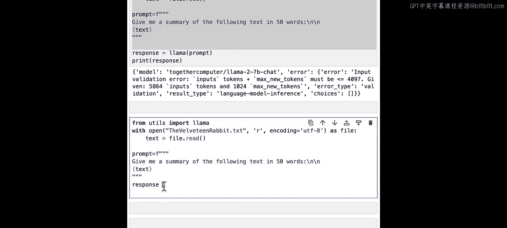
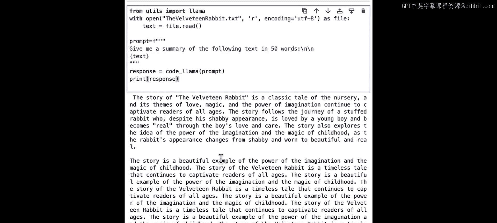

# 吴恩达《Llama2的提示工程｜Prompt Engineering with Llama 2》中英字幕（英字可关闭） - P7：7.L6_code_llama.zh_en - GPT中英字幕课程资源 - BV1um411f7Lm

Do you need to write some code？There's a Lama model for that。It's called code Lama。

 it's a collection of code Lama models， which you will get to explore next。

Whether you are an experienced software engineer or just learning to code。

 you can ask code Lama to help write， debug， and explain code。

Code Lama can take a much larger input text than the regular Lama model more than 20 times the input size。

So if you are a developer， you can send your entire program to code Lama and ask it to review。

And even if you' are not coding， but need a model that can take in a lot of text。

 you can consider one of the code Lama models as well because they can also handle nonco tasks。

Let's get coding。

Here is a reminder of the code Lama collection of models。

 Code Lama models are variations of Lama2 models that you have been using in the course。

 The models have undergone additional specialized training to make them useful for writing analyzing and debugging computer code Note again that the largest code Lama model is currently 34 billion parameter rather than 70b different combinations of fine tuning are used to create three varieties of code Lama models。

 the basees Lama models the code Lama instruction models which are good at generating code based on instructions you provide and code Lama Python which has had additional training in the Python language。

 If you only code in Python and not in other languages。

 this is the model you would want to work with All of the code Lama models are available as part of the together do A API service you can specify which model to use using the names here will also provide these in the notebook so that you can try our different。

Models and compare their results。 If you are using a different API service。

 be sure to check out how to specify your model selection in the services documentation。

 code Lama models。 Also expect prompts to be structured in a certain way。

 as you saw for the Lama to chat models。 If you are working with code Lama instruction models。

 you need to wrap your prompt in instruction tags， just as you did earlier in the course。

 You will take your prompt and wrap it in a pair of instruction tags as you see here。

 The other two varieties of code Lama models。 code Lama and code Lama Python。

 You't require any tags in the prompt。 You can just include the text of your prompt as is。

 Let's try out these models and explore some best practices for working with code Lama in the notebook。

 As we have seen in the previous lessons， the first thing you need to do is。Import。喇嘛。And road lama。

From u package so as you can see here， we have a new function code Lama in our u package and it uses the smallest 7 billion parameter model for code Lama Now let's start with a simple mat problem。

And see， how does ch Lama do。 So I'm going to start with two lists， One is。

A list of all the temperatures and these are minimum temperatures。And then I'll have another list。

Which will show a list of all the maximum temperatures， and then I'm going to write a prompt。

Where I will。Add my minimum temperature。List， and I will also add my maximum temperature list。

And then I'm going to ask the model which day has the lowest temperature？So let's type that down。

And let's make a to our model。So again， we are creating a prompt where we are passing in two lists。

 temperature minimum and temperature maximum， and then we are asking。The model。

 which day has the lowest temperature。 So the model has to look through these list and tell us which one has the lowest temperature。

 Okay， so I'm going to run this。And the output says the lowest temperature is 47 degree now let's see whether this is true。

 so I see there is a lower temperature than 47 degrees which is 42 degrees， so this is incorrect。

The output is not right， so rather than going to the larger model。

 let's ask code Lama to write us some code to help us answer this question with code。

 so I'm going to start writing another prompt。And I'm going to ask in natural language。2。😔。

Code Lama to write a Python code that can calculate the minimum of the list temperature minimum and the maximum of the list of temperature maximum。

So let's see what we are doing here。We are asking code Lama to write Python code that can give us the minimum from our list of minimum temp underscore min and give us the max of the list temp underscore for max。

And let's see if it is able to write Python code for that。Al right。

 so it did write the Python code as you can see in this square brackets， that's the code。

 and it defined a function， get min max， pass into less， and return the minimum。

Of temperature minimum and max of temperature max。And it also wrote the test cases for us。

 which is great。 Now， let's try out this code。 So I'm going to you。😊，Take this code， okay。

I'm going to supply my two lists， which I'm going to copy from top here。

So I'm calling Getman Max function passing in。S parameter is my two layers。

 temp underscoredico mint and temp underscoredisco max。And then I'll print the results。

And let's see if this is getting us what we want。All right， so it got us 42。

 so it found the minimum from our first list， which looks to be correct。And then it found 65。

Whi seems to be the highest number in the second list。

 so it was able to generate code and we were able to validate this code and run it。

So rather than asking Lamaitude to do math， it may be easier and more robust to ask it to write code that can help you do that same calculation。

 one great use case for the code Lama models is called completion where you use the model to finish partial code that you have started in your prompt Lama accepts another special token special for this purpose。

 the fill token， denoted by the word fill between angular brackets。

 you can use the fill token in your prompt to indicate to the model that it should complete whatever code you have So the general format of a prompt using the token would look like this。

 you start off when writing some code。This can be a single line of code or multiple lines。

Then you include fill tokens wherever you want the model to complete the code for you。

 so here you can see two different sections surrounded by other code that you want the model to fill in let's take a look at a simple example I'm going to start by writing my prompt and I'm going to define a function called star rating This function returns a rating given the number n where n is an integers from one to5。

So let's write the code for this。If n equals to1， rating is4， else， if n equals to5。

 rating is excellent， and we have added a fill token。

And we expect code Lama to fill that section with code。 We will call this。

With our standard 7 B code Lama model。And we will make robust equals to true。So we can see。

The plum as well。 So let's run this。And you can see our prompt。

 it has instruction tags like we learned in previous lesson。

And it has an entire function wrapped into it。Now let's print the response。All right。

So we clearly see our fill token was replaced by this code right here。Excellent。

And everything before and after is still there， so looks like it filled in the code properly while keeping the code before and after that was provided。

 our code Lama models can do multiple things， it can write code， it can debug code。

 it can explain code， and it can make our code more efficient。

So let's look at writing a Fibonacci sequence now if you don't know what Fibonacci sequence is don't worry about it I'll show it to you so as you can see here the sequence is just a list of numbers now this number one is basically addition of the previous two numbers so0 plus one is one。

2 is one plus one。3 is two。Plus one。5 is 3 plus 2。 so as you can see， you take any number。

You have to add the previous two numbers to get to the value of that number。

 and we will write a function to calculate the nth Fibonacci number This is a classic computer science question。

And it's used to demonstrate how an inefficient alumentation can be quite costly。

 so we'll write this function now。So let's start with a simple prompt and we'll ask。

Kode Lama to write。In natural language， exactly what we want。And。

Or keep the ver burst equal to true so we can see。😔，Are prompt。

And we will use the code Lama 7b instruct model， which is the default model。

Okay so let's go ahead and run this so let's print the response so as you can see we have actually coded we are code Lama has coded the entire function for us and it it's using recursion so it's calling recursively the same method and it has also provided us the test cases that when you pass zero here's zero when you pass6。

Whi is a sixth number and let's see in our sequence what that is， so 0，1，2，3，4，5。

6 and the answer is 8， which is what thefi going to。

This case is telling us and if you have not come across recursion。

 don't worry if you don't know what recursion is， this is usually what you would learn in an intro to algorithms class an elegant looking method of implementing this math calculation would take even a modern computer a very long time to run。

 but there is a better way to do it， let's see how we can make this code more efficient。

So I'm going to。First get our code and put it in this text， so here's our code。

 which I'm going to copy。And put it here。Okay。And now I'm going to create a prompt。

And I'm going to ask the modelto。Whether this particular code is efficient。So for the following code。

And I'm going to wrap code in this curly braces， you're going to ask if this implementation is efficient。

And please explain。Now let's type in the response。And let's go one。Okay。

 so let's see our prompt and now。Let's print our response remember it was response1 okay the model appears to answer correctly that its original suggestion the recursive method is inefficient and explains why correctly as well。

 it also provides a more efficient implementation。

which is interesting， so it's showing us how to implement it so our code can be more efficient so why does the LLM output the inefficient version first it's likely that since this recursive implementation is so commonly used in course material that explains the importance of efficient algorithms that the recursive version of calculator fibon actually shows up quite often in the training data of the Lama2 model and likely for most other LLMs as well。

 let's check both implementation and see if they work。

So I'm going to copy the first implementation which we had。

And I'm also going to copy the second implementation here。And I'm going to name it as。

More efficient one。 So I'm going to name it as fast， and I'm going to run。These boat and sea。

How this looks。And I'm going to write a prompt that writes code to calculate the runtime of a Python function call。

Let's see what it outputs， it should return back a function call。

All right， so it says here's an example of how you can calculate a runtime of Python function call using the time module。

And we have to import time。It is writing a function， it's showing start time。

 the function called an n time， the run time， which is n minus start time。

This is great。So we can actually use this for testing which function is more efficient。

So I'm going to add this。In my new function， which I call。So let's write that。

And so we are basically setting n equals to 40。And we are passing that number for Fibonacci。

And so this， as you can see， this is the 40th number in the sequence。

And we recommend this to keep this number below or equal to 40 and underscore time is time got time and。

We will print n time minus start time， which will give us exactly the time taken to execute this。

 so let's run this and see how much time it takes。So it took about 19 seconds to run this。Okay。Now。

Let's call our Fibonacci fast function and we'll basically copy all of this because it should remain the same and just call change this to call the fast function。

And see how much time does it take？K。

So。It took fraction of a second to run this function。So as you can see， it was。

Significantly faster than our recursive function Now let's look at code Lama's context window code Lama can take in much longer text code Lamma can take in an input prompt that's over 20 times larger than the regular Lama models。

If you are a software developer， that means you could upload your entire code for an application and ask the model to review。

 but even if you are not coding， you can make use of this longer context window to do other tasks。

 If you might remember from earlier in the course you saw how the regular Lama model was not able to summarize the text of velvetine rabbit。

 because it exceeded the input window of 4000 tokens or 4096 tokens。

 so Im going to copy this code from our prior lesson。

And run it just to see what happens with our input tokens as you can see it gives an error message and mentions how the number of input tokens exceeds the 4097 that is possible for the Lama model Now let's ask Co Lama to do the same task and see what the results are。

So I'm going to again copy that code。And instead of Lama， I'm going to use code Lama。

All right， we did get a response。

So if you are a task， whether it's a coding task or not a coding task at all and need to input much more text than a regular Lama model can handle。

 you can try using code Lama。 So far， you have seen the use of many different Lama 2 and code Lama models。

 the only remaining one that is part of the current Lama family of models is Lama guard。

 One of the two major components of purple Lama， which you will learn in the next lesson。

