# 吴恩达《Llama2的提示工程｜Prompt Engineering with Llama 2》中英字幕（英字可关闭） - P9：9.L8_walkthrough_helper_function.zh_en - GPT中英字幕课程资源 - BV1um411f7Lm

You may be wondering what's happening inside that nifty helper function that we have been using。

 Here's a step by step walk through the code。 You can also find it by looking at the us。

 pwifi First this is the URL that we are using to access the Together AI API Let's run some code that enables us to get the API key from our computer Don't worry if this seems kind of mysterious。

 the do Ev library lets you access sensitive information such as API access keys more easily but you don't need to know more about this or see this again for the rest of the course to access the service youll get an API key which lets the hosting service know who you are note that if you print out this variable in the classroom。

 you won't get a real API key， we have hidden the real one for security but if you wanted to use this service on your own computer outside the classroom you can sign up for an account and get your own API key from together AI's website you can put this API key into this byin dictionary。

You will also set the content type to application JSA next choose the model。

 let's choose the small 7v Lama chat model。And here's your prompt。Let's add those instruction tags。

And let's set that temperature。That sent Max tokins to 1024。

And you'll put the model prompt temperature and mass tokens into a Python dictionary called data。

Now finally， you'll pass in the URL headers and data into a call to requestquest docpost this request do post function call is what's sending your prompt and other details of which model you want to use over the internet to the hosted API service Now let's print out the response。

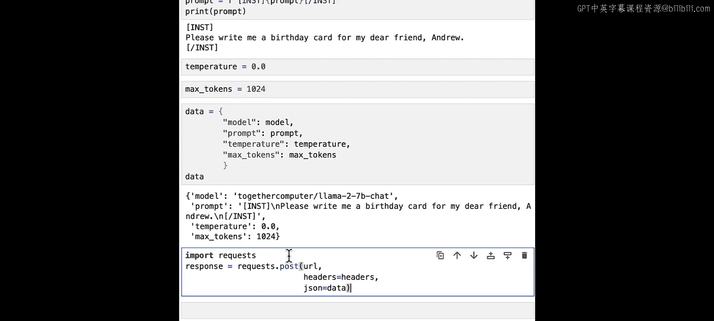

You can't see much here， the response object has a function called dot JsonN， let's call that。

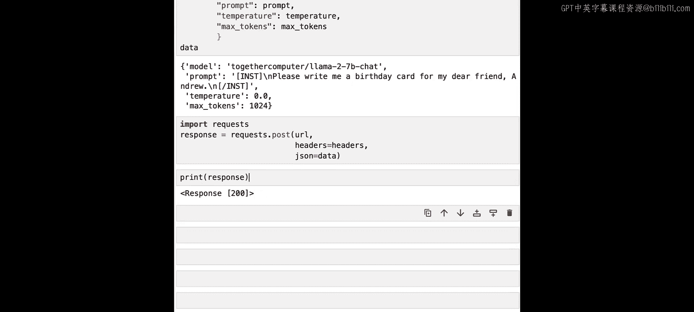

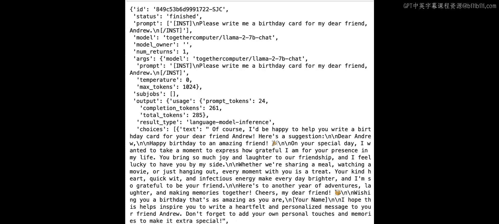

This looks like additionalary。It may be hard to read， but if you look closely。

 you'll see that the text is stored somewhere within the output key。

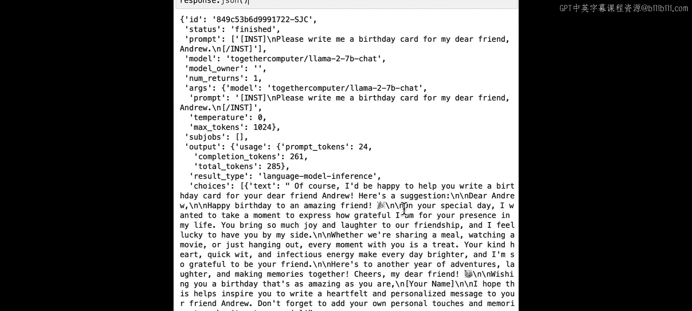

Let's access the subset of the dictionary by getting the output key。

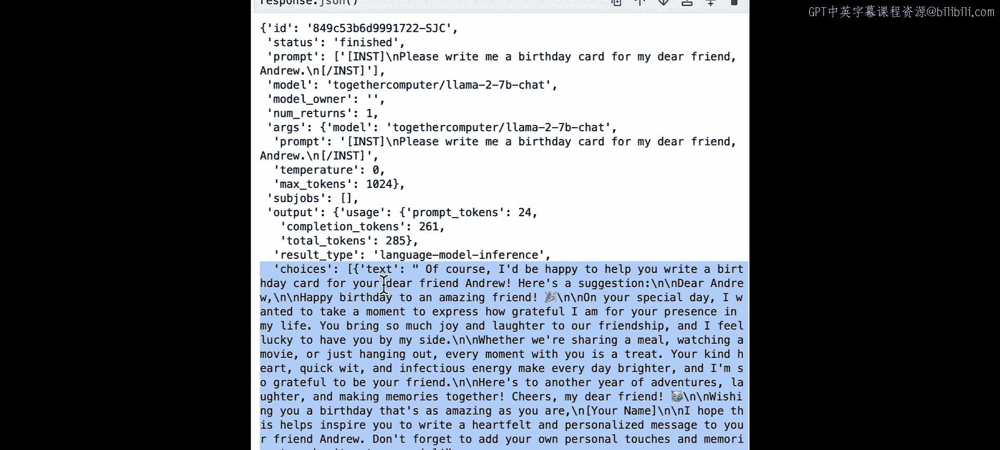

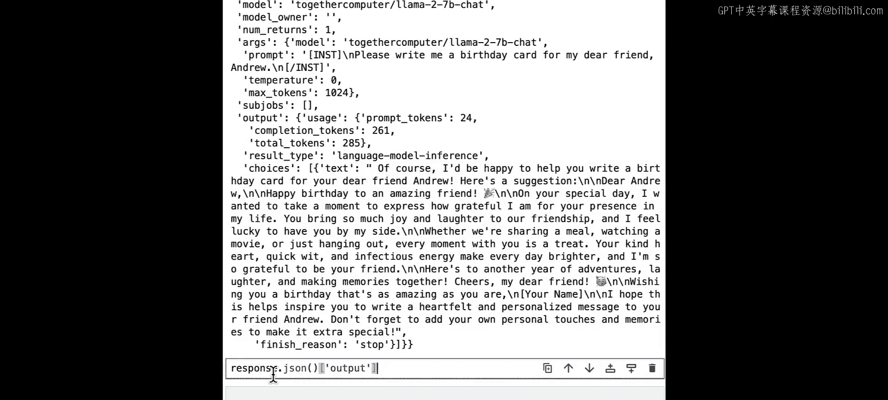

This is a bit less to look at。 There's another key called choices。

Let's access the choices within the output。So we'll copy this。Add it here。And now。Hard choices to it。

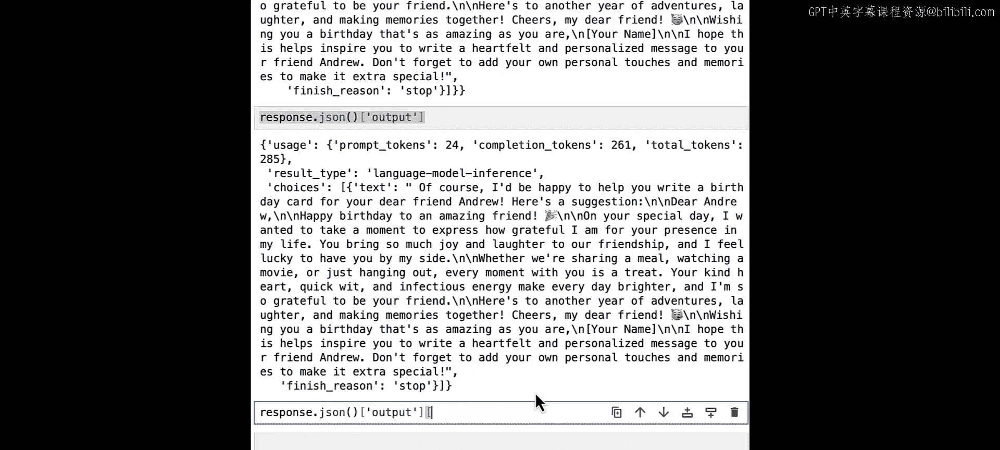

Okay。So this is a Python list。😔。

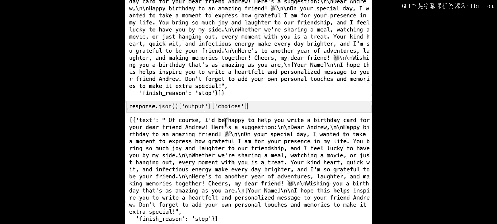

And let's。Make sure that is true and it's a list of just one item。

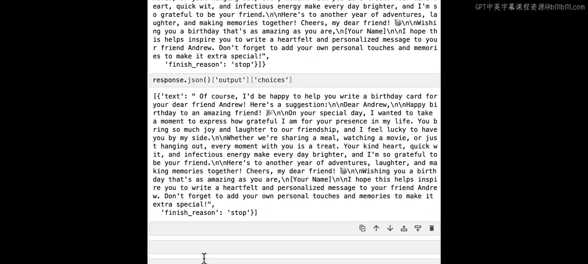

So let's get that one item at index zero and we will copy the response here。

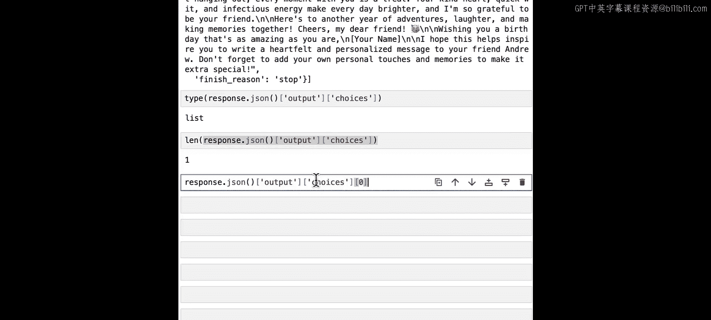

Finally， let's access the text key。

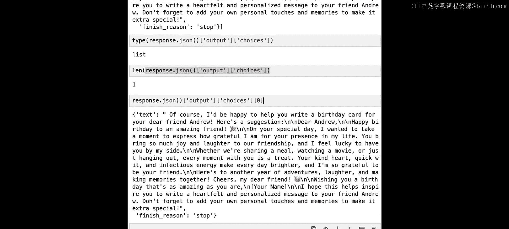

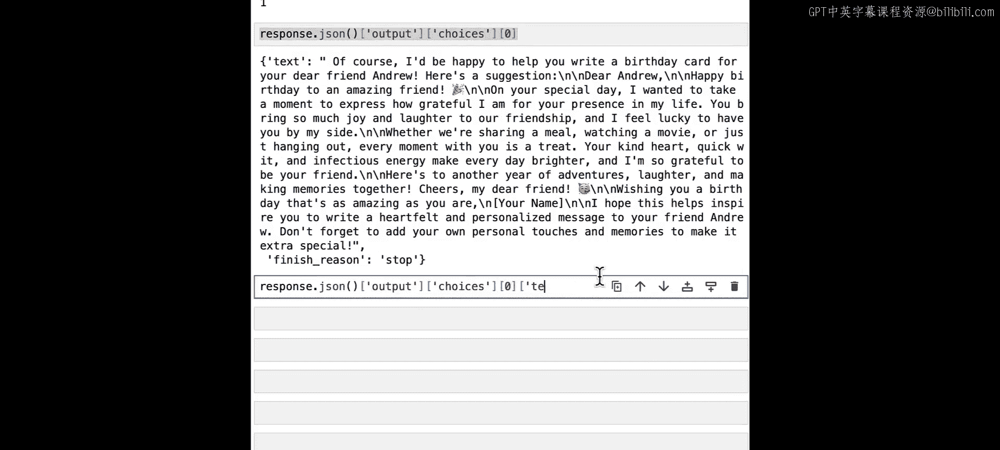

Okay， so we are able to。

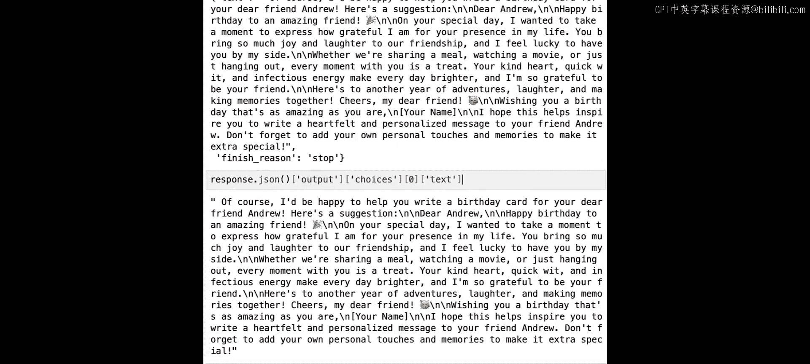

Finally， get the text。

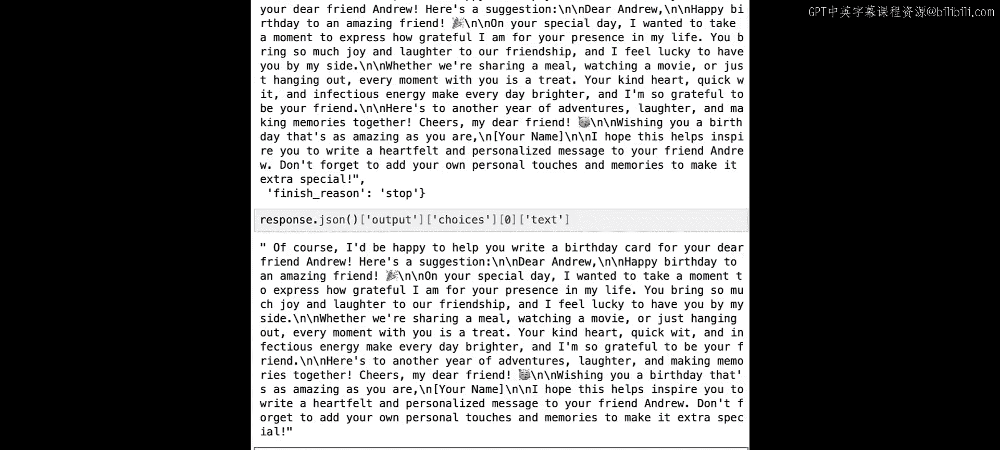

All right。And finally， this is the exact same thing that your helper function outputs。

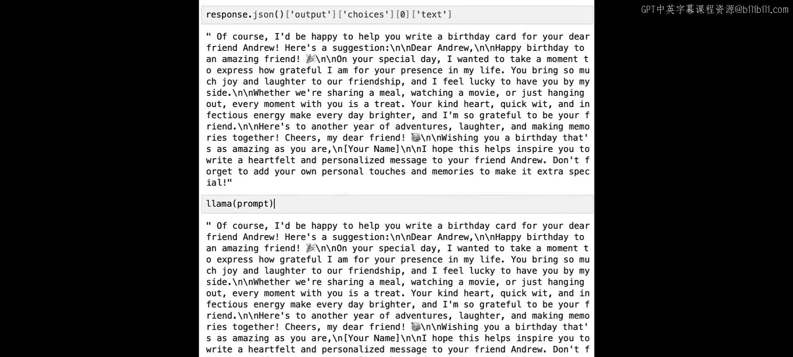