# 吴恩达《MCP：使用Anthropic构建具有丰富上下文的AI应用MCP： Build Rich-Context AI Apps with Anthropic》 - P10：10.creating-and-deploying-remote-servers.zh_en - GPT中英字幕课程资源 - BV1sxErzHEVj

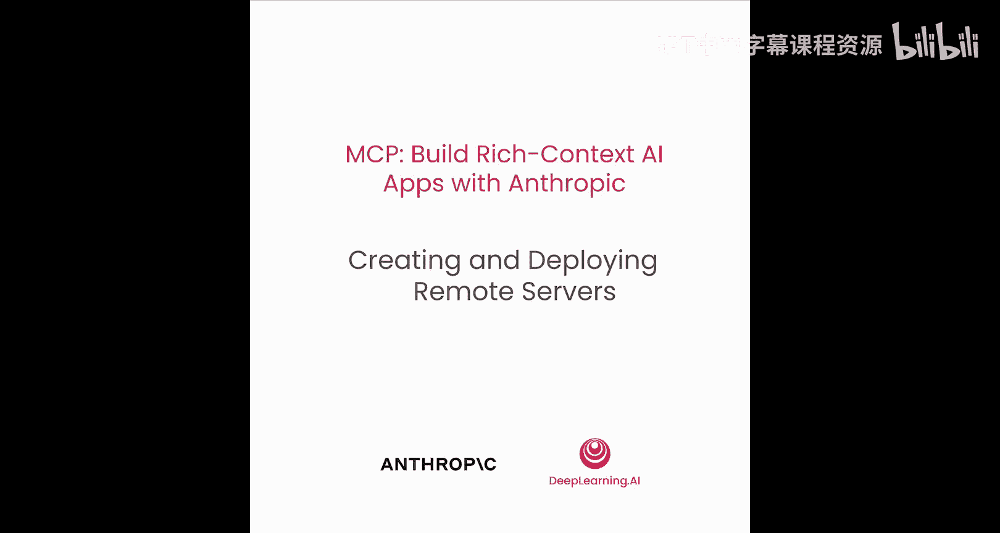

Your AI application can also connect to MCP servers running remotely In this lesson。

 you'll learn how to build a remote server， test it， and then deploy it。

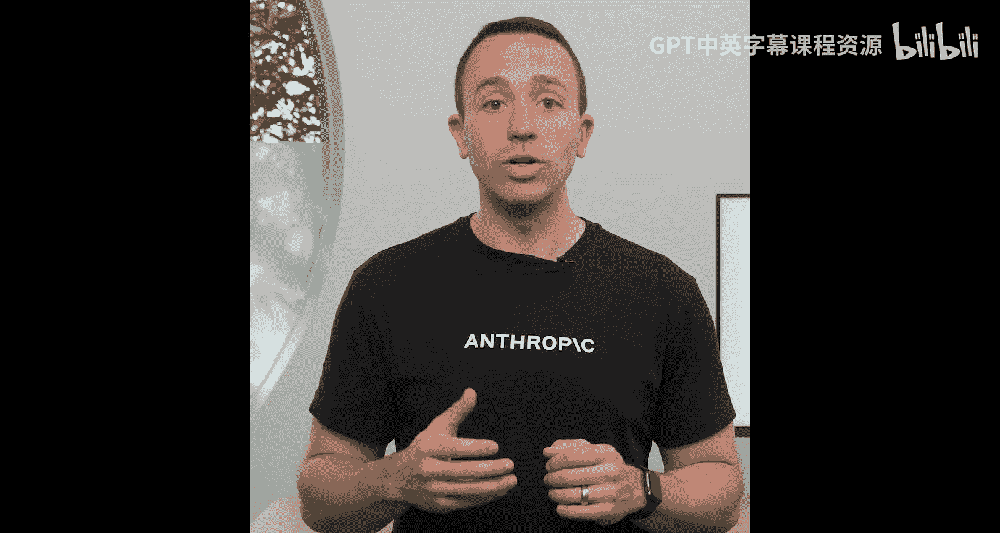

Let's jump in。 So far， we've seen how to build servers， build clients and hosts。

 But it's all been done locally using standard Iio。 Now。

 let's see what it looks like to create and deploy a remote server。

 The good news is we don't actually have to change that much inside of the research server。

 I've made a small configuration for our port to allow connecting a little bit easier。

 Everything else is going to feel the same。 We still have our tools， we still have our resources。

 we still have our prompts。 but where things are gonna to look a little bit different。

 I at the very bottom here， or we specify the transport that we're using。

 at the time of this recording。 the SDks and Python don't yet support H T TP streamable。

 So we're gonna be using SE。 The good news is once those SDks are released。

 It should be a very quick change to modify the transport。

 Now that we've seen how to modify our research server to get up and running with SSE。

 Let's go ahead and connect to it with the inspector。 from this code that we provided。

 You can see that the server is already。😊，Running at this particular URL。

 So there's nothing you need to do here to get the server up and running now that the server is running。

 let's bring in a terminal and connect to that server using the inspector。

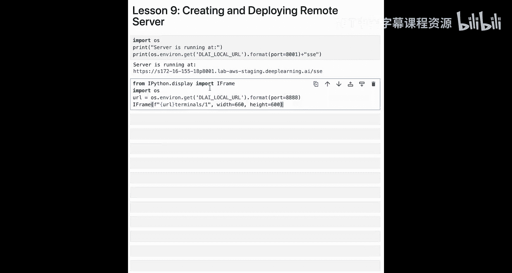

So I'll run NPX at model Contacttex protocoltocol。Slash Conor。This will get the inspector started。

And now I can go ahead and visit this in the browser。

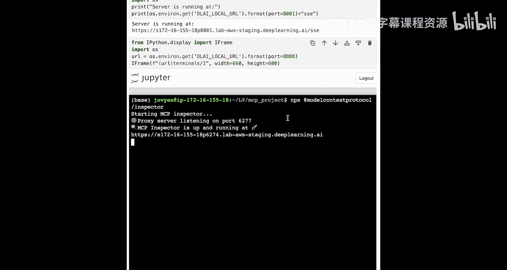

Over here in the inspector， I'm going make sure that I have the proxy address that we had before。

 and you can find this in the notebook as well。 And then I'm going to go ahead and make sure that my transport type is SSE。

 I'm now going to put in the URL to connect via SSE。 And we provided this to you as well。

 Let's go ahead and connect。 We can see here that we've initialized our connection。

 And we have our resources， prompts， tools and other primitives。

 I can list my resources and take a look at all of my folders。

 I can list my templates to get access to a particular topic。

 So let's go see if we can search for math like we had before。 go ahead and run that search。

 for the prompts。 We have our prompts available and for tools。 I have my tools available as well。

 Now that we're successfully connecting to this server using SSE。😊。

Let's see how we can deploy this so that anyone can access our MCP server。

 Let's go ahead and deploy this server using a tool called render。 I'll go bring in my terminal here。

 And right now， I'm inside of the MCP project folder in order to work with render。

 I need to make sure that I have a git repository。

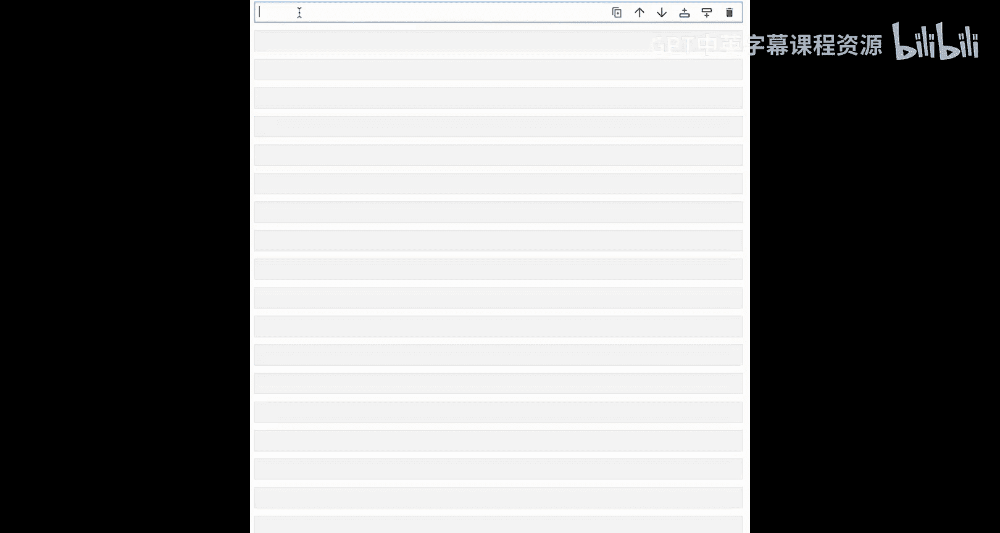

And then push that to Github so that render can access that particular repository。

 If you're not familiar with Git and Gitthub， I'll walk you through all those commands and what they do。

 If you're familiar with Git， This should be a breeze to get started with Git。

 The first thing I'm going to do is initialize an empty Git repository。

 I'm then going make sure that there are some files and folders that are not included in Git。

 So I'm going go ahead and add the string Ven to a file called dot git ignore。

 This is gonna make sure that when I add and commit files。 the dot Ven folder is not included。

 If I take a look at my git status right now， I can see that I don't see that dot then folder。

 which is great。 The next thing I need to do here。 is make sure that my dependencies are compatible with render。

 Since render does not support Uv at the moment。 We're gonna go ahead and make sure that we use Pip instead for dependency management。

 We're gonna have to take the dependencies for our server that we set up with Uv and make them compatible with Pip。

 The command we want is U V Pip。😊，Compile， so we're going to go ahead and type in Uv Pp compile。

Our pi project Tomal。And what you see here is the output of turning our dependencies into what Pip needs。

 So we're going to take the result of that， and we're going to send it to a file called requirements do Txt。

 Now that we have that file called requirements TX D。

 There is one more file that we need to make sure we have the right version of Python for render to use。

 We're going to go ahead and send the string Python 31111 into a file called runtime do TXD。

 Now that we have the necessary files。 let's take a look at Git status。

 And we can see that now we have requirements TXD， as well as runtime TXt。

 Let's go ahead and add and commit。And here our commit message is going to be ready for deployment。

And now we need to take this code on Git locally。And bring it into a repository on Github。

 We need a Github repository so that render can pick up and load the project files。

 So in the browser， I'm going to head over to Gitthub dot com slash new to make a new remote repository。

😊。

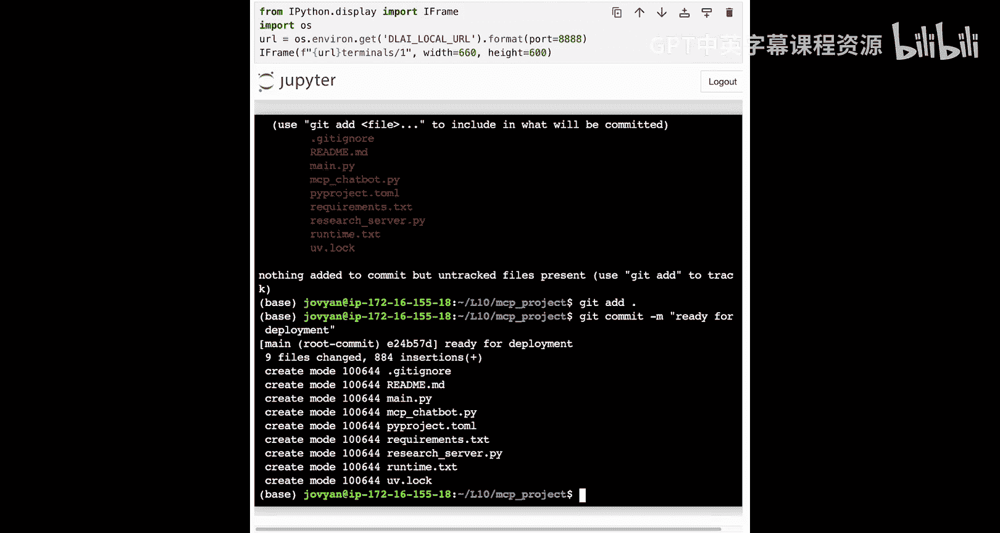

And I'll give this repository a name。Let's call this remote research。

I'll go ahead and create that repository。And once I created that repository。

 I'm just going to use these last couple steps in order to push an existing repository from the command line。

 I need to know where I'm sending that to。So I'm going to go ahead and copy and paste this command。

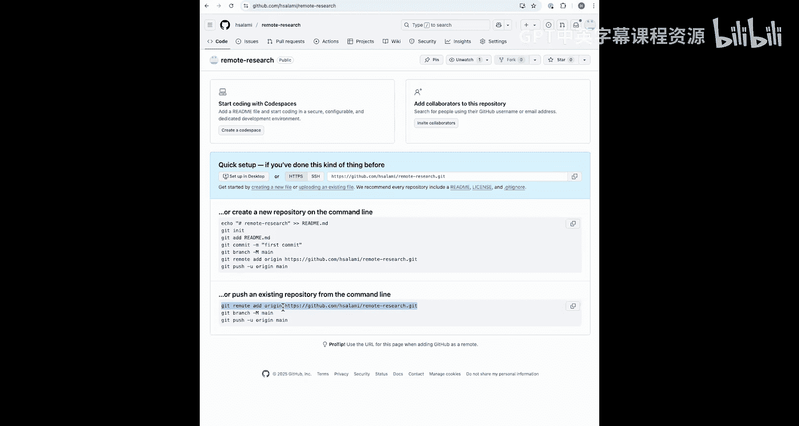

And go back to the terminal to run it。 If I've done that successfully。

 I should be able to type in Git remote dash V and see origin， as well as what I put in。

 I'm now going to go ahead and push this code up to Gitthub。 So I'll type in Git push origin。 mean。

 if this has been done successfully。😊，I should be able to go back to the browser。😊。

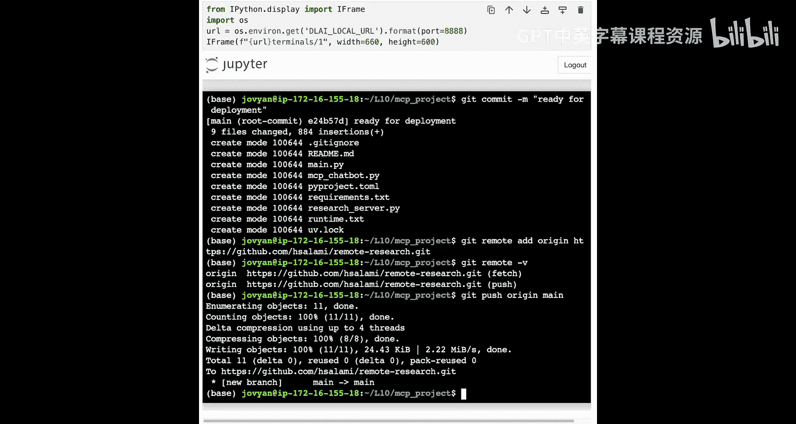

Refresh the page。And see that my code is there。 Now that this code is successfully on Github。

 Let's go ahead and make sure that render can pull it in so we can deploy successfully。

 I'm going to head over to render dot com And at render dot com， I'll make sure I sign up。😊。

Once you've signed up or signed in， you can head over to your dashboard。

 Once I sign into the dashboard， I can now add a new service， So I'll click on deploy web service。

 or I can always go to new and add that there。 If I authenticate through Github。

 I can put in repositories that I have， or I can put in a public Git repository。

 if I just want to put in the URL。 I'll go ahead and select remote research。

 and the only thing I need to change here is the command that we use to start our server。

 the command to do so is Python。Research Ser。大牌。I'll make sure right now I'm using the free plan。

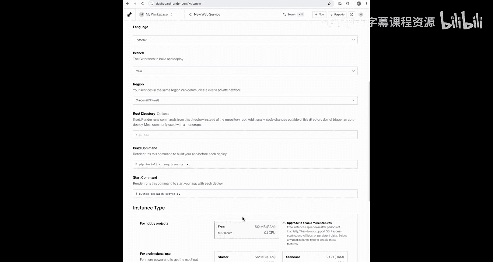

And once this is done， I'm ready to deploy。This might take a little bit。

 so give it a second while it starts the application。And as we start deploying。

 we're going to see the commands necessary to get our application up and running things that we actually saw before when we were running this locally。

 So we can see here we're using that Python 3，1111 that we specified in our runtime T X T。

 We're installing the dependencies from our requirements， T X T file。

 Since we're using Pip here for dependency management。 Once this is deployed。

 when we visit this link。 We're not going to find anything。 So we should expect a 404 error。

 What we do want to see is if we go to slash S E。 We're seeing a response with a session 90 back from the server。

 We're running the command Python research server do pi。

 So let's go ahead and see what things look like。 The first time you look at this。

 it might take a second as your applications loading。😊。

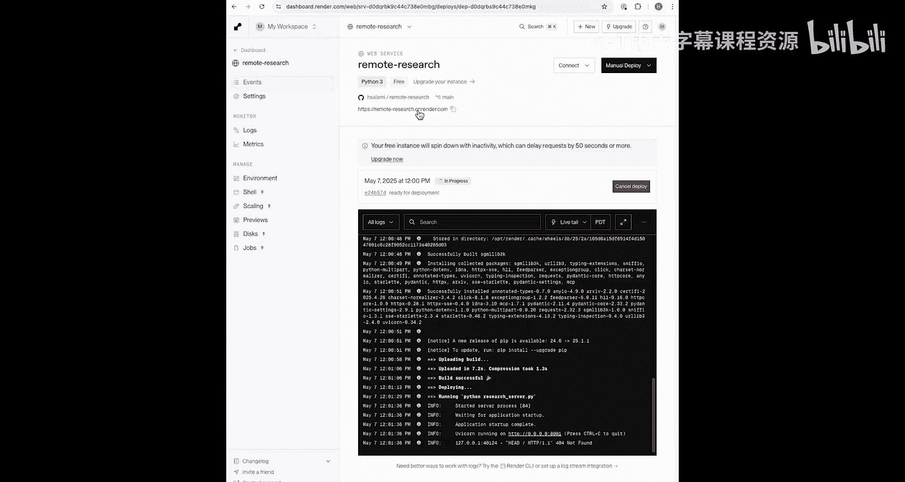

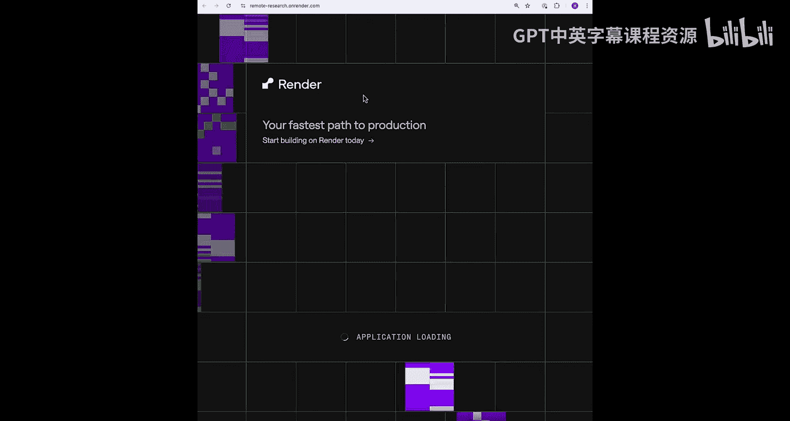

So feel free to give it a minute or two， and we'll refresh the page。

I have refreshed the page and as expected， I'm getting a 404。If I head over to the SSE endpoint。

 I can now see that I've made it with this particular endpoint and a session I D。

 This means that I've deployed successfully。 If you want to try this out in the inspector or in other tools。

 take a look at the resources we have。Great job getting this deployed。

 and I'll see you in the next lesson。

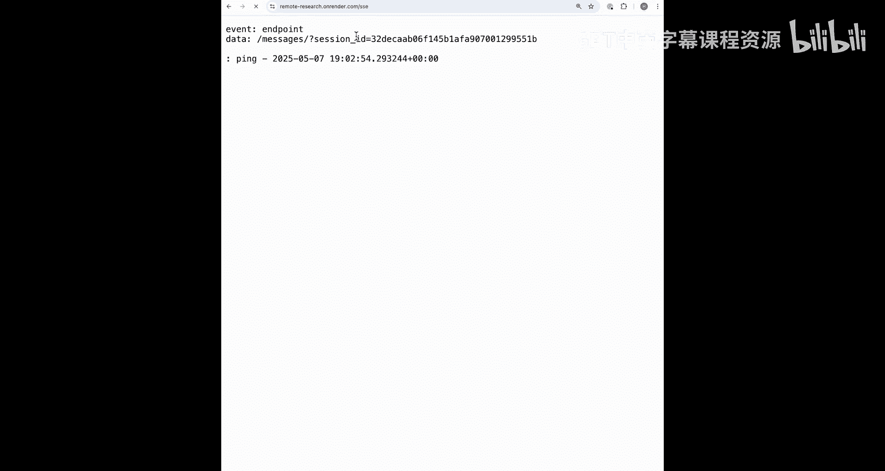