# 吴恩达《MCP：使用Anthropic构建具有丰富上下文的AI应用MCP： Build Rich-Context AI Apps with Anthropic》 - P11：11.conclusion.zh_en - GPT中英字幕课程资源 - BV1sxErzHEVj

In this course， you've learned about the core concepts of MCP。

 you've built a server that exposes tools， resources and prompts。

 develop a chatbot and connect to multiple servers。

 use cloud desktoptop to build more sophisticated applications and deploy your own remote server。

 Congratulations， MCP is constantly evolving。 In this last lesson。

 you'll learn about other features of MCP。 and some of the exciting things coming soon to the protocol。

I'll see you there。There's a lot you've learned about the model context protocol。

 You've learned about hosts and clients and servers， tools， resources and prompts。

 And then you've got a chance to write some code to power larger applications using all of these ideas。

 but there's still a bit that we have not yet covered about the model context protocol。

 Much of this is an active development and you can always examine the latest on the specification through Github and through the discussions that you can find The first piece we haven't covered yet is authentication in the model context protocol in the March specification update aloth 2。

1 was added as the means of authentication with remote servers。

 What this allows for is for clients and servers to authenticate and send authenticated requests to data sources。

 you can imagine many different servers need to access data that requires some form of authentication。

 This requires the client making a request to the server。

 The server then requires some user to authenticate。

 And once the authentication process is successfully done， the client and server。😊。

Can exchange a token， and the client can make authenticated requests to the server。

 and then to the data source。 This part of the protocol is an active development。

 and there are always newer features and security pieces being added。

 But authentication will primarily be done with the Olof 2。1 protocol。

 to highlight that in some depth。 This is an optional feature of the model context protocol。

 but it is highly recommended for remote servers with standard I O。

 We use environment variables and don't have the need for this kind of authentication。

 This is built on established standards that you can take a look at with these links below。

 So while you've explored a primitives that can be exposed by the server。

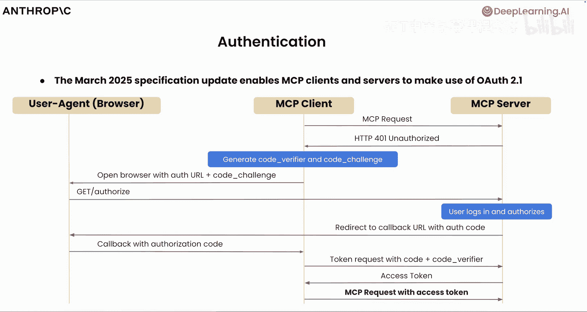

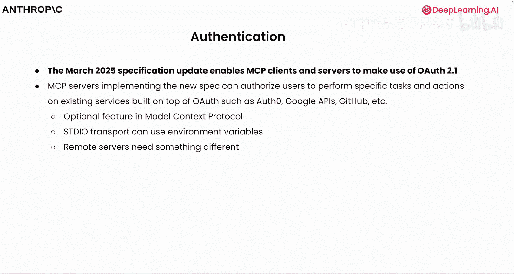

Tools， resources and prompts。 We also have primitives that the clients can expose。

 These include roots and sampling。 Let's dive into those。

 A route is a U that a client suggests a server should operate in。

 The idea is centered around only looking in specific folders for files that you might need when the client connects to a server。

 It can declare the routes that the server should work with。

 This can be useful for file system paths， but can be any valid U， including HttP URLs。

 The benefits of routes allow for security limitations。

 allow for keeping the server focused on a relevant file path or location。

 and roots also have some versatility baked in， where again， they are useful for file paths。

 but also can be any valid H TTP U。 We're slowly starting to see more and more clients adapt this primitive and is important one to keep track of as the protocol。

 The last primitive that we're going cover is sampling。

 Sam allows for servers to request inference from a large language model。

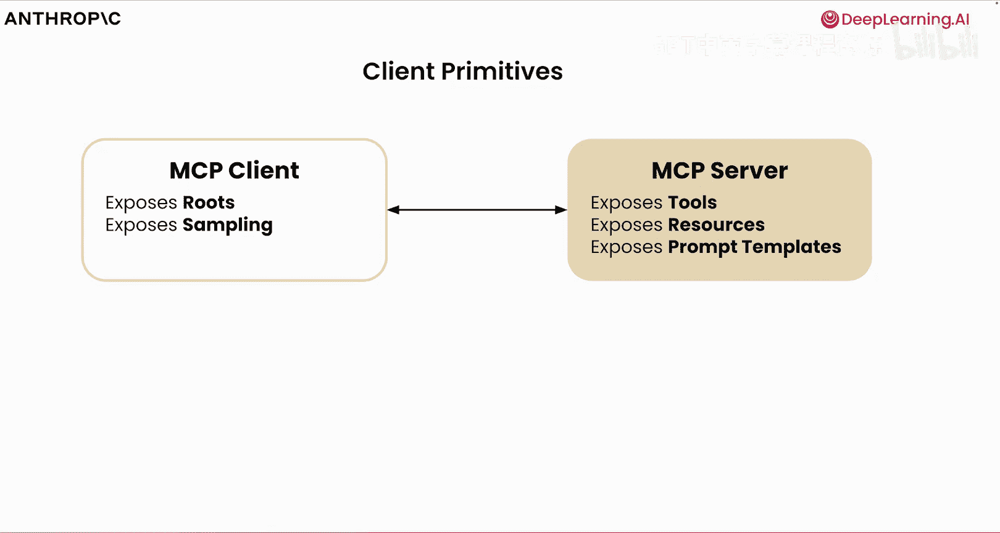

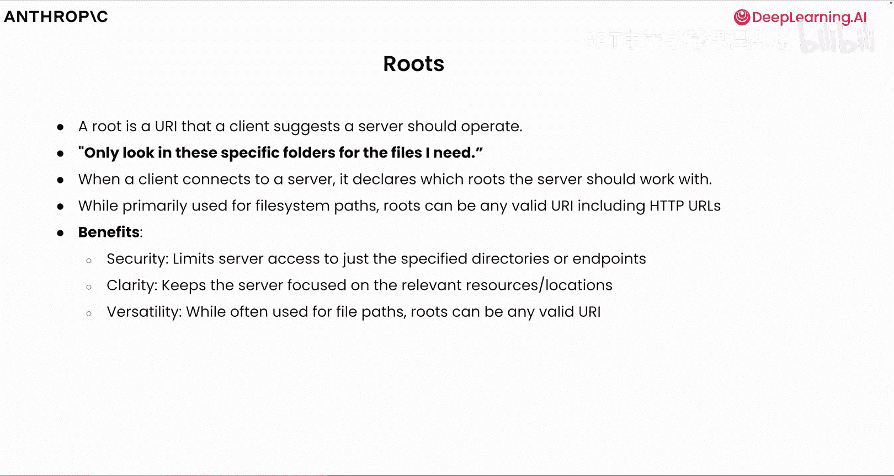

It's kindd of like the other side of communication。

 where instead of the client talking to the large language model。

 the server can talk back to the client and request inference。

 An example here might be a situation where your users report that a website is slow for some reason。

 Your MCP server can then collect server logs performance metrics。

 error logs and communicate with a variety of data sources to see what's going on。

 Instead of the server handing that back to the client， putting everything in the context window。

 or potentially any kind of breach of security between the server and the client。

 The server instead can talk directly to the large language model and ask it to diagnose performance issues。

 The large language model analyzes the patterns and returns data back and then the server can generate the steps to make the website a bit less slow。

 when there are concerns from a security standpoint or breaching boundaries or you might not want all that data coming back to be put into context。

 Sam and creating sampling loops。 It's a very powerful way for servers。

To request inference and kind of switch the direction of communication from what we've seen before。

 This is also quite powerful as we explore agent capabilities with the model context protocol as we start to move towards a world where more models are talking to different data sources。

😊。

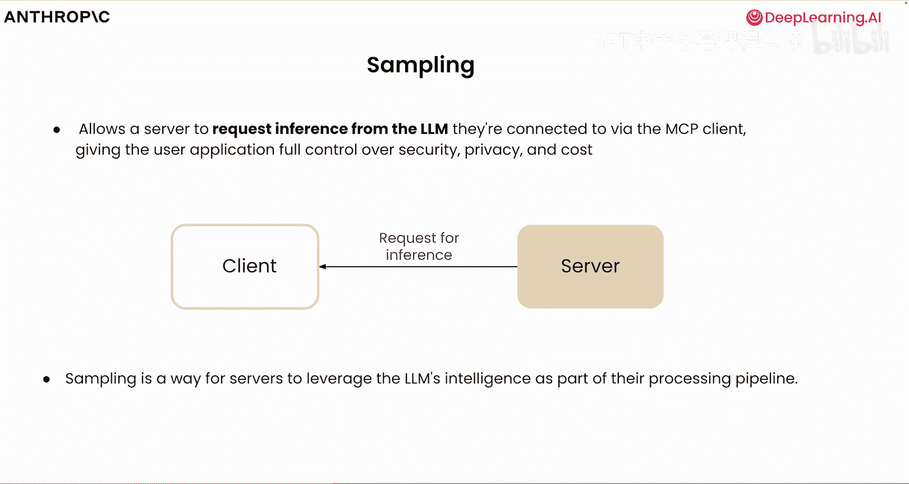

And we're giving more autonomy to models to call different tools and go off on their own。

 we believe MCP will be a foundational protocol for agents。

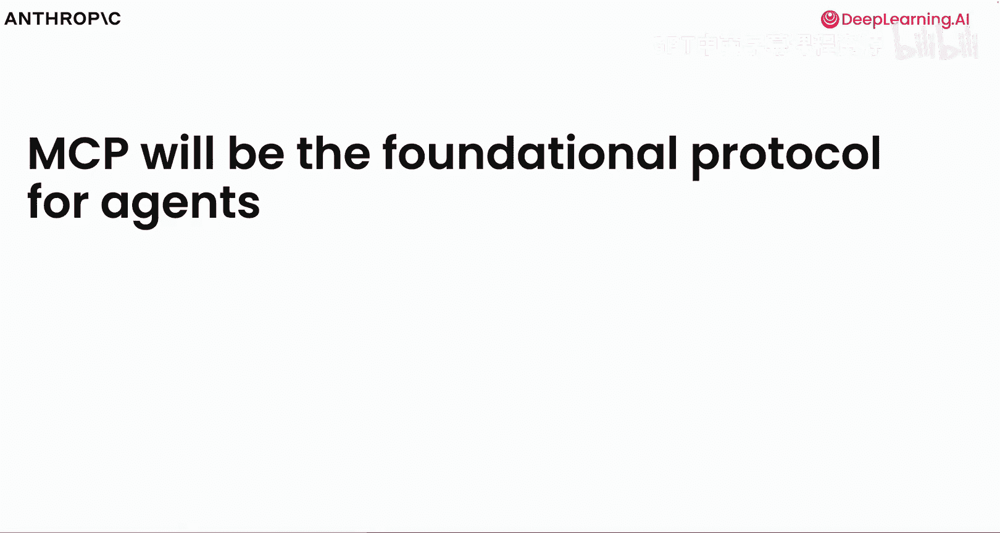

As we start to think about how MCP can be used with agententta capabilities。

 you can imagine a scenario where a user and a large language model need to access a variety of MCP servers。

 What's so powerful about the model context protocol。

 is that there' is a composable and somewhat recursive nature where clients can be servers and servers can be clients。

 What this allows us to do is to start creating an architecture。

 where we can take advantage of the ability for clients to communicate with servers。

 but also for servers to request the data that they need through sampling back to a client What we've set up here is the idea of a multiagent architecture。

 where the application and a large language model， communicate with an agent。

 This agent happens to be an MCP client and a server。

 and it can serve data back to the application but it can also connect to other clients and servers through the model context protocol。

 You can imagine that we have agents for analysis for coding for research。😊。

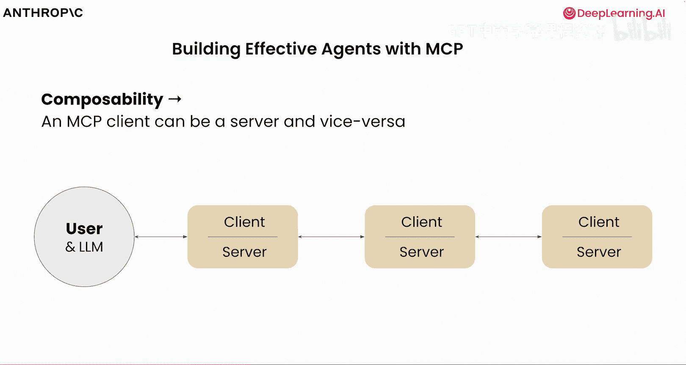

That also happen to be MCP servers。 And if they need to connect to other servers。

 clients as well through this composable nature， we can start to think about architectures that allow for multiple agents all speaking the same language with the same protocol。

 The next large piece that's on the roadmap for the model context protocol is the idea around a unified registry。

 the purpose of this is to standardize the way in which we think about discovering servers themselves。

 as we've seen before， there's a lot of excitement in the open source community。

 and there are many different servers for data providers， tools like Google Drive， Github and so on。

 may have dozens of mP servers。 But just like with packages with Nm or Pi pie。

 there's an opportunity for malicious code to exist inside of these particular servers。

 So the registry API serves the purpose of discovering servers of centralizing where these servers live and also verifying that these servers have been trusted by the community and by companies themselves。

 This also allows for versioning。😊。

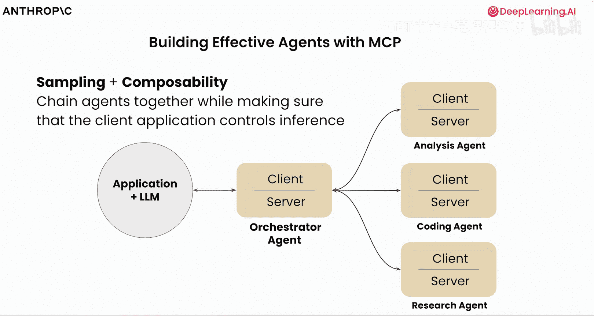

Of particular MCP servers to lock in dependencies just like you would in your application。

 where this also gets exciting is the ability for MCP servers to let agents selfdi them。

 you can imagine a scenario where a user needs to fix a bug based on something in some logs。

 The agent then searches through the registry API for the official MCP server installs it and queries and suggests a fix in this particular use case。

 instead of requiring the application to be connected to a variety of servers from the start。

 we can start to build applications where MCP servers are dynamically discovered and connected to。

 as we think about layering this on with authentication。

 we can imagine that a user has a request that requires a server to be discovered similar to other protocols like Oof and the agent to agent protocol that Google recently announced the idea of putting in a Json file in a well known folder is something that's been done before。

 except here， in this MCP Json。 we specify。😊。

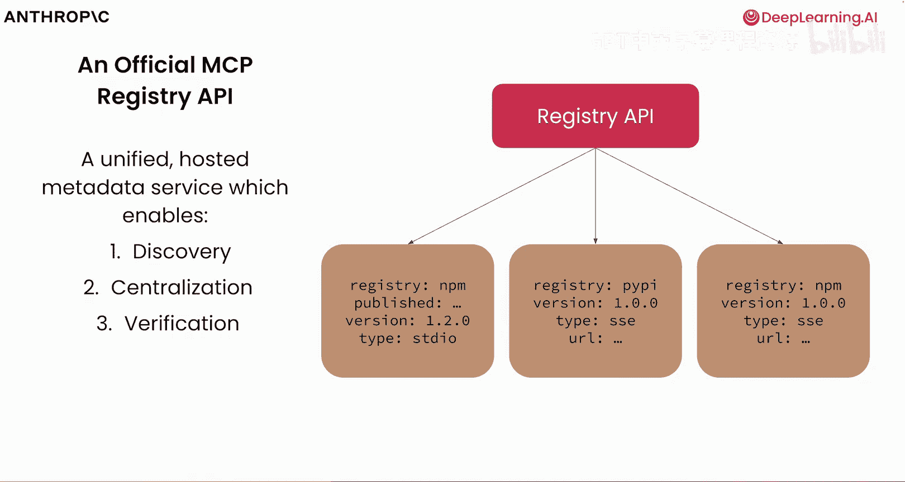

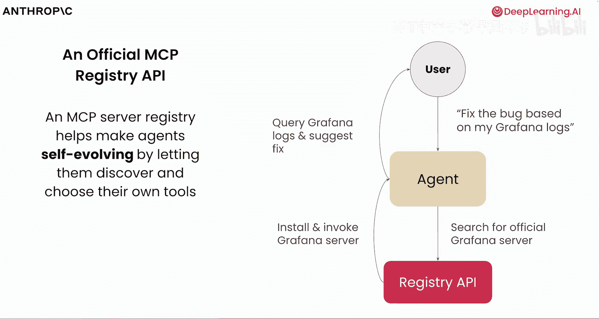

The end point of a server to connect to the capabilities or primitives that it exposes。

 And then the authentication that's required。 So a user might ask。

 help me manage my store on Shopify。 The agent or AI application will see if Shopify has a well known MCP Json file。

 And if it does， it will figure out what end point to connect to。

 and what authentication is required。 once the user authenticates the agent can perform the necessary action through a registry API。

 we can allow for this idea of dynamic discovery and through layering on a off to。

 we can ensure that these connections are secure。 As you might see in the suggestions and in the discussions。

 there's a lot more that's coming to the protocol。 as more and more clients support H T TP streamable。

 The aim is to achieve a smooth transition between staple and stateless capabilities。

 as remote MCP servers continue to be developed。 It's important to expand the ecosystem to support even more and more of those。

 As you can imagine， when multiple NP servers are being used， Its very。😊。

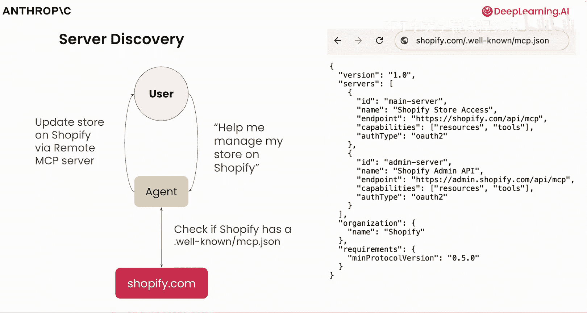

Possible for tools to have naming conflicts。 You can imagine servers that might have generic names of tools like fetch users fetch entities。

 and the model might get confused about what needs to be fetched。

 So it's important to think about preventing collisions and creating logical groups of servers or tools。

 We spoke a bit about sampling or proactively requesting context。

 There's a lot of work that's being put into the protocol and into conversations we have to enable primitives like sampling to become much more popular。

 And finally， while Oth2 is relatively new to the specification。

 They're still quite a bit more to think about with regards to authentication and authorization at scale。

 In just a short amount of time。 you've seen so much about the model context protocol。

 you've learned conceptually about the primitives， you've built servers and clients and hosts。

 and you've seen how to deploy remote MCP servers。 there's still so much more to be discovered So I encourage all of you to take a look at the discussions and the conversations and keep building and researching as much as you can。

😊，Thank you so much for joining me in this journey， and I can't wait to see what you build with MCP。

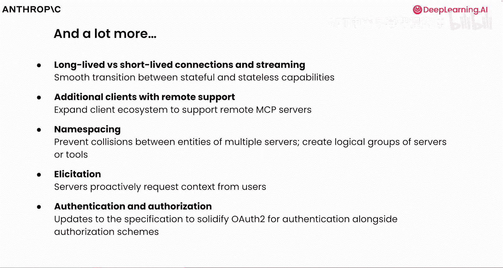