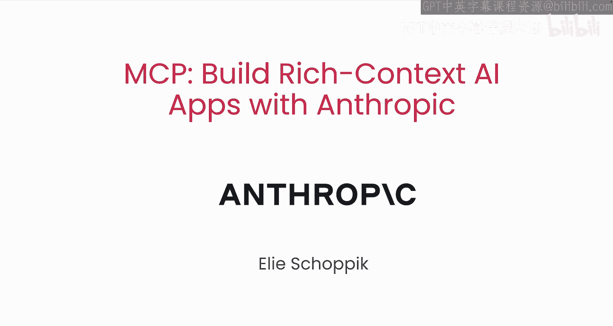
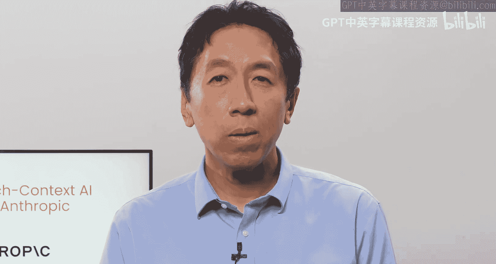
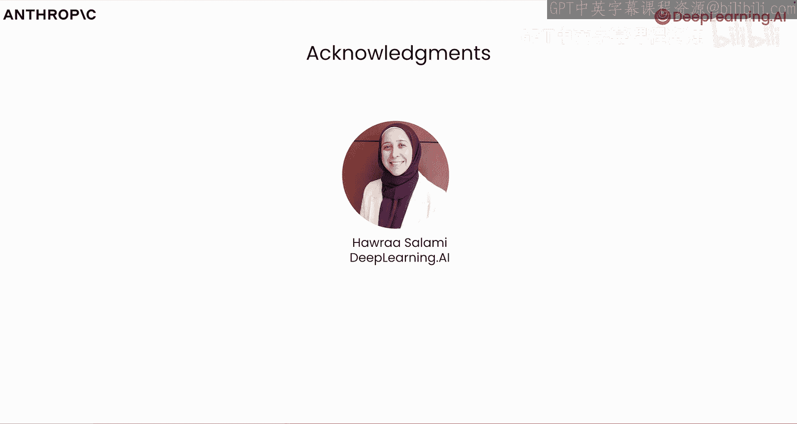
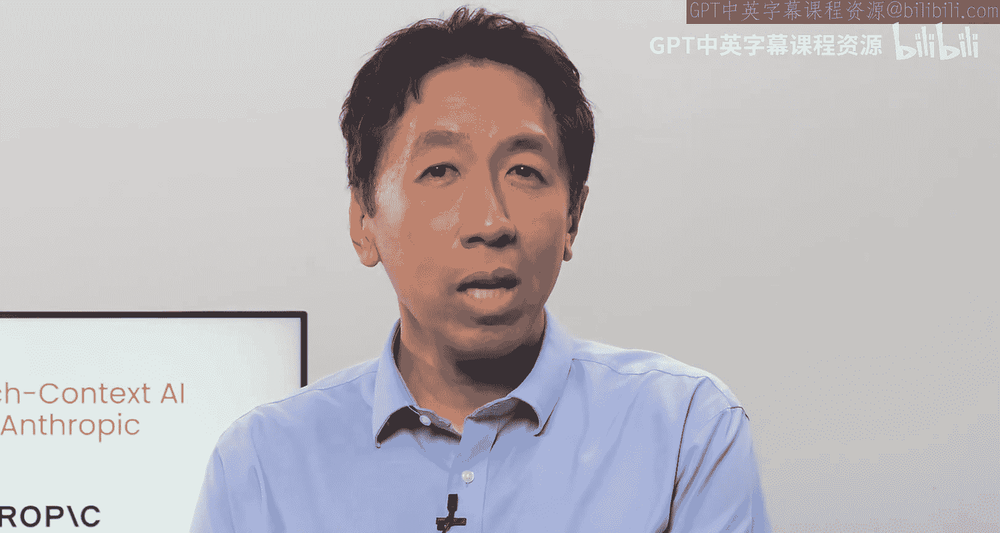

# 吴恩达《MCP：使用Anthropic构建具有丰富上下文的AI应用MCP： Build Rich-Context AI Apps with Anthropic》 - P1：1.intro.zh_en - GPT中英字幕课程资源 - BV1sxErzHEVj

Welcome to MCPBuilds rich context AI apps with Anthropic。

 built in partnership with Anthropic in this course you learn the core concepts of MCP and how it's implemented in your AI application。

The model contexttex protocol or MCP is an open protocol that standardizes how your LM applications can get access to context in terms of tools and data resources。

Based on the client's server architecture， it defines how communication takes place between an MCP client hosted inside your own application and an MCP server that exposes tools and data resources and prompt templates to your application。

Since Anthropic launched MCP in November of 2024， the MCP ecosystem has been growing really rapidly。

 I'm delighted to your instructor for this course is Eddie Schic。

 who is head of technical education at Anthropic。 Thanks Andrew。

 I'm excited to teach this course with you。 MCP originated as part of an internal project where we recognized an opportunity to extend the capabilities of cloud desktop so that it can interact with local file systems and other external systems。

 We found the protocol we developed was useful in many AI applications with similar needs。

 to make this available to more developers we publish the specification and open its development to the open source community。

 The MCP ecosystem includes a growing number of MCP service developed by the open source community as well as by Anthropics MCP team。

😊，MCP is model agnostic and is designed to be easy to plug into multiple applications。

 say you're building a research assistant agent and you'd like for this agent to interact with your Gitap repos。

 read notes from your Google Drive documents maybe create some reason store in your local system instead of you writing your own custom tools you can connect your agent to the Github Google Drive and file system service。

 which will provide the two or the API call definitions and also handle the two execution El will walk you through the details of the MCP protocol We first dive into the details of the MCP client server architecture you'll then work on a chatbot application to make it MCP compatible you'll build and test and MCP server and connect your chatbot to it your MCP server will provide tools prompt templates and resources to your chatbo you'll also connect your chatbot to other trusted thirdpart servers to extend its capabilities you'll then reuse your MCP server。

And connect it to other MCP applications like cloud desktopsktop。 Finally。

 you'll learn how you can deploy your MCP server remotely。

 I'd like to thank from Deepbl AI Harra Salami， who contributed to the course。

 MCP is a really important technology that's making much easier for own application developers to connect the systems to many tools and data resources。

😊。

And for teams building tools to providing data， it is also making it much easier to make what they build available to many developers。

So this is technology worth learning about the next video goes through why connecting own applications to resources had been so difficult before and how MCP addresses this so please go to the next video to learn more。

😊。