# 吴恩达《MCP：使用Anthropic构建具有丰富上下文的AI应用MCP： Build Rich-Context AI Apps with Anthropic》 - P2：2.why-mcp.zh_en - GPT中英字幕课程资源 - BV1sxErzHEVj

In this first lesson， we'll go through how MCP makes AI development less fragmented and how it standardizes connections between AI applications and external data sources。

 Let's go to answer the question why MCP or why the model context protocol。

 We like to say the models are only as good as the context provided to them。

 you can have an incredibly intelligent model at the frontier。

 but if it doesn't have the ability to connect to the outside world and pull in the data and context necessary。

 it's not as useful as it can possibly be。 the model context protocol is an open source protocol that standardizes how your large language model connects and works with your tools and data sources。

 The idea here is not to reinvent the wheel in how we do things like tool use。

 but instead to standardize the way that our AI applications connect with data sources。

 the same way that we standardize how web applications communicate with backends and other systems using RE。

😊。

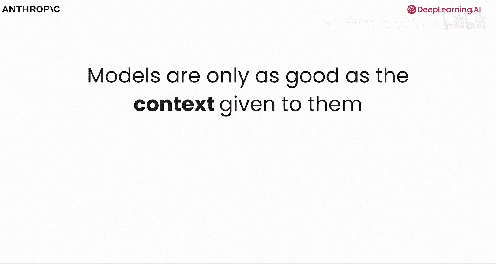

Where we specify the protocol and statelessness and so on。

 we're trying to achieve the same thing with the model context protocol。

 Everything that you're going to see with MCP can be done without MCP。

 but as we think about a world in which many different models communicate with many different data sources and even with each other we want to make sure that we're speaking the same language。

 we want to standardize how our AI applications interact with external systems。

 Instead of building the same integration for a different data source over and over and over again depending on the model or the data source。

 We're instead going to build once and use everywhere。

 The model context protocol borrows a lot of its ideas from other protocols that aim to achieve similar kind of ideas。

 For example， LP or the language server protocol developed in 2016 by Microsoft standardizes how integrated development environments interact with language specific tools。

 when you create extensions for particular languages for particular development environments。

You don't want to have to write that over and over again for all of those development environments。

 So while MCP is very novel in what it's trying to do。

 it stands on the shoulders of many other protocols and ideas around standardization。

 let's go show a quick demo where with just a few lines of code we can bring in context to our AI application on the left hand side here I'm using cloud desktop and I'm asking a question about retrieving some issues from a Github repository on the right。

 we can see this Github repository and immediately through natural language I'm able to talk to this data source。

 This is the power of MCP I have connected to an MCP server that's providing data necessary from Github and I'm also connected to another MCP server for Asana。

 a popular project management tool What I'm doing here is reading data from Github。

 and then I'm asking to triage particular issues and assign tickets in Asana so I am reading from one data source and writing to another。

 we can see here in this interface there there is a human in the loop verifying the actions that I want。

😊。

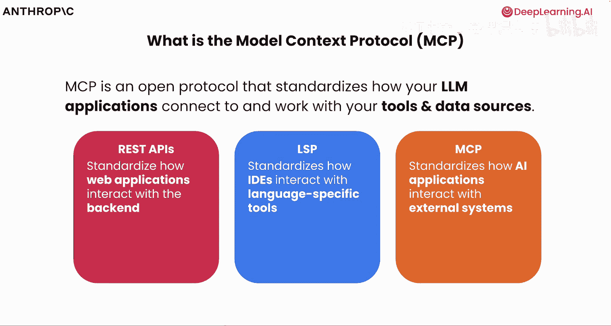

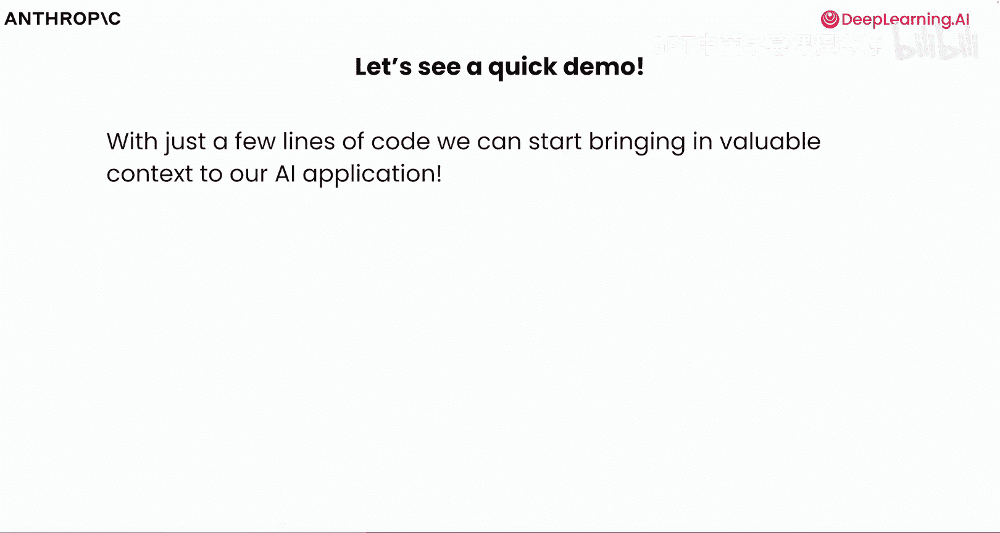

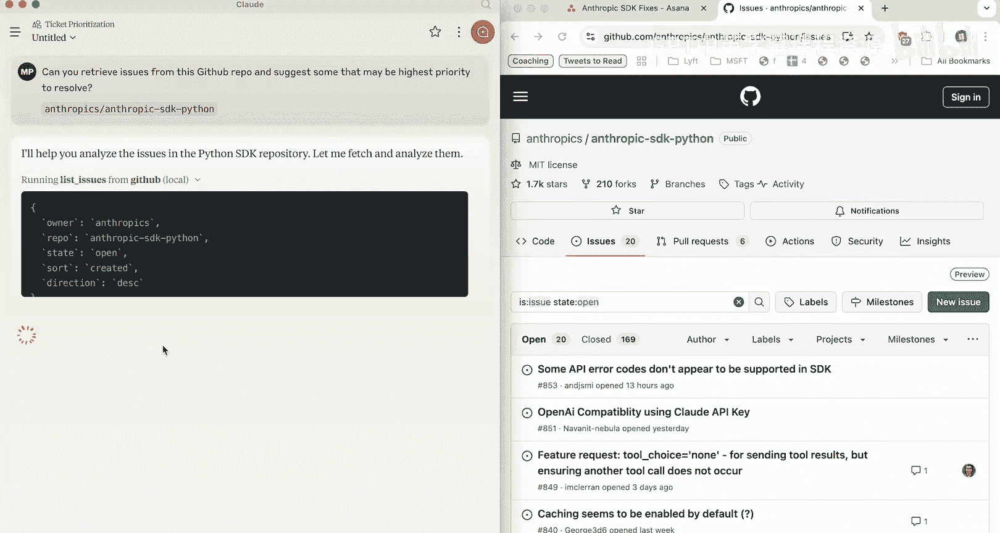

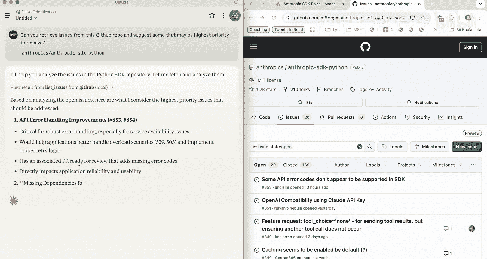

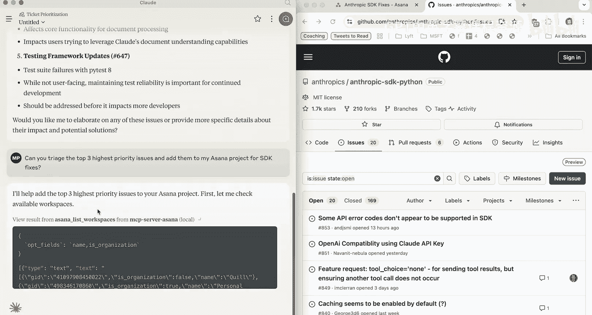

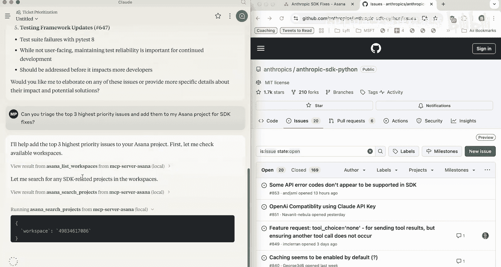

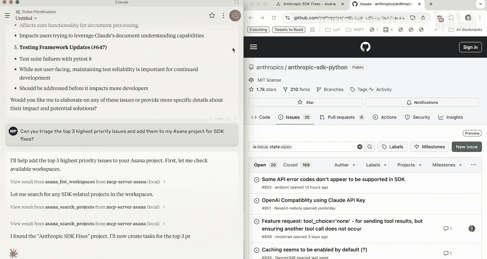

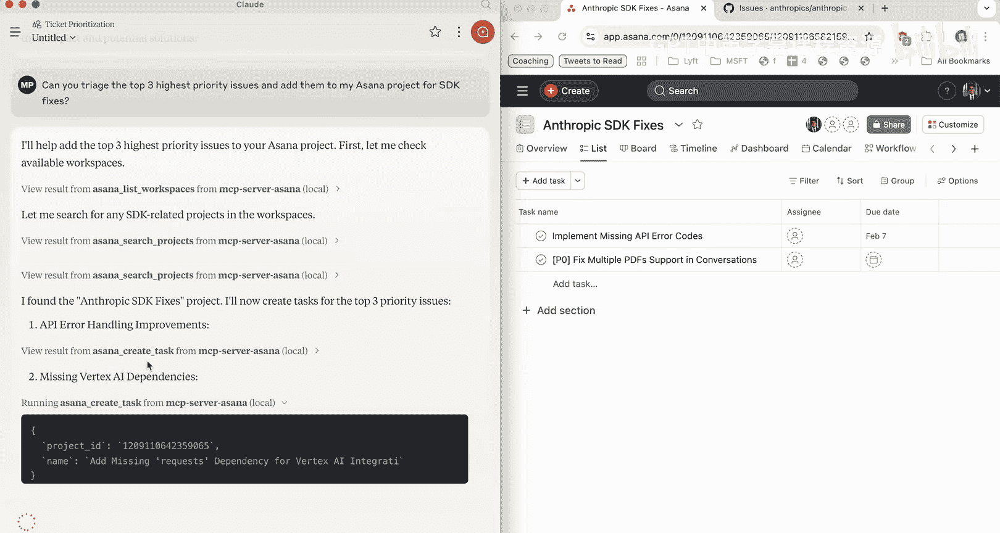

Take with just very little code。 I'm now communicating with external data sources with ease。

 This idea of being able to use MCP with any model provider completely open source allows for seamless integration with different models and different data sources。

 We can see here， I've created these tasks， things are updating for me in the browser。

 And I can now continue to use natural language to iterate on this task I have here。

 I'm going to assign a task to an individual。 I'm going to see that get updated。

 and through the use of a very intelligent model in this case，35 sonnet。

 a few tools provided by MCP and an environment to run this over and over again。

 We're actually taking a look at a very lightweight agent to power this application。

 Like I mentioned， everything you could do with MCP。 you could do without。

 But here's what it starts to look like as you build these integrations。

 Where do you store your tools。 Where do you store custom prompts that you have。

 Where do you store the data access layer and authentication logic。

 We found ourselves and saw many different teams repeating the wheel over。😊。

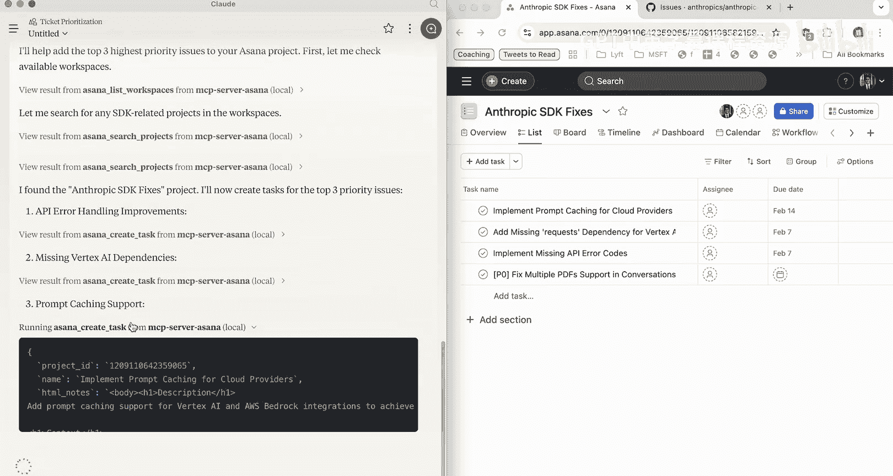

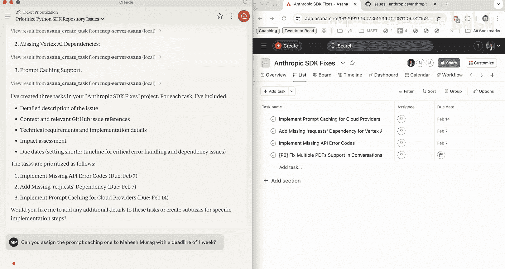

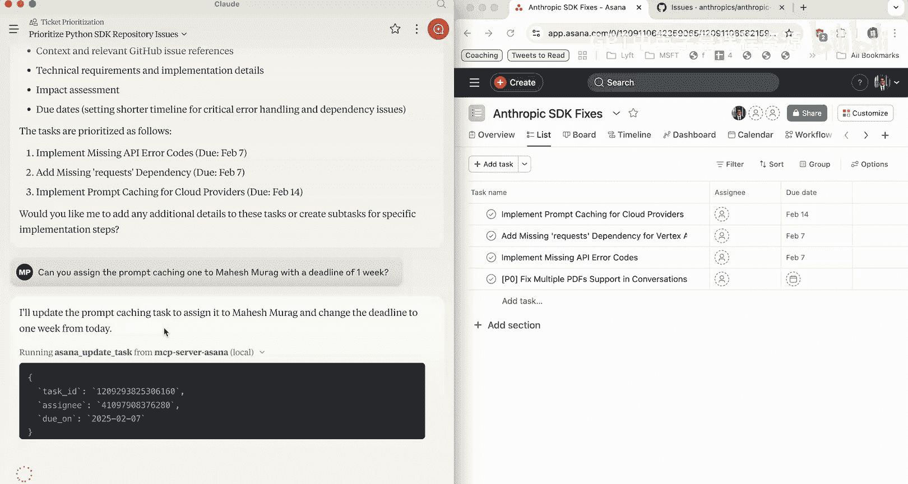

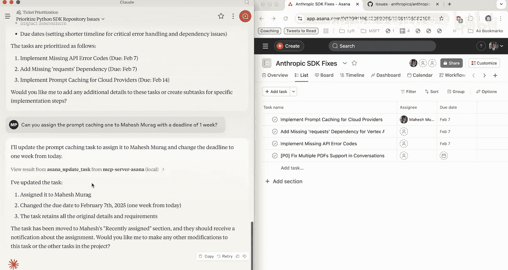

And over and over again， many different AI applications talking to a similar data source。

 but written in a different way with MCP not only is this model agnostic。

 It's completely open source So these tools and data connectivity are provided to you by the open source community or you can build them yourself with MCP。

 we ship the burden of responsibility and we separate our concerns in a really clean fashion。

 We build or use MCP compatible applications and connect to many different servers for the particular kind of data access that we need。

 We can have servers for data stores for customer relationship management tools like hubbsspg or Salforce Even servers for things like version control。

 and the aim here is to use natural language to talk to these data stores without having to write all that logic ourselves with MCP the beauty of the server is that it's also reusable across many different applications as we're going to see there are reference servers that we can use or servers that we can even build internally and share amongst。

😊。

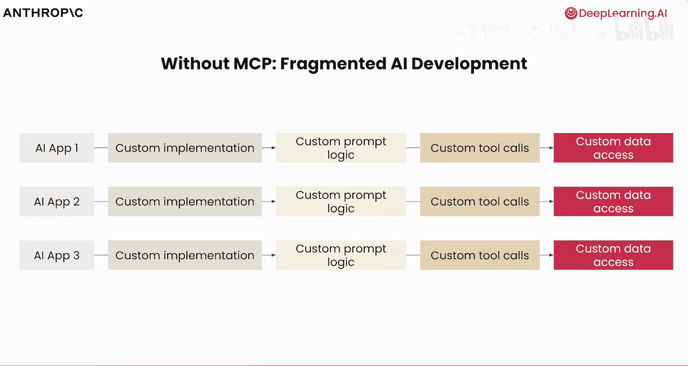

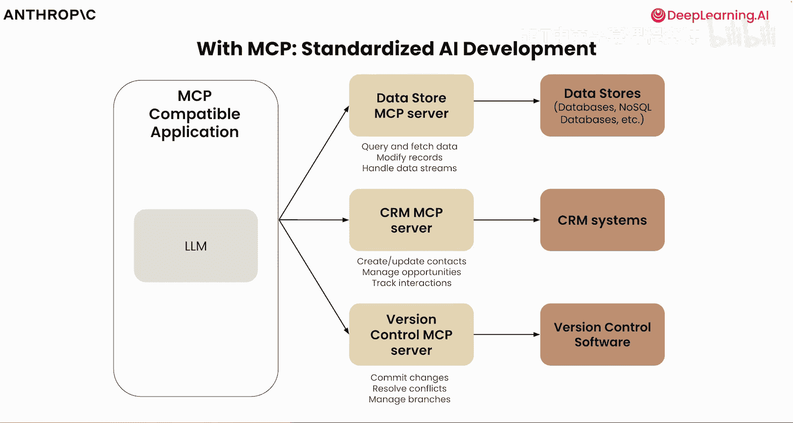

Many different applications that we built， we might build a MCP server or use one for Google Drive。

 And depending on the application that we're building。

 that could be an AI assistant or agent or desktop application as long as it is MCP compatible we can go and use that server and whatever else we want。

 You can let your imagination really start to carry you with all the different data access that you can bring in to your application with minimal code and effort with MCP。

 there are lots of wins for many different audiences for application developers。

 connect to an MCP server with very little work for API developers。

 build the MCP server once and adopted everywhere for users of AI applications the idea behind MCP can be abstracted away quite a bit so that you can bring a URL for an MCP server and simply have the data access that you need brought in to your application for enterprises and large organizations。

 you can think of the benefits of separating your concerns and building standalone integrations that different teams can use。

😊。

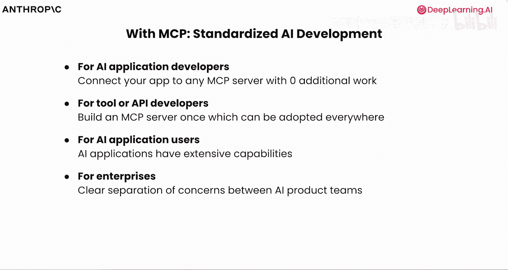

As you may be aware， the MCP ecosystem is growing fast。

 We're seeing development not only from large companies， but also startups at the frontier。

 and we're seeing many， many， many different servers being built privately and in the open source community。

 the SDks or software development kits that we have to power MCP are written across many different languages and developed in the open source community and also LED by many different companies and AI developers。

 We're seeing MCP compatible applications across web applications across desktop applications and even agentic products as well。

 Before we wrap up， let's answer a couple common questions you might be having about MCP。

 these MCP servers that we talk about from Github to Asana to Google Drive who actually writes those while anyone can you yourself as a developer can build them or you can go ahead and use community adopted ones in the next few lessons will see how MCP servers are built we're gonna to build quite a few of our own。

 You might think of MCP servers as very similar to working with As。😊。

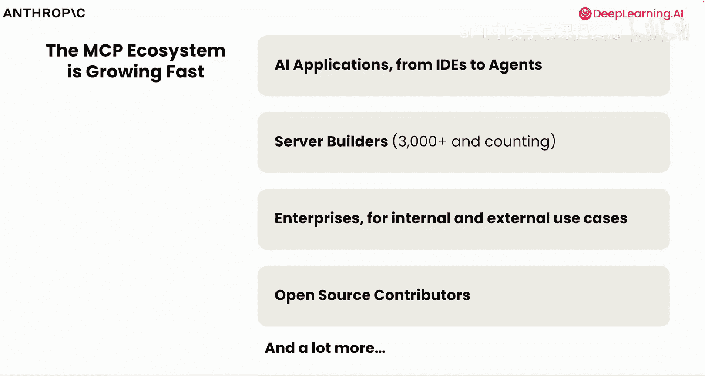

And in fact， you're not totally off。 You can think of an MCP server as kind of like a gateway or a wrapper on top of an API。

 where if you do not want to bother calling the API directly。

 you can use natural language and let the MCP server handle that for you。

 MCP servers support tool use。 but that's just one part of what MCP servers can do。

 The servers give you functions and schemas available to you。

 But as we're going to see in the next lesson， there's so much more that MCP provides。

So we'd answered the question， why the model context protocol。

 we've seen a really nice demo for what it can do with a very little amount of work。

 And the next lesson， we're going to start to explore how MCP works a bit under the hood and introduce the idea of hosts and clients and servers and talk a little bit about some of the underlying primitives in the protocol like resources。

 tools and prompts。 See you then。😊。

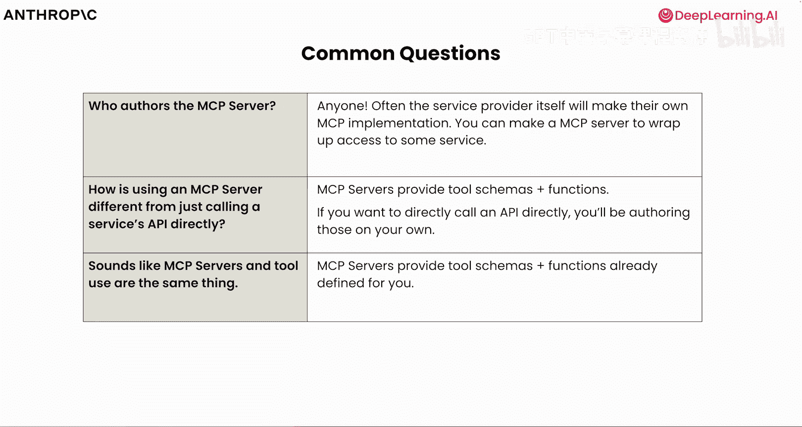